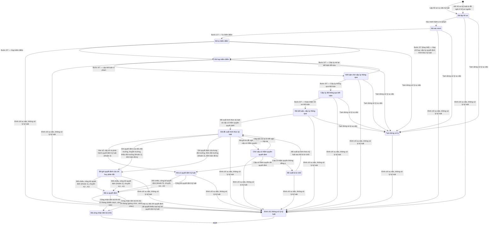

# qt-D15 · Xử lý kỷ luật DQTV

<!-- máy sinh: tom-tat -->
> **Hồ sơ:** Vụ việc kỷ luật (`DisciplinaryCase`)
>
> **Trong sổ phạm vi:** D15 · Xử lý kỷ luật DQTV (tầng 3)
>
> 41 bước · 16 chặng · 4 vai · 3 bảng quyết định · 2 hạn · 31 khớp nối.
>
> **Nguồn:** sổ nghiệp vụ `qt-D15` · khai báo của app: `dqtv-app/core/processes/discipline/workflow/discipline.yaml`. Các bảng do máy sinh từ nguồn này.
<!-- hết: tom-tat -->

<!-- viết tay: dien-giai -->
## Diễn giải

*Phần này viết tay, diễn giải lại điều các bảng bên dưới ghi.*

### Quy trình này để làm gì

Ban CHQS xã theo dõi một **vụ việc kỷ luật** của một chiến sĩ dân quân tự vệ: lập hồ sơ, xác minh, lập kết luận vi phạm theo trình tự nhiều bước, trình và ra quyết định kỷ luật, công bố, rồi phần sau quyết định (bàn giao, khiếu nại, công nhận tiến bộ). Trợ lý Tác huấn làm phần lớn các bước; Chỉ huy trưởng Ban CHQS xã thông qua, ký, đối chiếu; Bộ CHQS cấp tỉnh và Tư lệnh quân khu ký ở các khoản thuộc cấp mình.

Hồ sơ có 8 chặng: *Đã lập hồ sơ* → *Đã xác minh* → *Đã kết luận, cấp ủy thông qua* → *Đã ra quyết định* → *Đang khiếu nại (K3n)* → *Đã công nhận tiến bộ (K4)*; hai chặng rẽ là *Tạm dừng xử lý* và *Đình chỉ, không xử lý kỷ luật*.

### Khi nào bắt đầu

Trợ lý Tác huấn bấm **Lập hồ sơ vụ việc kỷ luật**: phải chọn chiến sĩ (`memberId`), nhập ngày phát hiện, tiếp nhận và mô tả hành vi vi phạm; số vụ việc nhập nếu có. Hồ sơ mở ra có nối tới hồ sơ *Chiến sĩ dân quân tự vệ* (16.enlistment), và ghi đơn vị chủ hồ sơ cùng cấp trên của chủ hồ sơ.

### Diễn ra thế nào

**Chặng "Đã lập hồ sơ"** — Trợ lý Tác huấn bấm **Xác minh hành vi vi phạm**, nhập kết quả xác minh; hồ sơ sang *Đã xác minh*.

**Chặng "Đã xác minh"** — lập kết luận vi phạm, thứ tự buộc bằng "phải có trước". Các bước 1/7 đến 5/7 lặp được; từ bước 2/7 đến 4/7 còn phải đã có chủ thể bản tự kiểm điểm:

1. **Bước 1/7 — Tự kiểm điểm**: ghi nội dung và chủ thể bản tự kiểm điểm (người vi phạm tự viết, hoặc vắng mặt thì biên bản xác minh thay thế); bước này tạo một hồ sơ con Vòng lập kết luận vi phạm.
2. **Bước 2/7 — Họp kiểm điểm**: phải có tự kiểm điểm. Đường thay thế: **Đánh dấu không chấp hành kiểm điểm (Điều 32 khoản 2)** (phải có tự kiểm điểm, ghi căn cứ họp thay thế), rồi **Bước 2/7 (thay thế) — Họp chỉ huy, cấp ủy quyết định hình thức kỷ luật** — bước này ghi vào cùng ô "họp kiểm điểm".
3. **Bước 3/7 — Xác minh**: phải có họp kiểm điểm.
4. **Bước 4/7 — Lập kết luận vi phạm**: phải có kết quả xác minh ở bước 3.
5. Chỉ huy trưởng bấm **Bước 5/7 — Cấp ủy thông qua kết luận**, hoặc **Bước 5/7 — Cấp ủy trả lại kết luận để sửa** (phải ghi lý do trả lại, cần sửa gì). Cả hai đòi đã có kết luận vi phạm; cả hai là quyết định trong hệ.
6. **Bước 6/7 — Hoàn thiện hồ sơ kết luận** (Trợ lý Tác huấn): phải có thời điểm cấp ủy thông qua; hồ sơ sang *Đã kết luận, cấp ủy thông qua*.

**Chặng "Đã kết luận, cấp ủy thông qua"** — ra quyết định:

- **Hoàn thiện, trình hồ sơ quyết định kỷ luật** (Trợ lý Tác huấn, lặp được): kèm bản chụp tờ trình đã ký; ghi hình thức kỷ luật, chức vụ người vi phạm, cấp có thẩm quyền quyết định (một khoản của Điều 35). Bảng quyết định xét ở bước này. Bước này không làm lại được khi đã có `decisionOnFileAt`.
- Ký số trong hệ, theo khoản: **Ký số quyết định kỷ luật (khoản 3 — Khiển trách/Cảnh cáo)** do Chỉ huy trưởng Ban CHQS xã; **Ký số quyết định kỷ luật (khoản 8 — Giáng chức/Cách chức)** do Bộ CHQS cấp tỉnh; **Ký số quyết định kỷ luật (khoản 9 — Tư lệnh quân khu)** do Tư lệnh quân khu. Ba bước đều đòi đã có hình thức kỷ luật và chức vụ người vi phạm, phải nhập số quyết định và bản quét quyết định đã ký, hồ sơ chưa đổi chặng. Đã có ô "ký số lúc" thì không ký lại được. Sau đó Trợ lý Tác huấn bấm **Công bố quyết định kỷ luật** (phải có thời điểm ký số) → *Đã ra quyết định*.
- Ký ngoài hệ, theo khoản (người ký là `squad_leader`, `platoon_leader`, `commune_chairman`) — Trợ lý Tác huấn ghi quyết định đã ký kèm ảnh, Chỉ huy trưởng đối chiếu và công bố, hồ sơ sang *Đã ra quyết định*. Đường này không đi được khi đã có ô "ký số lúc"; bước đối chiếu đòi phải có quyết định ký ngoài hệ và người thứ hai kiểm:
  - **Ghi quyết định đã ký (khoản 1 — Tiểu đội trưởng/Thuyền trưởng/Khẩu đội trưởng), đính kèm ảnh** rồi **Đối chiếu, công bố quyết định (khoản 1), chuyển K2→K3**;
  - **Ghi quyết định đã ký (khoản 2 — Trung đội trưởng/Thôn đội trưởng), đính kèm ảnh** rồi **Đối chiếu, công bố quyết định (khoản 2), chuyển K2→K3**;
  - **Ghi quyết định Chủ tịch UBND cấp xã đã ký (khoản 5), đính kèm ảnh** rồi **Đối chiếu, công bố quyết định (khoản 5), chuyển K2→K3**.
  
  Mọi bước công bố đều nối vụ việc tới một *đợt chịu kỷ luật*.

**Ba chặng đầu, làm lúc nào cũng được:**

- **Ghi nhận ngăn chặn khẩn cấp và báo cáo (Điều 32 khoản 1)** — hồ sơ đứng yên.
- **Tạm dừng xử lý vụ việc** (Trợ lý Tác huấn): chọn lý do, kèm giấy tờ nếu có; hồ sơ sang *Tạm dừng xử lý*, bước ghi lại chặng đang đứng lúc tạm dừng. Khi hết lý do, bấm **Tiếp tục xử lý — về chặng đã lập hồ sơ**, **Tiếp tục xử lý — về chặng đã xác minh** hoặc **Tiếp tục xử lý — về chặng đã kết luận**; mỗi bước chỉ bấm được khi vụ việc đã tạm dừng ở đúng chặng ấy.
- **Gia hạn thời hạn xử lý kỷ luật** (Chỉ huy trưởng, lặp được, ghi lý do) và **Đình chỉ vụ việc, không xử lý kỷ luật** (Chỉ huy trưởng, ghi căn cứ đình chỉ) — làm được cả khi đang tạm dừng. Đình chỉ là kết thúc.

**Chặng "Đã ra quyết định"** — **Bàn giao người/phương tiện/hồ sơ (khoản 5, Điều 32 khoản 3)** (phải nhập tỉnh, xã nhận bàn giao) hoặc **Miễn bàn giao (bị tòa án tuyên án phạt tù)** (ghi lý do); **Ghi nhận đơn khiếu nại quyết định kỷ luật** đưa hồ sơ sang *Đang khiếu nại (K3n)*.

**Chặng "Đang khiếu nại (K3n)"** — theo thứ tự bắt buộc: **Thẩm định điều kiện khiếu nại** → **Soạn dự thảo quyết định giải quyết khiếu nại** → ký hoặc ghi quyết định, tuỳ khoản đã ra quyết định gốc:

- ký trong hệ: **Ký giải quyết khiếu nại (quyết định gốc khoản 3)** do Chỉ huy trưởng; **Ký giải quyết khiếu nại (quyết định gốc khoản 8)** do Bộ CHQS cấp tỉnh. Chỉ làm được khi ô khoản Điều 35 đã ra quyết định gốc đúng là khoản 3, khoản 8;
- ký ngoài hệ: **Ghi quyết định giải quyết khiếu nại đã ký ngoài hệ thống, đính kèm ảnh** (Trợ lý Tác huấn), rồi **Đối chiếu lần hai, ghi nhận giải quyết khiếu nại (quyết định gốc khoản 5)**, **Đối chiếu lần hai, ghi nhận giải quyết khiếu nại (quyết định gốc khoản 1)**, **Đối chiếu lần hai, ghi nhận giải quyết khiếu nại (quyết định gốc khoản 2)** do Chỉ huy trưởng, hoặc **Đối chiếu lần hai, ghi nhận giải quyết khiếu nại (quyết định gốc khoản 9)** do Tư lệnh quân khu.

Đã có ô "giải quyết khiếu nại lúc" thì không ký hay đối chiếu lần nữa được, và bấm được **Tạo yêu cầu báo cáo lên cấp trên**. Tất cả các bước này hồ sơ đứng yên.

**Công nhận tiến bộ** — từ *Đã ra quyết định* hoặc *Đang khiếu nại (K3n)*: Trợ lý Tác huấn **Lập hồ sơ đề nghị công nhận tiến bộ**, rồi Chỉ huy trưởng **Ký quyết định công nhận tiến bộ, chuyển sang K4** (phải đã lập hồ sơ đề nghị).

### Kết thúc và để lại gì

Hồ sơ kết thúc ở hai chặng: *Đình chỉ, không xử lý kỷ luật* và *Đã công nhận tiến bộ (K4)*. Từ vụ việc kỷ luật mở ra **dòng quyết định cho thôi, đưa ra khỏi danh sách** (16.service-exit-decision) khi chiến sĩ bị tước danh hiệu. Gắn vào vụ việc ở bước giữa chừng: lần giáng, cách **chức vụ chỉ huy** (30) và **vụ việc vi phạm hành chính** cùng hành vi (10).

### Điều kiện chặn

- Người làm phải thuộc đơn vị chủ hồ sơ; với bốn bước của Bộ CHQS cấp tỉnh và Tư lệnh quân khu thì phải thuộc một đơn vị nằm trong ô cấp trên của chủ hồ sơ. Sai người, sai chặng, thiếu thứ phải có trước thì bước bị chặn, hồ sơ giữ nguyên.
- Bảng `article35-signing-authority`, xét khi trình hồ sơ quyết định: chưa chọn hình thức, chưa có chức vụ, chưa có cấp quyết định thì chặn; sau đó so bộ ba *khoản – hình thức – chức vụ người vi phạm* với 10 dòng cho qua (mục 8); không khớp dòng nào thì chặn với `wrong_authority`. Ví dụ: khoản 1 chỉ khiển trách người không giữ chức vụ chỉ huy; khoản 5 nhận mọi hình thức với người ở ba mức chức vụ thấp nhất, và nhận tước danh hiệu với mọi chức vụ; giáng chức, cách chức chỉ ở khoản 5, 8, 9.
- Đình chỉ: không làm được khi đã có `decisionOnFileAt` ("vụ việc đã có quyết định kỷ luật đã ký — không đình chỉ được nữa").
- Việc ngoài hệ (mục 8): ranh giới `title-revocation-off-system-decision` do `titleRevokingAuthority` làm; hệ nhận về `decisionOnFileAt` và mối nối tới Quyết định ký ngoài hệ thống; không được thì chặn, hồ sơ giữ nguyên.
<!-- hết viết tay -->

## 1. Đường đi ngắn nhất qua các chặng

<!-- máy sinh: luong-chinh -->
Đường ít bước nhất từ lúc mở hồ sơ tới chặng kết thúc xa nhất. Máy chọn theo số chặng, không theo ý nghĩa nghiệp vụ — trình tự công việc thật xem phần Diễn giải và bảng "Việc làm ở từng chặng" ở mục 6.

| # | Ai làm | Làm gì | Hồ sơ sang chặng |
|---|---|---|---|
| 1 | Trợ lý Tác huấn | Lập hồ sơ vụ việc kỷ luật | Đã lập hồ sơ |
| 2 | Trợ lý Tác huấn | Xác minh hành vi vi phạm | Đã xác minh |
| 3 | Trợ lý Tác huấn | Bước 1/7 — Tự kiểm điểm | Đã tự kiểm điểm |
| 4 | Trợ lý Tác huấn | Bước 2/7 — Họp kiểm điểm | Đã họp kiểm điểm |
| 5 | Trợ lý Tác huấn | Bước 4/7 — Lập kết luận vi phạm | Kết luận chờ cấp ủy thông qua |
| 6 | Chỉ huy trưởng Ban CHQS xã | Bước 5/7 — Cấp ủy thông qua kết luận | Cấp ủy đã thông qua kết luận |
| 7 | Trợ lý Tác huấn | Bước 6/7 — Hoàn thiện hồ sơ kết luận | Đã kết luận, cấp ủy thông qua |
| 8 | Trợ lý Tác huấn | Đề xuất hình thức kỷ luật và cấp có thẩm quyền quyết định | Đã đề xuất hình thức kỷ luật |
| 9 | Nhân viên văn thư | Vào sổ, cấp số và phát hành quyết định kỷ luật (khoản 3) | Đã có quyết định kỷ luật |
| 10 | Chỉ huy trưởng Ban CHQS xã | Đối chiếu, công bố quyết định (khoản 5), chuyển K2→K3 | Đã ra quyết định |
| 11 | Hệ thống tự làm | Công nhận tiến bộ khi đủ 12 tháng (khiển trách, cảnh cáo) | Đã công nhận tiến bộ (K4) |

```mermaid
flowchart LR
    S0(["Mở hồ sơ"])
    S1["Đã lập hồ sơ"]
    S0 -->|"Lập hồ sơ vụ việc kỷ luật"| S1
    S2["Đã xác minh"]
    S1 -->|"Xác minh hành vi vi phạm"| S2
    S3["Đã tự kiểm điểm"]
    S2 -->|"Bước 1/7 — Tự kiểm điểm"| S3
    S4["Đã họp kiểm điểm"]
    S3 -->|"Bước 2/7 — Họp kiểm điểm"| S4
    S5["Kết luận chờ cấp ủy thông qua"]
    S4 -->|"Bước 4/7 — Lập kết luận vi phạm"| S5
    S6["Cấp ủy đã thông qua kết luận"]
    S5 -->|"Bước 5/7 — Cấp ủy thông qua kết luận"| S6
    S7["Đã kết luận, cấp ủy thông qua"]
    S6 -->|"Bước 6/7 — Hoàn thiện hồ sơ kết luận"| S7
    S8["Đã đề xuất hình thức kỷ luật"]
    S7 -->|"Đề xuất hình thức kỷ luật và cấp có thẩm quyền quyết định"| S8
    S9["Đã có quyết định kỷ luật"]
    S8 -->|"Vào sổ, cấp số và phát hành quyết định kỷ luật (khoản 3)"| S9
    S10["Đã ra quyết định"]
    S9 -->|"Đối chiếu, công bố quyết định (khoản 5), chuyển K2→K3"| S10
    S11["Đã công nhận tiến bộ (K4)"]
    S10 -->|"Công nhận tiến bộ khi đủ 12 tháng (khiển trách, cảnh cáo)"| S11
```

<!-- hết: luong-chinh -->

## 2. Hồ sơ và việc nó để lại

<!-- máy sinh: muc-tieu -->
**App gọi quy trình này là:** Vụ việc kỷ luật.

**Khi mở, hồ sơ này ghi mối nối tới:**
- Chiến sĩ dân quân tự vệ (16.enlistment) — bước `openDisciplinaryCase`, khớp nối `disciplinaryCaseFor`
- Chiến sĩ dân quân tự vệ (16.enlistment) — bước `openDisciplineFromSource`, khớp nối `disciplinaryCaseFor`
- Chiến sĩ dân quân tự vệ (16.enlistment) — bước `openDisciplineFromSource`, khớp nối `disciplineFromEnlistment`
- Chức vụ chỉ huy dân quân tự vệ (30) — bước `openDisciplinaryCase`, khớp nối `disciplinaryCaseForTenure`
- Lệnh điều động (13a) — bước `openDisciplineFromSource`, khớp nối `disciplineFromDeployment`
- Sự cố trang phục (D13) — bước `openDisciplineFromSource`, khớp nối `disciplineFromUniformIncident`
- Sự kiện — huấn luyện, hội thi, diễn tập, hội nghị (14) — bước `openDisciplineFromSource`, khớp nối `disciplineFromTraining`
- Trang bị, phương tiện (D12) — bước `openDisciplineFromSource`, khớp nối `disciplineFromEquipment`
- Vụ việc vi phạm hành chính (10) — bước `openDisciplineFromSource`, khớp nối `disciplineFromViolation`
- Vụ việc vi phạm hành chính (10) — bước `openDisciplineFromSource`, khớp nối `relatedViolationCase`
- Vụ việc ứng phó (20) — bước `openDisciplineFromSource`, khớp nối `disciplineFromResponse`

**Hồ sơ này để lại cho quy trình khác** (bước tạo hồ sơ của quy trình kia ghi mối nối về đây):
- Hồ sơ bồi thường thiệt hại (12b.compensation) — bước `fileCompensation`, khớp nối `compensationCaseRelatesTo`
- Hồ sơ lưu trữ (D16) — bước `openRecordArchiveFile`, khớp nối `dossierOfDisciplinaryCase`
- Tệp lưu trữ (D16) — bước `recordArchiveFile`, khớp nối `fileOfDisciplinaryCase`
<!-- hết: muc-tieu -->

## 3. Khởi phát và kết thúc

<!-- máy sinh: khoi-phat -->
**2 cửa vào** — bước mở hồ sơ:

| Bước mở | Ai mở | Hồ sơ vào chặng | App bắt buộc nhập |
|---|---|---|---|
| Lập hồ sơ vụ việc kỷ luật | Trợ lý Tác huấn | Đã lập hồ sơ | `memberId`, ngày vi phạm, ngày phát hiện, không áp thời hiệu, mô tả hành vi vi phạm |
| Mở hồ sơ kỷ luật từ đề nghị ở hồ sơ nguồn | Hệ thống tự làm | Đã lập hồ sơ | `memberId`, ngày vi phạm, ngày phát hiện, mô tả hành vi vi phạm, loại hồ sơ nguồn, hồ sơ nguồn |

**Kết thúc:** *Đình chỉ, không xử lý kỷ luật* (`CLOSED`), *Đã công nhận tiến bộ (K4)* (`REHABILITATED`)
<!-- hết: khoi-phat -->

## 4. Vai trò

<!-- máy sinh: vai-tro -->
| Vai trong sổ | Tên trong app | Điều kiện | Làm những bước |
|---|---|---|---|
| `operator` | Trợ lý Tác huấn |  | Lập hồ sơ vụ việc kỷ luật · Xác minh hành vi vi phạm · Bước 1/7 — Tự kiểm điểm · Bước 2/7 — Họp kiểm điểm · Bước 3/7 — Xác minh · Bước 4/7 — Lập kết luận vi phạm · Bước 6/7 — Hoàn thiện hồ sơ kết luận · Đề xuất hình thức kỷ luật và cấp có thẩm quyền quyết định · Trình ký tờ đề nghị quyết định kỷ luật · Trình ký quyết định kỷ luật (khoản 3) · Ghi quyết định của tiểu đội trưởng, thuyền trưởng, khẩu đội trưởng (khoản 1), đính bản đã ký · Ghi quyết định của trung đội trưởng, thôn đội trưởng (khoản 2), đính bản đã ký · Công bố quyết định kỷ luật · Tạm dừng xử lý vụ việc · Tiếp tục xử lý — về chặng đã dừng · Bàn giao người/phương tiện/hồ sơ (khoản 5, Điều 32 khoản 3) · Miễn bàn giao (bị tòa án tuyên án phạt tù) · Ghi nhận ngăn chặn khẩn cấp và báo cáo (Điều 32 khoản 1) · Đánh dấu không chấp hành kiểm điểm (Điều 32 khoản 2) · Bước 2/7 (thay thế) — Họp chỉ huy, cấp ủy quyết định hình thức kỷ luật |
| `system` | Hệ thống tự làm |  | Mở hồ sơ kỷ luật từ đề nghị ở hồ sơ nguồn · Báo cấp trên: Ban CHQS trả lại quyết định kỷ luật, cần ban hành bản thay thế · Tính lại thời hạn công nhận tiến bộ · Đã gửi tờ đề nghị — chờ cấp có thẩm quyền · Cấp trên trả lại tờ đề nghị — nộp lại · Cấp có thẩm quyền đã quyết định · Cấp có thẩm quyền không đồng ý · Ghi hình thức kỷ luật mới theo quyết định giải quyết khiếu nại · Khép vụ việc khi quyết định giải quyết khiếu nại huỷ bỏ quyết định kỷ luật · Công nhận tiến bộ khi đủ 12 tháng (khiển trách, cảnh cáo) · Công nhận tiến bộ khi đủ 24 tháng (giáng chức, cách chức) · Đánh dấu vụ việc sắp hết thời hạn xử lý kỷ luật |
| `verifier` | Chỉ huy trưởng Ban CHQS xã |  | Bước 5/7 — Cấp ủy thông qua kết luận · Bước 5/7 — Cấp ủy trả lại kết luận để sửa · Đối chiếu, công bố quyết định (khoản 1), chuyển K2→K3 · Đối chiếu, công bố quyết định (khoản 2), chuyển K2→K3 · Đối chiếu, công bố quyết định (khoản 5), chuyển K2→K3 · Đình chỉ vụ việc, không xử lý kỷ luật · Đề xuất lại hình thức kỷ luật sau khi bị từ chối · Gia hạn thời hạn xử lý kỷ luật |
| `clerk` | Nhân viên văn thư |  | Vào sổ, cấp số và phát hành quyết định kỷ luật (khoản 3) |

*"Tên trong app" là tên app đặt cho mã chủ thể của vai. Hồ sơ thuộc đơn vị cấp khác thì người làm là người giữ vai ấy ở đơn vị nêu trong cột "Điều kiện" (nếu sổ có ghi) và ở cột "Người làm phải thuộc" của bảng "Theo khai báo của app" (mục 7).*

**Ngoài hệ** (hệ chỉ ghi kết quả, xem mục 8): `titleRevokingAuthority`.
<!-- hết: vai-tro -->

## 5. Nhánh phụ

<!-- máy sinh: nhanh-phu -->
**Bước khác đưa hồ sơ sang chặng mới** — đường song song, rẽ nhánh hoặc kết thúc sớm:

| Bước | Ai làm | Từ chặng | Sang chặng |
|---|---|---|---|
| Ghi quyết định của tiểu đội trưởng, thuyền trưởng, khẩu đội trưởng (khoản 1), đính bản đã ký | Trợ lý Tác huấn | Đã đề xuất hình thức kỷ luật | Đã ghi quyết định của chỉ huy phân đội |
| Đối chiếu, công bố quyết định (khoản 1), chuyển K2→K3 | Chỉ huy trưởng Ban CHQS xã | Đã ghi quyết định của chỉ huy phân đội | Đã ra quyết định |
| Ghi quyết định của trung đội trưởng, thôn đội trưởng (khoản 2), đính bản đã ký | Trợ lý Tác huấn | Đã đề xuất hình thức kỷ luật | Đã ghi quyết định của chỉ huy phân đội |
| Đối chiếu, công bố quyết định (khoản 2), chuyển K2→K3 | Chỉ huy trưởng Ban CHQS xã | Đã ghi quyết định của chỉ huy phân đội | Đã ra quyết định |
| Công bố quyết định kỷ luật | Trợ lý Tác huấn | Đã có quyết định kỷ luật | Đã ra quyết định |
| Đình chỉ vụ việc, không xử lý kỷ luật | Chỉ huy trưởng Ban CHQS xã | Đã lập hồ sơ, Đã xác minh, Đã kết luận, cấp ủy thông qua, Tạm dừng xử lý, Đã tự kiểm điểm, Đã họp kiểm điểm, Kết luận chờ cấp ủy thông qua, Cấp ủy đã thông qua kết luận, Đã đề xuất hình thức kỷ luật, Đã ghi quyết định của chỉ huy phân đội, Chờ cấp có thẩm quyền quyết định, Đã có quyết định kỷ luật, Đề xuất bị từ chối | Đình chỉ, không xử lý kỷ luật |
| Đã gửi tờ đề nghị — chờ cấp có thẩm quyền | Hệ thống tự làm | Đã đề xuất hình thức kỷ luật | Chờ cấp có thẩm quyền quyết định |
| Cấp có thẩm quyền đã quyết định | Hệ thống tự làm | Chờ cấp có thẩm quyền quyết định | Đã có quyết định kỷ luật |
| Cấp có thẩm quyền không đồng ý | Hệ thống tự làm | Chờ cấp có thẩm quyền quyết định | Đề xuất bị từ chối |
| Tạm dừng xử lý vụ việc | Trợ lý Tác huấn | Đã lập hồ sơ, Đã xác minh, Đã tự kiểm điểm, Đã họp kiểm điểm, Kết luận chờ cấp ủy thông qua, Cấp ủy đã thông qua kết luận, Đã kết luận, cấp ủy thông qua | Tạm dừng xử lý |
| Bước 2/7 (thay thế) — Họp chỉ huy, cấp ủy quyết định hình thức kỷ luật | Trợ lý Tác huấn | Đã tự kiểm điểm | Đã họp kiểm điểm |
| Khép vụ việc khi quyết định giải quyết khiếu nại huỷ bỏ quyết định kỷ luật | Hệ thống tự làm | Đã ra quyết định | Đình chỉ, không xử lý kỷ luật |
| Công nhận tiến bộ khi đủ 24 tháng (giáng chức, cách chức) | Hệ thống tự làm | Đã ra quyết định | Đã công nhận tiến bộ (K4) |

**Quay lại một chặng hồ sơ đã đi qua** (tính theo đường ngắn nhất từ lúc mở):

| Bước | Ai làm | Từ chặng | Về chặng |
|---|---|---|---|
| Bước 5/7 — Cấp ủy trả lại kết luận để sửa | Chỉ huy trưởng Ban CHQS xã | Kết luận chờ cấp ủy thông qua | Đã họp kiểm điểm |
| Cấp trên trả lại tờ đề nghị — nộp lại | Hệ thống tự làm | Chờ cấp có thẩm quyền quyết định | Đã đề xuất hình thức kỷ luật |
| Đề xuất lại hình thức kỷ luật sau khi bị từ chối | Chỉ huy trưởng Ban CHQS xã | Đề xuất bị từ chối | Đã đề xuất hình thức kỷ luật |

**Làm trong lúc hồ sơ đứng yên ở một chặng** — ghi nhận, bổ sung:

| Bước | Ai làm | Ở chặng |
|---|---|---|
| Bước 3/7 — Xác minh *(lặp được)* | Trợ lý Tác huấn | Đã họp kiểm điểm |
| Trình ký tờ đề nghị quyết định kỷ luật | Trợ lý Tác huấn | Đã đề xuất hình thức kỷ luật |
| Báo cấp trên: Ban CHQS trả lại quyết định kỷ luật, cần ban hành bản thay thế *(lặp được)* | Hệ thống tự làm | Đã có quyết định kỷ luật, Đã ra quyết định, Đã công nhận tiến bộ (K4), Đình chỉ, không xử lý kỷ luật |
| Trình ký quyết định kỷ luật (khoản 3) | Trợ lý Tác huấn | Đã đề xuất hình thức kỷ luật |
| Tính lại thời hạn công nhận tiến bộ | Hệ thống tự làm | Đã ra quyết định |
| Tiếp tục xử lý — về chặng đã dừng | Trợ lý Tác huấn | Tạm dừng xử lý |
| Gia hạn thời hạn xử lý kỷ luật *(lặp được)* | Chỉ huy trưởng Ban CHQS xã | Đã lập hồ sơ, Đã xác minh, Đã kết luận, cấp ủy thông qua, Tạm dừng xử lý, Đã tự kiểm điểm, Đã họp kiểm điểm, Kết luận chờ cấp ủy thông qua, Cấp ủy đã thông qua kết luận, Đã đề xuất hình thức kỷ luật, Đã ghi quyết định của chỉ huy phân đội, Chờ cấp có thẩm quyền quyết định, Đã có quyết định kỷ luật |
| Bàn giao người/phương tiện/hồ sơ (khoản 5, Điều 32 khoản 3) | Trợ lý Tác huấn | Đã ra quyết định |
| Miễn bàn giao (bị tòa án tuyên án phạt tù) | Trợ lý Tác huấn | Đã ra quyết định |
| Ghi nhận ngăn chặn khẩn cấp và báo cáo (Điều 32 khoản 1) | Trợ lý Tác huấn | Đã lập hồ sơ, Đã xác minh, Đã kết luận, cấp ủy thông qua, Đã tự kiểm điểm, Đã họp kiểm điểm, Kết luận chờ cấp ủy thông qua, Cấp ủy đã thông qua kết luận, Đã đề xuất hình thức kỷ luật, Đã ghi quyết định của chỉ huy phân đội, Chờ cấp có thẩm quyền quyết định, Đã có quyết định kỷ luật |
| Đánh dấu không chấp hành kiểm điểm (Điều 32 khoản 2) | Trợ lý Tác huấn | Đã tự kiểm điểm |
| Ghi hình thức kỷ luật mới theo quyết định giải quyết khiếu nại | Hệ thống tự làm | Đã ra quyết định |
| Đánh dấu vụ việc sắp hết thời hạn xử lý kỷ luật | Hệ thống tự làm | Đã lập hồ sơ, Đã xác minh, Đã kết luận, cấp ủy thông qua, Đã tự kiểm điểm, Đã họp kiểm điểm, Kết luận chờ cấp ủy thông qua, Cấp ủy đã thông qua kết luận, Đã đề xuất hình thức kỷ luật, Đã ghi quyết định của chỉ huy phân đội, Chờ cấp có thẩm quyền quyết định, Đã có quyết định kỷ luật |

**Cửa vào khác:** 2 bước cùng mở hồ sơ — xem mục 3.

<!-- hết: nhanh-phu -->

## 6. Các chặng và việc làm ở từng chặng

<!-- máy sinh: chang -->
| Chặng | Tên hiển thị | Vào bằng bước | Kết thúc? |
|---|---|---|---|
| `OPENED` | Đã lập hồ sơ | Lập hồ sơ vụ việc kỷ luật · Mở hồ sơ kỷ luật từ đề nghị ở hồ sơ nguồn |  |
| `VERIFIED` | Đã xác minh | Xác minh hành vi vi phạm |  |
| `SELF_REVIEWED` | Đã tự kiểm điểm | Bước 1/7 — Tự kiểm điểm |  |
| `REVIEWED` | Đã họp kiểm điểm | Bước 2/7 — Họp kiểm điểm · Bước 5/7 — Cấp ủy trả lại kết luận để sửa · Bước 2/7 (thay thế) — Họp chỉ huy, cấp ủy quyết định hình thức kỷ luật |  |
| `CONCLUSION_PENDING_REVIEW` | Kết luận chờ cấp ủy thông qua | Bước 4/7 — Lập kết luận vi phạm |  |
| `CONCLUSION_ENDORSED` | Cấp ủy đã thông qua kết luận | Bước 5/7 — Cấp ủy thông qua kết luận |  |
| `CONCLUDED` | Đã kết luận, cấp ủy thông qua | Bước 6/7 — Hoàn thiện hồ sơ kết luận |  |
| `DECISION_PROPOSED` | Đã đề xuất hình thức kỷ luật | Đề xuất hình thức kỷ luật và cấp có thẩm quyền quyết định · Cấp trên trả lại tờ đề nghị — nộp lại · Đề xuất lại hình thức kỷ luật sau khi bị từ chối |  |
| `LEADER_DECISION_RECORDED` | Đã ghi quyết định của chỉ huy phân đội | Ghi quyết định của tiểu đội trưởng, thuyền trưởng, khẩu đội trưởng (khoản 1), đính bản đã ký · Ghi quyết định của trung đội trưởng, thôn đội trưởng (khoản 2), đính bản đã ký |  |
| `AWAITING_SUPERIOR` | Chờ cấp có thẩm quyền quyết định | Đã gửi tờ đề nghị — chờ cấp có thẩm quyền |  |
| `DECISION_ISSUED` | Đã có quyết định kỷ luật | Vào sổ, cấp số và phát hành quyết định kỷ luật (khoản 3) · Cấp có thẩm quyền đã quyết định |  |
| `PROPOSAL_REFUSED` | Đề xuất bị từ chối | Cấp có thẩm quyền không đồng ý |  |
| `DECIDED` | Đã ra quyết định | Đối chiếu, công bố quyết định (khoản 1), chuyển K2→K3 · Đối chiếu, công bố quyết định (khoản 2), chuyển K2→K3 · Đối chiếu, công bố quyết định (khoản 5), chuyển K2→K3 · Công bố quyết định kỷ luật |  |
| `CLOSED` | Đình chỉ, không xử lý kỷ luật | Đình chỉ vụ việc, không xử lý kỷ luật · Khép vụ việc khi quyết định giải quyết khiếu nại huỷ bỏ quyết định kỷ luật | **kết thúc** — vẫn còn bước làm được |
| `SUSPENDED` | Tạm dừng xử lý | Tạm dừng xử lý vụ việc |  |
| `REHABILITATED` | Đã công nhận tiến bộ (K4) | Công nhận tiến bộ khi đủ 12 tháng (khiển trách, cảnh cáo) · Công nhận tiến bộ khi đủ 24 tháng (giáng chức, cách chức) | **kết thúc** — vẫn còn bước làm được |

### Việc làm ở từng chặng

Hồ sơ đang ở chặng nào thì làm được những bước nào.

| Hồ sơ đang ở chặng | Bước làm tại chặng (hồ sơ đứng yên) | Bước đưa hồ sơ sang chặng khác |
|---|---|---|
| **Đã lập hồ sơ** | Gia hạn thời hạn xử lý kỷ luật (lặp được) — Chỉ huy trưởng Ban CHQS xã Ghi nhận ngăn chặn khẩn cấp và báo cáo (Điều 32 khoản 1) — Trợ lý Tác huấn Đánh dấu vụ việc sắp hết thời hạn xử lý kỷ luật — Hệ thống tự làm | Xác minh hành vi vi phạm — Trợ lý Tác huấn → *Đã xác minh* Đình chỉ vụ việc, không xử lý kỷ luật — Chỉ huy trưởng Ban CHQS xã → *Đình chỉ, không xử lý kỷ luật* Tạm dừng xử lý vụ việc — Trợ lý Tác huấn → *Tạm dừng xử lý* |
| **Đã xác minh** | Gia hạn thời hạn xử lý kỷ luật (lặp được) — Chỉ huy trưởng Ban CHQS xã Ghi nhận ngăn chặn khẩn cấp và báo cáo (Điều 32 khoản 1) — Trợ lý Tác huấn Đánh dấu vụ việc sắp hết thời hạn xử lý kỷ luật — Hệ thống tự làm | Bước 1/7 — Tự kiểm điểm — Trợ lý Tác huấn → *Đã tự kiểm điểm* Đình chỉ vụ việc, không xử lý kỷ luật — Chỉ huy trưởng Ban CHQS xã → *Đình chỉ, không xử lý kỷ luật* Tạm dừng xử lý vụ việc — Trợ lý Tác huấn → *Tạm dừng xử lý* |
| **Đã tự kiểm điểm** | Gia hạn thời hạn xử lý kỷ luật (lặp được) — Chỉ huy trưởng Ban CHQS xã Ghi nhận ngăn chặn khẩn cấp và báo cáo (Điều 32 khoản 1) — Trợ lý Tác huấn Đánh dấu không chấp hành kiểm điểm (Điều 32 khoản 2) — Trợ lý Tác huấn Đánh dấu vụ việc sắp hết thời hạn xử lý kỷ luật — Hệ thống tự làm | Bước 2/7 — Họp kiểm điểm — Trợ lý Tác huấn → *Đã họp kiểm điểm* Đình chỉ vụ việc, không xử lý kỷ luật — Chỉ huy trưởng Ban CHQS xã → *Đình chỉ, không xử lý kỷ luật* Tạm dừng xử lý vụ việc — Trợ lý Tác huấn → *Tạm dừng xử lý* Bước 2/7 (thay thế) — Họp chỉ huy, cấp ủy quyết định hình thức kỷ luật — Trợ lý Tác huấn → *Đã họp kiểm điểm* |
| **Đã họp kiểm điểm** | Bước 3/7 — Xác minh (lặp được) — Trợ lý Tác huấn Gia hạn thời hạn xử lý kỷ luật (lặp được) — Chỉ huy trưởng Ban CHQS xã Ghi nhận ngăn chặn khẩn cấp và báo cáo (Điều 32 khoản 1) — Trợ lý Tác huấn Đánh dấu vụ việc sắp hết thời hạn xử lý kỷ luật — Hệ thống tự làm | Bước 4/7 — Lập kết luận vi phạm — Trợ lý Tác huấn → *Kết luận chờ cấp ủy thông qua* Đình chỉ vụ việc, không xử lý kỷ luật — Chỉ huy trưởng Ban CHQS xã → *Đình chỉ, không xử lý kỷ luật* Tạm dừng xử lý vụ việc — Trợ lý Tác huấn → *Tạm dừng xử lý* |
| **Kết luận chờ cấp ủy thông qua** | Gia hạn thời hạn xử lý kỷ luật (lặp được) — Chỉ huy trưởng Ban CHQS xã Ghi nhận ngăn chặn khẩn cấp và báo cáo (Điều 32 khoản 1) — Trợ lý Tác huấn Đánh dấu vụ việc sắp hết thời hạn xử lý kỷ luật — Hệ thống tự làm | Bước 5/7 — Cấp ủy thông qua kết luận — Chỉ huy trưởng Ban CHQS xã → *Cấp ủy đã thông qua kết luận* Bước 5/7 — Cấp ủy trả lại kết luận để sửa — Chỉ huy trưởng Ban CHQS xã → *Đã họp kiểm điểm* Đình chỉ vụ việc, không xử lý kỷ luật — Chỉ huy trưởng Ban CHQS xã → *Đình chỉ, không xử lý kỷ luật* Tạm dừng xử lý vụ việc — Trợ lý Tác huấn → *Tạm dừng xử lý* |
| **Cấp ủy đã thông qua kết luận** | Gia hạn thời hạn xử lý kỷ luật (lặp được) — Chỉ huy trưởng Ban CHQS xã Ghi nhận ngăn chặn khẩn cấp và báo cáo (Điều 32 khoản 1) — Trợ lý Tác huấn Đánh dấu vụ việc sắp hết thời hạn xử lý kỷ luật — Hệ thống tự làm | Bước 6/7 — Hoàn thiện hồ sơ kết luận — Trợ lý Tác huấn → *Đã kết luận, cấp ủy thông qua* Đình chỉ vụ việc, không xử lý kỷ luật — Chỉ huy trưởng Ban CHQS xã → *Đình chỉ, không xử lý kỷ luật* Tạm dừng xử lý vụ việc — Trợ lý Tác huấn → *Tạm dừng xử lý* |
| **Đã kết luận, cấp ủy thông qua** | Gia hạn thời hạn xử lý kỷ luật (lặp được) — Chỉ huy trưởng Ban CHQS xã Ghi nhận ngăn chặn khẩn cấp và báo cáo (Điều 32 khoản 1) — Trợ lý Tác huấn Đánh dấu vụ việc sắp hết thời hạn xử lý kỷ luật — Hệ thống tự làm | Đề xuất hình thức kỷ luật và cấp có thẩm quyền quyết định — Trợ lý Tác huấn → *Đã đề xuất hình thức kỷ luật* Đình chỉ vụ việc, không xử lý kỷ luật — Chỉ huy trưởng Ban CHQS xã → *Đình chỉ, không xử lý kỷ luật* Tạm dừng xử lý vụ việc — Trợ lý Tác huấn → *Tạm dừng xử lý* |
| **Đã đề xuất hình thức kỷ luật** | Trình ký tờ đề nghị quyết định kỷ luật — Trợ lý Tác huấn Trình ký quyết định kỷ luật (khoản 3) — Trợ lý Tác huấn Gia hạn thời hạn xử lý kỷ luật (lặp được) — Chỉ huy trưởng Ban CHQS xã Ghi nhận ngăn chặn khẩn cấp và báo cáo (Điều 32 khoản 1) — Trợ lý Tác huấn Đánh dấu vụ việc sắp hết thời hạn xử lý kỷ luật — Hệ thống tự làm | Vào sổ, cấp số và phát hành quyết định kỷ luật (khoản 3) — Nhân viên văn thư → *Đã có quyết định kỷ luật* Ghi quyết định của tiểu đội trưởng, thuyền trưởng, khẩu đội trưởng (khoản 1), đính bản đã ký — Trợ lý Tác huấn → *Đã ghi quyết định của chỉ huy phân đội* Ghi quyết định của trung đội trưởng, thôn đội trưởng (khoản 2), đính bản đã ký — Trợ lý Tác huấn → *Đã ghi quyết định của chỉ huy phân đội* Đình chỉ vụ việc, không xử lý kỷ luật — Chỉ huy trưởng Ban CHQS xã → *Đình chỉ, không xử lý kỷ luật* Đã gửi tờ đề nghị — chờ cấp có thẩm quyền — Hệ thống tự làm → *Chờ cấp có thẩm quyền quyết định* |
| **Đã ghi quyết định của chỉ huy phân đội** | Gia hạn thời hạn xử lý kỷ luật (lặp được) — Chỉ huy trưởng Ban CHQS xã Ghi nhận ngăn chặn khẩn cấp và báo cáo (Điều 32 khoản 1) — Trợ lý Tác huấn Đánh dấu vụ việc sắp hết thời hạn xử lý kỷ luật — Hệ thống tự làm | Đối chiếu, công bố quyết định (khoản 1), chuyển K2→K3 — Chỉ huy trưởng Ban CHQS xã → *Đã ra quyết định* Đối chiếu, công bố quyết định (khoản 2), chuyển K2→K3 — Chỉ huy trưởng Ban CHQS xã → *Đã ra quyết định* Đình chỉ vụ việc, không xử lý kỷ luật — Chỉ huy trưởng Ban CHQS xã → *Đình chỉ, không xử lý kỷ luật* |
| **Chờ cấp có thẩm quyền quyết định** | Gia hạn thời hạn xử lý kỷ luật (lặp được) — Chỉ huy trưởng Ban CHQS xã Ghi nhận ngăn chặn khẩn cấp và báo cáo (Điều 32 khoản 1) — Trợ lý Tác huấn Đánh dấu vụ việc sắp hết thời hạn xử lý kỷ luật — Hệ thống tự làm | Đình chỉ vụ việc, không xử lý kỷ luật — Chỉ huy trưởng Ban CHQS xã → *Đình chỉ, không xử lý kỷ luật* Cấp trên trả lại tờ đề nghị — nộp lại — Hệ thống tự làm → *Đã đề xuất hình thức kỷ luật* Cấp có thẩm quyền đã quyết định — Hệ thống tự làm → *Đã có quyết định kỷ luật* Cấp có thẩm quyền không đồng ý — Hệ thống tự làm → *Đề xuất bị từ chối* |
| **Đã có quyết định kỷ luật** | Báo cấp trên: Ban CHQS trả lại quyết định kỷ luật, cần ban hành bản thay thế (lặp được) — Hệ thống tự làm Gia hạn thời hạn xử lý kỷ luật (lặp được) — Chỉ huy trưởng Ban CHQS xã Ghi nhận ngăn chặn khẩn cấp và báo cáo (Điều 32 khoản 1) — Trợ lý Tác huấn Đánh dấu vụ việc sắp hết thời hạn xử lý kỷ luật — Hệ thống tự làm | Đối chiếu, công bố quyết định (khoản 5), chuyển K2→K3 — Chỉ huy trưởng Ban CHQS xã → *Đã ra quyết định* Công bố quyết định kỷ luật — Trợ lý Tác huấn → *Đã ra quyết định* Đình chỉ vụ việc, không xử lý kỷ luật — Chỉ huy trưởng Ban CHQS xã → *Đình chỉ, không xử lý kỷ luật* |
| **Đề xuất bị từ chối** | — | Đình chỉ vụ việc, không xử lý kỷ luật — Chỉ huy trưởng Ban CHQS xã → *Đình chỉ, không xử lý kỷ luật* Đề xuất lại hình thức kỷ luật sau khi bị từ chối — Chỉ huy trưởng Ban CHQS xã → *Đã đề xuất hình thức kỷ luật* |
| **Đã ra quyết định** | Báo cấp trên: Ban CHQS trả lại quyết định kỷ luật, cần ban hành bản thay thế (lặp được) — Hệ thống tự làm Tính lại thời hạn công nhận tiến bộ — Hệ thống tự làm Bàn giao người/phương tiện/hồ sơ (khoản 5, Điều 32 khoản 3) — Trợ lý Tác huấn Miễn bàn giao (bị tòa án tuyên án phạt tù) — Trợ lý Tác huấn Ghi hình thức kỷ luật mới theo quyết định giải quyết khiếu nại — Hệ thống tự làm | Khép vụ việc khi quyết định giải quyết khiếu nại huỷ bỏ quyết định kỷ luật — Hệ thống tự làm → *Đình chỉ, không xử lý kỷ luật* Công nhận tiến bộ khi đủ 12 tháng (khiển trách, cảnh cáo) — Hệ thống tự làm → *Đã công nhận tiến bộ (K4)* Công nhận tiến bộ khi đủ 24 tháng (giáng chức, cách chức) — Hệ thống tự làm → *Đã công nhận tiến bộ (K4)* |
| **Đình chỉ, không xử lý kỷ luật** | Báo cấp trên: Ban CHQS trả lại quyết định kỷ luật, cần ban hành bản thay thế (lặp được) — Hệ thống tự làm | — (kết thúc) |
| **Tạm dừng xử lý** | Tiếp tục xử lý — về chặng đã dừng — Trợ lý Tác huấn Gia hạn thời hạn xử lý kỷ luật (lặp được) — Chỉ huy trưởng Ban CHQS xã | Đình chỉ vụ việc, không xử lý kỷ luật — Chỉ huy trưởng Ban CHQS xã → *Đình chỉ, không xử lý kỷ luật* |
| **Đã công nhận tiến bộ (K4)** | Báo cấp trên: Ban CHQS trả lại quyết định kỷ luật, cần ban hành bản thay thế (lặp được) — Hệ thống tự làm | — (kết thúc) |
<!-- hết: chang -->

## 7. Bảng bước

<!-- máy sinh: buoc -->
| # | Bước | Mã bước | Ai thực hiện | Từ chặng | Sang chặng | Phải có trước | Ghi lại |
|---|---|---|---|---|---|---|---|
| 1 | Lập hồ sơ vụ việc kỷ luật | `openDisciplinaryCase` | Trợ lý Tác huấn | — (mở hồ sơ) | `OPENED` | `noDuplicateDiscipline` | nối tới Chiến sĩ dân quân tự vệ, số vụ việc, ngày vi phạm, ngày phát hiện, không áp thời hiệu, mô tả hành vi vi phạm, nhóm hành vi vi phạm, đơn vị chủ hồ sơ, cấp trên của chủ hồ sơ, `memberId`, `id`, số tháng vi phạm đến phát hiện, `discoveryBeforeViolation`, `discoveryInFuture`, ngày vi phạm mới hơn, số tháng đến vi phạm mới hơn, số tháng vi phạm mới hơn đến phát hiện, `ownerLevel`, nối tới Chức vụ chỉ huy dân quân tự vệ |
| 2 | Mở hồ sơ kỷ luật từ đề nghị ở hồ sơ nguồn | `openDisciplineFromSource` | Hệ thống tự làm | — (mở hồ sơ) | `OPENED` | `disciplineRaisedFromSource`, `noDuplicateDiscipline`, `discoveryDateFromViolationCase` | nối tới Chiến sĩ dân quân tự vệ, nối `disciplineSource`, đơn vị chủ hồ sơ, cấp trên của chủ hồ sơ, ngày vi phạm, ngày phát hiện, không áp thời hiệu, nhóm hành vi vi phạm, `id`, `memberId`, số tháng vi phạm đến phát hiện, `discoveryBeforeViolation`, `discoveryInFuture`, ngày vi phạm mới hơn, số tháng đến vi phạm mới hơn, số tháng vi phạm mới hơn đến phát hiện, mô tả hành vi vi phạm |
| 3 | Xác minh hành vi vi phạm | `verifyCase` | Trợ lý Tác huấn | `OPENED` | `VERIFIED` | người làm thuộc đơn vị chủ hồ sơ | kết quả xác minh, xác minh lúc, biên bản xác minh (giấy) |
| 4 | Bước 1/7 — Tự kiểm điểm | `recordSelfReview` | Trợ lý Tác huấn | `VERIFIED` | `SELF_REVIEWED` | người làm thuộc đơn vị chủ hồ sơ | tự kiểm điểm, nối tới Vòng lập kết luận vi phạm, chủ thể bản tự kiểm điểm, bản tự kiểm điểm (giấy), biên bản vắng mặt (giấy) |
| 5 | Bước 2/7 — Họp kiểm điểm | `recordReviewMeeting` | Trợ lý Tác huấn | `SELF_REVIEWED` | `REVIEWED` | người làm thuộc đơn vị chủ hồ sơ | họp kiểm điểm, biên bản họp kiểm điểm (giấy) |
| 6 | Bước 3/7 — Xác minh | `recordConclusionVerification` | Trợ lý Tác huấn | `REVIEWED` | giữ nguyên | người làm thuộc đơn vị chủ hồ sơ | xác minh trong khuôn kết luận |
| 7 | Bước 4/7 — Lập kết luận vi phạm | `draftConclusion` | Trợ lý Tác huấn | `REVIEWED` | `CONCLUSION_PENDING_REVIEW` | xác minh trong khuôn kết luận, người làm thuộc đơn vị chủ hồ sơ | kết luận vi phạm |
| 8 | Bước 5/7 — Cấp ủy thông qua kết luận | `endorseConclusion` | Chỉ huy trưởng Ban CHQS xã | `CONCLUSION_PENDING_REVIEW` | `CONCLUSION_ENDORSED` | người làm thuộc đơn vị chủ hồ sơ | cấp ủy thông qua lúc |
| 9 | Bước 5/7 — Cấp ủy trả lại kết luận để sửa | `returnConclusion` | Chỉ huy trưởng Ban CHQS xã | `CONCLUSION_PENDING_REVIEW` | `REVIEWED` | người làm thuộc đơn vị chủ hồ sơ | `conclusionReturnedAt` |
| 10 | Bước 6/7 — Hoàn thiện hồ sơ kết luận | `finalizeConclusion` | Trợ lý Tác huấn | `CONCLUSION_ENDORSED` | `CONCLUDED` | người làm thuộc đơn vị chủ hồ sơ | hoàn thiện hồ sơ kết luận lúc |
| 11 | Đề xuất hình thức kỷ luật và cấp có thẩm quyền quyết định | `proposeDecision` | Trợ lý Tác huấn | `CONCLUDED` | `DECISION_PROPOSED` | người làm thuộc đơn vị chủ hồ sơ | hình thức kỷ luật, chức vụ người vi phạm, cấp có thẩm quyền quyết định, `decisionProposed`, `chosenDecidingChannel`; **xoá:** `proposalRequestedAt`, tờ đề nghị vào sổ, phát hành lúc, `decisionSigningRequestedAt` |
| 12 | Trình ký tờ đề nghị quyết định kỷ luật | `requestProposalSignature` | Trợ lý Tác huấn | `DECISION_PROPOSED` | giữ nguyên | hình thức kỷ luật, cấp có thẩm quyền quyết định, `channelNeedsProposal`, người làm thuộc đơn vị chủ hồ sơ, `decisionProposed`, `noDisciplinaryCaseSubmittedDocumentOpen`, `noDisciplinaryCaseDecidedDocumentSigned` | nối tới Văn bản đi |
| 13 | Báo cấp trên: Ban CHQS trả lại quyết định kỷ luật, cần ban hành bản thay thế | `noteDecisionReturnedByReceiver` | Hệ thống tự làm | `DECISION_ISSUED`, `DECIDED`, `REHABILITATED`, `CLOSED` | giữ nguyên | `channelSuperiorCommand` | — |
| 14 | Trình ký quyết định kỷ luật (khoản 3) | `requestDecisionSignature` | Trợ lý Tác huấn | `DECISION_PROPOSED` | giữ nguyên | hình thức kỷ luật, chức vụ người vi phạm, `channelOwnCommander`, người làm thuộc đơn vị chủ hồ sơ, `decisionProposed`, `ownChannelMatchesOwner`, `noDisciplinaryCaseDecidedDocumentOpen`, `noDisciplinaryCaseDecidedDocumentSigned` | nối tới Văn bản đi |
| 15 | Vào sổ, cấp số và phát hành quyết định kỷ luật (khoản 3) | `publishDecision` | Nhân viên văn thư | `DECISION_PROPOSED` | `DECISION_ISSUED` | `disciplinaryCaseDecidedDocumentIssued`, `channelOwnCommander`, người làm thuộc đơn vị chủ hồ sơ, `ownChannelMatchesOwner` | — |
| 16 | Ghi quyết định của tiểu đội trưởng, thuyền trưởng, khẩu đội trưởng (khoản 1), đính bản đã ký | `recordSquadLeaderDecision` | Trợ lý Tác huấn | `DECISION_PROPOSED` | `LEADER_DECISION_RECORDED` | hình thức kỷ luật, chức vụ người vi phạm, `channelSquadLeader`, người làm thuộc đơn vị chủ hồ sơ, `decisionProposed` | nối tới Quyết định ký ngoài hệ thống |
| 17 | Đối chiếu, công bố quyết định (khoản 1), chuyển K2→K3 | `issueDecisionBySquadLeader` | Chỉ huy trưởng Ban CHQS xã | `LEADER_DECISION_RECORDED` | `DECIDED` | `channelSquadLeader`, người làm thuộc đơn vị chủ hồ sơ, ngày quyết định có hiệu lực, nối tới Quyết định ký ngoài hệ thống | công bố lúc, nối `disciplineOfMember`, ngày quyết định có hiệu lực, mốc tính thời hạn công nhận tiến bộ |
| 18 | Ghi quyết định của trung đội trưởng, thôn đội trưởng (khoản 2), đính bản đã ký | `recordPlatoonLeaderDecision` | Trợ lý Tác huấn | `DECISION_PROPOSED` | `LEADER_DECISION_RECORDED` | hình thức kỷ luật, chức vụ người vi phạm, `channelPlatoonLeader`, người làm thuộc đơn vị chủ hồ sơ, `decisionProposed` | nối tới Quyết định ký ngoài hệ thống |
| 19 | Đối chiếu, công bố quyết định (khoản 2), chuyển K2→K3 | `issueDecisionByPlatoonLeader` | Chỉ huy trưởng Ban CHQS xã | `LEADER_DECISION_RECORDED` | `DECIDED` | `channelPlatoonLeader`, người làm thuộc đơn vị chủ hồ sơ, ngày quyết định có hiệu lực, nối tới Quyết định ký ngoài hệ thống | nối `disciplineOfMember`, công bố lúc, ngày quyết định có hiệu lực, mốc tính thời hạn công nhận tiến bộ |
| 20 | Đối chiếu, công bố quyết định (khoản 5), chuyển K2→K3 | `revokeTitle` | Chỉ huy trưởng Ban CHQS xã | `DECISION_ISSUED` | `DECIDED` | người làm thuộc đơn vị chủ hồ sơ, ngày quyết định có hiệu lực, `channelCommuneChairman` | nối `disciplineOfMember`, công bố lúc, tước danh hiệu Dân quân tự vệ, ngày quyết định có hiệu lực, mốc tính thời hạn công nhận tiến bộ |
| 21 | Công bố quyết định kỷ luật | `announceDecision` | Trợ lý Tác huấn | `DECISION_ISSUED` | `DECIDED` | cấp có thẩm quyền quyết định, `memberId`, người làm thuộc đơn vị chủ hồ sơ, ngày quyết định có hiệu lực | nối `disciplineOfMember`, công bố lúc, ngày quyết định có hiệu lực, mốc tính thời hạn công nhận tiến bộ, ngày công bố, nơi công bố |
| 22 | Tính lại thời hạn công nhận tiến bộ | `restartRehabilitationPeriod` | Hệ thống tự làm | `DECIDED` | giữ nguyên | `newerDisciplineAnnouncedForMember` | tính lại thời hạn lúc, mốc tính thời hạn công nhận tiến bộ |
| 23 | Đình chỉ vụ việc, không xử lý kỷ luật | `discontinueCase` | Chỉ huy trưởng Ban CHQS xã | `OPENED`, `VERIFIED`, `CONCLUDED`, `SUSPENDED`, `SELF_REVIEWED`, `REVIEWED`, `CONCLUSION_PENDING_REVIEW`, `CONCLUSION_ENDORSED`, `DECISION_PROPOSED`, `LEADER_DECISION_RECORDED`, `AWAITING_SUPERIOR`, `DECISION_ISSUED`, `PROPOSAL_REFUSED` | `CLOSED` | người làm thuộc đơn vị chủ hồ sơ | `closedAt`, `closeReason` |
| 24 | Đã gửi tờ đề nghị — chờ cấp có thẩm quyền | `markProposalSubmitted` | Hệ thống tự làm | `DECISION_PROPOSED` | `AWAITING_SUPERIOR` | `submissionRoundOpened` | — |
| 25 | Cấp trên trả lại tờ đề nghị — nộp lại | `markProposalReturned` | Hệ thống tự làm | `AWAITING_SUPERIOR` | `DECISION_PROPOSED` | `submissionReturned` | — |
| 26 | Cấp có thẩm quyền đã quyết định | `markDecisionIssuedBySuperior` | Hệ thống tự làm | `AWAITING_SUPERIOR` | `DECISION_ISSUED` | `submissionDecided` | nối `decisionDeliveredAs`, nối tới Quyết định ký ngoài hệ thống |
| 27 | Cấp có thẩm quyền không đồng ý | `markProposalRefused` | Hệ thống tự làm | `AWAITING_SUPERIOR` | `PROPOSAL_REFUSED` | `submissionRefused` | — |
| 28 | Đề xuất lại hình thức kỷ luật sau khi bị từ chối | `reproposeAfterRefusal` | Chỉ huy trưởng Ban CHQS xã | `PROPOSAL_REFUSED` | `DECISION_PROPOSED` | người làm thuộc đơn vị chủ hồ sơ | — |
| 29 | Tạm dừng xử lý vụ việc | `suspendCase` | Trợ lý Tác huấn | `OPENED`, `VERIFIED`, `SELF_REVIEWED`, `REVIEWED`, `CONCLUSION_PENDING_REVIEW`, `CONCLUSION_ENDORSED`, `CONCLUDED` | `SUSPENDED` | người làm thuộc đơn vị chủ hồ sơ | lý do tạm dừng, căn cứ tạm dừng (giấy tờ), tạm dừng lúc, tạm dừng ở chặng |
| 30 | Tiếp tục xử lý — về chặng đã dừng | `resumeCase` | Trợ lý Tác huấn | `SUSPENDED` | giữ nguyên | người làm thuộc đơn vị chủ hồ sơ | tiếp tục lúc, căn cứ tiếp tục (giấy tờ) |
| 31 | Gia hạn thời hạn xử lý kỷ luật | `extendDisciplineDeadline` | Chỉ huy trưởng Ban CHQS xã | `OPENED`, `VERIFIED`, `CONCLUDED`, `SUSPENDED`, `SELF_REVIEWED`, `REVIEWED`, `CONCLUSION_PENDING_REVIEW`, `CONCLUSION_ENDORSED`, `DECISION_PROPOSED`, `LEADER_DECISION_RECORDED`, `AWAITING_SUPERIOR`, `DECISION_ISSUED` | giữ nguyên | người làm thuộc đơn vị chủ hồ sơ, lý do gia hạn, số tháng gia hạn | lý do gia hạn, gia hạn lúc, số tháng gia hạn |
| 32 | Bàn giao người/phương tiện/hồ sơ (khoản 5, Điều 32 khoản 3) | `recordCaseHandover` | Trợ lý Tác huấn | `DECIDED` | giữ nguyên | người làm thuộc đơn vị chủ hồ sơ | bàn giao lúc, tỉnh nhận bàn giao, xã nhận bàn giao, ghi chú bàn giao |
| 33 | Miễn bàn giao (bị tòa án tuyên án phạt tù) | `exemptCaseHandover` | Trợ lý Tác huấn | `DECIDED` | giữ nguyên | người làm thuộc đơn vị chủ hồ sơ | lý do miễn bàn giao |
| 34 | Ghi nhận ngăn chặn khẩn cấp và báo cáo (Điều 32 khoản 1) | `recordEmergencyPrevention` | Trợ lý Tác huấn | `OPENED`, `VERIFIED`, `CONCLUDED`, `SELF_REVIEWED`, `REVIEWED`, `CONCLUSION_PENDING_REVIEW`, `CONCLUSION_ENDORSED`, `DECISION_PROPOSED`, `LEADER_DECISION_RECORDED`, `AWAITING_SUPERIOR`, `DECISION_ISSUED` | giữ nguyên | người làm thuộc đơn vị chủ hồ sơ | biện pháp ngăn chặn khẩn cấp, báo cáo khẩn lúc |
| 35 | Đánh dấu không chấp hành kiểm điểm (Điều 32 khoản 2) | `markReviewMeetingNonCompliance` | Trợ lý Tác huấn | `SELF_REVIEWED` | giữ nguyên | người làm thuộc đơn vị chủ hồ sơ | xác nhận không chấp hành kiểm điểm lúc, căn cứ họp thay thế |
| 36 | Bước 2/7 (thay thế) — Họp chỉ huy, cấp ủy quyết định hình thức kỷ luật | `recordReviewMeetingByCommand` | Trợ lý Tác huấn | `SELF_REVIEWED` | `REVIEWED` | căn cứ họp thay thế, người làm thuộc đơn vị chủ hồ sơ | họp kiểm điểm, biên bản họp kiểm điểm (giấy) |
| 37 | Ghi hình thức kỷ luật mới theo quyết định giải quyết khiếu nại | `applyComplaintFormChange` | Hệ thống tự làm | `DECIDED` | giữ nguyên | `complaintFormChangedInChild` | hình thức kỷ luật |
| 38 | Khép vụ việc khi quyết định giải quyết khiếu nại huỷ bỏ quyết định kỷ luật | `closeOnComplaintAnnulled` | Hệ thống tự làm | `DECIDED` | `CLOSED` | `complaintAnnulledInChild` | `closedAt` |
| 39 | Công nhận tiến bộ khi đủ 12 tháng (khiển trách, cảnh cáo) | `rehabilitateAfterMinorForm` | Hệ thống tự làm | `DECIDED` | `REHABILITATED` | `minorFormInForce` | hệ công nhận tiến bộ lúc |
| 40 | Công nhận tiến bộ khi đủ 24 tháng (giáng chức, cách chức) | `rehabilitateAfterMajorForm` | Hệ thống tự làm | `DECIDED` | `REHABILITATED` | `majorFormInForce` | hệ công nhận tiến bộ lúc |
| 41 | Đánh dấu vụ việc sắp hết thời hạn xử lý kỷ luật | `flagDisciplineDeadlineNear` | Hệ thống tự làm | `OPENED`, `VERIFIED`, `CONCLUDED`, `SELF_REVIEWED`, `REVIEWED`, `CONCLUSION_PENDING_REVIEW`, `CONCLUSION_ENDORSED`, `DECISION_PROPOSED`, `LEADER_DECISION_RECORDED`, `AWAITING_SUPERIOR`, `DECISION_ISSUED` | giữ nguyên | `disciplineDeadlineNear` | đánh dấu sắp hết hạn xử lý ngày |

### Khi không đạt điều kiện

Mặc định: không đúng người, hồ sơ không ở đúng chặng, hoặc thiếu thứ "phải có trước" thì bước bị chặn, hồ sơ giữ nguyên. Bảng dưới chỉ kê những bước có kết quả riêng.

| # | Bước | Kết quả riêng |
|---|---|---|
| 1 | Lập hồ sơ vụ việc kỷ luật | bước dừng lại, hồ sơ giữ nguyên khi kết quả xét là: `out_of_limitation`, `invalid_discovery_date`, `missing_input` |
| 2 | Mở hồ sơ kỷ luật từ đề nghị ở hồ sơ nguồn | bước dừng lại, hồ sơ giữ nguyên khi kết quả xét là: `out_of_limitation`, `invalid_discovery_date`, `missing_input`; bước này không do người nào bấm |
| 11 | Đề xuất hình thức kỷ luật và cấp có thẩm quyền quyết định | bước dừng lại, hồ sơ giữ nguyên khi kết quả xét là: `form_not_chosen`, `position_unknown`, `authority_unknown`, `wrong_authority` |
| 13 | Báo cấp trên: Ban CHQS trả lại quyết định kỷ luật, cần ban hành bản thay thế | bước này không do người nào bấm |
| 22 | Tính lại thời hạn công nhận tiến bộ | bước này không do người nào bấm |
| 24 | Đã gửi tờ đề nghị — chờ cấp có thẩm quyền | bước này không do người nào bấm |
| 25 | Cấp trên trả lại tờ đề nghị — nộp lại | bước này không do người nào bấm |
| 26 | Cấp có thẩm quyền đã quyết định | bước này không do người nào bấm |
| 27 | Cấp có thẩm quyền không đồng ý | bước này không do người nào bấm |
| 37 | Ghi hình thức kỷ luật mới theo quyết định giải quyết khiếu nại | bước này không do người nào bấm |
| 38 | Khép vụ việc khi quyết định giải quyết khiếu nại huỷ bỏ quyết định kỷ luật | bước này không do người nào bấm |
| 39 | Công nhận tiến bộ khi đủ 12 tháng (khiển trách, cảnh cáo) | bước này không do người nào bấm |
| 40 | Công nhận tiến bộ khi đủ 24 tháng (giáng chức, cách chức) | bước này không do người nào bấm |
| 41 | Đánh dấu vụ việc sắp hết thời hạn xử lý kỷ luật | bước này không do người nào bấm |

### Điều kiện "phải có trước" bằng lời

Cột "Phải có trước" ở bảng bước có hai loại: ô dữ liệu thường (bước chỉ đòi ô ấy đã có giá trị) và điều kiện hệ tự xét. Bảng này diễn các điều kiện hệ tự xét theo đúng công thức sổ ghi; số ở cột cuối là số thứ tự bước.

| Điều kiện | Đúng khi | Bước đòi |
|---|---|---|
| `noDuplicateDiscipline` | không có hồ sơ Xử lý kỷ luật DQTV (qt-D15) có `memberId` trùng với `memberId` của hồ sơ đang làm và có nhóm hành vi vi phạm trùng với nhóm hành vi vi phạm của hồ sơ đang làm mà ngày vi phạm của hồ sơ đang xét bằng ngày vi phạm của hồ sơ này | 1, 2 |
| `discoveryDateFromViolationCase` | không có hồ sơ Xử lý vi phạm hành chính (qt-10) chính là hồ sơ ghi ở ô nối `disciplineSource` của hồ sơ đang làm HOẶC có hồ sơ Xử lý vi phạm hành chính (qt-10) chính là hồ sơ ghi ở ô nối `disciplineSource` của hồ sơ đang làm mà ngày phát hiện của hồ sơ đang xét bằng ngày phát hiện của hồ sơ này | 2 |
| `actorInOwnerUnit` | người đang làm là người của đơn vị ghi ở ô đơn vị chủ hồ sơ của hồ sơ này (theo danh mục người của đơn vị, `dm.unit-staff`) | 3, 4, 5, 6, 7, 8, 9, 10, 11, 12, 14, 15, 16, 17, 18, 19, 20, 21, 23, 28, 29, 30, 31, 32, 33, 34, 35, 36 |
| `channelNeedsProposal` | cấp có thẩm quyền quyết định là Khoản 5 — Chủ tịch UBND cấp xã (`khoan_5`) hoặc Khoản 8 — Bộ CHQS cấp tỉnh (`khoan_8`) hoặc Khoản 9 — Tư lệnh quân khu (`khoan_9`) | 12 |
| `noDisciplinaryCaseSubmittedDocumentOpen` | KHÔNG (có hồ sơ Việc luật giao kèm văn bản đến, đi — Văn bản đi (qt-1.outgoing-document) chính là hồ sơ ghi ở ô nối `disciplinaryCaseSubmittedByDocument` của hồ sơ đang làm mà hồ sơ ấy đang ở chặng `DRAFT` hoặc `PENDING_SIGNATURE` hoặc `SIGNED`) | 12 |
| `noDisciplinaryCaseDecidedDocumentSigned` | KHÔNG (có hồ sơ Việc luật giao kèm văn bản đến, đi — Văn bản đi (qt-1.outgoing-document) chính là hồ sơ ghi ở ô nối `disciplinaryCaseDecidedByDocument` của hồ sơ đang làm mà hồ sơ ấy đang ở chặng `SIGNED` hoặc `ISSUED`) | 12, 14 |
| `channelSuperiorCommand` | cấp có thẩm quyền quyết định là Khoản 8 — Bộ CHQS cấp tỉnh (`khoan_8`) hoặc Khoản 9 — Tư lệnh quân khu (`khoan_9`) | 13 |
| `channelOwnCommander` | cấp có thẩm quyền quyết định là Khoản 3 — Chỉ huy trưởng Ban CHQS cấp xã (`khoan_3`) hoặc Khoản 8 — Bộ CHQS cấp tỉnh (`khoan_8`) | 14, 15 |
| `ownChannelMatchesOwner` | KHÔNG ((`ownerLevel` là `commune` VÀ cấp có thẩm quyền quyết định là Khoản 8 — Bộ CHQS cấp tỉnh (`khoan_8`)) HOẶC (`ownerLevel` là `province` VÀ cấp có thẩm quyền quyết định là Khoản 3 — Chỉ huy trưởng Ban CHQS cấp xã (`khoan_3`)) HOẶC (`ownerLevel` là `organization` VÀ cấp có thẩm quyền quyết định là Khoản 8 — Bộ CHQS cấp tỉnh (`khoan_8`))) | 14, 15 |
| `noDisciplinaryCaseDecidedDocumentOpen` | KHÔNG (có hồ sơ Việc luật giao kèm văn bản đến, đi — Văn bản đi (qt-1.outgoing-document) chính là hồ sơ ghi ở ô nối `disciplinaryCaseDecidedByDocument` của hồ sơ đang làm mà hồ sơ ấy đang ở chặng `DRAFT` hoặc `PENDING_SIGNATURE` hoặc `SIGNED`) | 14 |
| `disciplinaryCaseDecidedDocumentIssued` | có hồ sơ Việc luật giao kèm văn bản đến, đi — Văn bản đi (qt-1.outgoing-document) chính là hồ sơ ghi ở ô nối `disciplinaryCaseDecidedByDocument` của hồ sơ đang làm mà hồ sơ ấy đang ở chặng `ISSUED` | 15 |
| `channelSquadLeader` | cấp có thẩm quyền quyết định là Khoản 1 — Tiểu đội trưởng/Thuyền trưởng/Khẩu đội trưởng (`khoan_1`) | 16, 17 |
| `channelPlatoonLeader` | cấp có thẩm quyền quyết định là Khoản 2 — Trung đội trưởng/Thôn đội trưởng (`khoan_2`) | 18, 19 |
| `channelCommuneChairman` | cấp có thẩm quyền quyết định là Khoản 5 — Chủ tịch UBND cấp xã (`khoan_5`) VÀ KHÔNG (`ownerLevel` là `organization`) | 20 |
| `submissionRoundOpened` | có hồ sơ Xử lý kỷ luật DQTV — Lượt trình đề nghị kỷ luật lên cấp có thẩm quyền (qt-D15.submission) có ô nối `submissionOfCase` trỏ về chính hồ sơ đang làm mà hồ sơ ấy đang ở chặng `RECEIVED` | 24 |
| `submissionReturned` | có hồ sơ Xử lý kỷ luật DQTV — Lượt trình đề nghị kỷ luật lên cấp có thẩm quyền (qt-D15.submission) có ô nối `submissionOfCase` trỏ về chính hồ sơ đang làm mà hồ sơ ấy đang ở chặng `RETURNED` VÀ không có hồ sơ Xử lý kỷ luật DQTV — Lượt trình đề nghị kỷ luật lên cấp có thẩm quyền (qt-D15.submission) có ô nối `submissionOfCase` trỏ về chính hồ sơ đang làm mà hồ sơ ấy đang ở chặng `RECEIVED` | 25 |
| `submissionDecided` | có hồ sơ Xử lý kỷ luật DQTV — Lượt trình đề nghị kỷ luật lên cấp có thẩm quyền (qt-D15.submission) có ô nối `submissionOfCase` trỏ về chính hồ sơ đang làm mà hồ sơ ấy đang ở chặng `DECIDED` | 26 |
| `submissionRefused` | có hồ sơ Xử lý kỷ luật DQTV — Lượt trình đề nghị kỷ luật lên cấp có thẩm quyền (qt-D15.submission) có ô nối `submissionOfCase` trỏ về chính hồ sơ đang làm mà hồ sơ ấy đang ở chặng `REFUSED` | 27 |
| `complaintFormChangedInChild` | có hồ sơ Xử lý kỷ luật DQTV — Khiếu nại quyết định kỷ luật (qt-D15.complaint) có ô nối `complaintOfCase` trỏ về chính hồ sơ đang làm mà hồ sơ ấy đang ở chặng `COMPLAINT_FORM_CHANGED` | 37 |
| `complaintAnnulledInChild` | có hồ sơ Xử lý kỷ luật DQTV — Khiếu nại quyết định kỷ luật (qt-D15.complaint) có ô nối `complaintOfCase` trỏ về chính hồ sơ đang làm mà hồ sơ ấy đang ở chặng `COMPLAINT_ANNULLED` | 38 |
| `minorFormInForce` | hình thức kỷ luật là Khiển trách (`reprimand`) hoặc Cảnh cáo (`warning`) | 39 |
| `majorFormInForce` | hình thức kỷ luật là Giáng chức (`demotion`) hoặc Cách chức (`dismissal`) | 40 |

### Theo khai báo của app

Người làm phải thuộc đơn vị nào, ô người dùng phải nhập, bước có lặp được không, và căn cứ pháp lý — lấy từ khai báo quy trình trong app.

| # | Bước | Người làm phải thuộc | Bắt buộc nhập | Nhập nếu có | Lặp được | Căn cứ |
|---|---|---|---|---|---|---|
| 1 | Lập hồ sơ vụ việc kỷ luật |  | `memberId`, ngày vi phạm, ngày phát hiện, không áp thời hiệu, mô tả hành vi vi phạm | số vụ việc, nhóm hành vi vi phạm, ngày vi phạm mới hơn |  | TT75/2020/TT-BQP |
| 2 | Mở hồ sơ kỷ luật từ đề nghị ở hồ sơ nguồn |  | `memberId`, ngày vi phạm, ngày phát hiện, mô tả hành vi vi phạm, loại hồ sơ nguồn, hồ sơ nguồn | nhóm hành vi vi phạm, không áp thời hiệu, số tháng vi phạm đến phát hiện, đơn vị chủ hồ sơ, vụ vi phạm mở cùng lượt, ngày vi phạm mới hơn, số tháng đến vi phạm mới hơn, số tháng vi phạm mới hơn đến phát hiện |  | sổ qt-D15 · step:openDisciplineFromSource · TT81/VBHN-BQP Đ.33 k1 |
| 3 | Xác minh hành vi vi phạm | đơn vị chủ hồ sơ | kết quả xác minh | biên bản xác minh (giấy) |  | TT75/2020/TT-BQP |
| 4 | Bước 1/7 — Tự kiểm điểm | đơn vị chủ hồ sơ | tự kiểm điểm, chủ thể bản tự kiểm điểm | bản tự kiểm điểm (giấy), biên bản vắng mặt (giấy) | có | TT75/2020/TT-BQP (trình tự 7 bước) |
| 5 | Bước 2/7 — Họp kiểm điểm | đơn vị chủ hồ sơ | họp kiểm điểm | biên bản họp kiểm điểm (giấy) | có | TT75/2020/TT-BQP (trình tự 7 bước) |
| 6 | Bước 3/7 — Xác minh | đơn vị chủ hồ sơ | xác minh trong khuôn kết luận | — | có | TT75/2020/TT-BQP (trình tự 7 bước) |
| 7 | Bước 4/7 — Lập kết luận vi phạm | đơn vị chủ hồ sơ | kết luận vi phạm | — | có | TT75/2020/TT-BQP (trình tự 7 bước) |
| 8 | Bước 5/7 — Cấp ủy thông qua kết luận | đơn vị chủ hồ sơ | — | — | có | TT75/2020/TT-BQP (trình tự 7 bước) |
| 9 | Bước 5/7 — Cấp ủy trả lại kết luận để sửa | đơn vị chủ hồ sơ | lý do trả lại, cần sửa gì | — | có | TT75/2020/TT-BQP Đ.31 k5 |
| 10 | Bước 6/7 — Hoàn thiện hồ sơ kết luận | đơn vị chủ hồ sơ | — | — |  | TT75/2020/TT-BQP (trình tự 7 bước) |
| 11 | Đề xuất hình thức kỷ luật và cấp có thẩm quyền quyết định | đơn vị chủ hồ sơ | — | hình thức kỷ luật, chức vụ người vi phạm, cấp có thẩm quyền quyết định | có | TT75/2020/TT-BQP Điều 31 khoản 6, Điều 35 |
| 12 | Trình ký tờ đề nghị quyết định kỷ luật | đơn vị chủ hồ sơ | tờ đề nghị (PDF) | — |  | TT75/2020/TT-BQP Điều 31 khoản 6, Điều 35 khoản 5, 8, 9; NĐ30/2020/NĐ-CP Đ.10, Đ.13 |
| 13 | Báo cấp trên: Ban CHQS trả lại quyết định kỷ luật, cần ban hành bản thay thế |  | lý do văn thư Ban CHQS trả lại | — | có | NĐ30/2020/NĐ-CP Đ.21 k2 b |
| 14 | Trình ký quyết định kỷ luật (khoản 3) | đơn vị chủ hồ sơ | dự thảo quyết định kỷ luật (PDF) | — |  | TT75/2020/TT-BQP Điều 35 khoản 3; NĐ30/2020/NĐ-CP Đ.10, Đ.13 |
| 15 | Vào sổ, cấp số và phát hành quyết định kỷ luật (khoản 3) |  | — | — |  | NĐ30/2020/NĐ-CP Đ.15, Đ.16 khoản 2 a, Đ.18 khoản 1; QĐ1126/QĐ-TM Đ.13, Đ.14 |
| 16 | Ghi quyết định của tiểu đội trưởng, thuyền trưởng, khẩu đội trưởng (khoản 1), đính bản đã ký | đơn vị chủ hồ sơ | `signedDate`, `legalBasis`, `scanPath` | số quyết định, `subject` |  | TT75/2020/TT-BQP Điều 35 khoản 1 |
| 17 | Đối chiếu, công bố quyết định (khoản 1), chuyển K2→K3 | đơn vị chủ hồ sơ | `decisionId`, ngày quyết định có hiệu lực | — |  | TT75/2020/TT-BQP Điều 35 khoản 1 |
| 18 | Ghi quyết định của trung đội trưởng, thôn đội trưởng (khoản 2), đính bản đã ký | đơn vị chủ hồ sơ | `signedDate`, `legalBasis`, `scanPath` | số quyết định, `subject` |  | TT75/2020/TT-BQP Điều 35 khoản 2 |
| 19 | Đối chiếu, công bố quyết định (khoản 2), chuyển K2→K3 | đơn vị chủ hồ sơ | `decisionId`, ngày quyết định có hiệu lực | — |  | TT75/2020/TT-BQP Điều 35 khoản 2 |
| 20 | Đối chiếu, công bố quyết định (khoản 5), chuyển K2→K3 | đơn vị chủ hồ sơ | `decisionId`, ngày quyết định có hiệu lực | — |  | TT75/2020/TT-BQP Điều 35 khoản 5 |
| 21 | Công bố quyết định kỷ luật | đơn vị chủ hồ sơ | ngày quyết định có hiệu lực | ngày công bố, nơi công bố |  | TT75/2020/TT-BQP Điều 35 |
| 22 | Tính lại thời hạn công nhận tiến bộ |  | mốc tính thời hạn công nhận tiến bộ | — |  | sổ qt-D15 · TT81/VBHN-BQP Đ.34 k2 |
| 23 | Đình chỉ vụ việc, không xử lý kỷ luật | đơn vị chủ hồ sơ | căn cứ đình chỉ | — |  | TT75/2020/TT-BQP Đ.33 k1 |
| 24 | Đã gửi tờ đề nghị — chờ cấp có thẩm quyền |  | — | — |  | TT75/2020/TT-BQP Điều 31 khoản 6 |
| 25 | Cấp trên trả lại tờ đề nghị — nộp lại |  | lý do trả lại gần nhất | — | có | NĐ30/2020/NĐ-CP Đ.21 k2 b |
| 26 | Cấp có thẩm quyền đã quyết định |  | — | — |  | TT75/2020/TT-BQP Điều 35 khoản 5, 8, 9 |
| 27 | Cấp có thẩm quyền không đồng ý |  | — | — |  | TT75/2020/TT-BQP Điều 35 khoản 5 |
| 28 | Đề xuất lại hình thức kỷ luật sau khi bị từ chối | đơn vị chủ hồ sơ | — | — |  | TT75/2020/TT-BQP Đ.31 k6, Đ.35 k5 |
| 29 | Tạm dừng xử lý vụ việc | đơn vị chủ hồ sơ | lý do tạm dừng | căn cứ tạm dừng (giấy tờ) |  | TT75/2020/TT-BQP |
| 30 | Tiếp tục xử lý — về chặng đã dừng | đơn vị chủ hồ sơ | — | căn cứ tiếp tục (giấy tờ) |  | TT75/2020/TT-BQP |
| 31 | Gia hạn thời hạn xử lý kỷ luật | đơn vị chủ hồ sơ | lý do gia hạn, số tháng gia hạn | — | có | TT75/2020/TT-BQP |
| 32 | Bàn giao người/phương tiện/hồ sơ (khoản 5, Điều 32 khoản 3) | đơn vị chủ hồ sơ | tỉnh nhận bàn giao, xã nhận bàn giao | — |  | TT75/2020/TT-BQP Điều 32 khoản 3 |
| 33 | Miễn bàn giao (bị tòa án tuyên án phạt tù) | đơn vị chủ hồ sơ | lý do miễn bàn giao | — |  | TT75/2020/TT-BQP Điều 32 khoản 3 |
| 34 | Ghi nhận ngăn chặn khẩn cấp và báo cáo (Điều 32 khoản 1) | đơn vị chủ hồ sơ | biện pháp ngăn chặn khẩn cấp | — |  | TT75/2020/TT-BQP Điều 32 khoản 1 |
| 35 | Đánh dấu không chấp hành kiểm điểm (Điều 32 khoản 2) | đơn vị chủ hồ sơ | căn cứ họp thay thế | — |  | TT75/2020/TT-BQP Điều 32 khoản 2 |
| 36 | Bước 2/7 (thay thế) — Họp chỉ huy, cấp ủy quyết định hình thức kỷ luật | đơn vị chủ hồ sơ | họp kiểm điểm | biên bản họp kiểm điểm (giấy) |  | TT75/2020/TT-BQP Điều 32 khoản 2 |
| 37 | Ghi hình thức kỷ luật mới theo quyết định giải quyết khiếu nại |  | hình thức kỷ luật | — |  | TT75/2020/TT-BQP Điều 6 |
| 38 | Khép vụ việc khi quyết định giải quyết khiếu nại huỷ bỏ quyết định kỷ luật |  | — | — |  | TT75/2020/TT-BQP Điều 6 |
| 39 | Công nhận tiến bộ khi đủ 12 tháng (khiển trách, cảnh cáo) |  | — | — |  | sổ qt-D15 · TT81/VBHN-BQP Đ.34 |
| 40 | Công nhận tiến bộ khi đủ 24 tháng (giáng chức, cách chức) |  | — | — |  | sổ qt-D15 · TT81/VBHN-BQP Đ.34 |
| 41 | Đánh dấu vụ việc sắp hết thời hạn xử lý kỷ luật |  | — | — |  | sổ qt-D15 · TT75/2020/TT-BQP Điều 33 khoản 2 |
| — | Lập hồ sơ vụ việc kỷ luật của chỉ huy Ban CHQS cơ quan, tổ chức (`openDisciplinaryCaseForTenure`) |  | hồ sơ chức vụ của chỉ huy Ban CHQS cơ quan, tổ chức (ghi họ tên), ngày vi phạm, ngày phát hiện, không áp thời hiệu, mô tả hành vi vi phạm | số vụ việc, nhóm hành vi vi phạm, ngày vi phạm mới hơn |  | TT75/2020/TT-BQP Đ.35 k8; Luật DQTV Đ.21 k2 |

### Điều kiện và ghi chú app khai cho từng bước

Lấy từ khai báo quy trình trong app. Lời trong ngoặc kép là câu app hiện cho người dùng. Chức danh người ký ngoài hệ app chỉ khai bằng mã.

| # | Bước | Điều kiện, ghi chú |
|---|---|---|
| 4 | Bước 1/7 — Tự kiểm điểm | · tạo thêm một hồ sơ con: Vòng lập kết luận vi phạm (`ConclusionRound`) |
| 5 | Bước 2/7 — Họp kiểm điểm | · phải đã có ô "tự kiểm điểm" — thiếu thì app báo: "chưa hoàn thành bước tự kiểm điểm thì chưa tổ chức họp kiểm điểm được" · phải đã có ô "chủ thể bản tự kiểm điểm" — thiếu thì app báo: "chưa ghi chủ thể bản tự kiểm điểm thì chưa tổ chức họp kiểm điểm được" |
| 6 | Bước 3/7 — Xác minh | · phải đã có ô "họp kiểm điểm" — thiếu thì app báo: "chưa họp kiểm điểm thì chưa xác minh trong khuôn kết luận vi phạm được" · phải đã có ô "chủ thể bản tự kiểm điểm" — thiếu thì app báo: "chưa ghi chủ thể bản tự kiểm điểm thì chưa xác minh trong khuôn kết luận vi phạm được" |
| 7 | Bước 4/7 — Lập kết luận vi phạm | · phải đã có ô "xác minh trong khuôn kết luận" — thiếu thì app báo: "chưa xác minh trong khuôn kết luận vi phạm thì chưa lập kết luận được" · phải đã có ô "chủ thể bản tự kiểm điểm" — thiếu thì app báo: "chưa ghi chủ thể bản tự kiểm điểm thì chưa lập kết luận được" |
| 8 | Bước 5/7 — Cấp ủy thông qua kết luận | · phải đã có ô "kết luận vi phạm" — thiếu thì app báo: "chưa lập kết luận vi phạm (tự kiểm điểm, họp kiểm điểm, xác minh, kết luận) thì cấp ủy chưa thông qua được" · bước này là một quyết định trong hệ, kết quả: đồng ý |
| 9 | Bước 5/7 — Cấp ủy trả lại kết luận để sửa | · phải đã có ô "kết luận vi phạm" — thiếu thì app báo: "chưa lập kết luận vi phạm thì cấp ủy chưa có gì để cho ý kiến" · bước này là một quyết định trong hệ, kết quả: từ chối, phải ghi ô "lý do trả lại, cần sửa gì" |
| 10 | Bước 6/7 — Hoàn thiện hồ sơ kết luận | · phải đã có ô "cấp ủy thông qua lúc" — thiếu thì app báo: "cấp ủy chưa thông qua kết luận thì chưa hoàn thiện hồ sơ được" |
| 11 | Đề xuất hình thức kỷ luật và cấp có thẩm quyền quyết định | · không làm được khi đã có `decisionOnFileAt` — app báo: "vụ việc này đã có quyết định kỷ luật đã ký — không sửa lại hình thức kỷ luật đã đề xuất; muốn đổi thì phải có quyết định thu hồi, huỷ bỏ quyết định cũ" |
| 12 | Trình ký tờ đề nghị quyết định kỷ luật | · chỉ làm được khi ô "cấp có thẩm quyền quyết định" là Khoản 5 — Chủ tịch UBND cấp xã (`khoan_5`) hoặc Khoản 8 — Bộ CHQS cấp tỉnh (`khoan_8`) hoặc Khoản 9 — Tư lệnh quân khu (`khoan_9`) — ngoài ra app báo: "kỷ luật thuộc thẩm quyền trong đơn vị (khoản 1, 2, 3 Điều 35) — không có tờ đề nghị nào gửi ra ngoài" · phải đã có ô "hình thức kỷ luật" — thiếu thì app báo: "chưa đề xuất hình thức kỷ luật thì chưa lập tờ đề nghị được" · phải đã có ô "cấp có thẩm quyền quyết định" — thiếu thì app báo: "chưa chọn cấp có thẩm quyền quyết định thì chưa lập tờ đề nghị được" · không làm được khi đã có `decisionOnFileAt` — app báo: "vụ việc này đã có quyết định kỷ luật đã ký — không lập thêm tờ đề nghị" |
| 13 | Báo cấp trên: Ban CHQS trả lại quyết định kỷ luật, cần ban hành bản thay thế | · chỉ làm được khi ô "cấp có thẩm quyền quyết định" là Khoản 8 — Bộ CHQS cấp tỉnh (`khoan_8`) hoặc Khoản 9 — Tư lệnh quân khu (`khoan_9`) — ngoài ra app báo: "chỉ quyết định của Bộ CHQS cấp tỉnh, quân khu mới vào sổ văn bản đến của Ban CHQS trong hệ" |
| 14 | Trình ký quyết định kỷ luật (khoản 3) | · chỉ làm được khi ô "cấp có thẩm quyền quyết định" là Khoản 3 — Chỉ huy trưởng Ban CHQS cấp xã (`khoan_3`) hoặc Khoản 8 — Bộ CHQS cấp tỉnh (`khoan_8`) — ngoài ra app báo: "quyết định kỷ luật của vụ việc này không do Chỉ huy trưởng Ban CHQS ký — theo khoản Điều 35 đã chọn" · phải đã có ô "hình thức kỷ luật" — thiếu thì app báo: "chưa đề xuất hình thức kỷ luật thì chưa trình ký quyết định được" · phải đã có ô "chức vụ người vi phạm" — thiếu thì app báo: "chưa ghi chức vụ người vi phạm thì chưa trình ký quyết định được" · không làm được khi đã có `decisionOnFileAt` — app báo: "vụ việc này đã có quyết định kỷ luật đã ký — không trình ký thêm một quyết định nữa" |
| 15 | Vào sổ, cấp số và phát hành quyết định kỷ luật (khoản 3) | · chỉ làm được khi ô "cấp có thẩm quyền quyết định" là Khoản 3 — Chỉ huy trưởng Ban CHQS cấp xã (`khoan_3`) hoặc Khoản 8 — Bộ CHQS cấp tỉnh (`khoan_8`) — ngoài ra app báo: "quyết định kỷ luật của vụ việc này không do Ban CHQS ban hành — theo khoản Điều 35 đã chọn" |
| 16 | Ghi quyết định của tiểu đội trưởng, thuyền trưởng, khẩu đội trưởng (khoản 1), đính bản đã ký | · chỉ làm được khi ô "cấp có thẩm quyền quyết định" là Khoản 1 — Tiểu đội trưởng/Thuyền trưởng/Khẩu đội trưởng (`khoan_1`) — ngoài ra app báo: "bước này ghi quyết định của tiểu đội trưởng, thuyền trưởng, khẩu đội trưởng (khoản 1) — vụ việc đang theo khoản Điều 35 khác" · phải đã có ô "hình thức kỷ luật" — thiếu thì app báo: "chưa hoàn thiện, trình hồ sơ quyết định kỷ luật thì chưa ký được" · phải đã có ô "chức vụ người vi phạm" — thiếu thì app báo: "chưa ghi chức vụ người vi phạm thì chưa ghi quyết định được" · không làm được khi đã có ô "ký số trên phần mềm lúc" — app báo: "vụ việc này đã có quyết định kỷ luật ký số trong hệ thống — không ghi thêm một quyết định ngoài hệ thống mâu thuẫn với bản đã ký" · bước này ghi một quyết định ký NGOÀI hệ (`disciplinaryCaseAuthorizedBy`), người ký: `squad_leader` · tạo thêm một hồ sơ con: Quyết định ký ngoài hệ thống (`OffSystemDecision`) |
| 17 | Đối chiếu, công bố quyết định (khoản 1), chuyển K2→K3 | · chỉ làm được khi ô "cấp có thẩm quyền quyết định" là Khoản 1 — Tiểu đội trưởng/Thuyền trưởng/Khẩu đội trưởng (`khoan_1`) — ngoài ra app báo: "bước này đối chiếu, công bố quyết định của tiểu đội trưởng, thuyền trưởng, khẩu đội trưởng (khoản 1) — vụ việc đang theo khoản Điều 35 khác" · không làm được khi đã có ô "ký số trên phần mềm lúc" — app báo: "vụ việc này đã có quyết định kỷ luật ký số trong hệ thống — việc còn lại là công bố, không đối chiếu thêm một quyết định khác" · phải có quyết định ký ngoài hệ `disciplinaryCaseAuthorizedBy`, người ký: `squad_leader`; phải có người thứ hai kiểm · tạo thêm một hồ sơ con: Đợt chịu kỷ luật (`DisciplinePeriod`) |
| 18 | Ghi quyết định của trung đội trưởng, thôn đội trưởng (khoản 2), đính bản đã ký | · chỉ làm được khi ô "cấp có thẩm quyền quyết định" là Khoản 2 — Trung đội trưởng/Thôn đội trưởng (`khoan_2`) — ngoài ra app báo: "bước này ghi quyết định của trung đội trưởng, thôn đội trưởng (khoản 2) — vụ việc đang theo khoản Điều 35 khác" · phải đã có ô "hình thức kỷ luật" — thiếu thì app báo: "chưa hoàn thiện, trình hồ sơ quyết định kỷ luật thì chưa ký được" · phải đã có ô "chức vụ người vi phạm" — thiếu thì app báo: "chưa ghi chức vụ người vi phạm thì chưa ghi quyết định được" · không làm được khi đã có ô "ký số trên phần mềm lúc" — app báo: "vụ việc này đã có quyết định kỷ luật ký số trong hệ thống — không ghi thêm một quyết định ngoài hệ thống mâu thuẫn với bản đã ký" · bước này ghi một quyết định ký NGOÀI hệ (`disciplinaryCaseAuthorizedBy`), người ký: `platoon_leader` · tạo thêm một hồ sơ con: Quyết định ký ngoài hệ thống (`OffSystemDecision`) |
| 19 | Đối chiếu, công bố quyết định (khoản 2), chuyển K2→K3 | · chỉ làm được khi ô "cấp có thẩm quyền quyết định" là Khoản 2 — Trung đội trưởng/Thôn đội trưởng (`khoan_2`) — ngoài ra app báo: "bước này đối chiếu, công bố quyết định của trung đội trưởng, thôn đội trưởng (khoản 2) — vụ việc đang theo khoản Điều 35 khác" · không làm được khi đã có ô "ký số trên phần mềm lúc" — app báo: "vụ việc này đã có quyết định kỷ luật ký số trong hệ thống — việc còn lại là công bố, không đối chiếu thêm một quyết định khác" · phải có quyết định ký ngoài hệ `disciplinaryCaseAuthorizedBy`, người ký: `platoon_leader`; phải có người thứ hai kiểm · tạo thêm một hồ sơ con: Đợt chịu kỷ luật (`DisciplinePeriod`) |
| 20 | Đối chiếu, công bố quyết định (khoản 5), chuyển K2→K3 | · phải đã có ô "số quyết định" — thiếu thì app báo: "chưa ghi nhận số quyết định của Chủ tịch UBND cấp xã thì chưa đối chiếu, công bố được" · phải đã có ô "ký quyết định lúc" — thiếu thì app báo: "chưa ghi nhận ngày ký quyết định của Chủ tịch UBND cấp xã thì chưa đối chiếu, công bố được" · không làm được khi đã có ô "ký số trên phần mềm lúc" — app báo: "vụ việc này đã có quyết định kỷ luật ký số trong hệ thống — việc còn lại là công bố, không đối chiếu thêm một quyết định khác" · phải có quyết định ký ngoài hệ `disciplinaryCaseAuthorizedBy`, người ký: `commune_chairman`; phải có người thứ hai kiểm · tạo thêm một hồ sơ con: Đợt chịu kỷ luật (`DisciplinePeriod`) |
| 21 | Công bố quyết định kỷ luật | · phải đã có ô "số quyết định" — thiếu thì app báo: "quyết định kỷ luật chưa có số — chưa vào sổ, phát hành (hoặc chưa ghi nhận từ văn bản đến) thì chưa công bố được" · phải đã có ô "ký quyết định lúc" — thiếu thì app báo: "chưa ghi ngày ký quyết định kỷ luật thì chưa công bố được" · phải đã có ô "khoản Điều 35 đã ra quyết định gốc" — thiếu thì app báo: "chưa ghi khoản Điều 35 đã ký quyết định thì chưa công bố được" · tạo thêm một hồ sơ con: Đợt chịu kỷ luật (`DisciplinePeriod`) |
| 23 | Đình chỉ vụ việc, không xử lý kỷ luật | · không làm được khi đã có `decisionOnFileAt` — app báo: "vụ việc đã có quyết định kỷ luật đã ký — không đình chỉ được nữa" · bước này là một quyết định trong hệ, kết quả: từ chối, phải ghi ô "căn cứ đình chỉ" |
| 35 | Đánh dấu không chấp hành kiểm điểm (Điều 32 khoản 2) | · phải đã có ô "tự kiểm điểm" — thiếu thì app báo: "chưa hoàn thành bước tự kiểm điểm thì chưa đánh dấu không chấp hành được" |
| 36 | Bước 2/7 (thay thế) — Họp chỉ huy, cấp ủy quyết định hình thức kỷ luật | · phải đã có ô "căn cứ họp thay thế" — thiếu thì app báo: "chưa xác nhận người vi phạm không chấp hành kiểm điểm thì chưa họp thay thế được" |
| 39 | Công nhận tiến bộ khi đủ 12 tháng (khiển trách, cảnh cáo) | · chỉ làm được khi ô "hình thức kỷ luật" là Khiển trách (`reprimand`) hoặc Cảnh cáo (`warning`) — ngoài ra app báo: "hình thức kỷ luật của vụ việc này không phải khiển trách, cảnh cáo — thời hạn công nhận tiến bộ không phải 12 tháng" |
| 40 | Công nhận tiến bộ khi đủ 24 tháng (giáng chức, cách chức) | · chỉ làm được khi ô "hình thức kỷ luật" là Giáng chức (`demotion`) hoặc Cách chức (`dismissal`) — ngoài ra app báo: "hình thức kỷ luật của vụ việc này không phải giáng chức, cách chức — thời hạn công nhận tiến bộ không phải 24 tháng" |
| 41 | Đánh dấu vụ việc sắp hết thời hạn xử lý kỷ luật | · không làm được khi đã có ô "đánh dấu sắp hết hạn xử lý ngày" — app báo: "vụ việc đã được đánh dấu sắp hết thời hạn xử lý" |
<!-- hết: buoc -->

## 8. Bảng quyết định, hạn, việc ngoài hệ

<!-- máy sinh: quyet-dinh -->
**Bảng `article35-signing-authority`** — xét ở bước *Đề xuất hình thức kỷ luật và cấp có thẩm quyền quyết định*; đầu vào: hình thức kỷ luật, chức vụ người vi phạm, `chosenDecidingChannel`. 14 dòng, dò từ trên xuống, dòng đầu tiên khớp thì dừng.

| Thứ tự dò (số sổ ghi) | Dòng | Khi | Thì |
|---|---|---|---|
| 1 | `form-unset` | chưa có hình thức kỷ luật | `form_not_chosen` |
| 2 | `position-unset` | chưa có chức vụ người vi phạm | `position_unknown` |
| 3 | `channel-unset` | chưa có `chosenDecidingChannel` | `authority_unknown` |
| 4 | `k1-reprimand` | `chosenDecidingChannel` là `khoan_1` và hình thức kỷ luật là Khiển trách (`reprimand`) và chức vụ người vi phạm là Chiến sĩ (không giữ chức vụ chỉ huy) (`none`) | cho qua |
| 5 | `k2-reprimand` | `chosenDecidingChannel` là `khoan_2` và hình thức kỷ luật là Khiển trách (`reprimand`) và chức vụ người vi phạm là Chiến sĩ (không giữ chức vụ chỉ huy) (`none`) hoặc Tiểu đội trưởng / Thuyền trưởng / Khẩu đội trưởng (`squad_or_similar`) | cho qua |
| 6 | `k2-warning` | `chosenDecidingChannel` là `khoan_2` và hình thức kỷ luật là Cảnh cáo (`warning`) và chức vụ người vi phạm là Chiến sĩ (không giữ chức vụ chỉ huy) (`none`) | cho qua |
| 7 | `k3-reprimand` | `chosenDecidingChannel` là `khoan_3` và hình thức kỷ luật là Khiển trách (`reprimand`) và chức vụ người vi phạm là Chiến sĩ (không giữ chức vụ chỉ huy) (`none`) hoặc Tiểu đội trưởng / Thuyền trưởng / Khẩu đội trưởng (`squad_or_similar`) hoặc Trung đội trưởng / Thôn đội trưởng (`platoon_or_hamlet`) | cho qua |
| 8 | `k3-warning` | `chosenDecidingChannel` là `khoan_3` và hình thức kỷ luật là Cảnh cáo (`warning`) và chức vụ người vi phạm là Chiến sĩ (không giữ chức vụ chỉ huy) (`none`) hoặc Tiểu đội trưởng / Thuyền trưởng / Khẩu đội trưởng (`squad_or_similar`) | cho qua |
| 9 | `k5-all-forms` | `chosenDecidingChannel` là `khoan_5` và hình thức kỷ luật là Khiển trách (`reprimand`) hoặc Cảnh cáo (`warning`) hoặc Giáng chức (`demotion`) hoặc Cách chức (`dismissal`) hoặc Tước danh hiệu Dân quân tự vệ (`title_revocation`) và chức vụ người vi phạm là Chiến sĩ (không giữ chức vụ chỉ huy) (`none`) hoặc Tiểu đội trưởng / Thuyền trưởng / Khẩu đội trưởng (`squad_or_similar`) hoặc Trung đội trưởng / Thôn đội trưởng (`platoon_or_hamlet`) | cho qua |
| 10 | `k5-title-any-position` | `chosenDecidingChannel` là `khoan_5` và hình thức kỷ luật là Tước danh hiệu Dân quân tự vệ (`title_revocation`) và chức vụ người vi phạm là Chiến sĩ (không giữ chức vụ chỉ huy) (`none`) hoặc Tiểu đội trưởng / Thuyền trưởng / Khẩu đội trưởng (`squad_or_similar`) hoặc Trung đội trưởng / Thôn đội trưởng (`platoon_or_hamlet`) hoặc Chỉ huy trưởng Ban CHQS cơ quan, tổ chức / Đại đội trưởng / Hải đội trưởng (`agency_or_company_chief`) hoặc Tiểu đoàn trưởng / Hải đoàn trưởng (`battalion_or_naval_chief`) | cho qua |
| 11 | `k8-warning` | `chosenDecidingChannel` là `khoan_8` và hình thức kỷ luật là Cảnh cáo (`warning`) và chức vụ người vi phạm là Chiến sĩ (không giữ chức vụ chỉ huy) (`none`) hoặc Tiểu đội trưởng / Thuyền trưởng / Khẩu đội trưởng (`squad_or_similar`) hoặc Trung đội trưởng / Thôn đội trưởng (`platoon_or_hamlet`) hoặc Chỉ huy trưởng Ban CHQS cơ quan, tổ chức / Đại đội trưởng / Hải đội trưởng (`agency_or_company_chief`) hoặc Tiểu đoàn trưởng / Hải đoàn trưởng (`battalion_or_naval_chief`) | cho qua |
| 12 | `k8-demote-dismiss` | `chosenDecidingChannel` là `khoan_8` và hình thức kỷ luật là Giáng chức (`demotion`) hoặc Cách chức (`dismissal`) và chức vụ người vi phạm là Chỉ huy trưởng Ban CHQS cơ quan, tổ chức / Đại đội trưởng / Hải đội trưởng (`agency_or_company_chief`) | cho qua |
| 13 | `k9-demote-dismiss` | `chosenDecidingChannel` là `khoan_9` và hình thức kỷ luật là Giáng chức (`demotion`) hoặc Cách chức (`dismissal`) và chức vụ người vi phạm là Tiểu đoàn trưởng / Hải đoàn trưởng (`battalion_or_naval_chief`) | cho qua |
| 16 | `otherwise` | mọi trường hợp còn lại | `wrong_authority` |

**Bảng `limitation-openDisciplinaryCase`** — xét ở bước *Lập hồ sơ vụ việc kỷ luật*; đầu vào: `discoveryBeforeViolation`, `discoveryInFuture`, không áp thời hiệu, số tháng vi phạm đến phát hiện, số tháng đến vi phạm mới hơn, số tháng vi phạm mới hơn đến phát hiện. 12 dòng, dò theo số thứ tự sổ ghi, từ nhỏ đến lớn, dòng đầu tiên khớp thì dừng.

| Thứ tự dò (số sổ ghi) | Dòng | Khi | Thì |
|---|---|---|---|
| 0 | `discoveryBeforeViolation-unset` | chưa có `discoveryBeforeViolation` | `missing_input` |
| 0 | `discoveryInFuture-unset` | chưa có `discoveryInFuture` | `missing_input` |
| 0 | `exempt-unset` | chưa có không áp thời hiệu | `missing_input` |
| 1 | `discoveryBeforeViolation` | `discoveryBeforeViolation` là `yes` | `invalid_discovery_date` |
| 2 | `discoveryInFuture` | `discoveryInFuture` là `yes` | `invalid_discovery_date` |
| 3 | `months-unset` | chưa có số tháng vi phạm đến phát hiện | `out_of_limitation` |
| 4 | `exempt` | không áp thời hiệu là Thuộc diện không áp thời hiệu (TT81 Đ.33 k1 b) (`yes`) | cho qua |
| 5 | `within` | số tháng vi phạm đến phát hiện đến 24 | cho qua |
| 6 | `restarted-by-newer` | số tháng đến vi phạm mới hơn đến 24 và số tháng vi phạm mới hơn đến phát hiện đến 24 | cho qua |
| 8 | `monthsNewerViolationToDiscovery-unset` | chưa có số tháng vi phạm mới hơn đến phát hiện | `out_of_limitation` |
| 8 | `monthsViolationToNewerViolation-unset` | chưa có số tháng đến vi phạm mới hơn | `out_of_limitation` |
| 9 | `expired` | mọi trường hợp còn lại | `out_of_limitation` |

**Bảng `limitation-openDisciplineFromSource`** — xét ở bước *Mở hồ sơ kỷ luật từ đề nghị ở hồ sơ nguồn*; đầu vào: `discoveryBeforeViolation`, `discoveryInFuture`, không áp thời hiệu, số tháng vi phạm đến phát hiện, số tháng đến vi phạm mới hơn, số tháng vi phạm mới hơn đến phát hiện. 12 dòng, dò theo số thứ tự sổ ghi, từ nhỏ đến lớn, dòng đầu tiên khớp thì dừng.

| Thứ tự dò (số sổ ghi) | Dòng | Khi | Thì |
|---|---|---|---|
| 0 | `discoveryBeforeViolation-unset` | chưa có `discoveryBeforeViolation` | `missing_input` |
| 0 | `discoveryInFuture-unset` | chưa có `discoveryInFuture` | `missing_input` |
| 0 | `exempt-unset` | chưa có không áp thời hiệu | `missing_input` |
| 1 | `discoveryBeforeViolation` | `discoveryBeforeViolation` là `yes` | `invalid_discovery_date` |
| 2 | `discoveryInFuture` | `discoveryInFuture` là `yes` | `invalid_discovery_date` |
| 3 | `months-unset` | chưa có số tháng vi phạm đến phát hiện | `out_of_limitation` |
| 4 | `exempt` | không áp thời hiệu là Thuộc diện không áp thời hiệu (TT81 Đ.33 k1 b) (`yes`) | cho qua |
| 5 | `within` | số tháng vi phạm đến phát hiện đến 24 | cho qua |
| 6 | `restarted-by-newer` | số tháng đến vi phạm mới hơn đến 24 và số tháng vi phạm mới hơn đến phát hiện đến 24 | cho qua |
| 8 | `monthsNewerViolationToDiscovery-unset` | chưa có số tháng vi phạm mới hơn đến phát hiện | `out_of_limitation` |
| 8 | `monthsViolationToNewerViolation-unset` | chưa có số tháng đến vi phạm mới hơn | `out_of_limitation` |
| 9 | `expired` | mọi trường hợp còn lại | `out_of_limitation` |

| Hạn | Tính từ | Thời hạn | Quá hạn thì |
|---|---|---|---|
| `rehabilitation.major` | `{"fact": "rehabilitationFrom"}` | 24 tháng | hệ làm bước Công nhận tiến bộ khi đủ 24 tháng (giáng chức, cách chức) |
| `rehabilitation.minor` | `{"fact": "rehabilitationFrom"}` | 12 tháng | hệ làm bước Công nhận tiến bộ khi đủ 12 tháng (khiển trách, cảnh cáo) |

**Việc làm ngoài hệ, hệ chỉ ghi kết quả:**

| Ranh giới | Ai làm | Hệ gửi ra | Hệ nhận về | Không được thì |
|---|---|---|---|---|
| `title-revocation-off-system-decision` | `titleRevokingAuthority` | — | `decisionOnFileAt`, nối tới Quyết định ký ngoài hệ thống | chặn, hồ sơ giữ nguyên |
<!-- hết: quyet-dinh -->

## 9. Dữ liệu của hồ sơ

<!-- máy sinh: du-lieu -->
Các ô mà bước trong sổ ghi hoặc đòi. Số trong hai cột cuối là số thứ tự bước ở bảng bước (mục 7).

| Ô dữ liệu | Mã | Kiểu (app) | Giá trị cho phép | Loại ô (sổ) | Bước ghi | Bước đòi | Mô tả trong app |
|---|---|---|---|---|---|---|---|
| số vụ việc | `caseNumber` | chữ |  | đưa vào ở bước (`input`) | 1 | — | Số vụ việc |
| ngày vi phạm | `violationDate` | ngày |  | đưa vào ở bước (`input`) | 1, 2 | — | Ngày thực hiện hành vi vi phạm — mốc đầu của thời hiệu (TT81 Đ.33 k1) |
| ngày phát hiện | `discoveryDate` | ngày |  | đưa vào ở bước (`input`) | 1, 2 | — | Ngày phát hiện hành vi vi phạm — mốc tính thời hiệu (TT81 Đ.33) |
| không áp thời hiệu | `limitationExempt` | chọn một | Thuộc diện không áp thời hiệu (TT81 Đ.33 k1 b) (`yes`), Áp thời hiệu 24 tháng (`no`) | đưa vào ở bước (`input`) | 1, 2 | — | Hành vi thuộc diện không áp thời hiệu xử lý kỷ luật — TT81 Đ.33 k1 b |
| mô tả hành vi vi phạm | `violationDescription` | chữ |  | đưa vào ở bước (`input`) | 1, 2 | — | Mô tả hành vi vi phạm — chưa có danh mục chuẩn hoá, ghi tự do (BA E14 BR-07) |
| nhóm hành vi vi phạm | `violationCategoryCode` | chọn một | Đ.9 — Vi phạm chức trách, nhiệm vụ của các chức vụ chỉ huy DQTV (`art9_command_duty`), Đ.10 — Vi phạm quyền hạn của các chức vụ chỉ huy DQTV (`art10_command_authority`), Đ.11 — Chống mệnh lệnh (`art11_defy_order`), Đ.12 — Chấp hành không nghiêm mệnh lệnh (`art12_incomplete_compliance`), Đ.13 — Cản trở Dân quân tự vệ thực hiện nhiệm vụ (`art13_obstruct_duty`), Đ.14 — Làm nhục, hành hung người chỉ huy hoặc cấp trên (`art14_insult_superior`), Đ.15 — Làm nhục hoặc dùng nhục hình đối với cấp dưới (`art15_insult_subordinate`), Đ.16 — Làm nhục, hành hung đồng đội (`art16_insult_peer`), Đ.17 — Vắng mặt trái phép (`art17_unauthorized_absence`), Đ.18 — Trốn tránh nhiệm vụ (`art18_evade_duty`), Đ.19 — Vô ý làm lộ bí mật hoặc làm mất tài liệu bí mật quân sự (`art19_leak_secret`), Đ.20 — Báo cáo sai, báo cáo không kịp thời, không báo cáo (`art20_false_report`), Đ.21 — Vi phạm các quy định về trực chiến, trực chỉ huy, trực ban (`art21_duty_watch`), Đ.22 — Vi phạm các quy định về bảo vệ (`art22_security_duty`), Đ.23 — Vi phạm các quy định về bảo đảm an toàn (`art23_safety`), Đ.24 — Vi phạm các quy định về quản lý, sử dụng vũ khí, vật liệu nổ quân dụng, công cụ hỗ trợ, trang bị, phương tiện kỹ thuật quân sự (`art24_weapons_management`), Đ.25 — Vô ý làm mất hoặc làm hư hỏng vũ khí vật liệu nổ quân dụng, công cụ hỗ trợ, trang bị, phương tiện kỹ thuật quân sự (`art25_weapons_loss`), Đ.26 — Quấy nhiễu nhân dân (`art26_harass_citizens`), Đ.27 — Chiếm đoạt tài sản (`art27_misappropriation`), Đ.28 — Vi phạm trật tự công cộng (`art28_public_order`), Đ.29 — Uống rượu, bia trong giờ làm việc và say rượu, bia (`art29_alcohol`), Đ.30 — Hành vi vi phạm khác (`art30_other`) | đưa vào ở bước (`input`) | 1, 2 | — | Nhóm hành vi vi phạm — TT75/2020/TT-BQP Điều 9 đến Điều 30 (22 điều = 22 nhóm), không bắt buộc |
| đơn vị chủ hồ sơ | `ownerUnit` |  |  | lưu trên hồ sơ (`stored`) | 1, 2 | — |  |
| cấp trên của chủ hồ sơ | `superiorUnits` |  |  | lưu trên hồ sơ (`stored`) | 1, 2 | — |  |
| — | `memberId` |  |  | lưu trên hồ sơ (`stored`) | 1, 2 | 21 |  |
| — | `id` |  |  | lưu trên hồ sơ (`stored`) | 1, 2 | — |  |
| số tháng vi phạm đến phát hiện | `monthsViolationToDiscovery` | số |  | đưa vào ở bước (`input`) | 1, 2 | — | Số tháng từ ngày vi phạm đến ngày phát hiện, lẻ ngày tính tròn lên một tháng — so với thời hiệu 24 tháng |
| — | `discoveryBeforeViolation` |  | `yes`, `no` | đưa vào ở bước (`input`) | 1, 2 | — |  |
| — | `discoveryInFuture` |  | `yes`, `no` | đưa vào ở bước (`input`) | 1, 2 | — |  |
| ngày vi phạm mới hơn | `newerViolationDate` | ngày |  | đưa vào ở bước (`input`) | 1, 2 | — | Ngày vi phạm mới hơn của chiến sĩ — thời hiệu của vi phạm này tính lại từ ngày ấy (TT81 Đ.33 k1 a) |
| số tháng đến vi phạm mới hơn | `monthsViolationToNewerViolation` | số |  | đưa vào ở bước (`input`) | 1, 2 | — | Số tháng từ ngày vi phạm đến ngày vi phạm mới hơn, lẻ ngày tính tròn lên |
| số tháng vi phạm mới hơn đến phát hiện | `monthsNewerViolationToDiscovery` | số |  | đưa vào ở bước (`input`) | 1, 2 | — | Số tháng từ ngày vi phạm mới hơn đến ngày phát hiện, lẻ ngày tính tròn lên |
| — | `ownerLevel` |  | `commune`, `province`, `organization` | lưu trên hồ sơ (`stored`) | 1 | — |  |
| kết quả xác minh | `verificationNote` | chữ |  | đưa vào ở bước (`input`) | 3 | — | Kết quả xác minh hành vi vi phạm |
| xác minh lúc | `verifiedAt` | ngày giờ |  | lưu trên hồ sơ (`stored`) | 3 | — | Thời điểm hoàn tất xác minh |
| biên bản xác minh (giấy) | `verificationMinutesScan` | tệp |  | đưa vào ở bước (`input`) | 3 | — | Biên bản xác minh hành vi vi phạm — bước xác minh |
| tự kiểm điểm | `selfReviewNote` | chữ |  | lưu trên hồ sơ (`stored`) | 4 | — | Nội dung tự kiểm điểm — bước 1/7 trình tự kết luận vi phạm |
| chủ thể bản tự kiểm điểm | `selfReviewAuthor` | chọn một | Người vi phạm có mặt, tự viết (`self`), Vắng mặt — biên bản xác minh thay thế (`absence_verified`) | lưu trên hồ sơ (`stored`) | 4 | — | Chủ thể bản tự kiểm điểm (cột tóm tắt vòng gần nhất) — Điều 31 khoản 1: self = người vi phạm có mặt, tự viết; absence_verified = vắng mặt, biên bản xác minh thay thế |
| bản tự kiểm điểm (giấy) | `selfReviewScan` | tệp |  | đưa vào ở bước (`input`) | 4 | — | Bản tự kiểm điểm người vi phạm viết — TT75/2020 Đ.31 k1, khi người vi phạm có mặt |
| biên bản vắng mặt (giấy) | `absenceMinutesScan` | tệp |  | đưa vào ở bước (`input`) | 4 | — | Biên bản về việc người vi phạm vắng mặt — TT75/2020 Đ.31 k1, thay bản tự kiểm điểm |
| họp kiểm điểm | `reviewMeetingNote` | chữ |  | lưu trên hồ sơ (`stored`) | 5, 36 | — | Biên bản họp kiểm điểm — bước 2/7 trình tự kết luận vi phạm |
| biên bản họp kiểm điểm (giấy) | `reviewMeetingMinutesScan` | tệp |  | đưa vào ở bước (`input`) | 5, 36 | — | Biên bản họp kiểm điểm — TT75/2020 Đ.31 k2 |
| xác minh trong khuôn kết luận | `conclusionVerificationNote` | chữ |  | lưu trên hồ sơ (`stored`) | 6 | 7 | Kết quả xác minh trong khuôn kết luận vi phạm — bước 3/7 trình tự kết luận vi phạm |
| kết luận vi phạm | `conclusionSummary` | chữ |  | lưu trên hồ sơ (`stored`) | 7 | — | Kết luận vi phạm — bước 4/7, tổng hợp tự kiểm điểm, họp kiểm điểm, xác minh, kết luận (TT75/2020, trình tự 7 bước) |
| cấp ủy thông qua lúc | `conclusionEndorsedAt` | ngày giờ |  | lưu trên hồ sơ (`stored`) | 8 | — | Thời điểm AC-CHT ký thông qua kết luận — bước 5/7, chưa đổi trạng thái vụ việc |
| — | `conclusionReturnedAt` | ngày giờ |  | lưu trên hồ sơ (`stored`) | 9 | — | Thời điểm cấp uỷ TRẢ LẠI kết luận để sửa — mở lại bốn bước lập kết luận, xoá khi cấp uỷ thông qua |
| hoàn thiện hồ sơ kết luận lúc | `concludedAt` | ngày giờ |  | lưu trên hồ sơ (`stored`) | 10 | — | Thời điểm AC-TLTH hoàn thiện hồ sơ kết luận — bước 6/7, chuyển trạng thái K1→K2 |
| hình thức kỷ luật | `disciplinaryForm` | chọn một | Khiển trách (`reprimand`), Cảnh cáo (`warning`), Giáng chức (`demotion`), Cách chức (`dismissal`), Tước danh hiệu Dân quân tự vệ (`title_revocation`) | đưa vào ở bước (`input`) | 11, 37 | 12, 14, 16, 18 | Hình thức kỷ luật đề xuất/áp dụng — TT75/2020/TT-BQP Điều 35 |
| chức vụ người vi phạm | `violatorPosition` | chọn một | Chiến sĩ (không giữ chức vụ chỉ huy) (`none`), Tiểu đội trưởng / Thuyền trưởng / Khẩu đội trưởng (`squad_or_similar`), Trung đội trưởng / Thôn đội trưởng (`platoon_or_hamlet`), Chỉ huy trưởng Ban CHQS cơ quan, tổ chức / Đại đội trưởng / Hải đội trưởng (`agency_or_company_chief`), Tiểu đoàn trưởng / Hải đoàn trưởng (`battalion_or_naval_chief`) | đưa vào ở bước (`input`) | 11 | 14, 16, 18 | Chức vụ người vi phạm tại thời điểm vi phạm — TT75/2020/TT-BQP Điều 35, cùng disciplinaryForm quyết định khoản thẩm quyền ký |
| cấp có thẩm quyền quyết định | `decidingChannel` | chọn một | Khoản 1 — Tiểu đội trưởng/Thuyền trưởng/Khẩu đội trưởng (`khoan_1`), Khoản 2 — Trung đội trưởng/Thôn đội trưởng (`khoan_2`), Khoản 3 — Chỉ huy trưởng Ban CHQS cấp xã (`khoan_3`), Khoản 5 — Chủ tịch UBND cấp xã (`khoan_5`), Khoản 8 — Bộ CHQS cấp tỉnh (`khoan_8`), Khoản 9 — Tư lệnh quân khu (`khoan_9`) | lưu trên hồ sơ (`stored`) | 11 | 12, 21 | Cấp có thẩm quyền quyết định kỷ luật đề nghị ở tờ trình — khoản Điều 35 TT81/VBHN-BQP |
| — | `decisionProposed` |  | có hay chưa | lưu trên hồ sơ (`stored`) | 11 | 12, 14, 16, 18 |  |
| — | `chosenDecidingChannel` |  | `khoan_1`, `khoan_2`, `khoan_3`, `khoan_5`, `khoan_8`, `khoan_9` | đưa vào ở bước (`input`) | 11 | — |  |
| công bố lúc | `decidedAt` | ngày giờ |  | lưu trên hồ sơ (`stored`) | 17, 19, 20, 21 | — | Thời điểm AC-TLTH công bố quyết định kỷ luật — đổi trạng thái K2→K3 |
| ngày quyết định có hiệu lực | `decisionEffectiveDate` | ngày |  | đưa vào ở bước (`input`) | 17, 19, 20, 21 | 17, 19, 20, 21 | Ngày quyết định kỷ luật có hiệu lực — ghi trên quyết định (TT81 Đ.34) |
| mốc tính thời hạn công nhận tiến bộ | `rehabilitationFrom` | ngày |  | lưu trên hồ sơ (`stored`) | 17, 19, 20, 21, 22 | — | Mốc tính thời hạn công nhận tiến bộ — ngày hiệu lực của quyết định, tính lại khi có quyết định mới (TT81 Đ.34 k2) |
| tước danh hiệu Dân quân tự vệ | `titleRevoked` | chọn một | Có — tước danh hiệu (`yes`), Không (`no`) | lưu trên hồ sơ (`stored`) | 20 | — | Quyết định khoản 5 có tước danh hiệu Dân quân tự vệ không |
| ngày công bố | `announcedAt` | ngày |  | đưa vào ở bước (`input`) | 21 | — | Ngày công bố quyết định kỷ luật trước đơn vị — chỉ tra cứu |
| nơi công bố | `announcementVenue` | chữ | có hay chưa | đưa vào ở bước (`input`) | 21 | — | Nơi công bố quyết định kỷ luật (hội nghị, đơn vị) — chỉ tra cứu |
| tính lại thời hạn lúc | `rehabilitationRestartedAt` | ngày giờ |  | lưu trên hồ sơ (`stored`) | 22 | — | Thời điểm hệ tính lại thời hạn công nhận tiến bộ vì có quyết định kỷ luật mới |
| — | `closedAt` | ngày giờ |  | lưu trên hồ sơ (`stored`) | 23, 38 | — | Thời điểm đình chỉ vụ việc, không xử lý kỷ luật |
| — | `closeReason` | chữ |  | đưa vào ở bước (`input`) | 23 | — | Căn cứ đình chỉ — hết thời hiệu Đ.33, hoặc kết luận không đủ căn cứ |
| lý do tạm dừng | `suspendReason` | chọn một | Đang nghỉ phép được duyệt (`on_approved_leave`), Đang điều trị bệnh (`under_medical_treatment`), Chờ kết luận của cơ quan tiến hành tố tụng (`awaiting_prosecution_conclusion`), Liên quan vụ án hình sự nhưng chưa bị khởi tố (`related_criminal_case_not_accused`) | đưa vào ở bước (`input`) | 29 | — | Lý do tạm dừng xử lý kỷ luật |
| căn cứ tạm dừng (giấy tờ) | `suspendBasisAttachment` | tệp |  | đưa vào ở bước (`input`) | 29 | — | Giấy tờ làm căn cứ tạm dừng |
| tạm dừng lúc | `suspendedAt` | ngày giờ |  | lưu trên hồ sơ (`stored`) | 29 | — | Thời điểm tạm dừng xử lý |
| tạm dừng ở chặng | `suspendedFromStage` | chọn một | Đã lập hồ sơ (`OPENED`), Đã xác minh (`VERIFIED`), Đã tự kiểm điểm (`SELF_REVIEWED`), Đã họp kiểm điểm (`REVIEWED`), Kết luận chờ cấp ủy thông qua (`CONCLUSION_PENDING_REVIEW`), Cấp ủy đã thông qua kết luận (`CONCLUSION_ENDORSED`), Đã kết luận, cấp ủy thông qua (`CONCLUDED`) | lưu trên hồ sơ (`stored`) | 29 | — | Chặng vụ việc đang ở khi tạm dừng — tiếp tục thì về đúng chặng này |
| tiếp tục lúc | `resumedAt` | ngày giờ |  | lưu trên hồ sơ (`stored`) | 30 | — | Thời điểm tiếp tục xử lý sau tạm dừng |
| căn cứ tiếp tục (giấy tờ) | `resumeBasisAttachment` | tệp |  | đưa vào ở bước (`input`) | 30 | — | Giấy tờ làm căn cứ tiếp tục xử lý |
| lý do gia hạn | `deadlineExtensionReason` | chữ |  | đưa vào ở bước (`input`) | 31 | 31 | Lý do gia hạn thời hạn xử lý kỷ luật |
| gia hạn lúc | `deadlineExtendedAt` | ngày giờ |  | lưu trên hồ sơ (`stored`) | 31 | — | Thời điểm gia hạn thời hạn xử lý kỷ luật gần nhất |
| số tháng gia hạn | `extensionMonths` | số |  | đưa vào ở bước (`input`) | 31 | 31 | Số tháng gia hạn thời hạn xử lý kỷ luật (1 hoặc 2) — lần gia hạn gần nhất |
| bàn giao lúc | `handoverAt` | ngày giờ |  | lưu trên hồ sơ (`stored`) | 32 | — | Thời điểm bàn giao người/phương tiện/hồ sơ — khoản 5, Điều 32 khoản 3 |
| tỉnh nhận bàn giao | `handoverToProvinceCode` | chữ |  | đưa vào ở bước (`input`) | 32 | — | Mã tỉnh nơi người vi phạm cư trú — nhận bàn giao |
| xã nhận bàn giao | `handoverToCommuneCode` | chữ |  | đưa vào ở bước (`input`) | 32 | — | Mã xã nơi người vi phạm cư trú — nhận bàn giao |
| ghi chú bàn giao | `handoverNote` | chữ |  | đưa vào ở bước (`input`) | 32 | — | Ghi chú bàn giao (người/phương tiện/hồ sơ) |
| lý do miễn bàn giao | `handoverExemptReason` | chữ |  | đưa vào ở bước (`input`) | 33 | — | Lý do miễn bàn giao — vd bị tòa án tuyên án phạt tù (Điều 32 khoản 3, trừ trường hợp) |
| biện pháp ngăn chặn khẩn cấp | `emergencyPreventionNote` | chữ |  | đưa vào ở bước (`input`) | 34 | — | Biện pháp ngăn chặn đã thực hiện — Điều 32 khoản 1, không tự chuyển trạng thái |
| báo cáo khẩn lúc | `emergencyReportedAt` | ngày giờ |  | lưu trên hồ sơ (`stored`) | 34 | — | Thời điểm báo cáo ngay cấp có thẩm quyền — Điều 32 khoản 1 |
| xác nhận không chấp hành kiểm điểm lúc | `reviewMeetingNonComplianceAt` | ngày giờ |  | lưu trên hồ sơ (`stored`) | 35 | — | Thời điểm xác nhận người vi phạm không chấp hành kiểm điểm — Điều 32 khoản 2 |
| căn cứ họp thay thế | `reviewMeetingNonComplianceNote` | chữ |  | lưu trên hồ sơ (`stored`) | 35 | 36 | Căn cứ/tính chất, mức độ vi phạm dẫn tới họp thay thế — Điều 32 khoản 2 |
| hệ công nhận tiến bộ lúc | `rehabilitatedAt` | ngày giờ |  | lưu trên hồ sơ (`stored`) | 39, 40 | — | Thời điểm hệ tự công nhận tiến bộ khi đủ thời hạn Điều 34 — chuyển K4 |
| đánh dấu sắp hết hạn xử lý ngày | `deadlineNearFlaggedAt` | ngày |  | lưu trên hồ sơ (`stored`) | 41 | — | Ngày hệ đánh dấu vụ việc sắp hết thời hạn xử lý kỷ luật (TT75/2020/TT-BQP Điều 33 khoản 2) |
| — | `noDuplicateDiscipline` |  |  | hệ suy ra (`derived`) | — | 1, 2 |  |
| — | `disciplineRaisedFromSource` |  |  | đưa vào ở bước (`input`) | — | 2 |  |
| — | `discoveryDateFromViolationCase` |  |  | hệ suy ra (`derived`) | — | 2 |  |
| người làm thuộc đơn vị chủ hồ sơ | `actorInOwnerUnit` |  | có hay chưa | hệ suy ra (`derived`) | — | 3, 4, 5, 6, 7, 8, 9, 10, 11, 12, 14, 15, 16, 17, 18, 19, 20, 21, 23, 28, 29, 30, 31, 32, 33, 34, 35, 36 |  |
| — | `channelNeedsProposal` |  | có hay chưa | hệ suy ra (`derived`) | — | 12 |  |
| — | `noDisciplinaryCaseSubmittedDocumentOpen` |  | có hay chưa | hệ suy ra (`derived`) | — | 12 |  |
| — | `noDisciplinaryCaseDecidedDocumentSigned` |  | có hay chưa | hệ suy ra (`derived`) | — | 12, 14 |  |
| — | `channelSuperiorCommand` |  | có hay chưa | hệ suy ra (`derived`) | — | 13 |  |
| — | `channelOwnCommander` |  | có hay chưa | hệ suy ra (`derived`) | — | 14, 15 |  |
| — | `ownChannelMatchesOwner` |  | có hay chưa | hệ suy ra (`derived`) | — | 14, 15 |  |
| — | `noDisciplinaryCaseDecidedDocumentOpen` |  | có hay chưa | hệ suy ra (`derived`) | — | 14 |  |
| — | `disciplinaryCaseDecidedDocumentIssued` |  | có hay chưa | hệ suy ra (`derived`) | — | 15 |  |
| — | `channelSquadLeader` |  | có hay chưa | hệ suy ra (`derived`) | — | 16, 17 |  |
| — | `channelPlatoonLeader` |  | có hay chưa | hệ suy ra (`derived`) | — | 18, 19 |  |
| — | `channelCommuneChairman` |  | có hay chưa | hệ suy ra (`derived`) | — | 20 |  |
| — | `newerDisciplineAnnouncedForMember` |  |  | đưa vào ở bước (`input`) | — | 22 |  |
| — | `submissionRoundOpened` |  | có hay chưa | hệ suy ra (`derived`) | — | 24 |  |
| — | `submissionReturned` |  | có hay chưa | hệ suy ra (`derived`) | — | 25 |  |
| — | `submissionDecided` |  | có hay chưa | hệ suy ra (`derived`) | — | 26 |  |
| — | `submissionRefused` |  | có hay chưa | hệ suy ra (`derived`) | — | 27 |  |
| — | `complaintFormChangedInChild` |  | có hay chưa | hệ suy ra (`derived`) | — | 37 |  |
| — | `complaintAnnulledInChild` |  | có hay chưa | hệ suy ra (`derived`) | — | 38 |  |
| — | `minorFormInForce` |  | có hay chưa | hệ suy ra (`derived`) | — | 39 |  |
| — | `majorFormInForce` |  | có hay chưa | hệ suy ra (`derived`) | — | 40 |  |
| — | `disciplineDeadlineNear` |  |  | đưa vào ở bước (`input`) | — | 41 |  |

90 ô. Cột "Loại ô" là cách sổ phân loại ô, in kèm đúng chữ của sổ; ô nào người dùng phải nhập xem bảng "Theo khai báo của app" ở mục 7.
<!-- hết: du-lieu -->

## 10. Khớp nối với quy trình khác

<!-- máy sinh: khop-noi -->
| Quy trình kia | Hồ sơ kia | Quan hệ | Nội dung (mô tả trong app) | Bước ghi mối nối | Tên ô nối |
|---|---|---|---|---|---|
| 1.incoming-document | Văn bản đến | gắn với nhau ở một bước giữa chừng | Quyết định kỷ luật của cấp có thẩm quyền gửi về (Điều 35 khoản 5, 8, 9) — văn bản đến đã vào sổ, trợ lý chọn… | D15.submission·recordOrgHeadDecision, D15.submission·recordTitleRevocationDecision | `disciplinaryCaseDecidedByIncomingDocument` |
| 1.incoming-document | Văn bản đến | có nối | Quyết định kỷ luật của Bộ CHQS cấp tỉnh, quân khu ở sổ văn bản đến của Ban CHQS giữ hồ sơ — chỉ để tra cứu | — | `disciplineDecisionDeliveredAs` |
| 1.incoming-document | Văn bản đến | có nối | Tờ đề nghị quyết định kỷ luật ở sổ văn bản đến của Bộ CHQS cấp tỉnh, quân khu (NĐ30/2020/NĐ-CP Đ.20–22) | — | `disciplineSubmissionDeliveredAs` |
| 1.incoming-document | Văn bản đến | gắn với nhau ở một bước giữa chừng | Văn bản trả lời không đồng ý đề nghị tước danh hiệu (Điều 35 khoản 5) — văn bản đến đã vào sổ, trợ lý chọn để… | D15.submission·recordProposalRefusal | `proposalRefusedByIncomingDocument` |
| 1.outgoing-document | Văn bản đi | gắn với nhau ở một bước giữa chừng | Quyết định kỷ luật là văn bản đi của cơ quan ra quyết định (xã: khoản 3 · tỉnh: khoản 8 · quân khu: khoản 9)… | D15·requestDecisionSignature, D15.submission·requestDecisionSignatureByMilitaryRegion, D15.submission·requestDecisionSignatureByProvince | `disciplinaryCaseDecidedByDocument` |
| 1.outgoing-document | Văn bản đi | gắn với nhau ở một bước giữa chừng | Tờ đề nghị cấp có thẩm quyền quyết định kỷ luật (Điều 35 khoản 5, 8, 9) — văn bản đi của Ban CHQS: trợ lý trì… | D15·requestProposalSignature | `disciplinaryCaseSubmittedByDocument` |
| 10 | Vụ việc vi phạm hành chính | hồ sơ này **mở ra có nối tới** hồ sơ kia | Vụ việc kỷ luật mở từ đề nghị trên vụ vi phạm hành chính (qt-10) — Luật DQTV Đ.47 | D15·openDisciplineFromSource ⊕ | `disciplineFromViolation` |
| 10 | Vụ việc vi phạm hành chính | hồ sơ này **mở ra có nối tới** hồ sơ kia | Vụ vi phạm hành chính mở cùng lượt đề nghị ở hồ sơ nguồn — cùng một hành vi (Luật DQTV Đ.47) | D15·openDisciplineFromSource ⊕ | `relatedViolationCase` |
| 10 | Vụ việc vi phạm hành chính | gắn với nhau ở một bước giữa chừng | Hồ sơ kỷ luật mở từ đề nghị trên vụ vi phạm này — người vi phạm là dân quân (Luật DQTV Đ.47) | 10·proposeDisciplineFromViolation | `violationHandlingDisciplinaryCase` |
| 12b.compensation | Hồ sơ bồi thường thiệt hại | hồ sơ kia **mở ra từ** hồ sơ này | Liên kết TUỲ CHỌN (io.link gọi hay không tuỳ hồ sơ) tới vụ việc kỷ luật cùng sự việc gây thiệt hại — BA mục 7… | 12b.compensation·fileCompensation ⊕ | `compensationCaseRelatesTo` |
| 13a | Lệnh điều động | gắn với nhau ở một bước giữa chừng | Hồ sơ kỷ luật (qt-D15) mở từ đề nghị xử lý vi phạm trên hồ sơ này — sổ qt-13a | 13a·proposeDeploymentViolationHandling | `deploymentOrderHandlingDisciplinaryCase` |
| 13a | Lệnh điều động | hồ sơ này **mở ra có nối tới** hồ sơ kia | Vụ việc kỷ luật mở từ lệnh điều động (qt-13a) — TT81 Đ.11, Đ.12 | D15·openDisciplineFromSource ⊕ | `disciplineFromDeployment` |
| 14 | Sự kiện — huấn luyện, hội thi, diễn tập, hội nghị | hồ sơ này **mở ra có nối tới** hồ sơ kia | Vụ việc kỷ luật mở từ đợt tập trung huấn luyện (qt-14) — TT81 Đ.17 | D15·openDisciplineFromSource ⊕ | `disciplineFromTraining` |
| 14 | Sự kiện — huấn luyện, hội thi, diễn tập, hội nghị | gắn với nhau ở một bước giữa chừng | Hồ sơ kỷ luật (qt-D15) mở từ đề nghị xử lý vi phạm trên hồ sơ này — sổ qt-14 | 14·proposeTrainingViolationHandling | `trainingEventHandlingDisciplinaryCase` |
| 16.enlistment | Chiến sĩ dân quân tự vệ | hồ sơ này **mở ra có nối tới** hồ sơ kia | Vụ việc kỷ luật của chiến sĩ nào — TT75/2020/TT-BQP | D15·openDisciplinaryCase ⊕, D15·openDisciplineFromSource ⊕ | `disciplinaryCaseFor` |
| 16.enlistment | Chiến sĩ dân quân tự vệ | hồ sơ này **mở ra có nối tới** hồ sơ kia | Vụ việc kỷ luật mở từ hồ sơ chiến sĩ tự ý thôi nghĩa vụ (qt-16) — TT81 Đ.18 | D15·openDisciplineFromSource ⊕ | `disciplineFromEnlistment` |
| 16.enlistment | Chiến sĩ dân quân tự vệ | có nối | Cờ chờ quyết định đưa ra — vụ kỷ luật tước danh hiệu đã quyết (Luật Đ.12 k2 c) | — | `exitDueSourceDisciplinaryCase` |
| 16.enlistment | Chiến sĩ dân quân tự vệ | gắn với nhau ở một bước giữa chừng | Hồ sơ kỷ luật (qt-D15) mở từ đề nghị xử lý vi phạm tự ý bỏ nghĩa vụ trên lần tham gia — TT81 Đ.18 | 16.enlistment·proposeDutyAbandonmentHandling | `memberHandlingDisciplinaryCase` |
| 16.service-exit-decision | Dòng quyết định cho thôi, đưa ra khỏi danh sách | có nối | Đưa ra vì bị tước danh hiệu — chứng cứ là vụ việc kỷ luật trên hệ (Luật Đ.12 k2 c) | — | `exitCausedByDisciplinaryCase` |
| 20 | Vụ việc ứng phó | hồ sơ này **mở ra có nối tới** hồ sơ kia | Vụ việc kỷ luật mở từ vụ việc ứng phó (qt-20) — TT81 Đ.11, Đ.12 | D15·openDisciplineFromSource ⊕ | `disciplineFromResponse` |
| 20 | Vụ việc ứng phó | gắn với nhau ở một bước giữa chừng | Hồ sơ kỷ luật (qt-D15) mở từ đề nghị xử lý vi phạm trên hồ sơ này — sổ qt-20 | 20·proposeCaseViolationHandling | `responseCaseHandlingDisciplinaryCase` |
| 30 | Chức vụ chỉ huy dân quân tự vệ | hồ sơ này **mở ra có nối tới** hồ sơ kia | Vụ việc kỷ luật của người giữ chức vụ chỉ huy Ban CHQS cơ quan, tổ chức (ghi họ tên, không phải chiến sĩ) — L… | D15·openDisciplinaryCase ⊕ | `disciplinaryCaseForTenure` |
| 30 | Chức vụ chỉ huy dân quân tự vệ | gắn với nhau ở một bước giữa chừng | Vụ việc kỷ luật (E14, đã ra quyết định giáng/cách chức) làm căn cứ cho lần giáng, cách chức này — Đ.33. 1..N… | 30·disciplineTenure | `tenureDisciplinedBy` |
| 6 | Yêu cầu báo cáo cấp trên | có nối | Yêu cầu báo cáo cấp trên phát sinh từ vụ việc kỷ luật nào — FR-12 | — | `superiorReportRequestForDisciplinaryCase` |
| C1 | Dòng quyết định về một người | có nối | Vụ kỷ luật đã quyết hình thức từ cảnh cáo trở lên làm căn cứ thôi công nhận tuyên truyền viên — VBHN83 Đ.6 | — | `withdrawalDisciplinaryCase` |
| D12 | Trang bị, phương tiện | hồ sơ này **mở ra có nối tới** hồ sơ kia | Vụ việc kỷ luật mở từ khoản trang bị bị mất, hư hỏng (qt-D12) — TT81 Đ.25 | D15·openDisciplineFromSource ⊕ | `disciplineFromEquipment` |
| D12 | Trang bị, phương tiện | gắn với nhau ở một bước giữa chừng | Hồ sơ kỷ luật (qt-D15) mở từ đề nghị trên khoản trang bị bị mất, hư hỏng | D12·proposeEquipmentLossDiscipline | `equipmentHandlingDisciplinaryCase` |
| D13 | Sự cố trang phục | hồ sơ này **mở ra có nối tới** hồ sơ kia | Vụ việc kỷ luật mở từ sự cố mất, hỏng trang phục (qt-D13) — TT81 Đ.30 | D15·openDisciplineFromSource ⊕ | `disciplineFromUniformIncident` |
| D13 | Sự cố trang phục | gắn với nhau ở một bước giữa chừng | Hồ sơ kỷ luật (qt-D15) mở từ đề nghị trên sự cố mất, hỏng trang phục | D13·proposeUniformLossDiscipline | `uniformIncidentHandlingDisciplinaryCase` |
| D16 | Hồ sơ lưu trữ | hồ sơ kia **mở ra từ** hồ sơ này | Hồ sơ lưu trữ của vụ việc kỷ luật nào — hệ mở khi quyết định kỷ luật đã công bố (câu 9b) | D16·openRecordArchiveFile ⊕ | `dossierOfDisciplinaryCase` |
| D16 | Tệp lưu trữ | hồ sơ kia **mở ra từ** hồ sơ này | Tệp là quyết định kỷ luật đã ký hoặc quyết định giải quyết khiếu nại đã ký đính kèm vụ việc kỷ luật này | D16.archive-file·recordArchiveFile ⊕ | `fileOfDisciplinaryCase` |

31 khớp nối. ⊕ là bước tạo hồ sơ.
<!-- hết: khop-noi -->

## 11. Thông tin chung

<!-- máy sinh: thong-tin -->
| | |
|---|---|
| **Mã trong sổ** | `qt-D15` |
| **Quy trình trong app** | `discipline` (`workflow/discipline.yaml`) — mặt công tác: `political` |
| **Hồ sơ** | Vụ việc kỷ luật (`DisciplinaryCase`) |
| **Cùng mã quy trình** | [qt-D15.complaint](qt-D15.complaint.html), [qt-D15.submission](qt-D15.submission.html) |
| **Căn cứ pháp lý từng bước** | cột "Căn cứ" ở bảng "Theo khai báo của app", mục 7 |
<!-- hết: thong-tin -->
