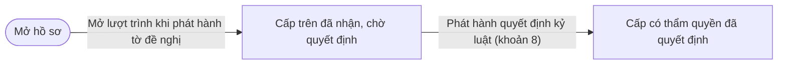
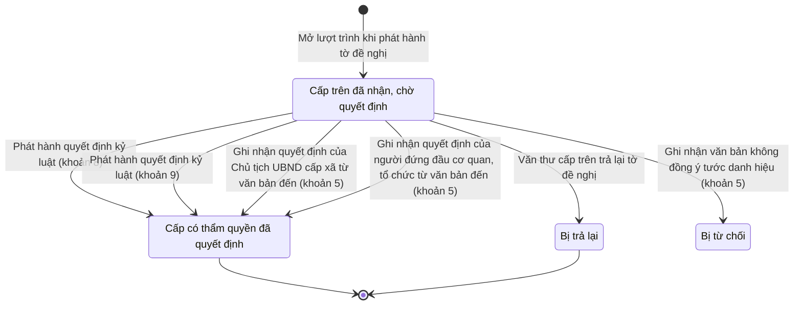

# qt-D15.submission · Xử lý kỷ luật DQTV — Lượt trình đề nghị kỷ luật lên cấp có thẩm quyền

<!-- máy sinh: tom-tat -->
> **Hồ sơ:** Lượt trình đề nghị kỷ luật lên cấp có thẩm quyền (`DisciplineSubmission`)
>
> **Trong sổ phạm vi:** D15 · Xử lý kỷ luật DQTV — hồ sơ phụ submission: một lượt trình đề xuất lên cấp trên — nhận, ký quyết định hoặc trả lại (tầng 3)
>
> 9 bước · 4 chặng · 7 vai · 0 bảng quyết định · 0 hạn · 5 khớp nối.
>
> **Nguồn:** sổ nghiệp vụ `qt-D15.submission` · khai báo của app: `dqtv-app/core/processes/discipline/workflow/discipline-submission.yaml`. Các bảng do máy sinh từ nguồn này.
<!-- hết: tom-tat -->

## 1. Đường đi ngắn nhất qua các chặng

<!-- máy sinh: luong-chinh -->
Đường ít bước nhất từ lúc mở hồ sơ tới chặng kết thúc xa nhất. Máy chọn theo số chặng, không theo ý nghĩa nghiệp vụ — trình tự công việc thật xem phần Diễn giải và bảng "Việc làm ở từng chặng" ở mục 6.

| # | Ai làm | Làm gì | Hồ sơ sang chặng |
|---|---|---|---|
| 1 | Nhân viên văn thư | Mở lượt trình khi phát hành tờ đề nghị | Cấp trên đã nhận, chờ quyết định |
| 2 | Văn thư Bộ CHQS cấp tỉnh (thuộc cấp trên của chủ hồ sơ) | Phát hành quyết định kỷ luật (khoản 8) | Cấp có thẩm quyền đã quyết định |

<!-- hết: luong-chinh -->

## 2. Hồ sơ và việc nó để lại

<!-- máy sinh: muc-tieu -->
**App gọi quy trình này là:** Lượt trình đề nghị kỷ luật.

**Khi mở, hồ sơ này ghi mối nối tới:**
- Văn bản đi (1.outgoing-document) — bước `openSubmissionRound`, khớp nối `disciplineRoundSubmittedByDocument`
- Văn bản đến (1.incoming-document) — bước `openSubmissionRound`, khớp nối `disciplineRoundDeliveredAs`
<!-- hết: muc-tieu -->

## 3. Khởi phát và kết thúc

<!-- máy sinh: khoi-phat -->
**1 cửa vào** — bước mở hồ sơ:

| Bước mở | Ai mở | Hồ sơ vào chặng | App bắt buộc nhập |
|---|---|---|---|
| Mở lượt trình khi phát hành tờ đề nghị | Nhân viên văn thư | Cấp trên đã nhận, chờ quyết định | `caseId`, `submissionDocumentId` |

**Kết thúc:** *Cấp có thẩm quyền đã quyết định* (`DECIDED`), *Bị trả lại* (`RETURNED`)
<!-- hết: khoi-phat -->

## 4. Vai trò

<!-- máy sinh: vai-tro -->
| Vai trong sổ | Tên trong app | Điều kiện | Làm những bước |
|---|---|---|---|
| `clerk` | Nhân viên văn thư |  | Mở lượt trình khi phát hành tờ đề nghị |
| `provincialAssistant` | Ban Dân quân tự vệ, Bộ CHQS cấp tỉnh | thuộc cấp trên của chủ hồ sơ (`actorInSuperiorUnit`, công thức ở mục 7) | Trình ký quyết định kỷ luật (khoản 8 — Bộ CHQS cấp tỉnh) |
| `provincialClerk` | Văn thư Bộ CHQS cấp tỉnh | thuộc cấp trên của chủ hồ sơ (`actorInSuperiorUnit`, công thức ở mục 7) | Phát hành quyết định kỷ luật (khoản 8) |
| `militaryRegionAssistant` | Phòng Dân quân tự vệ, quân khu | thuộc cấp trên của chủ hồ sơ (`actorInSuperiorUnit`, công thức ở mục 7) | Trình ký quyết định kỷ luật (khoản 9 — quân khu) |
| `militaryRegionClerk` | Văn thư quân khu | thuộc cấp trên của chủ hồ sơ (`actorInSuperiorUnit`, công thức ở mục 7) | Phát hành quyết định kỷ luật (khoản 9) |
| `operator` | Trợ lý Tác huấn |  | Ghi nhận quyết định của Chủ tịch UBND cấp xã từ văn bản đến (khoản 5) · Ghi nhận quyết định của người đứng đầu cơ quan, tổ chức từ văn bản đến (khoản 5) · Ghi nhận văn bản không đồng ý tước danh hiệu (khoản 5) |
| `system` | Hệ thống tự làm |  | Văn thư cấp trên trả lại tờ đề nghị |

*"Tên trong app" là tên app đặt cho mã chủ thể của vai. Hồ sơ thuộc đơn vị cấp khác thì người làm là người giữ vai ấy ở đơn vị nêu trong cột "Điều kiện" (nếu sổ có ghi) và ở cột "Người làm phải thuộc" của bảng "Theo khai báo của app" (mục 7).*

**Ngoài hệ** (hệ chỉ ghi kết quả, xem mục 8): `communeChairman`.
<!-- hết: vai-tro -->

## 5. Nhánh phụ

<!-- máy sinh: nhanh-phu -->
**Bước khác đưa hồ sơ sang chặng mới** — đường song song, rẽ nhánh hoặc kết thúc sớm:

| Bước | Ai làm | Từ chặng | Sang chặng |
|---|---|---|---|
| Phát hành quyết định kỷ luật (khoản 9) | Văn thư quân khu (thuộc cấp trên của chủ hồ sơ) | Cấp trên đã nhận, chờ quyết định | Cấp có thẩm quyền đã quyết định |
| Ghi nhận quyết định của Chủ tịch UBND cấp xã từ văn bản đến (khoản 5) | Trợ lý Tác huấn | Cấp trên đã nhận, chờ quyết định | Cấp có thẩm quyền đã quyết định |
| Ghi nhận quyết định của người đứng đầu cơ quan, tổ chức từ văn bản đến (khoản 5) | Trợ lý Tác huấn | Cấp trên đã nhận, chờ quyết định | Cấp có thẩm quyền đã quyết định |
| Ghi nhận văn bản không đồng ý tước danh hiệu (khoản 5) | Trợ lý Tác huấn | Cấp trên đã nhận, chờ quyết định | Bị từ chối |
| Văn thư cấp trên trả lại tờ đề nghị | Hệ thống tự làm | Cấp trên đã nhận, chờ quyết định | Bị trả lại |

**Làm trong lúc hồ sơ đứng yên ở một chặng** — ghi nhận, bổ sung:

| Bước | Ai làm | Ở chặng |
|---|---|---|
| Trình ký quyết định kỷ luật (khoản 8 — Bộ CHQS cấp tỉnh) | Ban Dân quân tự vệ, Bộ CHQS cấp tỉnh (thuộc cấp trên của chủ hồ sơ) | Cấp trên đã nhận, chờ quyết định |
| Trình ký quyết định kỷ luật (khoản 9 — quân khu) | Phòng Dân quân tự vệ, quân khu (thuộc cấp trên của chủ hồ sơ) | Cấp trên đã nhận, chờ quyết định |

<!-- hết: nhanh-phu -->

## 6. Các chặng và việc làm ở từng chặng

<!-- máy sinh: chang -->
| Chặng | Tên hiển thị | Vào bằng bước | Kết thúc? |
|---|---|---|---|
| `RECEIVED` | Cấp trên đã nhận, chờ quyết định | Mở lượt trình khi phát hành tờ đề nghị |  |
| `DECIDED` | Cấp có thẩm quyền đã quyết định | Phát hành quyết định kỷ luật (khoản 8) · Phát hành quyết định kỷ luật (khoản 9) · Ghi nhận quyết định của Chủ tịch UBND cấp xã từ văn bản đến (khoản 5) · Ghi nhận quyết định của người đứng đầu cơ quan, tổ chức từ văn bản đến (khoản 5) | **kết thúc** |
| `RETURNED` | Bị trả lại | Văn thư cấp trên trả lại tờ đề nghị | **kết thúc** |
| `REFUSED` | Bị từ chối | Ghi nhận văn bản không đồng ý tước danh hiệu (khoản 5) |  |

### Việc làm ở từng chặng

Hồ sơ đang ở chặng nào thì làm được những bước nào.

| Hồ sơ đang ở chặng | Bước làm tại chặng (hồ sơ đứng yên) | Bước đưa hồ sơ sang chặng khác |
|---|---|---|
| **Cấp trên đã nhận, chờ quyết định** | Trình ký quyết định kỷ luật (khoản 8 — Bộ CHQS cấp tỉnh) — Ban Dân quân tự vệ, Bộ CHQS cấp tỉnh (thuộc cấp trên của chủ hồ sơ) Trình ký quyết định kỷ luật (khoản 9 — quân khu) — Phòng Dân quân tự vệ, quân khu (thuộc cấp trên của chủ hồ sơ) | Phát hành quyết định kỷ luật (khoản 8) — Văn thư Bộ CHQS cấp tỉnh (thuộc cấp trên của chủ hồ sơ) → *Cấp có thẩm quyền đã quyết định* Phát hành quyết định kỷ luật (khoản 9) — Văn thư quân khu (thuộc cấp trên của chủ hồ sơ) → *Cấp có thẩm quyền đã quyết định* Ghi nhận quyết định của Chủ tịch UBND cấp xã từ văn bản đến (khoản 5) — Trợ lý Tác huấn → *Cấp có thẩm quyền đã quyết định* Ghi nhận quyết định của người đứng đầu cơ quan, tổ chức từ văn bản đến (khoản 5) — Trợ lý Tác huấn → *Cấp có thẩm quyền đã quyết định* Ghi nhận văn bản không đồng ý tước danh hiệu (khoản 5) — Trợ lý Tác huấn → *Bị từ chối* Văn thư cấp trên trả lại tờ đề nghị — Hệ thống tự làm → *Bị trả lại* |
| **Cấp có thẩm quyền đã quyết định** | — | — (kết thúc) |
| **Bị trả lại** | — | — (kết thúc) |
| **Bị từ chối** | — | — |
<!-- hết: chang -->

## 7. Bảng bước

<!-- máy sinh: buoc -->
| # | Bước | Mã bước | Ai thực hiện | Từ chặng | Sang chặng | Phải có trước | Ghi lại |
|---|---|---|---|---|---|---|---|
| 1 | Mở lượt trình khi phát hành tờ đề nghị | `openSubmissionRound` | Nhân viên văn thư | — (mở hồ sơ) | `RECEIVED` | `proposalReadyForSubmission`, `noRoundOpen`, `proposalGoesToSuperior`, `actorInCaseOwnerUnit`, `submittedDocumentIssued` | `id`, nối `submissionOfCase`, nối `submittedByDocument`, nối `submissionDeliveredAs`, đơn vị chủ hồ sơ |
| 2 | Trình ký quyết định kỷ luật (khoản 8 — Bộ CHQS cấp tỉnh) | `requestDecisionSignatureByProvince` | Ban Dân quân tự vệ, Bộ CHQS cấp tỉnh (thuộc cấp trên của chủ hồ sơ) | `RECEIVED` | giữ nguyên | `caseFormRecorded`, `submittedDocumentIssued`, người làm thuộc cấp trên của chủ hồ sơ, `submissionDistributedAtReceiver`, `noDisciplinaryCaseDecidedDocumentOpen`, `noDisciplinaryCaseDecidedDocumentSigned`, `channelProvinceCommand` | nối `disciplinaryCaseDecidedByDocument` (Vụ việc kỷ luật → Văn bản đi) |
| 3 | Phát hành quyết định kỷ luật (khoản 8) | `publishDecisionByProvince` | Văn thư Bộ CHQS cấp tỉnh (thuộc cấp trên của chủ hồ sơ) | `RECEIVED` | `DECIDED` | `disciplinaryCaseDecidedDocumentSigned`, người làm thuộc cấp trên của chủ hồ sơ, `channelProvinceCommand` | nối `decisionDeliveredAs` |
| 4 | Trình ký quyết định kỷ luật (khoản 9 — quân khu) | `requestDecisionSignatureByMilitaryRegion` | Phòng Dân quân tự vệ, quân khu (thuộc cấp trên của chủ hồ sơ) | `RECEIVED` | giữ nguyên | `caseFormRecorded`, `submittedDocumentIssued`, người làm thuộc cấp trên của chủ hồ sơ, `submissionDistributedAtReceiver`, `noDisciplinaryCaseDecidedDocumentOpen`, `noDisciplinaryCaseDecidedDocumentSigned`, `channelMilitaryRegion` | nối `disciplinaryCaseDecidedByDocument` (Vụ việc kỷ luật → Văn bản đi) |
| 5 | Phát hành quyết định kỷ luật (khoản 9) | `publishDecisionByMilitaryRegion` | Văn thư quân khu (thuộc cấp trên của chủ hồ sơ) | `RECEIVED` | `DECIDED` | `disciplinaryCaseDecidedDocumentSigned`, người làm thuộc cấp trên của chủ hồ sơ, `channelMilitaryRegion` | nối `decisionDeliveredAs` |
| 6 | Ghi nhận quyết định của Chủ tịch UBND cấp xã từ văn bản đến (khoản 5) | `recordTitleRevocationDecision` | Trợ lý Tác huấn | `RECEIVED` | `DECIDED` | `disciplinaryCaseDecidedByIncomingDocumentUsable`, `decisionProposed`, `channelCommuneChairman`, `actorInCaseOwnerUnit` | nối `disciplinaryCaseAuthorizedBy` (Vụ việc kỷ luật → Quyết định ký ngoài hệ thống), nối `disciplinaryCaseDecidedByIncomingDocument` (Vụ việc kỷ luật → Văn bản đến) |
| 7 | Ghi nhận quyết định của người đứng đầu cơ quan, tổ chức từ văn bản đến (khoản 5) | `recordOrgHeadDecision` | Trợ lý Tác huấn | `RECEIVED` | `DECIDED` | `disciplinaryCaseDecidedByIncomingDocumentUsable`, `decisionProposed`, `channelOrgHead`, `actorInCaseOwnerUnit` | nối `disciplinaryCaseAuthorizedBy` (Vụ việc kỷ luật → Quyết định ký ngoài hệ thống), nối `disciplinaryCaseDecidedByIncomingDocument` (Vụ việc kỷ luật → Văn bản đến) |
| 8 | Ghi nhận văn bản không đồng ý tước danh hiệu (khoản 5) | `recordProposalRefusal` | Trợ lý Tác huấn | `RECEIVED` | `REFUSED` | `proposalRefusedByIncomingDocumentUsable`, `channelOffSystemAuthority`, `actorInCaseOwnerUnit` | nối `proposalRefusedByIncomingDocument` (Vụ việc kỷ luật → Văn bản đến) |
| 9 | Văn thư cấp trên trả lại tờ đề nghị | `returnProposalByReceiver` | Hệ thống tự làm | `RECEIVED` | `RETURNED` | `submittedDocumentIssued`, `noDisciplinaryCaseDecidedDocumentSigned`, `channelSuperiorCommand` | lý do văn thư cấp trên trả lại; **xoá:** `proposalRequestedAt`, `proposalIssuedAt` |

### Khi không đạt điều kiện

Mặc định: không đúng người, hồ sơ không ở đúng chặng, hoặc thiếu thứ "phải có trước" thì bước bị chặn, hồ sơ giữ nguyên. Bảng dưới chỉ kê những bước có kết quả riêng.

| # | Bước | Kết quả riêng |
|---|---|---|
| 9 | Văn thư cấp trên trả lại tờ đề nghị | bước này không do người nào bấm |

### Điều kiện "phải có trước" bằng lời

Cột "Phải có trước" ở bảng bước có hai loại: ô dữ liệu thường (bước chỉ đòi ô ấy đã có giá trị) và điều kiện hệ tự xét. Bảng này diễn các điều kiện hệ tự xét theo đúng công thức sổ ghi; số ở cột cuối là số thứ tự bước.

| Điều kiện | Đúng khi | Bước đòi |
|---|---|---|
| `proposalReadyForSubmission` | có hồ sơ Xử lý kỷ luật DQTV (qt-D15) chính là hồ sơ ghi ở ô nối `submissionOfCase` của hồ sơ đang làm mà hồ sơ ấy đang ở chặng `DECISION_PROPOSED` | 1 |
| `noRoundOpen` | KHÔNG (có hồ sơ Xử lý kỷ luật DQTV — Lượt trình đề nghị kỷ luật lên cấp có thẩm quyền (qt-D15.submission) có ô nối `submissionOfCase` trùng với ô nối `submissionOfCase` của hồ sơ đang làm mà hồ sơ ấy đang ở chặng `RECEIVED`) | 1 |
| `proposalGoesToSuperior` | có hồ sơ Xử lý kỷ luật DQTV (qt-D15) chính là hồ sơ ghi ở ô nối `submissionOfCase` của hồ sơ đang làm mà kênh thẩm quyền là Khoản 5 — Chủ tịch UBND cấp xã, người đứng đầu cơ quan, tổ chức (`khoan_5`) hoặc Khoản 8 — Bộ CHQS cấp tỉnh (`khoan_8`) hoặc Khoản 9 — Tư lệnh quân khu (`khoan_9`) | 1 |
| `actorInCaseOwnerUnit` | có hồ sơ Xử lý kỷ luật DQTV (qt-D15) (gọi là src) chính là hồ sơ ghi ở ô nối `submissionOfCase` của hồ sơ đang làm mà người đang làm là người của đơn vị ghi ở ô đơn vị chủ hồ sơ của hồ sơ src ấy (theo danh mục người của đơn vị, `dm.unit-staff`) | 1, 6, 7, 8 |
| `submittedDocumentIssued` | có hồ sơ Việc luật giao kèm văn bản đến, đi — Văn bản đi (qt-1.outgoing-document) chính là hồ sơ ghi ở ô nối `submittedByDocument` của hồ sơ đang làm mà hồ sơ ấy đang ở chặng `ISSUED` | 1, 2, 4, 9 |
| `caseFormRecorded` | có hồ sơ Xử lý kỷ luật DQTV (qt-D15) chính là hồ sơ ghi ở ô nối `submissionOfCase` của hồ sơ đang làm mà đã có `disciplinaryForm` | 2, 4 |
| `actorInSuperiorUnit` | người đang làm là người của một đơn vị nằm trong ô cấp trên của chủ hồ sơ của hồ sơ này (theo danh mục người của đơn vị, `dm.unit-staff`) | 2, 3, 4, 5 |
| `submissionDistributedAtReceiver` | có hồ sơ Việc luật giao kèm văn bản đến, đi — Văn bản đến (qt-1.incoming-document) chính là hồ sơ ghi ở ô nối `submissionDeliveredAs` của hồ sơ đang làm mà hồ sơ ấy đang ở chặng `DISTRIBUTED` | 2, 4 |
| `noDisciplinaryCaseDecidedDocumentOpen` | KHÔNG (có hồ sơ Việc luật giao kèm văn bản đến, đi — Văn bản đi (qt-1.outgoing-document) chính là hồ sơ ghi ở ô nối `disciplinaryCaseDecidedByDocument` của hồ sơ đang làm mà hồ sơ ấy đang ở chặng `DRAFT` hoặc `PENDING_SIGNATURE` hoặc `SIGNED`) | 2, 4 |
| `noDisciplinaryCaseDecidedDocumentSigned` | KHÔNG (có hồ sơ Việc luật giao kèm văn bản đến, đi — Văn bản đi (qt-1.outgoing-document) chính là hồ sơ ghi ở ô nối `disciplinaryCaseDecidedByDocument` của hồ sơ đang làm mà hồ sơ ấy đang ở chặng `SIGNED` hoặc `ISSUED`) | 2, 4, 9 |
| `channelProvinceCommand` | có hồ sơ Xử lý kỷ luật DQTV (qt-D15) chính là hồ sơ ghi ở ô nối `submissionOfCase` của hồ sơ đang làm mà kênh thẩm quyền là Khoản 8 — Bộ CHQS cấp tỉnh (`khoan_8`) | 2, 3 |
| `disciplinaryCaseDecidedDocumentSigned` | có hồ sơ Việc luật giao kèm văn bản đến, đi — Văn bản đi (qt-1.outgoing-document) chính là hồ sơ ghi ở ô nối `disciplinaryCaseDecidedByDocument` của hồ sơ đang làm mà hồ sơ ấy đang ở chặng `SIGNED` | 3, 5 |
| `channelMilitaryRegion` | có hồ sơ Xử lý kỷ luật DQTV (qt-D15) chính là hồ sơ ghi ở ô nối `submissionOfCase` của hồ sơ đang làm mà kênh thẩm quyền là Khoản 9 — Tư lệnh quân khu (`khoan_9`) | 4, 5 |
| `disciplinaryCaseDecidedByIncomingDocumentUsable` | có hồ sơ Việc luật giao kèm văn bản đến, đi — Văn bản đến (qt-1.incoming-document) chính là hồ sơ ghi ở ô nối `disciplinaryCaseDecidedByIncomingDocument` của hồ sơ đang làm mà hồ sơ ấy đang ở chặng `RECEIVED` hoặc `DISTRIBUTED` | 6, 7 |
| `decisionProposed` | có hồ sơ Xử lý kỷ luật DQTV (qt-D15) chính là hồ sơ ghi ở ô nối `submissionOfCase` của hồ sơ đang làm mà đã có `decisionProposed` | 6, 7 |
| `channelCommuneChairman` | có hồ sơ Xử lý kỷ luật DQTV (qt-D15) chính là hồ sơ ghi ở ô nối `submissionOfCase` của hồ sơ đang làm mà kênh thẩm quyền là Khoản 5 — Chủ tịch UBND cấp xã, người đứng đầu cơ quan, tổ chức (`khoan_5`) VÀ KHÔNG (`ownerLevel` là `organization`) | 6 |
| `channelOrgHead` | có hồ sơ Xử lý kỷ luật DQTV (qt-D15) chính là hồ sơ ghi ở ô nối `submissionOfCase` của hồ sơ đang làm mà kênh thẩm quyền là Khoản 5 — Chủ tịch UBND cấp xã, người đứng đầu cơ quan, tổ chức (`khoan_5`) VÀ `ownerLevel` là `organization` | 7 |
| `proposalRefusedByIncomingDocumentUsable` | có hồ sơ Việc luật giao kèm văn bản đến, đi — Văn bản đến (qt-1.incoming-document) chính là hồ sơ ghi ở ô nối `proposalRefusedByIncomingDocument` của hồ sơ đang làm mà hồ sơ ấy đang ở chặng `RECEIVED` hoặc `DISTRIBUTED` | 8 |
| `channelOffSystemAuthority` | có hồ sơ Xử lý kỷ luật DQTV (qt-D15) chính là hồ sơ ghi ở ô nối `submissionOfCase` của hồ sơ đang làm mà kênh thẩm quyền là Khoản 5 — Chủ tịch UBND cấp xã, người đứng đầu cơ quan, tổ chức (`khoan_5`) | 8 |
| `channelSuperiorCommand` | có hồ sơ Xử lý kỷ luật DQTV (qt-D15) chính là hồ sơ ghi ở ô nối `submissionOfCase` của hồ sơ đang làm mà kênh thẩm quyền là Khoản 8 — Bộ CHQS cấp tỉnh (`khoan_8`) hoặc Khoản 9 — Tư lệnh quân khu (`khoan_9`) | 9 |

### Theo khai báo của app

Người làm phải thuộc đơn vị nào, ô người dùng phải nhập, bước có lặp được không, và căn cứ pháp lý — lấy từ khai báo quy trình trong app.

| # | Bước | Người làm phải thuộc | Bắt buộc nhập | Nhập nếu có | Lặp được | Căn cứ |
|---|---|---|---|---|---|---|
| 1 | Mở lượt trình khi phát hành tờ đề nghị |  | `caseId`, `submissionDocumentId` | `submissionIncomingId` |  | TT75/2020/TT-BQP Điều 31 khoản 6; NĐ30/2020/NĐ-CP Đ.15, Đ.18 |
| 2 | Trình ký quyết định kỷ luật (khoản 8 — Bộ CHQS cấp tỉnh) | cấp trên của chủ hồ sơ | dự thảo quyết định kỷ luật (PDF) | — |  | TT75/2020/TT-BQP Điều 35 khoản 8; NĐ30/2020/NĐ-CP Đ.10, Đ.13 |
| 3 | Phát hành quyết định kỷ luật (khoản 8) |  | — | — |  | NĐ30/2020/NĐ-CP Đ.15, Đ.16 khoản 2 a, Đ.18 khoản 1 |
| 4 | Trình ký quyết định kỷ luật (khoản 9 — quân khu) | cấp trên của chủ hồ sơ | dự thảo quyết định kỷ luật (PDF) | — |  | TT75/2020/TT-BQP Điều 35 khoản 9; NĐ30/2020/NĐ-CP Đ.10, Đ.13 |
| 5 | Phát hành quyết định kỷ luật (khoản 9) |  | — | — |  | NĐ30/2020/NĐ-CP Đ.15, Đ.16 khoản 2 a, Đ.18 khoản 1 |
| 6 | Ghi nhận quyết định của Chủ tịch UBND cấp xã từ văn bản đến (khoản 5) | đơn vị chủ hồ sơ | văn bản đến là quyết định của Chủ tịch UBND cấp xã | ngày ký quyết định (để trống thì lấy ngày đến) |  | TT75/2020/TT-BQP Điều 35 khoản 5; NĐ30/2020/NĐ-CP Đ.3 k6, Đ.22 |
| 7 | Ghi nhận quyết định của người đứng đầu cơ quan, tổ chức từ văn bản đến (khoản 5) | đơn vị chủ hồ sơ | văn bản đến là quyết định của người đứng đầu cơ quan, tổ chức | ngày ký quyết định (để trống thì lấy ngày đến) |  | TT75/2020/TT-BQP Điều 35 khoản 5; NĐ30/2020/NĐ-CP Đ.3 k6, Đ.22 |
| 8 | Ghi nhận văn bản không đồng ý tước danh hiệu (khoản 5) | đơn vị chủ hồ sơ | `incomingDocumentId` | lý do không đồng ý |  | TT75/2020/TT-BQP Điều 35 khoản 5; NĐ30/2020/NĐ-CP Đ.3 k6 |
| 9 | Văn thư cấp trên trả lại tờ đề nghị |  | lý do văn thư cấp trên trả lại | — |  | NĐ30/2020/NĐ-CP Đ.21 k2 b |

### Điều kiện và ghi chú app khai cho từng bước

Lấy từ khai báo quy trình trong app. Lời trong ngoặc kép là câu app hiện cho người dùng. Chức danh người ký ngoài hệ app chỉ khai bằng mã.

| # | Bước | Điều kiện, ghi chú |
|---|---|---|
| 2 | Trình ký quyết định kỷ luật (khoản 8 — Bộ CHQS cấp tỉnh) | · chỉ làm được khi ô "kênh thẩm quyền" là Khoản 8 — Bộ CHQS cấp tỉnh (`khoan_8`) — ngoài ra app báo: "vụ việc này không thuộc thẩm quyền quyết định của Bộ CHQS cấp tỉnh — theo khoản Điều 35 đã chọn" |
| 3 | Phát hành quyết định kỷ luật (khoản 8) | · chỉ làm được khi ô "kênh thẩm quyền" là Khoản 8 — Bộ CHQS cấp tỉnh (`khoan_8`) — ngoài ra app báo: "vụ việc này không thuộc thẩm quyền quyết định của Bộ CHQS cấp tỉnh — theo khoản Điều 35 đã chọn" |
| 4 | Trình ký quyết định kỷ luật (khoản 9 — quân khu) | · chỉ làm được khi ô "kênh thẩm quyền" là Khoản 9 — Tư lệnh quân khu (`khoan_9`) — ngoài ra app báo: "vụ việc này không thuộc thẩm quyền quyết định của quân khu — theo khoản Điều 35 đã chọn" |
| 5 | Phát hành quyết định kỷ luật (khoản 9) | · chỉ làm được khi ô "kênh thẩm quyền" là Khoản 9 — Tư lệnh quân khu (`khoan_9`) — ngoài ra app báo: "vụ việc này không thuộc thẩm quyền quyết định của quân khu — theo khoản Điều 35 đã chọn" |
| 6 | Ghi nhận quyết định của Chủ tịch UBND cấp xã từ văn bản đến (khoản 5) | · chỉ làm được khi ô "kênh thẩm quyền" là Khoản 5 — Chủ tịch UBND cấp xã, người đứng đầu cơ quan, tổ chức (`khoan_5`) — ngoài ra app báo: "bước này ghi nhận quyết định của Chủ tịch UBND cấp xã — vụ việc đang theo khoản Điều 35 khác" · bước này ghi một quyết định ký NGOÀI hệ (`disciplineRoundAuthorizedBy`), người ký: `commune_chairman` |
| 7 | Ghi nhận quyết định của người đứng đầu cơ quan, tổ chức từ văn bản đến (khoản 5) | · chỉ làm được khi ô "kênh thẩm quyền" là Khoản 5 — Chủ tịch UBND cấp xã, người đứng đầu cơ quan, tổ chức (`khoan_5`) — ngoài ra app báo: "bước này ghi nhận quyết định của người đứng đầu cơ quan, tổ chức — vụ việc đang theo khoản Điều 35 khác" · bước này ghi một quyết định ký NGOÀI hệ (`disciplineRoundAuthorizedBy`), người ký: `organization_head` |
| 8 | Ghi nhận văn bản không đồng ý tước danh hiệu (khoản 5) | · chỉ làm được khi ô "kênh thẩm quyền" là Khoản 5 — Chủ tịch UBND cấp xã, người đứng đầu cơ quan, tổ chức (`khoan_5`) — ngoài ra app báo: "bước này ghi văn bản không đồng ý của Chủ tịch UBND cấp xã, người đứng đầu cơ quan, tổ chức — vụ việc đang theo khoản Điều 35 khác" · bước này ghi một quyết định ký NGOÀI hệ (`disciplineRoundRefusedByIncomingDocument`) |
| 9 | Văn thư cấp trên trả lại tờ đề nghị | · chỉ làm được khi ô "kênh thẩm quyền" là Khoản 8 — Bộ CHQS cấp tỉnh (`khoan_8`) hoặc Khoản 9 — Tư lệnh quân khu (`khoan_9`) — ngoài ra app báo: "chỉ tờ đề nghị gửi Bộ CHQS cấp tỉnh, quân khu mới vào sổ văn bản đến của cấp trên trong hệ" |
<!-- hết: buoc -->

## 8. Bảng quyết định, hạn, việc ngoài hệ

<!-- máy sinh: quyet-dinh -->
**Việc làm ngoài hệ, hệ chỉ ghi kết quả:**

| Ranh giới | Ai làm | Hệ gửi ra | Hệ nhận về | Không được thì |
|---|---|---|---|---|
| `title-revocation-off-system-decision` | `communeChairman` | nối `submittedByDocument` | nối `disciplinaryCaseDecidedByIncomingDocument` (Vụ việc kỷ luật → Văn bản đến) | hồ sơ sang *Bị từ chối* |
<!-- hết: quyet-dinh -->

## 9. Dữ liệu của hồ sơ

<!-- máy sinh: du-lieu -->
Các ô mà bước trong sổ ghi hoặc đòi. Số trong hai cột cuối là số thứ tự bước ở bảng bước (mục 7).

| Ô dữ liệu | Mã | Kiểu (app) | Giá trị cho phép | Loại ô (sổ) | Bước ghi | Bước đòi | Mô tả trong app |
|---|---|---|---|---|---|---|---|
| — | `id` |  |  | lưu trên hồ sơ (`stored`) | 1 | — |  |
| đơn vị chủ hồ sơ | `ownerUnit` |  |  | lưu trên hồ sơ (`stored`) | 1 | — |  |
| lý do trả lại | `returnReason` | chữ |  | đưa vào ở bước (`input`) | 9 | — | Lý do cấp nhận trả lại tờ đề nghị |
| — | `proposalReadyForSubmission` |  | có hay chưa | hệ suy ra (`derived`) | — | 1 |  |
| — | `noRoundOpen` |  | có hay chưa | hệ suy ra (`derived`) | — | 1 |  |
| — | `proposalGoesToSuperior` |  | có hay chưa | hệ suy ra (`derived`) | — | 1 |  |
| — | `actorInCaseOwnerUnit` |  | có hay chưa | hệ suy ra (`derived`) | — | 1, 6, 7, 8 |  |
| — | `submittedDocumentIssued` |  | có hay chưa | hệ suy ra (`derived`) | — | 1, 2, 4, 9 |  |
| — | `caseFormRecorded` |  | có hay chưa | hệ suy ra (`derived`) | — | 2, 4 |  |
| người làm thuộc cấp trên của chủ hồ sơ | `actorInSuperiorUnit` |  | có hay chưa | hệ suy ra (`derived`) | — | 2, 3, 4, 5 |  |
| — | `submissionDistributedAtReceiver` |  | có hay chưa | hệ suy ra (`derived`) | — | 2, 4 |  |
| — | `noDisciplinaryCaseDecidedDocumentOpen` |  | có hay chưa | hệ suy ra (`derived`) | — | 2, 4 |  |
| — | `noDisciplinaryCaseDecidedDocumentSigned` |  | có hay chưa | hệ suy ra (`derived`) | — | 2, 4, 9 |  |
| — | `channelProvinceCommand` |  | có hay chưa | hệ suy ra (`derived`) | — | 2, 3 |  |
| — | `disciplinaryCaseDecidedDocumentSigned` |  | có hay chưa | hệ suy ra (`derived`) | — | 3, 5 |  |
| — | `channelMilitaryRegion` |  | có hay chưa | hệ suy ra (`derived`) | — | 4, 5 |  |
| — | `disciplinaryCaseDecidedByIncomingDocumentUsable` |  | có hay chưa | hệ suy ra (`derived`) | — | 6, 7 |  |
| — | `decisionProposed` |  | có hay chưa | hệ suy ra (`derived`) | — | 6, 7 |  |
| — | `channelCommuneChairman` |  | có hay chưa | hệ suy ra (`derived`) | — | 6 |  |
| — | `channelOrgHead` |  | có hay chưa | hệ suy ra (`derived`) | — | 7 |  |
| — | `proposalRefusedByIncomingDocumentUsable` |  | có hay chưa | hệ suy ra (`derived`) | — | 8 |  |
| — | `channelOffSystemAuthority` |  | có hay chưa | hệ suy ra (`derived`) | — | 8 |  |
| — | `channelSuperiorCommand` |  | có hay chưa | hệ suy ra (`derived`) | — | 9 |  |

23 ô. Cột "Loại ô" là cách sổ phân loại ô, in kèm đúng chữ của sổ; ô nào người dùng phải nhập xem bảng "Theo khai báo của app" ở mục 7.
<!-- hết: du-lieu -->

## 10. Khớp nối với quy trình khác

<!-- máy sinh: khop-noi -->
| Quy trình kia | Hồ sơ kia | Quan hệ | Nội dung (mô tả trong app) | Bước ghi mối nối | Tên ô nối |
|---|---|---|---|---|---|
| 1.incoming-document | Văn bản đến | có nối | Quyết định của Chủ tịch UBND cấp xã, người đứng đầu cơ quan, tổ chức về sổ đến (khoản 5) | — | `disciplineRoundDecidedByIncomingDocument` |
| 1.incoming-document | Văn bản đến | hồ sơ này **mở ra có nối tới** hồ sơ kia | Tờ đề nghị vào sổ văn bản đến của cấp nhận (khoản 8, 9) | D15.submission·openSubmissionRound ⊕ | `disciplineRoundDeliveredAs` |
| 1.incoming-document | Văn bản đến | có nối | Văn bản không đồng ý tước danh hiệu về sổ đến (khoản 5) | — | `disciplineRoundRefusedByIncomingDocument` |
| 1.outgoing-document | Văn bản đi | có nối | Quyết định kỷ luật do cấp nhận ban hành trên hệ (khoản 8, 9) | — | `disciplineRoundDecidedByDocument` |
| 1.outgoing-document | Văn bản đi | hồ sơ này **mở ra có nối tới** hồ sơ kia | Tờ đề nghị đã phát hành của lượt trình | D15.submission·openSubmissionRound ⊕ | `disciplineRoundSubmittedByDocument` |

5 khớp nối. ⊕ là bước tạo hồ sơ.

**Ô nối giữa các hồ sơ cùng mã quy trình, hoặc tới danh mục nền:** `disciplineRoundOfCase` (Lượt trình đề nghị kỷ luật lên cấp có thẩm quyền → Vụ việc kỷ luật) — bước Mở lượt trình khi phát hành tờ đề nghị.
<!-- hết: khop-noi -->

## 11. Thông tin chung

<!-- máy sinh: thong-tin -->
| | |
|---|---|
| **Mã trong sổ** | `qt-D15.submission` |
| **Quy trình trong app** | `discipline` (`workflow/discipline-submission.yaml`) — mặt công tác: `political` |
| **Hồ sơ** | Lượt trình đề nghị kỷ luật lên cấp có thẩm quyền (`DisciplineSubmission`) |
| **Cùng mã quy trình** | [qt-D15](qt-D15.html), [qt-D15.complaint](qt-D15.complaint.html) |
| **Căn cứ pháp lý từng bước** | cột "Căn cứ" ở bảng "Theo khai báo của app", mục 7 |
<!-- hết: thong-tin -->
