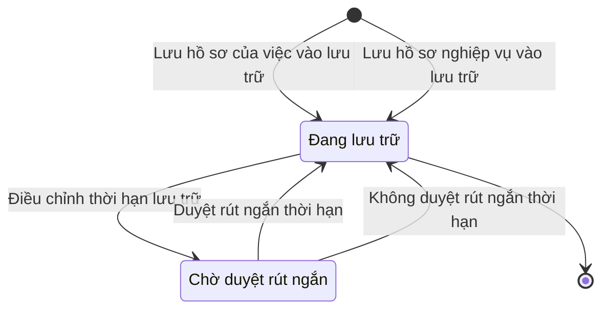

# qt-D16 · Hồ sơ lưu trữ

<!-- máy sinh: tom-tat -->
> **Hồ sơ:** Hồ sơ lưu trữ (`ArchiveDossier`)
>
> **Trong sổ phạm vi:** D16 · Hồ sơ lưu trữ (tầng 1)
>
> 10 bước · 2 chặng · 4 vai · 3 bảng quyết định · 0 hạn · 16 khớp nối.
>
> **Nguồn:** sổ nghiệp vụ `qt-D16` · khai báo của app: `dqtv-app/core/processes/archive/workflow/archive-dossier.yaml`. Các bảng do máy sinh từ nguồn này.
<!-- hết: tom-tat -->

<!-- viết tay: dien-giai -->
## Diễn giải

*Phần này viết tay, diễn giải lại điều các bảng bên dưới ghi.*

### Quy trình này để làm gì

Mỗi việc làm xong để lại một **hồ sơ lưu trữ** của đơn vị. Mỗi việc là một hồ sơ; hệ tự gom văn bản, quyết định, bản ký của việc; việc bấm xong thì hồ sơ tự khép và tự vào lưu trữ, không ai bấm nộp lưu, văn thư không tiếp nhận từng hồ sơ. Thời hạn lưu trữ mặc định theo loại việc, người làm sửa khi cần.

Hồ sơ chỉ có hai chặng: *Đang lưu trữ* và *Chờ duyệt rút ngắn*. Phần việc của người dùng ở đây là ghi vị trí bản giấy, đổi thời hạn lưu trữ, và xem hồ sơ nào đã hết hạn.

### Khi nào bắt đầu

Khi một việc được bấm xong, hệ thống tự mở hồ sơ bằng bước `openArchiveFile`, không người nào bấm: bước ghi `taskingId`, loại việc, năm công việc kết thúc, thời điểm vào lưu trữ, đơn vị chủ hồ sơ. Hồ sơ vào thẳng chặng *Đang lưu trữ*. Bảng `default-retention` xét ngay ở bước này và cho ra một trong bốn nhánh `20y`, `5y`, `permanent`, `enteredByPerson`; ba nhánh đầu ghi thêm số năm lưu trữ.

### Diễn ra thế nào

**Chặng "Đang lưu trữ"** — năm việc, không buộc thứ tự:

- **Ghi vị trí bản giấy** (Nhân viên văn thư) — kho, giá, hộp. Bản giấy để ngoài hệ, hệ chỉ có ô vị trí.
- **Điều chỉnh thời hạn lưu trữ** (Trợ lý Tác huấn) — làm được khi ô "lần điều chỉnh gần nhất" là Kéo dài (`longer`): kéo dài thì sửa thẳng. Bước ghi số năm đề nghị và số năm lưu trữ, hồ sơ đứng yên.
- **Đề nghị rút ngắn thời hạn lưu trữ** (Trợ lý Tác huấn) — làm được khi ô "lần điều chỉnh gần nhất" là Rút ngắn (`shorter`). Rút ngắn thì phải có người duyệt: bước này chỉ ghi số năm đề nghị và đưa hồ sơ sang *Chờ duyệt rút ngắn*.
- `listExpiredArchiveByClerk` (Nhân viên văn thư) và `listExpiredArchiveByCommander` (Chỉ huy trưởng Ban CHQS xã) — xem hồ sơ đã hết thời hạn lưu trữ; hạn tính từ năm công việc kết thúc, cả văn thư và chỉ huy trưởng đều xem được. Cả hai đòi phải có năm hết hạn (`retentionExpiryYear`) và không ghi lại gì.

**Chặng "Chờ duyệt rút ngắn"** — Chỉ huy trưởng Ban CHQS xã, tức Chỉ huy trưởng của đơn vị giữ hồ sơ, chọn một trong hai:

- **Duyệt rút ngắn thời hạn** — số năm đề nghị thành số năm lưu trữ.
- **Không duyệt rút ngắn thời hạn** — giữ thời hạn cũ.

Cả hai đưa hồ sơ về *Đang lưu trữ*.

### Kết thúc và để lại gì

*Đang lưu trữ* là chặng kết thúc: hồ sơ ở lại đó. Mỗi hồ sơ lưu trữ là hồ sơ của một việc (Nhiệm vụ trên giao, quy trình 1), mở khi việc sang Đã xong.

### Điều kiện chặn

- **Thời hạn mặc định theo loại việc** (bảng `default-retention`, 14 dòng): `permanent` với tuyển quân; công trình quốc phòng, khu vực phòng thủ; tài chính, ngân sách; sơ kết, tổng kết, thi đua khen thưởng. `5y` với tuyển sinh, đào tạo cán bộ và giáo dục quốc phòng và an ninh. `20y` với các loại còn lại. "Việc khác" thì `enteredByPerson`.
- **Năm hết hạn** tính theo công thức `retention-expiry`, tính từ năm công việc kết thúc.
- Kéo dài và rút ngắn tách nhau bằng hai điều kiện `retentionIsLonger`, `retentionIsShorter`: đúng khi ô "lần điều chỉnh gần nhất" bằng `longer`, bằng `shorter`. Không khớp thì bước bị chặn.
- Duyệt rút ngắn: phải đã có số năm đề nghị.
- Mọi bước trừ bước mở: người làm phải thuộc đơn vị chủ hồ sơ. Sai người, sai chặng, thiếu thứ phải có trước thì bước bị chặn, hồ sơ giữ nguyên. Không bước nào có kết quả chặn riêng.
- Quy trình này không có hạn và không có việc ngoài hệ.
<!-- hết viết tay -->

## 1. Đường đi ngắn nhất qua các chặng

<!-- máy sinh: luong-chinh -->
Đường ít bước nhất từ lúc mở hồ sơ tới chặng kết thúc xa nhất. Máy chọn theo số chặng, không theo ý nghĩa nghiệp vụ — trình tự công việc thật xem phần Diễn giải và bảng "Việc làm ở từng chặng" ở mục 6.

| # | Ai làm | Làm gì | Hồ sơ sang chặng |
|---|---|---|---|
| 1 | Hệ thống tự làm | Lưu hồ sơ của việc vào lưu trữ | Đang lưu trữ |

<!-- hết: luong-chinh -->

## 2. Hồ sơ và việc nó để lại

<!-- máy sinh: muc-tieu -->
**App gọi quy trình này là:** Hồ sơ lưu trữ.

**Khi mở, hồ sơ này ghi mối nối tới:**
- Hồ sơ bồi thường thiệt hại (12b.compensation) — bước `openRecordArchiveFile`, khớp nối `dossierOfCompensationCase`
- Khoá bồi dưỡng kiến thức QP&AN (G1) — bước `openRecordArchiveFile`, khớp nối `dossierOfRefresherCourse`
- Nhiệm vụ trên giao (1) — bước `openArchiveFile`, khớp nối `dossierOfTasking`
- Vụ việc kỷ luật (D15) — bước `openRecordArchiveFile`, khớp nối `dossierOfDisciplinaryCase`

**Hồ sơ này để lại cho quy trình khác** (bước tạo hồ sơ của quy trình kia ghi mối nối về đây):
- Hồ sơ Kỷ niệm chương "Vì sự nghiệp vũ trang quần chúng" (8.medal) — bước `recordArchiveFile`, khớp nối `fileOfMedalCase`
- Hồ sơ bồi thường thiệt hại (12b.compensation) — bước `recordArchiveFile`, khớp nối `fileOfCompensationCase`
- Hồ sơ khen thưởng (8) — bước `recordArchiveFile`, khớp nối `fileOfAwardCase`
- Khoá bồi dưỡng kiến thức QP&AN (G1) — bước `recordArchiveFile`, khớp nối `fileOfRefresherCourse`
- Văn bản đi (1.outgoing-document) — bước `recordArchiveFile`, khớp nối `fileOfOutgoingDocument`
- Văn bản đến (1.incoming-document) — bước `recordArchiveFile`, khớp nối `fileOfIncomingDocument`
- Vụ việc kỷ luật (D15) — bước `recordArchiveFile`, khớp nối `fileOfDisciplinaryCase`
- Vụ việc ứng phó (20) — bước `recordArchiveFile`, khớp nối `fileOfResponseCase`
<!-- hết: muc-tieu -->

## 3. Khởi phát và kết thúc

<!-- máy sinh: khoi-phat -->
**2 cửa vào** — bước mở hồ sơ:

| Bước mở | Ai mở | Hồ sơ vào chặng | App bắt buộc nhập |
|---|---|---|---|
| Lưu hồ sơ của việc vào lưu trữ | Hệ thống tự làm | Đang lưu trữ | `taskingId`, tên hồ sơ, loại việc, cấp, năm công việc kết thúc |
| Lưu hồ sơ nghiệp vụ vào lưu trữ | Hệ thống tự làm | Đang lưu trữ | loại hồ sơ nghiệp vụ, `recordId`, tên hồ sơ, cấp, năm công việc kết thúc |

**Kết thúc:** *Đang lưu trữ* (`ARCHIVED`)
<!-- hết: khoi-phat -->

## 4. Vai trò

<!-- máy sinh: vai-tro -->
| Vai trong sổ | Tên trong app | Điều kiện | Làm những bước |
|---|---|---|---|
| `system` | Hệ thống tự làm |  | Lưu hồ sơ của việc vào lưu trữ · Lưu hồ sơ nghiệp vụ vào lưu trữ · Cập nhật năm công việc kết thúc (`refreshArchiveWorkEndYear`) · Cập nhật năm công việc kết thúc (`refreshArchiveWorkEndYearOnRecordEnd`) |
| `clerk` | Nhân viên văn thư |  | Ghi vị trí bản giấy · `listExpiredArchiveByClerk` |
| `operator` | Trợ lý Tác huấn |  | Điều chỉnh thời hạn lưu trữ |
| `commander` | Chỉ huy trưởng Ban CHQS xã |  | Duyệt rút ngắn thời hạn · Không duyệt rút ngắn thời hạn · `listExpiredArchiveByCommander` |

*"Tên trong app" là tên app đặt cho mã chủ thể của vai. Hồ sơ thuộc đơn vị cấp khác thì người làm là người giữ vai ấy ở đơn vị nêu trong cột "Điều kiện" (nếu sổ có ghi) và ở cột "Người làm phải thuộc" của bảng "Theo khai báo của app" (mục 7).*
<!-- hết: vai-tro -->

## 5. Nhánh phụ

<!-- máy sinh: nhanh-phu -->
**Bước khác đưa hồ sơ sang chặng mới** — đường song song, rẽ nhánh hoặc kết thúc sớm:

| Bước | Ai làm | Từ chặng | Sang chặng |
|---|---|---|---|
| Điều chỉnh thời hạn lưu trữ | Trợ lý Tác huấn | Đang lưu trữ | Chờ duyệt rút ngắn |

**Quay lại một chặng hồ sơ đã đi qua** (tính theo đường ngắn nhất từ lúc mở):

| Bước | Ai làm | Từ chặng | Về chặng |
|---|---|---|---|
| Duyệt rút ngắn thời hạn | Chỉ huy trưởng Ban CHQS xã | Chờ duyệt rút ngắn | Đang lưu trữ |
| Không duyệt rút ngắn thời hạn | Chỉ huy trưởng Ban CHQS xã | Chờ duyệt rút ngắn | Đang lưu trữ |

**Làm trong lúc hồ sơ đứng yên ở một chặng** — ghi nhận, bổ sung:

| Bước | Ai làm | Ở chặng |
|---|---|---|
| Cập nhật năm công việc kết thúc (`refreshArchiveWorkEndYear`) *(lặp được)* | Hệ thống tự làm | Đang lưu trữ, Chờ duyệt rút ngắn |
| Cập nhật năm công việc kết thúc (`refreshArchiveWorkEndYearOnRecordEnd`) *(lặp được)* | Hệ thống tự làm | Đang lưu trữ, Chờ duyệt rút ngắn |
| Ghi vị trí bản giấy | Nhân viên văn thư | Đang lưu trữ |
| `listExpiredArchiveByClerk` | Nhân viên văn thư | Đang lưu trữ |
| `listExpiredArchiveByCommander` | Chỉ huy trưởng Ban CHQS xã | Đang lưu trữ |

**Cửa vào khác:** 2 bước cùng mở hồ sơ — xem mục 3.

<!-- hết: nhanh-phu -->

## 6. Các chặng và việc làm ở từng chặng

<!-- máy sinh: chang -->
| Chặng | Tên hiển thị | Vào bằng bước | Kết thúc? |
|---|---|---|---|
| `ARCHIVED` | Đang lưu trữ | Lưu hồ sơ của việc vào lưu trữ · Lưu hồ sơ nghiệp vụ vào lưu trữ · Duyệt rút ngắn thời hạn · Không duyệt rút ngắn thời hạn | **kết thúc** — vẫn còn bước làm được |
| `SHORTENING_PENDING` | Chờ duyệt rút ngắn | Điều chỉnh thời hạn lưu trữ |  |

### Việc làm ở từng chặng

Hồ sơ đang ở chặng nào thì làm được những bước nào.

| Hồ sơ đang ở chặng | Bước làm tại chặng (hồ sơ đứng yên) | Bước đưa hồ sơ sang chặng khác |
|---|---|---|
| **Đang lưu trữ** | Cập nhật năm công việc kết thúc (`refreshArchiveWorkEndYear`) (lặp được) — Hệ thống tự làm Cập nhật năm công việc kết thúc (`refreshArchiveWorkEndYearOnRecordEnd`) (lặp được) — Hệ thống tự làm Ghi vị trí bản giấy — Nhân viên văn thư `listExpiredArchiveByClerk` — Nhân viên văn thư `listExpiredArchiveByCommander` — Chỉ huy trưởng Ban CHQS xã | Điều chỉnh thời hạn lưu trữ — Trợ lý Tác huấn → *Chờ duyệt rút ngắn* |
| **Chờ duyệt rút ngắn** | Cập nhật năm công việc kết thúc (`refreshArchiveWorkEndYear`) (lặp được) — Hệ thống tự làm Cập nhật năm công việc kết thúc (`refreshArchiveWorkEndYearOnRecordEnd`) (lặp được) — Hệ thống tự làm | Duyệt rút ngắn thời hạn — Chỉ huy trưởng Ban CHQS xã → *Đang lưu trữ* Không duyệt rút ngắn thời hạn — Chỉ huy trưởng Ban CHQS xã → *Đang lưu trữ* |
<!-- hết: chang -->

## 7. Bảng bước

<!-- máy sinh: buoc -->
| # | Bước | Mã bước | Ai thực hiện | Từ chặng | Sang chặng | Phải có trước | Ghi lại |
|---|---|---|---|---|---|---|---|
| 1 | Lưu hồ sơ của việc vào lưu trữ | `openArchiveFile` | Hệ thống tự làm | — (mở hồ sơ) | `ARCHIVED` | — | nối tới Nhiệm vụ trên giao, loại việc, vào lưu trữ lúc, đơn vị chủ hồ sơ, năm công việc kết thúc |
| 2 | Lưu hồ sơ nghiệp vụ vào lưu trữ | `openRecordArchiveFile` | Hệ thống tự làm | — (mở hồ sơ) | `ARCHIVED` | `recordEnded` | loại hồ sơ nghiệp vụ, nối tới Vụ việc kỷ luật, nối tới Hồ sơ bồi thường thiệt hại, nối tới Khoá bồi dưỡng kiến thức QP&AN, vào lưu trữ lúc, đơn vị chủ hồ sơ, năm công việc kết thúc |
| 3 | Cập nhật năm công việc kết thúc (`refreshArchiveWorkEndYear`) | `refreshArchiveWorkEndYear` | Hệ thống tự làm | `ARCHIVED`, `SHORTENING_PENDING` | giữ nguyên | — | năm công việc kết thúc, `retentionExpiryYear` |
| 4 | Cập nhật năm công việc kết thúc (`refreshArchiveWorkEndYearOnRecordEnd`) | `refreshArchiveWorkEndYearOnRecordEnd` | Hệ thống tự làm | `ARCHIVED`, `SHORTENING_PENDING` | giữ nguyên | `taskingEnded`, `servingRecordEnded` | năm công việc kết thúc, `retentionExpiryYear` |
| 5 | Ghi vị trí bản giấy | `recordPaperLocation` | Nhân viên văn thư | `ARCHIVED` | giữ nguyên | người làm thuộc đơn vị chủ hồ sơ | vị trí bản giấy |
| 6 | Điều chỉnh thời hạn lưu trữ | `adjustRetention` | Trợ lý Tác huấn | `ARCHIVED` | `SHORTENING_PENDING` | kéo dài / rút ngắn (hệ so thời hạn mới với thời hạn đang có), số năm lưu trữ, người làm thuộc đơn vị chủ hồ sơ | kéo dài / rút ngắn (hệ so thời hạn mới với thời hạn đang có), số năm lưu trữ |
| 7 | Duyệt rút ngắn thời hạn | `approveRetentionShortening` | Chỉ huy trưởng Ban CHQS xã | `SHORTENING_PENDING` | `ARCHIVED` | số năm đề nghị, người làm thuộc đơn vị chủ hồ sơ | số năm lưu trữ, `retentionExpiryYear` |
| 8 | Không duyệt rút ngắn thời hạn | `rejectRetentionShortening` | Chỉ huy trưởng Ban CHQS xã | `SHORTENING_PENDING` | `ARCHIVED` | người làm thuộc đơn vị chủ hồ sơ | — |
| 9 | `listExpiredArchiveByClerk` | `listExpiredArchiveByClerk` | Nhân viên văn thư | `ARCHIVED` | giữ nguyên | `retentionExpiryYear`, người làm thuộc đơn vị chủ hồ sơ | — |
| 10 | `listExpiredArchiveByCommander` | `listExpiredArchiveByCommander` | Chỉ huy trưởng Ban CHQS xã | `ARCHIVED` | giữ nguyên | `retentionExpiryYear`, người làm thuộc đơn vị chủ hồ sơ | — |

### Khi không đạt điều kiện

Mặc định: không đúng người, hồ sơ không ở đúng chặng, hoặc thiếu thứ "phải có trước" thì bước bị chặn, hồ sơ giữ nguyên. Bảng dưới chỉ kê những bước có kết quả riêng.

| # | Bước | Kết quả riêng |
|---|---|---|
| 1 | Lưu hồ sơ của việc vào lưu trữ | nhánh `20y`: hồ sơ sang *Đang lưu trữ*, ghi thêm số năm lưu trữ, `retentionExpiryYear`; nhánh `5y`: hồ sơ sang *Đang lưu trữ*, ghi thêm số năm lưu trữ, `retentionExpiryYear`; nhánh `enteredByPerson`: hồ sơ sang *Đang lưu trữ*; nhánh `permanent`: hồ sơ sang *Đang lưu trữ*, ghi thêm số năm lưu trữ; bước này không do người nào bấm |
| 2 | Lưu hồ sơ nghiệp vụ vào lưu trữ | nhánh `20y`: hồ sơ sang *Đang lưu trữ*, ghi thêm số năm lưu trữ, `retentionExpiryYear`; nhánh `5y`: hồ sơ sang *Đang lưu trữ*, ghi thêm số năm lưu trữ, `retentionExpiryYear`; bước này không do người nào bấm |
| 3 | Cập nhật năm công việc kết thúc (`refreshArchiveWorkEndYear`) | bước này không do người nào bấm |
| 4 | Cập nhật năm công việc kết thúc (`refreshArchiveWorkEndYearOnRecordEnd`) | bước này không do người nào bấm |
| 6 | Điều chỉnh thời hạn lưu trữ | nhánh `longer`: hồ sơ sang *Đang lưu trữ*, ghi thêm số năm lưu trữ, `retentionExpiryYear`; nhánh `shorter`: hồ sơ sang *Chờ duyệt rút ngắn* |

### Điều kiện "phải có trước" bằng lời

Cột "Phải có trước" ở bảng bước có hai loại: ô dữ liệu thường (bước chỉ đòi ô ấy đã có giá trị) và điều kiện hệ tự xét. Bảng này diễn các điều kiện hệ tự xét theo đúng công thức sổ ghi; số ở cột cuối là số thứ tự bước.

| Điều kiện | Đúng khi | Bước đòi |
|---|---|---|
| `recordEnded` | có hồ sơ Xử lý kỷ luật DQTV (qt-D15) chính là hồ sơ ghi ở ô nối `dossierOfDisciplinaryCase` của hồ sơ đang làm mà hồ sơ ấy đang ở chặng `DECIDED` hoặc `REHABILITATED` HOẶC (hồ sơ ấy đang ở chặng `CLOSED` VÀ đã có `decidedAt`) HOẶC có hồ sơ Giải quyết chế độ theo hồ sơ từng người — Hồ sơ bồi thường thiệt hại (qt-12b.compensation) chính là hồ sơ ghi ở ô nối `dossierOfCompensationCase` của hồ sơ đang làm mà hồ sơ ấy đang ở chặng `PAID` hoặc `CLOSED` HOẶC có hồ sơ Khoá bồi dưỡng kiến thức QP&AN, cấp giấy chứng nhận (qt-G1) chính là hồ sơ ghi ở ô nối `dossierOfRefresherCourse` của hồ sơ đang làm mà hồ sơ ấy đang ở chặng `CERTIFIED` hoặc `CANCELLED` | 2 |
| `taskingEnded` | có hồ sơ Việc luật giao kèm văn bản đến, đi (qt-1) chính là hồ sơ ghi ở ô nối `dossierOfTasking` của hồ sơ đang làm mà hồ sơ ấy đang ở chặng `DONE` hoặc `REVOKED` hoặc `RETURNED` | 4 |
| `servingRecordEnded` | có hồ sơ Khen thưởng (qt-8) có ô nối `awardCaseServesTasking` trùng với ô nối `dossierOfTasking` của hồ sơ đang làm mà hồ sơ ấy đang ở chặng `PAID` hoặc `CLOSED` hoặc `REVOKED` hoặc `RECOVERED` HOẶC có hồ sơ Khen thưởng — Hồ sơ Kỷ niệm chương "Vì sự nghiệp vũ trang quần chúng" (qt-8.medal) có ô nối `medalCaseServesTasking` trùng với ô nối `dossierOfTasking` của hồ sơ đang làm mà hồ sơ ấy đang ở chặng `DECIDED` hoặc `CLOSED` HOẶC có hồ sơ Vụ việc ứng phó (qt-20) có ô nối `responseCaseServesTasking` trùng với ô nối `dossierOfTasking` của hồ sơ đang làm mà hồ sơ ấy đang ở chặng `CLOSED` hoặc `DAYS_LOCKED` hoặc `DAYS_APPROVED` HOẶC có hồ sơ Vụ việc ứng phó — Tài sản đã huy động của dân (qt-20.mobilized-asset) có ô nối `assetOfCase` trỏ về chính hồ sơ vừa nêu mà hồ sơ ấy đang ở chặng `compensated` VÀ đã có `compensatedAt` | 4 |
| `actorInOwnerUnit` | người đang làm là người của đơn vị ghi ở ô đơn vị chủ hồ sơ của hồ sơ này (theo danh mục người của đơn vị, `dm.unit-staff`) | 5, 6, 7, 8, 9, 10 |
| `retentionIsSet` | đã có số năm lưu trữ | đầu vào bảng quyết định (mục 8) |

### Theo khai báo của app

Người làm phải thuộc đơn vị nào, ô người dùng phải nhập, bước có lặp được không, và căn cứ pháp lý — lấy từ khai báo quy trình trong app.

| # | Bước | Người làm phải thuộc | Bắt buộc nhập | Nhập nếu có | Lặp được | Căn cứ |
|---|---|---|---|---|---|---|
| 1 | Lưu hồ sơ của việc vào lưu trữ |  | `taskingId`, tên hồ sơ, loại việc, cấp, năm công việc kết thúc | — |  | sổ nghiệp vụ qt-D16 · step:openArchiveFile — việc bấm xong thì hồ sơ tự khép và tự vào lưu trữ |
| 2 | Lưu hồ sơ nghiệp vụ vào lưu trữ |  | loại hồ sơ nghiệp vụ, `recordId`, tên hồ sơ, cấp, năm công việc kết thúc | — |  | sổ nghiệp vụ qt-D16 · step:openRecordArchiveFile — TT75/2020 Đ.31 k7: lưu trữ hồ sơ của chính vụ việc |
| 3 | Cập nhật năm công việc kết thúc (`refreshArchiveWorkEndYear`) |  | năm công việc kết thúc | — | có | sổ nghiệp vụ qt-D16 — chốt 13/10/2026: lưu trữ theo lần xong sau cùng |
| 4 | Cập nhật năm công việc kết thúc (`refreshArchiveWorkEndYearOnRecordEnd`) |  | năm công việc kết thúc | — | có | sổ nghiệp vụ qt-D16 · step:refreshArchiveWorkEndYearOnRecordEnd — hồ sơ phục vụ việc khép sau việc (24/10/2026) |
| 5 | Ghi vị trí bản giấy | đơn vị chủ hồ sơ | vị trí bản giấy | — |  | sổ nghiệp vụ qt-D16 · step:recordPaperLocation — bản giấy để ngoài hệ, chỉ có ô vị trí |
| 6 | Điều chỉnh thời hạn lưu trữ | đơn vị chủ hồ sơ | thời hạn mới | số năm lưu trữ, kéo dài / rút ngắn (hệ so thời hạn mới với thời hạn đang có) |  | sổ nghiệp vụ qt-D16 · step:adjustRetention — kéo dài thì sửa thẳng; rút ngắn thì sang chờ Chỉ huy trưởng duyệt (tầng ghi đặt chặng) |
| 7 | Duyệt rút ngắn thời hạn | đơn vị chủ hồ sơ | — | — |  | sổ nghiệp vụ qt-D16 · step:approveRetentionShortening — Chỉ huy trưởng của đơn vị giữ hồ sơ duyệt |
| 8 | Không duyệt rút ngắn thời hạn | đơn vị chủ hồ sơ | — | — |  | sổ nghiệp vụ qt-D16 · step:rejectRetentionShortening — giữ thời hạn cũ |
<!-- hết: buoc -->

## 8. Bảng quyết định, hạn, việc ngoài hệ

<!-- máy sinh: quyet-dinh -->
**Bảng `default-retention`** — xét ở bước *Lưu hồ sơ của việc vào lưu trữ*; đầu vào: loại việc. 15 dòng, dòng đầu tiên khớp thì dừng.

| Thứ tự dò (số sổ ghi) | Dòng | Khi | Thì |
|---|---|---|---|
| — | `cadre-education` | loại việc là Tuyển sinh, đào tạo cán bộ (`cadre_education`) | `5y` |
| — | `civil-defence` | loại việc là Phòng thủ dân sự, ứng phó thảm hoạ, sự cố (`civil_defence`) | `20y` |
| — | `combat-readiness` | loại việc là Sẵn sàng chiến đấu (`combat_readiness`) | `20y` |
| — | `conscription` | loại việc là Tuyển quân (`conscription`) | `permanent` |
| — | `defence-education` | loại việc là Giáo dục quốc phòng và an ninh (`defence_education`) | `5y` |
| — | `defence-works` | loại việc là Công trình quốc phòng, khu vực phòng thủ (`defence_works`) | `permanent` |
| — | `finance-budget` | loại việc là Tài chính, ngân sách (`finance_budget`) | `permanent` |
| — | `logistics-technical` | loại việc là Hậu cần, kỹ thuật (`logistics_technical`) | `20y` |
| — | `other` | loại việc là Việc khác (`other`) | `enteredByPerson` |
| — | `outreach` | loại việc là Tuyên truyền, vận động Nhân dân (`outreach`) | `20y` |
| — | `review-commendation` | loại việc là Sơ kết, tổng kết, thi đua khen thưởng (`review_commendation`) | `permanent` |
| — | `system-onboarding` | loại việc là Đưa hệ thống vào sử dụng (`system_onboarding`) | `20y` |
| — | `training` | loại việc là Huấn luyện (`training`) | `20y` |
| — | `twenty-years` | loại việc là Xây dựng lực lượng dân quân tự vệ (`force_building`) hoặc Dự bị động viên (`reserve_mobilisation`) hoặc Sử dụng lực lượng — điều động, huy động, phối hợp (`force_employment`) hoặc Chế độ, chính sách (`policy_benefit`) hoặc Diễn tập, hội thi, hội thao (`exercise_contest`) hoặc Ban hành văn bản lãnh đạo, chỉ đạo (`directive_issuance`) hoặc Kiểm tra, thanh tra (`inspection`) | `20y` |
| — | `workKind-unset` | chưa có loại việc | `enteredByPerson` |

**Bảng `record-retention`** — xét ở bước *Lưu hồ sơ nghiệp vụ vào lưu trữ*; đầu vào: loại hồ sơ nghiệp vụ. 3 dòng, dòng đầu tiên khớp thì dừng.

| Thứ tự dò (số sổ ghi) | Dòng | Khi | Thì |
|---|---|---|---|
| — | `compensation-case` | loại hồ sơ nghiệp vụ là Hồ sơ bồi thường thiệt hại (`compensation_case`) | `20y` |
| — | `disciplinary-case` | loại hồ sơ nghiệp vụ là Vụ việc kỷ luật (`disciplinary_case`) | `20y` |
| — | `refresher-course` | loại hồ sơ nghiệp vụ là Khoá bồi dưỡng kiến thức QP&AN (`refresher_course`) | `5y` |

**Bảng `retention-change`** — xét ở bước *Điều chỉnh thời hạn lưu trữ*; đầu vào: lần điều chỉnh gần nhất, `retentionIsSet`. 3 dòng, dò từ trên xuống, dòng đầu tiên khớp thì dừng.

| Thứ tự dò (số sổ ghi) | Dòng | Khi | Thì |
|---|---|---|---|
| 1 | `shorter` | lần điều chỉnh gần nhất là Rút ngắn (`shorter`) và đã có `retentionIsSet` | `shorter` |
| 2 | `first-fill` | chưa có `retentionIsSet` | `longer` |
| 3 | `longer` | mọi trường hợp còn lại | `longer` |

**Công thức:** `retention-expiry` — xem trong sổ.

<!-- hết: quyet-dinh -->

## 9. Dữ liệu của hồ sơ

<!-- máy sinh: du-lieu -->
Các ô mà bước trong sổ ghi hoặc đòi. Số trong hai cột cuối là số thứ tự bước ở bảng bước (mục 7).

| Ô dữ liệu | Mã | Kiểu (app) | Giá trị cho phép | Loại ô (sổ) | Bước ghi | Bước đòi | Mô tả trong app |
|---|---|---|---|---|---|---|---|
| loại việc | `workKind` | chọn một | Xây dựng lực lượng dân quân tự vệ (`force_building`), Huấn luyện (`training`), Tuyển sinh, đào tạo cán bộ (`cadre_education`), Diễn tập, hội thi, hội thao (`exercise_contest`), Giáo dục quốc phòng và an ninh (`defence_education`), Tuyển quân (`conscription`), Dự bị động viên (`reserve_mobilisation`), Công trình quốc phòng, khu vực phòng thủ (`defence_works`), Sử dụng lực lượng — điều động, huy động, phối hợp (`force_employment`), Phòng thủ dân sự, ứng phó thảm hoạ, sự cố (`civil_defence`), Chế độ, chính sách (`policy_benefit`), Hậu cần, kỹ thuật (`logistics_technical`), Sẵn sàng chiến đấu (`combat_readiness`), Ban hành văn bản lãnh đạo, chỉ đạo (`directive_issuance`), Sơ kết, tổng kết, thi đua khen thưởng (`review_commendation`), Tài chính, ngân sách (`finance_budget`), Tuyên truyền, vận động Nhân dân (`outreach`), Kiểm tra, thanh tra (`inspection`), Đưa hệ thống vào sử dụng (`system_onboarding`), Việc khác (`other`) | đưa vào ở bước (`input`) | 1 | — | Loại việc — chép từ việc; quyết định thời hạn mặc định |
| vào lưu trữ lúc | `archivedAt` | ngày giờ |  | lưu trên hồ sơ (`stored`) | 1, 2 | — | Thời điểm hồ sơ vào lưu trữ |
| đơn vị chủ hồ sơ | `ownerUnit` |  |  | lưu trên hồ sơ (`stored`) | 1, 2 | — |  |
| năm công việc kết thúc | `workEndYear` | số |  | lưu trên hồ sơ (`stored`) | 1, 2, 3, 4 | — | Năm công việc kết thúc — mốc tính thời hạn lưu trữ (TT10/2022/TT-BNV) |
| loại hồ sơ nghiệp vụ | `recordKind` | chọn một | Vụ việc kỷ luật (`disciplinary_case`), Hồ sơ bồi thường thiệt hại (`compensation_case`), Khoá bồi dưỡng kiến thức QP&AN (`refresher_course`) | đưa vào ở bước (`input`) | 2 | — | Loại hồ sơ nghiệp vụ của hồ sơ lưu trữ riêng — quyết định thời hạn mặc định (câu 1b) |
| — | `retentionExpiryYear` |  |  | lưu trên hồ sơ (`stored`) | 3, 4, 7 | 9, 10 |  |
| vị trí bản giấy | `paperLocation` | chữ |  | đưa vào ở bước (`input`) | 5 | — | Vị trí bản giấy — kho, giá, hộp |
| lần điều chỉnh gần nhất | `retentionChange` | chọn một | Kéo dài (`longer`), Rút ngắn (`shorter`) | đưa vào ở bước (`input`) | 6 | 6 | Lần điều chỉnh gần nhất là kéo dài hay rút ngắn |
| số năm đề nghị | `proposedRetentionYears` | số |  | đưa vào ở bước (`input`) | 6 | 6, 7 | Số năm đề nghị |
| số năm lưu trữ | `retentionYears` | số |  | lưu trên hồ sơ (`stored`) | 7 | — | Số năm lưu trữ — chỉ có khi lưu có thời hạn |
| — | `recordEnded` |  | có hay chưa | hệ suy ra (`derived`) | — | 2 |  |
| — | `taskingEnded` |  | có hay chưa | hệ suy ra (`derived`) | — | 4 |  |
| — | `servingRecordEnded` |  | có hay chưa | hệ suy ra (`derived`) | — | 4 |  |
| người làm thuộc đơn vị chủ hồ sơ | `actorInOwnerUnit` |  | có hay chưa | hệ suy ra (`derived`) | — | 5, 6, 7, 8, 9, 10 |  |
| — | `retentionIsSet` |  | có hay chưa | hệ suy ra (`derived`) | — | — |  |

15 ô. Cột "Loại ô" là cách sổ phân loại ô, in kèm đúng chữ của sổ; ô nào người dùng phải nhập xem bảng "Theo khai báo của app" ở mục 7.
<!-- hết: du-lieu -->

## 10. Khớp nối với quy trình khác

<!-- máy sinh: khop-noi -->
| Quy trình kia | Hồ sơ kia | Quan hệ | Nội dung (mô tả trong app) | Bước ghi mối nối | Tên ô nối |
|---|---|---|---|---|---|
| 1 | Nhiệm vụ trên giao | hồ sơ này **mở ra có nối tới** hồ sơ kia | Hồ sơ lưu trữ của việc nào — hệ mở khi việc sang Đã xong | D16·openArchiveFile ⊕ | `dossierOfTasking` |
| 1.incoming-document | Văn bản đến | hồ sơ kia **mở ra từ** hồ sơ này | Tệp là bản số hoá của văn bản đến này — bản chính hoặc phụ lục kèm theo, NĐ30/2020 Điều 22 | D16.archive-file·recordArchiveFile ⊕ | `fileOfIncomingDocument` |
| 1.outgoing-document | Văn bản đi | hồ sơ kia **mở ra từ** hồ sơ này | Tệp là bản đã ký của văn bản đi này — bản gốc lưu theo NĐ30/2020 Điều 19 | D16.archive-file·recordArchiveFile ⊕ | `fileOfOutgoingDocument` |
| 12b.compensation | Hồ sơ bồi thường thiệt hại | hồ sơ này **mở ra có nối tới** hồ sơ kia | Hồ sơ lưu trữ của hồ sơ bồi thường nào — hệ mở khi đã thu bồi thường hoặc đã khép | D16·openRecordArchiveFile ⊕ | `dossierOfCompensationCase` |
| 12b.compensation | Hồ sơ bồi thường thiệt hại | hồ sơ kia **mở ra từ** hồ sơ này | Tệp là quyết định chi trả bồi thường đã ký đính kèm hồ sơ bồi thường này | D16.archive-file·recordArchiveFile ⊕ | `fileOfCompensationCase` |
| 16.enlistment | Chiến sĩ dân quân tự vệ | có nối | Tệp là ảnh chụp đơn xin tạm hoãn đính trên hồ sơ chiến sĩ | — | `fileOfMember` |
| 2 | Kế hoạch, văn kiện | có nối | Tệp đính kèm của kế hoạch — bản đồ, sơ đồ, thuyết minh; khối ⑤ ở docs/91_ | — | `fileOfPlan` |
| 20 | Vụ việc ứng phó | hồ sơ kia **mở ra từ** hồ sơ này | Tệp thống kê thiệt hại thuộc vụ việc ứng phó nào | D16.archive-file·recordArchiveFile ⊕ | `fileOfResponseCase` |
| 23 | Công trình, đất đai quốc phòng | có nối | Tệp thuộc hồ sơ công trình, đất quốc phòng nào | — | `fileOfDefenceWork` |
| 23 | Lượt kiểm kê công trình, đất | có nối | Tệp thuộc lượt kiểm kê công trình, đất quốc phòng nào | — | `fileOfInventoryRound` |
| 8 | Hồ sơ khen thưởng | hồ sơ kia **mở ra từ** hồ sơ này | Tệp là quyết định khen thưởng đã ký hoặc chứng từ chi trả tiền thưởng đính kèm hồ sơ khen thưởng | D16.archive-file·recordArchiveFile ⊕ | `fileOfAwardCase` |
| 8.medal | Hồ sơ Kỷ niệm chương "Vì sự nghiệp vũ trang quần chúng" | hồ sơ kia **mở ra từ** hồ sơ này | Tệp là quyết định tặng Kỷ niệm chương đã ký đính kèm hồ sơ này | D16.archive-file·recordArchiveFile ⊕ | `fileOfMedalCase` |
| D15 | Vụ việc kỷ luật | hồ sơ này **mở ra có nối tới** hồ sơ kia | Hồ sơ lưu trữ của vụ việc kỷ luật nào — hệ mở khi quyết định kỷ luật đã công bố (câu 9b) | D16·openRecordArchiveFile ⊕ | `dossierOfDisciplinaryCase` |
| D15 | Vụ việc kỷ luật | hồ sơ kia **mở ra từ** hồ sơ này | Tệp là quyết định kỷ luật đã ký hoặc quyết định giải quyết khiếu nại đã ký đính kèm vụ việc kỷ luật này | D16.archive-file·recordArchiveFile ⊕ | `fileOfDisciplinaryCase` |
| G1 | Khoá bồi dưỡng kiến thức QP&AN | hồ sơ này **mở ra có nối tới** hồ sơ kia | Hồ sơ lưu trữ của khoá bồi dưỡng nào — hệ mở khi khoá đã cấp giấy hoặc đã huỷ | D16·openRecordArchiveFile ⊕ | `dossierOfRefresherCourse` |
| G1 | Khoá bồi dưỡng kiến thức QP&AN | hồ sơ kia **mở ra từ** hồ sơ này | Tệp thuộc khoá bồi dưỡng kiến thức QP&AN nào | D16.archive-file·recordArchiveFile ⊕ | `fileOfRefresherCourse` |

16 khớp nối. ⊕ là bước tạo hồ sơ.
<!-- hết: khop-noi -->

## 11. Thông tin chung

<!-- máy sinh: thong-tin -->
| | |
|---|---|
| **Mã trong sổ** | `qt-D16` |
| **Quy trình trong app** | `archive` (`workflow/archive-dossier.yaml`) — mặt công tác: `common` |
| **Hồ sơ** | Hồ sơ lưu trữ (`ArchiveDossier`) |
| **Cùng mã quy trình** | [qt-D16.archive-file](qt-D16.archive-file.html) |
| **Căn cứ pháp lý từng bước** | cột "Căn cứ" ở bảng "Theo khai báo của app", mục 7 |
<!-- hết: thong-tin -->
