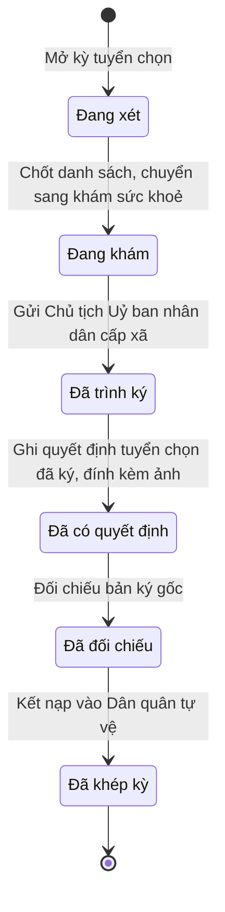

# qt-D2 · Tuyển chọn vào DQTV

<!-- máy sinh: tom-tat -->
> **Hồ sơ:** Kỳ tuyển chọn (`SelectionDrive`)
>
> **Trong sổ phạm vi:** D2 · Tuyển chọn vào DQTV (tầng 3)
>
> 11 bước · 6 chặng · 3 vai · 1 bảng quyết định · 0 hạn · 6 khớp nối.
>
> **Nguồn:** sổ nghiệp vụ `qt-D2` · khai báo của app: `dqtv-app/core/processes/selection-drive/workflow/selection-drive.yaml`. Các bảng do máy sinh từ nguồn này.
<!-- hết: tom-tat -->

<!-- viết tay: dien-giai -->
## Diễn giải

*Phần này viết tay, diễn giải lại điều các bảng bên dưới ghi.*

### Quy trình này để làm gì

Ban CHQS xã theo dõi một **kỳ tuyển chọn** vào dân quân tự vệ của một năm: đưa người trong sổ nghĩa vụ vào diện xét, khám sức khoẻ, ghi đơn vị cho từng người, trình Chủ tịch Uỷ ban nhân dân cấp xã ký quyết định, rồi kết nạp và khép kỳ.

Hồ sơ đi qua tám chặng: *Đang xét* → *Đang khám* → *Chờ ký tờ trình* → *Đã ký, chờ gửi Uỷ ban* → *Đã trình ký* → *Đã có quyết định* → *Đã đối chiếu* → *Đã khép kỳ*. Đường đi gần như thẳng, chỉ có một đường quay lại.

### Khi nào bắt đầu

Trợ lý Quân lực bấm **Mở kỳ tuyển chọn**. Phải nhập năm, ngày mở kỳ và `planTargetIds`; số văn bản hướng dẫn của Bộ CHQS tỉnh là ô nhập nếu có. Kỳ mở ra có nối tới **Chỉ tiêu** (quy trình 2) — chỉ tiêu số lượng dân quân trên giao — và vào chặng *Đang xét*.

### Diễn ra thế nào

**Chặng "Đang xét"** (Trợ lý Quân lực)

- **Đưa vào diện xét tuyển chọn** — phải nhập `registrationIds`; bước này nối kỳ với Sổ nghĩa vụ; lặp được.
- **Chốt danh sách, chuyển sang khám sức khoẻ** — hồ sơ sang *Đang khám*.

**Chặng "Đang khám"** (Trợ lý Quân lực)

- **Ghi kết quả khám của kỳ** — phải nhập kết quả khám từng người, ngày khám, giấy xác nhận sức khoẻ của y tế; lặp được.
- **Ghi đơn vị cho người trong kỳ** — phải nhập ai vào đơn vị nào; bước ghi ô nối từ dòng Sổ nghĩa vụ tới Đơn vị dân quân tự vệ; lặp được.
- **Trình ký tờ trình tuyển chọn** — phải đính tờ trình (PDF); bước tạo một hồ sơ con Văn bản đi và nối kỳ với Văn bản đi ấy (quy trình 1). Hồ sơ sang *Chờ ký tờ trình*.

**Chặng "Chờ ký tờ trình"** — Chỉ huy trưởng Ban CHQS xã bấm **Ký tờ trình** (hồ sơ sang *Đã ký, chờ gửi Uỷ ban*) hoặc **Trả lại tờ trình** (phải ghi cần sửa gì; hồ sơ về *Đang khám*).

**Chặng "Đã ký, chờ gửi Uỷ ban"** — Nhân viên văn thư bấm **Gửi Chủ tịch Uỷ ban nhân dân cấp xã**: phải đính tờ trình đã ký, đã ghi số; nơi nhận tờ trình là `commune_chairman`; bước ghi ngày trình ký; hồ sơ sang *Đã trình ký*. Ở chặng này Chỉ huy trưởng vẫn trả lại tờ trình được.

**Chặng "Đã trình ký"** — Trợ lý Quân lực bấm **Ghi quyết định tuyển chọn đã ký, đính kèm ảnh**: phải nhập `decisionNumber`, `subject`, `signedBy`, `signedDate`, `legalBasis`, `scanPath`; bước ghi `decisionNumber`, `decisionSignerTitle`, `signedDate`, `scanPath`. Đây là bước ghi một quyết định ký ngoài hệ, người ký `commune_chairman`. Hồ sơ sang *Đã có quyết định*.

**Chặng "Đã có quyết định"** — Chỉ huy trưởng bấm **Đối chiếu bản ký gốc**: phải nhập `decisionId` và ngày đối chiếu, phải có quyết định ký ngoài hệ và người thứ hai kiểm; hồ sơ sang *Đã đối chiếu*.

**Chặng "Đã đối chiếu"** — Chỉ huy trưởng bấm **Kết nạp vào Dân quân tự vệ**: phải nhập ai kết nạp, vào đơn vị nào và `decisionId`, phải có quyết định ký ngoài hệ; bước ghi ngày khép kỳ; hồ sơ sang *Đã khép kỳ*.

### Kết thúc và để lại gì

Hồ sơ kết thúc ở chặng *Đã khép kỳ*: đã kết nạp xong, chốt sổ của kỳ. Kỳ đã mở thì khép bằng bước kết nạp.

Kỳ tuyển chọn được gắn với **Sổ nghĩa vụ** (16) ở bước đưa vào diện xét và với **Văn bản đi** (1) ở bước trình ký. Dự trù, đề nghị cấp kinh phí (4.funding-request) có thể phát sinh từ kỳ tuyển chọn, cho việc khám sức khoẻ.

### Điều kiện chặn

- Mọi bước trừ bước mở: người làm phải thuộc đơn vị chủ hồ sơ. Sai người, sai chặng thì bước bị chặn, hồ sơ giữ nguyên.
- Đối chiếu và kết nạp đều phải có quyết định ký ngoài hệ `selectionAuthorizedBy`, người ký `commune_chairman`.
- Bảng `selection-admission.decider`, xét ở bước ghi quyết định, có 3 dòng: thiếu chức danh người ký thì chặn (`authority_unknown`); `decisionSignerTitle` là `commune_chairman` hoặc `agency_head` thì cho qua; còn lại chặn (`wrong_authority`).
- Quy trình này không có hạn.
<!-- hết viết tay -->

## 1. Đường đi ngắn nhất qua các chặng

<!-- máy sinh: luong-chinh -->
Đường ít bước nhất từ lúc mở hồ sơ tới chặng kết thúc xa nhất. Máy chọn theo số chặng, không theo ý nghĩa nghiệp vụ — trình tự công việc thật xem phần Diễn giải và bảng "Việc làm ở từng chặng" ở mục 6.

| # | Ai làm | Làm gì | Hồ sơ sang chặng |
|---|---|---|---|
| 1 | Trợ lý Quân lực | Mở kỳ tuyển chọn | Đang xét |
| 2 | Trợ lý Quân lực | Chốt danh sách, chuyển sang khám sức khoẻ | Đang khám |
| 3 | Nhân viên văn thư | Gửi Chủ tịch Uỷ ban nhân dân cấp xã | Đã trình ký |
| 4 | Trợ lý Quân lực | Ghi quyết định tuyển chọn đã ký, đính kèm ảnh | Đã có quyết định |
| 5 | Chỉ huy trưởng Ban CHQS xã | Đối chiếu bản ký gốc | Đã đối chiếu |
| 6 | Chỉ huy trưởng Ban CHQS xã | Kết nạp vào Dân quân tự vệ | Đã khép kỳ |

<!-- hết: luong-chinh -->

## 2. Hồ sơ và việc nó để lại

<!-- máy sinh: muc-tieu -->
**App gọi quy trình này là:** Kỳ tuyển chọn.

**Khi mở, hồ sơ này ghi mối nối tới:**
- Chỉ tiêu (2) — bước `openSelectionDrive`, khớp nối `selectionUnderTarget`
- Nhiệm vụ trên giao (1) — bước `openSelectionDrive`, khớp nối `selectionDriveServesTasking`

**Hồ sơ này để lại cho quy trình khác** (bước tạo hồ sơ của quy trình kia ghi mối nối về đây):
- Đề nghị cấp kinh phí (4.funding-request) — bước `estimateCommuneFundingRequest`, khớp nối `fundingRequestFromSelection`
- Đề nghị cấp kinh phí (4.funding-request) — bước `estimateProvinceFundingRequest`, khớp nối `fundingRequestFromSelection`
<!-- hết: muc-tieu -->

## 3. Khởi phát và kết thúc

<!-- máy sinh: khoi-phat -->
**1 cửa vào** — bước mở hồ sơ:

| Bước mở | Ai mở | Hồ sơ vào chặng | App bắt buộc nhập |
|---|---|---|---|
| Mở kỳ tuyển chọn | Trợ lý Quân lực | Đang xét | năm, ngày mở kỳ, `planTargetIds`, việc gốc |

**Kết thúc:** *Đã khép kỳ* (`CLOSED`)
<!-- hết: khoi-phat -->

## 4. Vai trò

<!-- máy sinh: vai-tro -->
| Vai trong sổ | Tên trong app | Điều kiện | Làm những bước |
|---|---|---|---|
| `operator` | Trợ lý Quân lực |  | Mở kỳ tuyển chọn · Đưa vào diện xét tuyển chọn · Chốt danh sách, chuyển sang khám sức khoẻ · Ghi kết quả khám của kỳ · Ghi đơn vị cho người trong kỳ · Trình ký tờ trình tuyển chọn · Ghi quyết định tuyển chọn đã ký, đính kèm ảnh · Đổi đơn vị dự kiến cho người vướng đơn vị giải thể |
| `clerk` | Nhân viên văn thư |  | Gửi Chủ tịch Uỷ ban nhân dân cấp xã |
| `verifier` | Chỉ huy trưởng Ban CHQS xã |  | Đối chiếu bản ký gốc · Kết nạp vào Dân quân tự vệ |

*"Tên trong app" là tên app đặt cho mã chủ thể của vai. Hồ sơ thuộc đơn vị cấp khác thì người làm là người giữ vai ấy ở đơn vị nêu trong cột "Điều kiện" (nếu sổ có ghi) và ở cột "Người làm phải thuộc" của bảng "Theo khai báo của app" (mục 7).*
<!-- hết: vai-tro -->

## 5. Nhánh phụ

<!-- máy sinh: nhanh-phu -->
**Làm trong lúc hồ sơ đứng yên ở một chặng** — ghi nhận, bổ sung:

| Bước | Ai làm | Ở chặng |
|---|---|---|
| Đưa vào diện xét tuyển chọn *(lặp được)* | Trợ lý Quân lực | Đang xét |
| Ghi kết quả khám của kỳ *(lặp được)* | Trợ lý Quân lực | Đang khám |
| Ghi đơn vị cho người trong kỳ *(lặp được)* | Trợ lý Quân lực | Đang khám |
| Trình ký tờ trình tuyển chọn | Trợ lý Quân lực | Đang khám |
| Đổi đơn vị dự kiến cho người vướng đơn vị giải thể *(lặp được)* | Trợ lý Quân lực | Đã đối chiếu |

<!-- hết: nhanh-phu -->

## 6. Các chặng và việc làm ở từng chặng

<!-- máy sinh: chang -->
| Chặng | Tên hiển thị | Vào bằng bước | Kết thúc? |
|---|---|---|---|
| `OPEN` | Đang xét | Mở kỳ tuyển chọn |  |
| `EXAMINING` | Đang khám | Chốt danh sách, chuyển sang khám sức khoẻ |  |
| `SUBMITTED` | Đã trình ký | Gửi Chủ tịch Uỷ ban nhân dân cấp xã |  |
| `DECIDED` | Đã có quyết định | Ghi quyết định tuyển chọn đã ký, đính kèm ảnh |  |
| `VERIFIED` | Đã đối chiếu | Đối chiếu bản ký gốc |  |
| `CLOSED` | Đã khép kỳ | Kết nạp vào Dân quân tự vệ | **kết thúc** |

### Việc làm ở từng chặng

Hồ sơ đang ở chặng nào thì làm được những bước nào.

| Hồ sơ đang ở chặng | Bước làm tại chặng (hồ sơ đứng yên) | Bước đưa hồ sơ sang chặng khác |
|---|---|---|
| **Đang xét** | Đưa vào diện xét tuyển chọn (lặp được) — Trợ lý Quân lực | Chốt danh sách, chuyển sang khám sức khoẻ — Trợ lý Quân lực → *Đang khám* |
| **Đang khám** | Ghi kết quả khám của kỳ (lặp được) — Trợ lý Quân lực Ghi đơn vị cho người trong kỳ (lặp được) — Trợ lý Quân lực Trình ký tờ trình tuyển chọn — Trợ lý Quân lực | Gửi Chủ tịch Uỷ ban nhân dân cấp xã — Nhân viên văn thư → *Đã trình ký* |
| **Đã trình ký** | — | Ghi quyết định tuyển chọn đã ký, đính kèm ảnh — Trợ lý Quân lực → *Đã có quyết định* |
| **Đã có quyết định** | — | Đối chiếu bản ký gốc — Chỉ huy trưởng Ban CHQS xã → *Đã đối chiếu* |
| **Đã đối chiếu** | Đổi đơn vị dự kiến cho người vướng đơn vị giải thể (lặp được) — Trợ lý Quân lực | Kết nạp vào Dân quân tự vệ — Chỉ huy trưởng Ban CHQS xã → *Đã khép kỳ* |
| **Đã khép kỳ** | — | — (kết thúc) |
<!-- hết: chang -->

## 7. Bảng bước

<!-- máy sinh: buoc -->
| # | Bước | Mã bước | Ai thực hiện | Từ chặng | Sang chặng | Phải có trước | Ghi lại |
|---|---|---|---|---|---|---|---|
| 1 | Mở kỳ tuyển chọn | `openSelectionDrive` | Trợ lý Quân lực | — (mở hồ sơ) | `OPEN` | `taskingAssigned`, `yearCurrentOrNext` | mã tỉnh, mã xã, `planTargetId`, kỳ tuyển chọn, năm, ngày mở kỳ, số văn bản hướng dẫn của Bộ CHQS tỉnh, ghi chú, nối tới Chỉ tiêu, nối tới Nhiệm vụ trên giao, đơn vị chủ hồ sơ, `id` |
| 2 | Đưa vào diện xét tuyển chọn | `addCandidates` | Trợ lý Quân lực | `OPEN` | giữ nguyên | người làm thuộc đơn vị chủ hồ sơ, `candidatesNotArrangedReserve` | nối tới Sổ nghĩa vụ |
| 3 | Chốt danh sách, chuyển sang khám sức khoẻ | `startExamining` | Trợ lý Quân lực | `OPEN` | `EXAMINING` | người làm thuộc đơn vị chủ hồ sơ | — |
| 4 | Ghi kết quả khám của kỳ | `recordDriveMedical` | Trợ lý Quân lực | `EXAMINING` | giữ nguyên | người làm thuộc đơn vị chủ hồ sơ | — |
| 5 | Ghi đơn vị cho người trong kỳ | `assignCandidateUnits` | Trợ lý Quân lực | `EXAMINING` | giữ nguyên | người làm thuộc đơn vị chủ hồ sơ | nối `candidateProposedUnit` |
| 6 | Trình ký tờ trình tuyển chọn | `requestDriveListSignature` | Trợ lý Quân lực | `EXAMINING` | giữ nguyên | người làm thuộc đơn vị chủ hồ sơ, `noSelectionDriveSubmittedDocumentOpen`, `driveHasReadyCandidate` | nối tới Văn bản đi |
| 7 | Gửi Chủ tịch Uỷ ban nhân dân cấp xã | `submitDriveList` | Nhân viên văn thư | `EXAMINING` | `SUBMITTED` | người làm thuộc đơn vị chủ hồ sơ, `selectionDriveSubmittedDocumentIssued` | ngày trình ký |
| 8 | Ghi quyết định tuyển chọn đã ký, đính kèm ảnh | `recordDriveDecision2` | Trợ lý Quân lực | `SUBMITTED` | `DECIDED` | người làm thuộc đơn vị chủ hồ sơ, `recordDriveDecision2FromIncomingDocumentUsable` | nối tới Văn bản đến, người ký quyết định |
| 9 | Đối chiếu bản ký gốc | `verifyDriveDecision` | Chỉ huy trưởng Ban CHQS xã | `DECIDED` | `VERIFIED` | người làm thuộc đơn vị chủ hồ sơ | ngày đối chiếu bản ký gốc |
| 10 | Đổi đơn vị dự kiến cho người vướng đơn vị giải thể | `reassignStrandedCandidateUnit` | Trợ lý Quân lực | `VERIFIED` | giữ nguyên | người làm thuộc đơn vị chủ hồ sơ, `candidateProposedUnitStranded` | nối `candidateProposedUnit` |
| 11 | Kết nạp vào Dân quân tự vệ | `admitDriveBatch` | Chỉ huy trưởng Ban CHQS xã | `VERIFIED` | `CLOSED` | người làm thuộc đơn vị chủ hồ sơ | ngày khép kỳ |

### Khi không đạt điều kiện

Mặc định: không đúng người, hồ sơ không ở đúng chặng, hoặc thiếu thứ "phải có trước" thì bước bị chặn, hồ sơ giữ nguyên. Bảng dưới chỉ kê những bước có kết quả riêng.

| # | Bước | Kết quả riêng |
|---|---|---|
| 8 | Ghi quyết định tuyển chọn đã ký, đính kèm ảnh | bước dừng lại, hồ sơ giữ nguyên khi kết quả xét là: `authority_unknown`, `wrong_authority` |

### Điều kiện "phải có trước" bằng lời

Cột "Phải có trước" ở bảng bước có hai loại: ô dữ liệu thường (bước chỉ đòi ô ấy đã có giá trị) và điều kiện hệ tự xét. Bảng này diễn các điều kiện hệ tự xét theo đúng công thức sổ ghi; số ở cột cuối là số thứ tự bước.

| Điều kiện | Đúng khi | Bước đòi |
|---|---|---|
| `taskingAssigned` | đã có nối tới Chỉ tiêu HOẶC có hồ sơ Việc luật giao kèm văn bản đến, đi (qt-1) chính là hồ sơ ghi ở ô nối `selectionDriveServesTasking` của hồ sơ đang làm mà hồ sơ ấy đang ở chặng `ASSIGNED` hoặc `BROKEN_DOWN` | 1 |
| `actorInOwnerUnit` | người đang làm là người của đơn vị ghi ở ô đơn vị chủ hồ sơ của hồ sơ này (theo danh mục người của đơn vị, `dm.unit-staff`) | 2, 3, 4, 5, 6, 7, 8, 9, 10, 11 |
| `candidatesNotArrangedReserve` | mọi hồ sơ Sổ đăng ký người theo diện (qt-16) chính là hồ sơ ghi ở ô nối `candidateInDrive` của hồ sơ đang làm đều thoả: KHÔNG (đã có `reserveArranged`) | 2 |
| `noSelectionDriveSubmittedDocumentOpen` | KHÔNG (có hồ sơ Việc luật giao kèm văn bản đến, đi — Văn bản đi (qt-1.outgoing-document) chính là hồ sơ ghi ở ô nối `selectionDriveSubmittedByDocument` của hồ sơ đang làm mà hồ sơ ấy đang ở chặng `DRAFT` hoặc `PENDING_SIGNATURE` hoặc `SIGNED`) | 6 |
| `selectionDriveSubmittedDocumentIssued` | có hồ sơ Việc luật giao kèm văn bản đến, đi — Văn bản đi (qt-1.outgoing-document) chính là hồ sơ ghi ở ô nối `selectionDriveSubmittedByDocument` của hồ sơ đang làm mà hồ sơ ấy đang ở chặng `ISSUED` | 7 |
| `recordDriveDecision2FromIncomingDocumentUsable` | có hồ sơ Việc luật giao kèm văn bản đến, đi — Văn bản đến (qt-1.incoming-document) chính là hồ sơ ghi ở ô nối `recordDriveDecision2FromIncomingDocument` của hồ sơ đang làm mà hồ sơ ấy đang ở chặng `RECEIVED` hoặc `DISTRIBUTED` | 8 |
| `candidateProposedUnitStranded` | không có hồ sơ `dm.militia-unit` chính là hồ sơ ghi ở ô nối `candidateProposedUnit` của hồ sơ đang làm mà `unitStatus` là `ESTABLISHED` HOẶC có hồ sơ Giải thể tổ chức (qt-31) có ô nối `dissolutionOfUnit` trùng với ô nối `candidateProposedUnit` của hồ sơ đang làm mà hồ sơ ấy đang ở chặng `SUBMITTED` hoặc `ACCEPTED` | 10 |

### Theo khai báo của app

Người làm phải thuộc đơn vị nào, ô người dùng phải nhập, bước có lặp được không, và căn cứ pháp lý — lấy từ khai báo quy trình trong app.

| # | Bước | Người làm phải thuộc | Bắt buộc nhập | Nhập nếu có | Lặp được | Căn cứ |
|---|---|---|---|---|---|---|
| 1 | Mở kỳ tuyển chọn |  | năm, ngày mở kỳ, `planTargetIds`, việc gốc | số văn bản hướng dẫn của Bộ CHQS tỉnh |  | L48/2019/QH14 Đ.10 k2 b · NQ66.12/2026 Đ.4 |
| 2 | Đưa vào diện xét tuyển chọn | đơn vị chủ hồ sơ | `registrationIds` | — | có | L48/2019/QH14 Đ.10 k1 |
| 3 | Chốt danh sách, chuyển sang khám sức khoẻ | đơn vị chủ hồ sơ | — | — |  | TT77/2020/TT-BQP Đ.3 k2 🔒 · L48/2019/QH14 Đ.10 k1 c |
| 4 | Ghi kết quả khám của kỳ | đơn vị chủ hồ sơ | kết quả khám từng người — đã khớp với danh sách của kỳ, ngày khám, giấy xác nhận sức khoẻ của y tế | — | có | TT77/2020/TT-BQP Đ.3 k2 🔒 |
| 5 | Ghi đơn vị cho người trong kỳ | đơn vị chủ hồ sơ | ai vào đơn vị nào | — | có | L48/2019/QH14 Đ.10 k4 · TT77/2020/TT-BQP Phụ lục (sổ quản lý Dân quân tự vệ) |
| 6 | Trình ký tờ trình tuyển chọn | đơn vị chủ hồ sơ | tờ trình (PDF) | — |  | L48/2019/QH14 Đ.10 k4; NĐ30/2020/NĐ-CP Đ.10, Đ.13 |
| 7 | Gửi Chủ tịch Uỷ ban nhân dân cấp xã | đơn vị chủ hồ sơ | — | — |  | L48/2019/QH14 Đ.10 k4; NĐ30/2020/NĐ-CP Đ.18, Đ.19 |
| 8 | Ghi quyết định tuyển chọn đã ký, đính kèm ảnh | đơn vị chủ hồ sơ | văn bản đến là quyết định tuyển chọn của Chủ tịch UBND xã, người ký quyết định | ngày ký (để trống thì lấy ngày ghi trên văn bản đến) |  | 50_MAU_KY_NGOAI_HE_THONG.md §D · L48/2019/QH14 Đ.10 k4 |
| 9 | Đối chiếu bản ký gốc | đơn vị chủ hồ sơ | `decisionId`, ngày đối chiếu | — |  | 50_MAU_KY_NGOAI_HE_THONG.md §C biện pháp 2 · §D |
| 10 | Đổi đơn vị dự kiến cho người vướng đơn vị giải thể | đơn vị chủ hồ sơ | ai đổi sang đơn vị nào | — | có | L48/2019/QH14 Đ.10 k4 (sửa bởi L98/2025) · TT77/2020/TT-BQP Phụ lục (sổ quản lý Dân quân tự vệ) |
| 11 | Kết nạp vào Dân quân tự vệ | đơn vị chủ hồ sơ | ai kết nạp, vào đơn vị nào, `decisionId` | — |  | L48/2019/QH14 Đ.10 k2 b, k4 |

### Điều kiện và ghi chú app khai cho từng bước

Lấy từ khai báo quy trình trong app. Lời trong ngoặc kép là câu app hiện cho người dùng. Chức danh người ký ngoài hệ app chỉ khai bằng mã.

| # | Bước | Điều kiện, ghi chú |
|---|---|---|
| 6 | Trình ký tờ trình tuyển chọn | · tạo thêm một hồ sơ con: Văn bản đi (`OutgoingDocument`) |
| 7 | Gửi Chủ tịch Uỷ ban nhân dân cấp xã | · app khai nơi nhận: `commune_chairman` |
| 8 | Ghi quyết định tuyển chọn đã ký, đính kèm ảnh | · bước này ghi một quyết định ký NGOÀI hệ (`selectionAuthorizedBy`), người ký: `commune_chairman`, `organization_head` · không đòi bản chụp — app ghi: "bản số hoá lấy từ văn bản đến văn thư đã vào sổ (tầng đọc chép `scanPath` của văn bản ấy), không tải ảnh ở bước này" |
| 9 | Đối chiếu bản ký gốc | · phải có quyết định ký ngoài hệ `selectionAuthorizedBy`, người ký: `commune_chairman`, `organization_head`; phải có người thứ hai kiểm |
| 11 | Kết nạp vào Dân quân tự vệ | · phải có quyết định ký ngoài hệ `selectionAuthorizedBy`, người ký: `commune_chairman` |
<!-- hết: buoc -->

## 8. Bảng quyết định, hạn, việc ngoài hệ

<!-- máy sinh: quyet-dinh -->
**Bảng `selection-admission.decider`** — xét ở bước *Ghi quyết định tuyển chọn đã ký, đính kèm ảnh*; đầu vào: người ký quyết định. 3 dòng, dò từ trên xuống, dòng đầu tiên khớp thì dừng.

| Thứ tự dò (số sổ ghi) | Dòng | Khi | Thì |
|---|---|---|---|
| 1 | `signer-unset` | chưa có người ký quyết định | `authority_unknown` |
| 2 | `chairman-or-agency-head` | người ký quyết định là Chủ tịch UBND xã (`commune_chairman`) hoặc Người đứng đầu cơ quan, tổ chức (`agency_head`) | cho qua |
| 3 | `otherwise` | mọi trường hợp còn lại | `wrong_authority` |

<!-- hết: quyet-dinh -->

## 9. Dữ liệu của hồ sơ

<!-- máy sinh: du-lieu -->
Các ô mà bước trong sổ ghi hoặc đòi. Số trong hai cột cuối là số thứ tự bước ở bảng bước (mục 7).

| Ô dữ liệu | Mã | Kiểu (app) | Giá trị cho phép | Loại ô (sổ) | Bước ghi | Bước đòi | Mô tả trong app |
|---|---|---|---|---|---|---|---|
| mã tỉnh | `provinceCode` | chữ |  | lưu trên hồ sơ (`stored`) | 1 | — | Mã tỉnh — dùng lọc phạm vi theo hàng |
| mã xã | `communeCode` | chữ |  | lưu trên hồ sơ (`stored`) | 1 | — | Mã xã |
| — | `planTargetId` | chữ |  | đưa vào ở bước (`input`) | 1 | — | id chỉ tiêu trên giao mà kỳ này thực hiện — quan hệ thật ở cạnh selectionUnderTarget |
| kỳ tuyển chọn | `driveName` | chữ |  | lưu trên hồ sơ (`stored`) | 1 | — | Tên kỳ — đọc được, vd Kỳ tuyển chọn năm 2027 |
| năm | `year` | số |  | đưa vào ở bước (`input`) | 1 | — | Năm của kỳ — Luật Đ.10 k2 b: hằng năm |
| ngày mở kỳ | `openedAt` | ngày |  | đưa vào ở bước (`input`) | 1 | — | Ngày mở kỳ |
| số văn bản hướng dẫn của Bộ CHQS tỉnh | `guidanceRef` | chữ |  | đưa vào ở bước (`input`) | 1 | — | Số, ngày văn bản hướng dẫn tuyển chọn của Bộ CHQS cấp tỉnh — Luật Đ.10 k2 b |
| ghi chú | `note` | chữ |  | đưa vào ở bước (`input`) | 1 | — | Ghi chú |
| đơn vị chủ hồ sơ | `ownerUnit` |  |  | lưu trên hồ sơ (`stored`) | 1 | — |  |
| — | `id` |  |  | lưu trên hồ sơ (`stored`) | 1 | — |  |
| ngày trình ký | `submittedAt` | ngày |  | lưu trên hồ sơ (`stored`) | 7 | — | Ngày trình Chủ tịch Uỷ ban nhân dân cấp xã ký quyết định tuyển chọn — Luật Đ.10 k4 |
| người ký quyết định | `decisionSignerTitle` | chọn một | Chủ tịch UBND xã (`commune_chairman`), Người đứng đầu cơ quan, tổ chức (`agency_head`), Người khác (`other`) | đưa vào ở bước (`input`) | 8 | — | Chức danh người ký quyết định công nhận vào DQTV — ký ngoài hệ, trợ lý chọn; chỉ Chủ tịch UBND xã (dân quân) hoặc người đứng đầu cơ quan, tổ chức (tự vệ) — sổ qt-D2, L48/2019/QH14 Đ.10 k4 (người dùng… |
| ngày đối chiếu bản ký gốc | `decisionCheckedAt` | ngày |  | đưa vào ở bước (`input`) | 9 | — | Ngày Chỉ huy trưởng đối chiếu bản ký gốc của quyết định tuyển chọn — bốn mắt của ký ngoài |
| ngày khép kỳ | `closedAt` | ngày |  | lưu trên hồ sơ (`stored`) | 11 | — | Ngày khép kỳ |
| — | `taskingAssigned` |  | có hay chưa | hệ suy ra (`derived`) | — | 1 |  |
| — | `yearCurrentOrNext` |  | có hay chưa | đưa vào ở bước (`input`) | — | 1 |  |
| người làm thuộc đơn vị chủ hồ sơ | `actorInOwnerUnit` |  | có hay chưa | hệ suy ra (`derived`) | — | 2, 3, 4, 5, 6, 7, 8, 9, 10, 11 |  |
| — | `candidatesNotArrangedReserve` |  | có hay chưa | hệ suy ra (`derived`) | — | 2 |  |
| — | `noSelectionDriveSubmittedDocumentOpen` |  | có hay chưa | hệ suy ra (`derived`) | — | 6 |  |
| — | `driveHasReadyCandidate` |  | có hay chưa | đưa vào ở bước (`input`) | — | 6 |  |
| — | `selectionDriveSubmittedDocumentIssued` |  | có hay chưa | hệ suy ra (`derived`) | — | 7 |  |
| — | `recordDriveDecision2FromIncomingDocumentUsable` |  | có hay chưa | hệ suy ra (`derived`) | — | 8 |  |
| — | `candidateProposedUnitStranded` |  | có hay chưa | hệ suy ra (`derived`) | — | 10 |  |

23 ô. Cột "Loại ô" là cách sổ phân loại ô, in kèm đúng chữ của sổ; ô nào người dùng phải nhập xem bảng "Theo khai báo của app" ở mục 7.
<!-- hết: du-lieu -->

## 10. Khớp nối với quy trình khác

<!-- máy sinh: khop-noi -->
| Quy trình kia | Hồ sơ kia | Quan hệ | Nội dung (mô tả trong app) | Bước ghi mối nối | Tên ô nối |
|---|---|---|---|---|---|
| 1 | Nhiệm vụ trên giao | hồ sơ này **mở ra có nối tới** hồ sơ kia | Việc gốc mà kỳ tuyển chọn này thực hiện — lấy theo dòng chỉ tiêu của kỳ; tờ trình của kỳ kế thừa việc này (ch… | D2·openSelectionDrive ⊕ | `selectionDriveServesTasking` |
| 1.incoming-document | Văn bản đến | gắn với nhau ở một bước giữa chừng | Văn bản đến là quyết định công nhận công dân vào DQTV của Chủ tịch UBND xã — sổ qt-D2 (L48/2019/QH14 Đ.10 k4) | D2·recordDriveDecision2 | `recordDriveDecision2FromIncomingDocument` |
| 1.outgoing-document | Văn bản đi | gắn với nhau ở một bước giữa chừng | Tờ trình Chủ tịch Uỷ ban nhân dân cấp xã ký quyết định tuyển chọn — danh sách người khám đạt, đã có đơn vị (L… | D2·requestDriveListSignature | `selectionDriveSubmittedByDocument` |
| 16 | Sổ nghĩa vụ | gắn với nhau ở một bước giữa chừng | Dòng sổ nghĩa vụ được xét trong những kỳ tuyển chọn nào | D2·addCandidates | `candidateInDrive` |
| 2 | Chỉ tiêu | hồ sơ này **mở ra có nối tới** hồ sơ kia | Kỳ tuyển chọn thực hiện chỉ tiêu số lượng dân quân trên giao — NQ66.12 Đ.4, Luật Đ.10 k2 b | D2·openSelectionDrive ⊕ | `selectionUnderTarget` |
| 4.funding-request | Đề nghị cấp kinh phí | hồ sơ kia **mở ra từ** hồ sơ này | Dự trù/đề nghị kinh phí phát sinh từ kỳ tuyển chọn nào (khám sức khoẻ) — doc 112 §8.2 A4, L48 Đ.38 k2 | 4.funding-request·estimateCommuneFundingRequest ⊕, 4.funding-request·estimateProvinceFundingRequest ⊕ | `fundingRequestFromSelection` |

6 khớp nối. ⊕ là bước tạo hồ sơ.

**Ô nối giữa các hồ sơ cùng mã quy trình, hoặc tới danh mục nền:** `candidateProposedUnit` (Sổ nghĩa vụ → Đơn vị dân quân tự vệ) — bước Đổi đơn vị dự kiến cho người vướng đơn vị giải thể.
<!-- hết: khop-noi -->

## 11. Thông tin chung

<!-- máy sinh: thong-tin -->
| | |
|---|---|
| **Mã trong sổ** | `qt-D2` |
| **Quy trình trong app** | `selection-drive` (`workflow/selection-drive.yaml`) — mặt công tác: `personnel` |
| **Hồ sơ** | Kỳ tuyển chọn (`SelectionDrive`) |
| **Căn cứ pháp lý từng bước** | cột "Căn cứ" ở bảng "Theo khai báo của app", mục 7 |
<!-- hết: thong-tin -->
