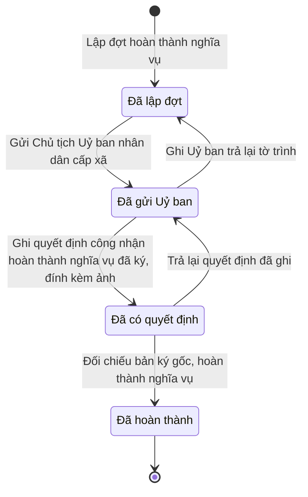

# qt-D3 · Công nhận hoàn thành nghĩa vụ theo lô

<!-- máy sinh: tom-tat -->
> **Hồ sơ:** Đợt hoàn thành nghĩa vụ (`ServiceCompletionBatch`)
>
> **Trong sổ phạm vi:** D3 · Công nhận hoàn thành nghĩa vụ theo lô (tầng 3)
>
> 7 bước · 4 chặng · 3 vai · 1 bảng quyết định · 0 hạn · 4 khớp nối.
>
> **Nguồn:** sổ nghiệp vụ `qt-D3` · khai báo của app: `dqtv-app/core/processes/service-completion/workflow/service-completion-batch.yaml`. Các bảng do máy sinh từ nguồn này.
<!-- hết: tom-tat -->

<!-- viết tay: dien-giai -->
## Diễn giải

*Phần này viết tay, diễn giải lại điều các bảng bên dưới ghi.*

### Quy trình này để làm gì

Ban CHQS xã lập một **đợt hoàn thành nghĩa vụ** cho nhiều chiến sĩ cùng lúc: gom danh sách, làm tờ trình, Chỉ huy trưởng ký, gửi Chủ tịch Uỷ ban nhân dân cấp xã, ghi quyết định công nhận đã ký, rồi đối chiếu và hoàn thành cho cả đợt.

Hồ sơ đi qua sáu chặng: *Đã lập đợt* → *Chờ ký tờ trình* → *Đã ký, chờ gửi Uỷ ban* → *Đã gửi Uỷ ban* → *Đã có quyết định* → *Đã hoàn thành*. Có ba đường quay lại để sửa.

### Khi nào bắt đầu

Trợ lý Quân lực bấm **Lập đợt hoàn thành nghĩa vụ**. Phải nhập các đồng chí trong đợt, tên đợt, năm. Đợt mở ra có nối tới hồ sơ **Chiến sĩ dân quân tự vệ** của từng người (quy trình 16.enlistment) và vào chặng *Đã lập đợt*.

Bước này có thể bị chặn với kết quả `term_not_served`: chỉ người đã phục vụ đủ thời hạn mới nằm trong danh sách của đợt.

### Diễn ra thế nào

**Chặng "Đã lập đợt"** — Trợ lý Quân lực bấm **Trình ký tờ trình hoàn thành nghĩa vụ**: phải đính tờ trình (PDF); bước tạo một hồ sơ con Văn bản đi và ghi mối nối tới tờ trình ấy. Hồ sơ sang *Chờ ký tờ trình*.

**Chặng "Chờ ký tờ trình"** — Chỉ huy trưởng Ban CHQS xã bấm **Ký tờ trình** (hồ sơ sang *Đã ký, chờ gửi Uỷ ban*) hoặc **Trả lại tờ trình** (phải ghi cần sửa gì; hồ sơ về *Đã lập đợt*).

**Chặng "Đã ký, chờ gửi Uỷ ban"** — Nhân viên văn thư bấm **Gửi Chủ tịch Uỷ ban nhân dân cấp xã**: phải đính tờ trình đã ký, đã ghi số; nơi nhận là `commune_chairman`; bước ghi ngày gửi Uỷ ban; hồ sơ sang *Đã gửi Uỷ ban*. Ở chặng này Chỉ huy trưởng vẫn trả lại tờ trình được.

**Chặng "Đã gửi Uỷ ban"** — Trợ lý Quân lực làm một trong hai việc:

- **Ghi Uỷ ban trả lại tờ trình** — phải ghi uỷ ban trả lại vì sao; bước xoá ngày gửi Uỷ ban; hồ sơ về *Đã lập đợt* để Ban CHQS sửa rồi trình lại.
- **Ghi quyết định công nhận hoàn thành nghĩa vụ đã ký, đính kèm ảnh** — phải nhập số quyết định, trích yếu, người ký, ngày ký, căn cứ, bản chụp (`decisionNumber`, `subject`, `signedBy`, `signedDate`, `legalBasis`, `scanPath`); đây là một quyết định ký ngoài hệ, người ký `commune_chairman`; hồ sơ sang *Đã có quyết định*.

**Chặng "Đã có quyết định"** — Chỉ huy trưởng làm một trong hai việc:

- **Trả lại quyết định đã ghi** — phải nhập `decisionId` và ghi sai chỗ nào; bước xoá bốn ô quyết định đã ghi; hồ sơ về *Đã gửi Uỷ ban*.
- `completeService` — đối chiếu bản ký gốc và hoàn thành nghĩa vụ cho cả đợt; bước ghi ngày đối chiếu bản ký gốc; hồ sơ sang *Đã hoàn thành*.

### Kết thúc và để lại gì

Hồ sơ kết thúc ở chặng *Đã hoàn thành*: các đồng chí đã hoàn thành nghĩa vụ, rời đơn vị.

Đợt nối tới các chiến sĩ trong đợt (16.enlistment), ghi lúc lập đợt. Tờ trình Chủ tịch Uỷ ban nhân dân cấp xã công nhận hoàn thành nghĩa vụ là một văn bản đi (quy trình 1); trình lại là tờ thứ hai. Không hồ sơ nào của quy trình khác mở ra từ đợt này.

### Điều kiện chặn

- Mọi bước trừ bước lập đợt đòi người làm thuộc đơn vị chủ hồ sơ. Sai người, sai chặng thì bước bị chặn, hồ sơ giữ nguyên.
- Bảng `service-completion.decider`, xét ở bước ghi quyết định, hai dòng: `decisionSignerTitle` là `commune_chairman` thì cho qua; mọi trường hợp còn lại chặn (`wrong_authority`).
- Bước lập đợt chặn với kết quả `term_not_served` khi có người trong danh sách không đủ thời hạn phục vụ.
- Quy trình này không có hạn.
<!-- hết viết tay -->

## 1. Đường đi ngắn nhất qua các chặng

<!-- máy sinh: luong-chinh -->
Đường ít bước nhất từ lúc mở hồ sơ tới chặng kết thúc xa nhất. Máy chọn theo số chặng, không theo ý nghĩa nghiệp vụ — trình tự công việc thật xem phần Diễn giải và bảng "Việc làm ở từng chặng" ở mục 6.

| # | Ai làm | Làm gì | Hồ sơ sang chặng |
|---|---|---|---|
| 1 | Trợ lý Quân lực | Lập đợt hoàn thành nghĩa vụ | Đã lập đợt |
| 2 | Nhân viên văn thư | Gửi Chủ tịch Uỷ ban nhân dân cấp xã | Đã gửi Uỷ ban |
| 3 | Trợ lý Quân lực | Ghi quyết định công nhận hoàn thành nghĩa vụ đã ký, đính kèm ảnh | Đã có quyết định |
| 4 | Chỉ huy trưởng Ban CHQS xã | Đối chiếu bản ký gốc, hoàn thành nghĩa vụ | Đã hoàn thành |

<!-- hết: luong-chinh -->

## 2. Hồ sơ và việc nó để lại

<!-- máy sinh: muc-tieu -->
**App gọi quy trình này là:** Đợt hoàn thành nghĩa vụ.

**Khi mở, hồ sơ này ghi mối nối tới:**
- Chiến sĩ dân quân tự vệ (16.enlistment) — bước `gatherServiceCompletionBatch`, khớp nối `serviceCompletionCoversMember`
- Nhiệm vụ trên giao (1) — bước `gatherServiceCompletionBatch`, khớp nối `serviceCompletionBatchServesTasking`
<!-- hết: muc-tieu -->

## 3. Khởi phát và kết thúc

<!-- máy sinh: khoi-phat -->
**1 cửa vào** — bước mở hồ sơ:

| Bước mở | Ai mở | Hồ sơ vào chặng | App bắt buộc nhập |
|---|---|---|---|
| Lập đợt hoàn thành nghĩa vụ | Trợ lý Quân lực | Đã lập đợt | các đồng chí trong đợt, đợt, năm, việc gốc |

**Kết thúc:** *Đã hoàn thành* (`COMPLETED`)
<!-- hết: khoi-phat -->

## 4. Vai trò

<!-- máy sinh: vai-tro -->
| Vai trong sổ | Tên trong app | Điều kiện | Làm những bước |
|---|---|---|---|
| `operator` | Trợ lý Quân lực |  | Lập đợt hoàn thành nghĩa vụ · Trình ký tờ trình hoàn thành nghĩa vụ · Ghi Uỷ ban trả lại tờ trình · Ghi quyết định công nhận hoàn thành nghĩa vụ đã ký, đính kèm ảnh |
| `clerk` | Nhân viên văn thư |  | Gửi Chủ tịch Uỷ ban nhân dân cấp xã |
| `verifier` | Chỉ huy trưởng Ban CHQS xã |  | Trả lại quyết định đã ghi · Đối chiếu bản ký gốc, hoàn thành nghĩa vụ |

*"Tên trong app" là tên app đặt cho mã chủ thể của vai. Hồ sơ thuộc đơn vị cấp khác thì người làm là người giữ vai ấy ở đơn vị nêu trong cột "Điều kiện" (nếu sổ có ghi) và ở cột "Người làm phải thuộc" của bảng "Theo khai báo của app" (mục 7).*
<!-- hết: vai-tro -->

## 5. Nhánh phụ

<!-- máy sinh: nhanh-phu -->
**Quay lại một chặng hồ sơ đã đi qua** (tính theo đường ngắn nhất từ lúc mở):

| Bước | Ai làm | Từ chặng | Về chặng |
|---|---|---|---|
| Ghi Uỷ ban trả lại tờ trình | Trợ lý Quân lực | Đã gửi Uỷ ban | Đã lập đợt |
| Trả lại quyết định đã ghi | Chỉ huy trưởng Ban CHQS xã | Đã có quyết định | Đã gửi Uỷ ban |

**Làm trong lúc hồ sơ đứng yên ở một chặng** — ghi nhận, bổ sung:

| Bước | Ai làm | Ở chặng |
|---|---|---|
| Trình ký tờ trình hoàn thành nghĩa vụ | Trợ lý Quân lực | Đã lập đợt |

<!-- hết: nhanh-phu -->

## 6. Các chặng và việc làm ở từng chặng

<!-- máy sinh: chang -->
| Chặng | Tên hiển thị | Vào bằng bước | Kết thúc? |
|---|---|---|---|
| `GATHERED` | Đã lập đợt | Lập đợt hoàn thành nghĩa vụ · Ghi Uỷ ban trả lại tờ trình |  |
| `SUBMITTED` | Đã gửi Uỷ ban | Gửi Chủ tịch Uỷ ban nhân dân cấp xã · Trả lại quyết định đã ghi |  |
| `DECIDED` | Đã có quyết định | Ghi quyết định công nhận hoàn thành nghĩa vụ đã ký, đính kèm ảnh |  |
| `COMPLETED` | Đã hoàn thành | Đối chiếu bản ký gốc, hoàn thành nghĩa vụ | **kết thúc** |

### Việc làm ở từng chặng

Hồ sơ đang ở chặng nào thì làm được những bước nào.

| Hồ sơ đang ở chặng | Bước làm tại chặng (hồ sơ đứng yên) | Bước đưa hồ sơ sang chặng khác |
|---|---|---|
| **Đã lập đợt** | Trình ký tờ trình hoàn thành nghĩa vụ — Trợ lý Quân lực | Gửi Chủ tịch Uỷ ban nhân dân cấp xã — Nhân viên văn thư → *Đã gửi Uỷ ban* |
| **Đã gửi Uỷ ban** | — | Ghi Uỷ ban trả lại tờ trình — Trợ lý Quân lực → *Đã lập đợt* Ghi quyết định công nhận hoàn thành nghĩa vụ đã ký, đính kèm ảnh — Trợ lý Quân lực → *Đã có quyết định* |
| **Đã có quyết định** | — | Trả lại quyết định đã ghi — Chỉ huy trưởng Ban CHQS xã → *Đã gửi Uỷ ban* Đối chiếu bản ký gốc, hoàn thành nghĩa vụ — Chỉ huy trưởng Ban CHQS xã → *Đã hoàn thành* |
| **Đã hoàn thành** | — | — (kết thúc) |
<!-- hết: chang -->

## 7. Bảng bước

<!-- máy sinh: buoc -->
| # | Bước | Mã bước | Ai thực hiện | Từ chặng | Sang chặng | Phải có trước | Ghi lại |
|---|---|---|---|---|---|---|---|
| 1 | Lập đợt hoàn thành nghĩa vụ | `gatherServiceCompletionBatch` | Trợ lý Quân lực | — (mở hồ sơ) | `GATHERED` | `taskingAssigned` | đơn vị chủ hồ sơ, nối tới Chiến sĩ dân quân tự vệ, nối tới Nhiệm vụ trên giao |
| 2 | Trình ký tờ trình hoàn thành nghĩa vụ | `requestServiceCompletionSignature` | Trợ lý Quân lực | `GATHERED` | giữ nguyên | người làm thuộc đơn vị chủ hồ sơ, `noServiceCompletionBatchSubmittedDocumentOpen` | nối tới Văn bản đi |
| 3 | Gửi Chủ tịch Uỷ ban nhân dân cấp xã | `submitServiceCompletionBatch` | Nhân viên văn thư | `GATHERED` | `SUBMITTED` | người làm thuộc đơn vị chủ hồ sơ, `serviceCompletionBatchSubmittedDocumentIssued` | ngày gửi Uỷ ban |
| 4 | Ghi Uỷ ban trả lại tờ trình | `recordServiceCompletionReturn` | Trợ lý Quân lực | `SUBMITTED` | `GATHERED` | người làm thuộc đơn vị chủ hồ sơ | uỷ ban trả lại vì sao; **xoá:** ngày gửi Uỷ ban |
| 5 | Ghi quyết định công nhận hoàn thành nghĩa vụ đã ký, đính kèm ảnh | `recordServiceCompletionDecision` | Trợ lý Quân lực | `SUBMITTED` | `DECIDED` | người làm thuộc đơn vị chủ hồ sơ, `recordServiceCompletionDecisionFromIncomingDocumentUsable` | ngày ký (để trống thì lấy ngày ghi trên văn bản đến), `scanPath`, nối tới Văn bản đến, người ký quyết định |
| 6 | Trả lại quyết định đã ghi | `returnServiceCompletionDecision` | Chỉ huy trưởng Ban CHQS xã | `DECIDED` | `SUBMITTED` | người làm thuộc đơn vị chủ hồ sơ | —; **xoá:** `decisionNumber`, người ký quyết định, ngày ký (để trống thì lấy ngày ghi trên văn bản đến), `scanPath` |
| 7 | Đối chiếu bản ký gốc, hoàn thành nghĩa vụ | `completeService` | Chỉ huy trưởng Ban CHQS xã | `DECIDED` | `COMPLETED` | người làm thuộc đơn vị chủ hồ sơ | ngày đối chiếu bản ký gốc |

### Khi không đạt điều kiện

Mặc định: không đúng người, hồ sơ không ở đúng chặng, hoặc thiếu thứ "phải có trước" thì bước bị chặn, hồ sơ giữ nguyên. Bảng dưới chỉ kê những bước có kết quả riêng.

| # | Bước | Kết quả riêng |
|---|---|---|
| 1 | Lập đợt hoàn thành nghĩa vụ | bước dừng lại, hồ sơ giữ nguyên khi kết quả xét là: `term_not_served` |
| 5 | Ghi quyết định công nhận hoàn thành nghĩa vụ đã ký, đính kèm ảnh | bước dừng lại, hồ sơ giữ nguyên khi kết quả xét là: `wrong_authority` |

### Điều kiện "phải có trước" bằng lời

Cột "Phải có trước" ở bảng bước có hai loại: ô dữ liệu thường (bước chỉ đòi ô ấy đã có giá trị) và điều kiện hệ tự xét. Bảng này diễn các điều kiện hệ tự xét theo đúng công thức sổ ghi; số ở cột cuối là số thứ tự bước.

| Điều kiện | Đúng khi | Bước đòi |
|---|---|---|
| `taskingAssigned` | có hồ sơ Việc luật giao kèm văn bản đến, đi (qt-1) chính là hồ sơ ghi ở ô nối `serviceCompletionBatchServesTasking` của hồ sơ đang làm mà hồ sơ ấy đang ở chặng `ASSIGNED` hoặc `BROKEN_DOWN` | 1 |
| `actorInOwnerUnit` | người đang làm là người của đơn vị ghi ở ô đơn vị chủ hồ sơ của hồ sơ này (theo danh mục người của đơn vị, `dm.unit-staff`) | 2, 3, 4, 5, 6, 7 |
| `noServiceCompletionBatchSubmittedDocumentOpen` | KHÔNG (có hồ sơ Việc luật giao kèm văn bản đến, đi — Văn bản đi (qt-1.outgoing-document) chính là hồ sơ ghi ở ô nối `serviceCompletionBatchSubmittedByDocument` của hồ sơ đang làm mà hồ sơ ấy đang ở chặng `DRAFT` hoặc `PENDING_SIGNATURE` hoặc `SIGNED`) | 2 |
| `serviceCompletionBatchSubmittedDocumentIssued` | có hồ sơ Việc luật giao kèm văn bản đến, đi — Văn bản đi (qt-1.outgoing-document) chính là hồ sơ ghi ở ô nối `serviceCompletionBatchSubmittedByDocument` của hồ sơ đang làm mà hồ sơ ấy đang ở chặng `ISSUED` | 3 |
| `recordServiceCompletionDecisionFromIncomingDocumentUsable` | có hồ sơ Việc luật giao kèm văn bản đến, đi — Văn bản đến (qt-1.incoming-document) chính là hồ sơ ghi ở ô nối `recordServiceCompletionDecisionFromIncomingDocument` của hồ sơ đang làm mà hồ sơ ấy đang ở chặng `RECEIVED` hoặc `DISTRIBUTED` | 5 |

### Theo khai báo của app

Người làm phải thuộc đơn vị nào, ô người dùng phải nhập, bước có lặp được không, và căn cứ pháp lý — lấy từ khai báo quy trình trong app.

| # | Bước | Người làm phải thuộc | Bắt buộc nhập | Nhập nếu có | Lặp được | Căn cứ |
|---|---|---|---|---|---|---|
| 1 | Lập đợt hoàn thành nghĩa vụ |  | các đồng chí trong đợt, đợt, năm, việc gốc | ghi chú |  | L48/2019/QH14 Đ.8 k2, Đ.13 k1 |
| 2 | Trình ký tờ trình hoàn thành nghĩa vụ | đơn vị chủ hồ sơ | tờ trình (PDF) | — |  | L48/2019/QH14 Đ.13 k4; NĐ30/2020/NĐ-CP Đ.10, Đ.13 |
| 3 | Gửi Chủ tịch Uỷ ban nhân dân cấp xã | đơn vị chủ hồ sơ | — | — |  | L48/2019/QH14 Đ.13 k4; NĐ30/2020/NĐ-CP Đ.18, Đ.19 |
| 4 | Ghi Uỷ ban trả lại tờ trình | đơn vị chủ hồ sơ | uỷ ban trả lại vì sao | — |  | sổ tri thức qt-D3 |
| 5 | Ghi quyết định công nhận hoàn thành nghĩa vụ đã ký, đính kèm ảnh | đơn vị chủ hồ sơ | văn bản đến là quyết định công nhận hoàn thành nghĩa vụ đã ký, `signedBy`, `legalBasis`, người ký quyết định | ngày ký (để trống thì lấy ngày ghi trên văn bản đến) |  | 50_MAU_KY_NGOAI_HE_THONG.md §D · L48/2019/QH14 Đ.13 k4 |
| 6 | Trả lại quyết định đã ghi | đơn vị chủ hồ sơ | `decisionId`, ghi sai chỗ nào | — |  | 50_MAU_KY_NGOAI_HE_THONG.md §C biện pháp 2 |
| 7 | Đối chiếu bản ký gốc, hoàn thành nghĩa vụ |  | `decisionId`, ngày đối chiếu | — |  | L48/2019/QH14 Đ.13 · 50_MAU_KY_NGOAI_HE_THONG.md §C biện pháp 2 |

### Điều kiện và ghi chú app khai cho từng bước

Lấy từ khai báo quy trình trong app. Lời trong ngoặc kép là câu app hiện cho người dùng. Chức danh người ký ngoài hệ app chỉ khai bằng mã.

| # | Bước | Điều kiện, ghi chú |
|---|---|---|
| 2 | Trình ký tờ trình hoàn thành nghĩa vụ | · tạo thêm một hồ sơ con: Văn bản đi (`OutgoingDocument`) |
| 3 | Gửi Chủ tịch Uỷ ban nhân dân cấp xã | · app khai nơi nhận: `commune_chairman` |
| 5 | Ghi quyết định công nhận hoàn thành nghĩa vụ đã ký, đính kèm ảnh | · bước này ghi một quyết định ký NGOÀI hệ (`serviceCompletionAuthorizedBy`), người ký: `commune_chairman` · không đòi bản chụp — app ghi: "bản số hoá lấy từ văn bản đến văn thư đã vào sổ (tầng đọc chép `scanPath` của văn bản ấy), không tải ảnh ở bước này" |
| 7 | Đối chiếu bản ký gốc, hoàn thành nghĩa vụ | · phải có quyết định ký ngoài hệ `serviceCompletionAuthorizedBy`, người ký: `commune_chairman`; phải có người thứ hai kiểm |
<!-- hết: buoc -->

## 8. Bảng quyết định, hạn, việc ngoài hệ

<!-- máy sinh: quyet-dinh -->
**Bảng `service-completion.decider`** — xét ở bước *Ghi quyết định công nhận hoàn thành nghĩa vụ đã ký, đính kèm ảnh*; đầu vào: người ký quyết định. 2 dòng, dò từ trên xuống, dòng đầu tiên khớp thì dừng.

| Thứ tự dò (số sổ ghi) | Dòng | Khi | Thì |
|---|---|---|---|
| 2 | `chairman-or-agency-head` | người ký quyết định là Chủ tịch Uỷ ban nhân dân cấp xã (`commune_chairman`) | cho qua |
| 3 | `otherwise` | mọi trường hợp còn lại | `wrong_authority` |

<!-- hết: quyet-dinh -->

## 9. Dữ liệu của hồ sơ

<!-- máy sinh: du-lieu -->
Các ô mà bước trong sổ ghi hoặc đòi. Số trong hai cột cuối là số thứ tự bước ở bảng bước (mục 7).

| Ô dữ liệu | Mã | Kiểu (app) | Giá trị cho phép | Loại ô (sổ) | Bước ghi | Bước đòi | Mô tả trong app |
|---|---|---|---|---|---|---|---|
| đơn vị chủ hồ sơ | `ownerUnit` |  |  | lưu trên hồ sơ (`stored`) | 1 | — |  |
| ngày gửi Uỷ ban | `submittedAt` | ngày |  | lưu trên hồ sơ (`stored`) | 3 | — | Ngày gửi tờ trình lên Chủ tịch Uỷ ban nhân dân cấp xã |
| lý do trả lại | `returnReason` | chữ |  | đưa vào ở bước (`input`) | 4 | — | Lý do lần trả lại gần nhất (tờ trình, hay Uỷ ban trả về, hay quyết định ghi sai) |
| ngày ký (để trống thì lấy ngày ghi trên văn bản đến) | `signedDate` |  |  | đưa vào ở bước (`input`) | 5 | — |  |
| — | `scanPath` |  |  | lưu trên hồ sơ (`stored`) | 5 | — |  |
| người ký quyết định | `decisionSignerTitle` | chọn một | Chủ tịch Uỷ ban nhân dân cấp xã (`commune_chairman`), Thủ trưởng cơ quan (`agency_head`), Người khác (`other`) | đưa vào ở bước (`input`) | 5 | — | Chức danh người ký quyết định công nhận — ký ngoài hệ, trợ lý khai; chỉ Chủ tịch UBND xã được duyệt (sổ qt-D3, 2/10/2026) |
| ngày đối chiếu bản ký gốc | `decisionCheckedAt` | ngày |  | đưa vào ở bước (`input`) | 7 | — | Ngày Chỉ huy trưởng đối chiếu bản ký gốc — bốn mắt của ký ngoài |
| — | `taskingAssigned` |  | có hay chưa | hệ suy ra (`derived`) | — | 1 |  |
| người làm thuộc đơn vị chủ hồ sơ | `actorInOwnerUnit` |  | có hay chưa | hệ suy ra (`derived`) | — | 2, 3, 4, 5, 6, 7 |  |
| — | `noServiceCompletionBatchSubmittedDocumentOpen` |  | có hay chưa | hệ suy ra (`derived`) | — | 2 |  |
| — | `serviceCompletionBatchSubmittedDocumentIssued` |  | có hay chưa | hệ suy ra (`derived`) | — | 3 |  |
| — | `recordServiceCompletionDecisionFromIncomingDocumentUsable` |  | có hay chưa | hệ suy ra (`derived`) | — | 5 |  |

12 ô. Cột "Loại ô" là cách sổ phân loại ô, in kèm đúng chữ của sổ; ô nào người dùng phải nhập xem bảng "Theo khai báo của app" ở mục 7.
<!-- hết: du-lieu -->

## 10. Khớp nối với quy trình khác

<!-- máy sinh: khop-noi -->
| Quy trình kia | Hồ sơ kia | Quan hệ | Nội dung (mô tả trong app) | Bước ghi mối nối | Tên ô nối |
|---|---|---|---|---|---|
| 1 | Nhiệm vụ trên giao | hồ sơ này **mở ra có nối tới** hồ sơ kia | Việc gốc mà đợt hoàn thành nghĩa vụ này thực hiện — người lập chọn trong các việc của đơn vị đã phân công; tờ… | D3·gatherServiceCompletionBatch ⊕ | `serviceCompletionBatchServesTasking` |
| 1.incoming-document | Văn bản đến | gắn với nhau ở một bước giữa chừng | Quyết định công nhận hoàn thành nghĩa vụ tham gia DQTV — văn bản đến đã vào sổ (L48/2019/QH14 Đ.13 k4) | D3·recordServiceCompletionDecision | `recordServiceCompletionDecisionFromIncomingDocument` |
| 1.outgoing-document | Văn bản đi | gắn với nhau ở một bước giữa chừng | Tờ trình Chủ tịch Uỷ ban nhân dân cấp xã công nhận hoàn thành nghĩa vụ — trình lại là tờ thứ hai (L48/2019/QH… | D3·requestServiceCompletionSignature | `serviceCompletionBatchSubmittedByDocument` |
| 16.enlistment | Chiến sĩ dân quân tự vệ | hồ sơ này **mở ra có nối tới** hồ sơ kia | Đồng chí trong đợt — chỉ người đã phục vụ đủ thời hạn (L48/2019/QH14 Đ.8 k2, Đ.13 k1) | D3·gatherServiceCompletionBatch ⊕ | `serviceCompletionCoversMember` |

4 khớp nối. ⊕ là bước tạo hồ sơ.
<!-- hết: khop-noi -->

## 11. Thông tin chung

<!-- máy sinh: thong-tin -->
| | |
|---|---|
| **Mã trong sổ** | `qt-D3` |
| **Quy trình trong app** | `service-completion` (`workflow/service-completion-batch.yaml`) — mặt công tác: `personnel` |
| **Hồ sơ** | Đợt hoàn thành nghĩa vụ (`ServiceCompletionBatch`) |
| **Căn cứ pháp lý từng bước** | cột "Căn cứ" ở bảng "Theo khai báo của app", mục 7 |
<!-- hết: thong-tin -->
