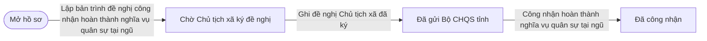
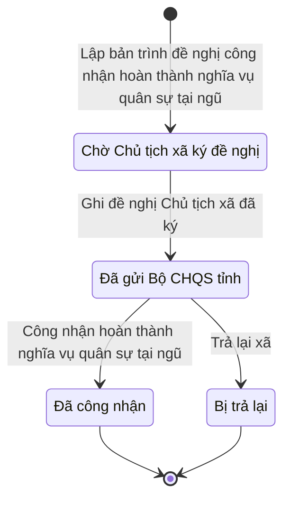

# qt-D4 · Công nhận hoàn thành NVQS tại ngũ cho DQTT

<!-- máy sinh: tom-tat -->
> **Hồ sơ:** Đề nghị công nhận hoàn thành nghĩa vụ quân sự tại ngũ (`ServiceRecognitionProposal`)
>
> **Trong sổ phạm vi:** D4 · Công nhận hoàn thành NVQS tại ngũ cho DQTT (tầng 3)
>
> 6 bước · 4 chặng · 3 vai · 3 bảng quyết định · 0 hạn · 8 khớp nối.
>
> **Nguồn:** sổ nghiệp vụ `qt-D4` · khai báo của app: `dqtv-app/core/processes/service-recognition/workflow/service-recognition.yaml`. Các bảng do máy sinh từ nguồn này.
<!-- hết: tom-tat -->

<!-- viết tay: dien-giai -->
## Diễn giải

*Phần này viết tay, diễn giải lại điều các bảng bên dưới ghi.*

### Quy trình này để làm gì

Ban CHQS xã lập một **bản trình đề nghị công nhận hoàn thành nghĩa vụ quân sự tại ngũ** cho các chiến sĩ dân quân thường trực đủ điều kiện, lấy chữ ký đề nghị của Chủ tịch xã (ngoài hệ), gửi Bộ CHQS tỉnh, và nhận kết quả công nhận. Được công nhận thì lập hồ sơ trợ cấp một lần. Một bản trình có thể gồm nhiều chiến sĩ.

Hồ sơ đi qua các chặng: *Chờ Chủ tịch xã ký đề nghị* → *Đã ký, chờ gửi tỉnh* → *Đã gửi Bộ CHQS tỉnh* → *Đã công nhận*; hoặc rẽ sang *Bị trả lại*.

### Khi nào bắt đầu

Trợ lý Quân lực bấm **Lập bản trình đề nghị công nhận hoàn thành nghĩa vụ quân sự tại ngũ**, nhập chiến sĩ trong bản trình, ngày lập và bản trình (tên bản trình do máy đặt theo ngày lập và số người). Hồ sơ mở ra có nối tới **Chiến sĩ dân quân tự vệ** (16.enlistment). Bước này bị chặn nếu chiến sĩ chưa đủ điều kiện về thời gian thường trực — xem "Điều kiện chặn". Hồ sơ vào *Chờ Chủ tịch xã ký đề nghị*.

### Diễn ra thế nào

**Chặng "Chờ Chủ tịch xã ký đề nghị".** Việc trình Chủ tịch Uỷ ban nhân dân xã ký diễn ra ngoài hệ. Ký xong, Trợ lý Quân lực bấm **Ghi đề nghị Chủ tịch xã đã ký**: nhập số tờ đề nghị, người ký, ngày ký và bản chụp. Hồ sơ sang *Đã ký, chờ gửi tỉnh*.

**Chặng "Đã ký, chờ gửi tỉnh".** Trợ lý Quân lực bấm **Gửi Bộ CHQS tỉnh**; bước không đòi nhập gì, ghi lại ngày gửi Bộ CHQS tỉnh và ngày Trợ lý soát lại trước khi gửi. Hồ sơ sang *Đã gửi Bộ CHQS tỉnh*.

Ở cả hai chặng trên, Chỉ huy trưởng Ban CHQS xã có thể bấm **Trả lại Trợ lý Quân lực**, phải ghi lý do; hồ sơ sang *Bị trả lại*.

**Chặng "Đã gửi Bộ CHQS tỉnh".** Bộ CHQS cấp tỉnh (phải thuộc cấp trên của chủ hồ sơ) làm một trong hai việc:

- **Công nhận hoàn thành nghĩa vụ quân sự tại ngũ** — ghi cơ quan công nhận, người ký quyết định công nhận, ý kiến nếu có. Hồ sơ sang *Đã công nhận*; ngày công nhận cũng là ngày ghi lên hồ sơ từng chiến sĩ.
- **Trả lại xã** — phải ghi lý do; hồ sơ sang *Bị trả lại*.

**Chặng "Đã công nhận".** Trợ lý Quân lực bấm **Lập hồ sơ trợ cấp một lần**; hồ sơ đứng yên, ghi ngày lập và mối nối sang hồ sơ chế độ chính sách.

### Kết thúc và để lại gì

Hồ sơ kết thúc ở *Đã công nhận* hoặc *Bị trả lại*. Bị trả lại thì bản trình khép lại, người trong bản trình về lại danh sách đủ điều kiện. Từ bản trình đã công nhận mở ra **Hồ sơ chế độ chính sách** (12b) — trợ cấp một lần.

### Điều kiện chặn

- **Đủ thời gian thường trực** (bảng `standing-militia-min-months`, xét lúc lập bản trình): chiến sĩ phải là dân quân thường trực, có ngày vào thường trực, và đã đủ 24 tháng. Không phải thường trực, thiếu ngày vào thường trực, chưa đủ tháng mà còn đang phục vụ, hoặc đã thôi mà chưa đủ tháng — mỗi trường hợp chặn với một kết quả riêng.
- **Người ký đề nghị** (bảng `proposal-submission.decider`): phải là Chủ tịch Uỷ ban nhân dân xã hoặc người đứng đầu cơ quan, tổ chức; để trống hoặc người khác thì chặn.
- **Người ký quyết định công nhận** (bảng `service-recognition.decider`): phải là Chỉ huy trưởng Bộ CHQS cấp tỉnh; để trống hoặc người khác thì chặn.
- **Người làm**: bốn bước của Trợ lý Quân lực và Chỉ huy trưởng (trừ bước lập) phải do người thuộc đơn vị chủ hồ sơ làm; hai bước của Bộ CHQS cấp tỉnh phải do người thuộc một đơn vị nằm trong ô cấp trên của chủ hồ sơ làm.
<!-- hết viết tay -->

## 1. Đường đi ngắn nhất qua các chặng

<!-- máy sinh: luong-chinh -->
Đường ít bước nhất từ lúc mở hồ sơ tới chặng kết thúc xa nhất. Máy chọn theo số chặng, không theo ý nghĩa nghiệp vụ — trình tự công việc thật xem phần Diễn giải và bảng "Việc làm ở từng chặng" ở mục 6.

| # | Ai làm | Làm gì | Hồ sơ sang chặng |
|---|---|---|---|
| 1 | Trợ lý Quân lực | Lập bản trình đề nghị công nhận hoàn thành nghĩa vụ quân sự tại ngũ | Chờ Chủ tịch xã ký đề nghị |
| 2 | Trợ lý Quân lực | Ghi đề nghị Chủ tịch xã đã ký | Đã gửi Bộ CHQS tỉnh |
| 3 | Bộ CHQS cấp tỉnh (thuộc cấp trên của chủ hồ sơ) | Công nhận hoàn thành nghĩa vụ quân sự tại ngũ | Đã công nhận |

<!-- hết: luong-chinh -->

## 2. Hồ sơ và việc nó để lại

<!-- máy sinh: muc-tieu -->
**App gọi quy trình này là:** Đề nghị công nhận hoàn thành nghĩa vụ quân sự tại ngũ.

**Khi mở, hồ sơ này ghi mối nối tới:**
- Chiến sĩ dân quân tự vệ (16.enlistment) — bước `draftServiceRecognitionProposal`, khớp nối `recognitionProposalCovers`
- Nhiệm vụ trên giao (1) — bước `draftServiceRecognitionProposal`, khớp nối `recognitionProposalServesTasking`

**Hồ sơ này để lại cho quy trình khác** (bước tạo hồ sơ của quy trình kia ghi mối nối về đây):
- Hồ sơ chế độ chính sách (12b) — bước `raiseAllowanceFromServiceRecognition`, khớp nối `allowanceFromServiceRecognition`
<!-- hết: muc-tieu -->

## 3. Khởi phát và kết thúc

<!-- máy sinh: khoi-phat -->
**1 cửa vào** — bước mở hồ sơ:

| Bước mở | Ai mở | Hồ sơ vào chặng | App bắt buộc nhập |
|---|---|---|---|
| Lập bản trình đề nghị công nhận hoàn thành nghĩa vụ quân sự tại ngũ | Trợ lý Quân lực | Chờ Chủ tịch xã ký đề nghị | chiến sĩ trong bản trình, ngày lập, bản trình, việc gốc |

**Kết thúc:** *Đã công nhận* (`APPROVED`), *Bị trả lại* (`RETURNED`)
<!-- hết: khoi-phat -->

## 4. Vai trò

<!-- máy sinh: vai-tro -->
| Vai trong sổ | Tên trong app | Điều kiện | Làm những bước |
|---|---|---|---|
| `operator` | Trợ lý Quân lực |  | Lập bản trình đề nghị công nhận hoàn thành nghĩa vụ quân sự tại ngũ · Trình ký văn bản trình Chủ tịch UBND xã đề nghị công nhận · Ghi đề nghị Chủ tịch xã đã ký |
| `approver` | Bộ CHQS cấp tỉnh | thuộc cấp trên của chủ hồ sơ (`actorInSuperiorUnit`, công thức ở mục 7) | Công nhận hoàn thành nghĩa vụ quân sự tại ngũ |
| `operator` | Trợ lý Quân lực | thuộc cấp trên của chủ hồ sơ (`actorInSuperiorUnit`, công thức ở mục 7) | Trình ký văn bản trả lại bản trình công nhận |
| `system` | Hệ thống tự làm |  | Trả lại xã |

*"Tên trong app" là tên app đặt cho mã chủ thể của vai. Hồ sơ thuộc đơn vị cấp khác thì người làm là người giữ vai ấy ở đơn vị nêu trong cột "Điều kiện" (nếu sổ có ghi) và ở cột "Người làm phải thuộc" của bảng "Theo khai báo của app" (mục 7).*
<!-- hết: vai-tro -->

## 5. Nhánh phụ

<!-- máy sinh: nhanh-phu -->
**Bước khác đưa hồ sơ sang chặng mới** — đường song song, rẽ nhánh hoặc kết thúc sớm:

| Bước | Ai làm | Từ chặng | Sang chặng |
|---|---|---|---|
| Trả lại xã | Hệ thống tự làm | Đã gửi Bộ CHQS tỉnh | Bị trả lại |

**Làm trong lúc hồ sơ đứng yên ở một chặng** — ghi nhận, bổ sung:

| Bước | Ai làm | Ở chặng |
|---|---|---|
| Trình ký văn bản trình Chủ tịch UBND xã đề nghị công nhận | Trợ lý Quân lực | Chờ Chủ tịch xã ký đề nghị |
| Trình ký văn bản trả lại bản trình công nhận | Trợ lý Quân lực (thuộc cấp trên của chủ hồ sơ) | Đã gửi Bộ CHQS tỉnh |

<!-- hết: nhanh-phu -->

## 6. Các chặng và việc làm ở từng chặng

<!-- máy sinh: chang -->
| Chặng | Tên hiển thị | Vào bằng bước | Kết thúc? |
|---|---|---|---|
| `DRAFT` | Chờ Chủ tịch xã ký đề nghị | Lập bản trình đề nghị công nhận hoàn thành nghĩa vụ quân sự tại ngũ |  |
| `SUBMITTED` | Đã gửi Bộ CHQS tỉnh | Ghi đề nghị Chủ tịch xã đã ký |  |
| `APPROVED` | Đã công nhận | Công nhận hoàn thành nghĩa vụ quân sự tại ngũ | **kết thúc** |
| `RETURNED` | Bị trả lại | Trả lại xã | **kết thúc** |

### Việc làm ở từng chặng

Hồ sơ đang ở chặng nào thì làm được những bước nào.

| Hồ sơ đang ở chặng | Bước làm tại chặng (hồ sơ đứng yên) | Bước đưa hồ sơ sang chặng khác |
|---|---|---|
| **Chờ Chủ tịch xã ký đề nghị** | Trình ký văn bản trình Chủ tịch UBND xã đề nghị công nhận — Trợ lý Quân lực | Ghi đề nghị Chủ tịch xã đã ký — Trợ lý Quân lực → *Đã gửi Bộ CHQS tỉnh* |
| **Đã gửi Bộ CHQS tỉnh** | Trình ký văn bản trả lại bản trình công nhận — Trợ lý Quân lực (thuộc cấp trên của chủ hồ sơ) | Công nhận hoàn thành nghĩa vụ quân sự tại ngũ — Bộ CHQS cấp tỉnh (thuộc cấp trên của chủ hồ sơ) → *Đã công nhận* Trả lại xã — Hệ thống tự làm → *Bị trả lại* |
| **Đã công nhận** | — | — (kết thúc) |
| **Bị trả lại** | — | — (kết thúc) |
<!-- hết: chang -->

## 7. Bảng bước

<!-- máy sinh: buoc -->
| # | Bước | Mã bước | Ai thực hiện | Từ chặng | Sang chặng | Phải có trước | Ghi lại |
|---|---|---|---|---|---|---|---|
| 1 | Lập bản trình đề nghị công nhận hoàn thành nghĩa vụ quân sự tại ngũ | `draftServiceRecognitionProposal` | Trợ lý Quân lực | — (mở hồ sơ) | `DRAFT` | `taskingAssigned` | mã tỉnh, mã xã, bản trình, ngày lập, nối tới Chiến sĩ dân quân tự vệ, đơn vị chủ hồ sơ, `id`, nối tới Nhiệm vụ trên giao |
| 2 | Trình ký văn bản trình Chủ tịch UBND xã đề nghị công nhận | `requestSendServiceRecognitionToChairmanSignature` | Trợ lý Quân lực | `DRAFT` | giữ nguyên | `noSendServiceRecognitionToChairmanDocumentOpen`, người làm thuộc đơn vị chủ hồ sơ | nối tới Văn bản đi |
| 3 | Ghi đề nghị Chủ tịch xã đã ký | `recordProposalSubmissionSigned` | Trợ lý Quân lực | `DRAFT` | `SUBMITTED` | người làm thuộc đơn vị chủ hồ sơ, `sendServiceRecognitionToChairmanDocumentIssued`, `recordProposalSubmissionSignedFromIncomingDocumentUsable` | nối tới Văn bản đến, ngày gửi Bộ CHQS tỉnh, ngày Trợ lý soát lại trước khi gửi, nối `submissionDeliveredAs`, người ký đề nghị |
| 4 | Công nhận hoàn thành nghĩa vụ quân sự tại ngũ | `approveServiceRecognition` | Bộ CHQS cấp tỉnh (thuộc cấp trên của chủ hồ sơ) | `SUBMITTED` | `APPROVED` | người làm thuộc cấp trên của chủ hồ sơ, `submissionDistributedAtReceiver` | ngày tỉnh công nhận, cơ quan công nhận, ý kiến của tỉnh, người ký quyết định công nhận |
| 5 | Trình ký văn bản trả lại bản trình công nhận | `requestRejectServiceRecognitionProposalSignature` | Trợ lý Quân lực (thuộc cấp trên của chủ hồ sơ) | `SUBMITTED` | giữ nguyên | `submissionDistributedAtReceiver`, `noRejectServiceRecognitionProposalDocumentOpen`, người làm thuộc cấp trên của chủ hồ sơ | vì sao trả lại — xã bổ sung gì, nối tới Văn bản đi |
| 6 | Trả lại xã | `rejectServiceRecognitionProposal` | Hệ thống tự làm | `SUBMITTED` | `RETURNED` | `rejectServiceRecognitionProposalDocumentIssued` | ngày trả lại, nối `returnDeliveredAs` |

### Khi không đạt điều kiện

Mặc định: không đúng người, hồ sơ không ở đúng chặng, hoặc thiếu thứ "phải có trước" thì bước bị chặn, hồ sơ giữ nguyên. Bảng dưới chỉ kê những bước có kết quả riêng.

| # | Bước | Kết quả riêng |
|---|---|---|
| 1 | Lập bản trình đề nghị công nhận hoàn thành nghĩa vụ quân sự tại ngũ | bước dừng lại, hồ sơ giữ nguyên khi kết quả xét là: `NOT_STANDING_MILITIA`, `NO_STANDING_START`, `STANDING_MONTHS_NOT_SERVED`, `STANDING_MONTHS_CLOSED_SHORT` |
| 3 | Ghi đề nghị Chủ tịch xã đã ký | bước dừng lại, hồ sơ giữ nguyên khi kết quả xét là: `authority_unknown`, `wrong_authority` |
| 4 | Công nhận hoàn thành nghĩa vụ quân sự tại ngũ | bước dừng lại, hồ sơ giữ nguyên khi kết quả xét là: `authority_unknown`, `wrong_authority` |
| 6 | Trả lại xã | bước này không do người nào bấm |

### Điều kiện "phải có trước" bằng lời

Cột "Phải có trước" ở bảng bước có hai loại: ô dữ liệu thường (bước chỉ đòi ô ấy đã có giá trị) và điều kiện hệ tự xét. Bảng này diễn các điều kiện hệ tự xét theo đúng công thức sổ ghi; số ở cột cuối là số thứ tự bước.

| Điều kiện | Đúng khi | Bước đòi |
|---|---|---|
| `taskingAssigned` | có hồ sơ Việc luật giao kèm văn bản đến, đi (qt-1) chính là hồ sơ ghi ở ô nối `recognitionProposalServesTasking` của hồ sơ đang làm mà hồ sơ ấy đang ở chặng `ASSIGNED` hoặc `BROKEN_DOWN` | 1 |
| `noSendServiceRecognitionToChairmanDocumentOpen` | KHÔNG (có hồ sơ Việc luật giao kèm văn bản đến, đi — Văn bản đi (qt-1.outgoing-document) chính là hồ sơ ghi ở ô nối `sendServiceRecognitionToChairmanByDocument` của hồ sơ đang làm mà hồ sơ ấy đang ở chặng `DRAFT` hoặc `PENDING_SIGNATURE` hoặc `SIGNED`) | 2 |
| `actorInOwnerUnit` | người đang làm là người của đơn vị ghi ở ô đơn vị chủ hồ sơ của hồ sơ này (theo danh mục người của đơn vị, `dm.unit-staff`) | 2, 3 |
| `sendServiceRecognitionToChairmanDocumentIssued` | có hồ sơ Việc luật giao kèm văn bản đến, đi — Văn bản đi (qt-1.outgoing-document) chính là hồ sơ ghi ở ô nối `sendServiceRecognitionToChairmanByDocument` của hồ sơ đang làm mà hồ sơ ấy đang ở chặng `ISSUED` | 3 |
| `recordProposalSubmissionSignedFromIncomingDocumentUsable` | có hồ sơ Việc luật giao kèm văn bản đến, đi — Văn bản đến (qt-1.incoming-document) chính là hồ sơ ghi ở ô nối `recordProposalSubmissionSignedFromIncomingDocument` của hồ sơ đang làm mà hồ sơ ấy đang ở chặng `RECEIVED` hoặc `DISTRIBUTED` | 3 |
| `actorInSuperiorUnit` | người đang làm là người của một đơn vị nằm trong ô cấp trên của chủ hồ sơ của hồ sơ này (theo danh mục người của đơn vị, `dm.unit-staff`) | 4, 5 |
| `submissionDistributedAtReceiver` | có hồ sơ Việc luật giao kèm văn bản đến, đi — Văn bản đến (qt-1.incoming-document) chính là hồ sơ ghi ở ô nối `submissionDeliveredAs` của hồ sơ đang làm mà hồ sơ ấy đang ở chặng `DISTRIBUTED` | 4, 5 |
| `noRejectServiceRecognitionProposalDocumentOpen` | KHÔNG (có hồ sơ Việc luật giao kèm văn bản đến, đi — Văn bản đi (qt-1.outgoing-document) chính là hồ sơ ghi ở ô nối `rejectServiceRecognitionProposalByDocument` của hồ sơ đang làm mà hồ sơ ấy đang ở chặng `DRAFT` hoặc `PENDING_SIGNATURE` hoặc `SIGNED`) | 5 |
| `rejectServiceRecognitionProposalDocumentIssued` | có hồ sơ Việc luật giao kèm văn bản đến, đi — Văn bản đi (qt-1.outgoing-document) chính là hồ sơ ghi ở ô nối `rejectServiceRecognitionProposalByDocument` của hồ sơ đang làm mà hồ sơ ấy đang ở chặng `ISSUED` | 6 |

### Theo khai báo của app

Người làm phải thuộc đơn vị nào, ô người dùng phải nhập, bước có lặp được không, và căn cứ pháp lý — lấy từ khai báo quy trình trong app.

| # | Bước | Người làm phải thuộc | Bắt buộc nhập | Nhập nếu có | Lặp được | Căn cứ |
|---|---|---|---|---|---|---|
| 1 | Lập bản trình đề nghị công nhận hoàn thành nghĩa vụ quân sự tại ngũ |  | chiến sĩ trong bản trình, ngày lập, bản trình, việc gốc | — |  | L78/2015/QH13 Đ.4 k4 a |
| 2 | Trình ký văn bản trình Chủ tịch UBND xã đề nghị công nhận | đơn vị chủ hồ sơ | — | dự thảo văn bản (PDF) |  | L78/2015/QH13 Đ.4 k4 a (sửa bởi L98/2025/QH15 Đ.4 k2) · NĐ30/2020/NĐ-CP Đ.13 |
| 3 | Ghi đề nghị Chủ tịch xã đã ký | đơn vị chủ hồ sơ | văn bản đến là tờ đề nghị Chủ tịch UBND xã đã ký, người ký đề nghị | — |  | L78/2015/QH13 Đ.4 k4 a (sửa bởi L98/2025/QH15 Đ.4 k2) |
| 4 | Công nhận hoàn thành nghĩa vụ quân sự tại ngũ | cấp trên của chủ hồ sơ | người ký quyết định công nhận | ý kiến của tỉnh |  | L78/2015/QH13 Đ.4 k4 a (sửa bởi L98/2025/QH15 Đ.4 k2) |
| 5 | Trình ký văn bản trả lại bản trình công nhận | cấp trên của chủ hồ sơ | vì sao trả lại — xã bổ sung gì | dự thảo văn bản (PDF) |  | L78/2015/QH13 Đ.4 k4 a (sửa bởi L98/2025/QH15 Đ.4 k2) · NĐ30/2020/NĐ-CP Đ.13 |
| 6 | Trả lại xã |  | — | — |  | L78/2015/QH13 Đ.4 k4 a (sửa bởi L98/2025/QH15 Đ.4 k2) |
| — | Ghi đã trình Chủ tịch UBND xã — văn bản trình đã phát hành (`sendServiceRecognitionToChairman`) |  | — | — |  | L78/2015/QH13 Đ.4 k4 a (sửa bởi L98/2025/QH15 Đ.4 k2) |
| — | Gửi đề nghị Chủ tịch xã đã ký lên Bộ CHQS tỉnh (`submitServiceRecognitionProposal`) |  | — | — |  | L78/2015/QH13 Đ.4 k4 a |
| — | Trả lại Trợ lý Quân lực (`returnServiceRecognitionProposal`) | đơn vị chủ hồ sơ | lý do trả lại | — |  | L78/2015/QH13 Đ.4 k4 a |
| — | Lập hồ sơ trợ cấp một lần (`raiseServiceRecognitionAllowance`) | đơn vị chủ hồ sơ | — | — |  | L48/2019/QH14 Đ.34 k1 c; NĐ72/2020/NĐ-CP Đ.12 k2 |

### Điều kiện và ghi chú app khai cho từng bước

Lấy từ khai báo quy trình trong app. Lời trong ngoặc kép là câu app hiện cho người dùng. Chức danh người ký ngoài hệ app chỉ khai bằng mã.

| # | Bước | Điều kiện, ghi chú |
|---|---|---|
| 3 | Ghi đề nghị Chủ tịch xã đã ký | · phải đã có ô "ngày trình Chủ tịch UBND xã" — thiếu thì app báo: "văn bản trình Chủ tịch UBND xã chưa phát hành — Chỉ huy trưởng ký, văn thư phát hành trước, rồi mới ghi đề nghị đã ký" · không đòi bản chụp — app ghi: "bản số hoá lấy từ văn bản đến văn thư đã vào sổ (tầng đọc chép `scanPath` của văn bản ấy), không tải ảnh ở bước này" |
| — | Ghi đã trình Chủ tịch UBND xã — văn bản trình đã phát hành | · không làm được khi đã có ô "ngày trình Chủ tịch UBND xã" — app báo: "đã trình Chủ tịch UBND xã rồi" |
<!-- hết: buoc -->

## 8. Bảng quyết định, hạn, việc ngoài hệ

<!-- máy sinh: quyet-dinh -->
**Bảng `proposal-submission.decider`** — xét ở bước *Ghi đề nghị Chủ tịch xã đã ký*; đầu vào: người ký đề nghị. 3 dòng, dò từ trên xuống, dòng đầu tiên khớp thì dừng.

| Thứ tự dò (số sổ ghi) | Dòng | Khi | Thì |
|---|---|---|---|
| 1 | `signer-unset` | chưa có người ký đề nghị | `authority_unknown` |
| 2 | `chairman-or-agency-head` | người ký đề nghị là Chủ tịch UBND xã (`commune_chairman`) hoặc Người đứng đầu cơ quan, tổ chức (`agency_head`) | cho qua |
| 3 | `otherwise` | mọi trường hợp còn lại | `wrong_authority` |

**Bảng `service-recognition.decider`** — xét ở bước *Công nhận hoàn thành nghĩa vụ quân sự tại ngũ*; đầu vào: người ký quyết định công nhận. 3 dòng, dò từ trên xuống, dòng đầu tiên khớp thì dừng.

| Thứ tự dò (số sổ ghi) | Dòng | Khi | Thì |
|---|---|---|---|
| 1 | `signer-unset` | chưa có người ký quyết định công nhận | `authority_unknown` |
| 2 | `province-military-commander` | người ký quyết định công nhận là Chỉ huy trưởng Bộ CHQS tỉnh (`province_military_commander`) | cho qua |
| 3 | `otherwise` | mọi trường hợp còn lại | `wrong_authority` |

**Bảng `standing-militia-min-months`** — xét ở bước *Lập bản trình đề nghị công nhận hoàn thành nghĩa vụ quân sự tại ngũ*; đầu vào: `militiaType`, `standingSince`, `serviceEndDate`, `standingMonths`. 8 dòng, dò từ trên xuống, dòng đầu tiên khớp thì dừng.

| Thứ tự dò (số sổ ghi) | Dòng | Khi | Thì |
|---|---|---|---|
| 1 | `type-unset` | chưa có `militiaType` | `NOT_STANDING_MILITIA` |
| 2 | `type-not-standing` | `militiaType` là `local` hoặc `mobile` hoặc `maritime` hoặc `specialist` | `NOT_STANDING_MILITIA` |
| 3 | `no-start` | chưa có `standingSince` | `NO_STANDING_START` |
| 4 | `enough-24-months` | `militiaType` là `standing` và `standingMonths` từ 24 | cho qua |
| 5 | `months-unset-closed` | chưa có `standingMonths` và đã có `serviceEndDate` | `STANDING_MONTHS_CLOSED_SHORT` |
| 6 | `months-unset-open` | chưa có `standingMonths` và chưa có `serviceEndDate` | `STANDING_MONTHS_NOT_SERVED` |
| 7 | `short-closed` | `standingMonths` nhỏ hơn 24 và đã có `serviceEndDate` | `STANDING_MONTHS_CLOSED_SHORT` |
| 8 | `short-open` | `standingMonths` nhỏ hơn 24 và chưa có `serviceEndDate` | `STANDING_MONTHS_NOT_SERVED` |

<!-- hết: quyet-dinh -->

## 9. Dữ liệu của hồ sơ

<!-- máy sinh: du-lieu -->
Các ô mà bước trong sổ ghi hoặc đòi. Số trong hai cột cuối là số thứ tự bước ở bảng bước (mục 7).

| Ô dữ liệu | Mã | Kiểu (app) | Giá trị cho phép | Loại ô (sổ) | Bước ghi | Bước đòi | Mô tả trong app |
|---|---|---|---|---|---|---|---|
| mã tỉnh | `provinceCode` | chữ |  | lưu trên hồ sơ (`stored`) | 1 | — | Mã tỉnh — dùng lọc phạm vi theo hàng |
| mã xã | `communeCode` | chữ |  | lưu trên hồ sơ (`stored`) | 1 | — | Mã xã |
| bản trình | `proposalName` | chữ |  | đưa vào ở bước (`input`) | 1 | — | Tên bản trình đọc được — máy đặt theo ngày lập và số người |
| ngày lập | `draftedAt` | ngày |  | đưa vào ở bước (`input`) | 1 | — | Ngày Trợ lý Quân lực lập bản trình |
| đơn vị chủ hồ sơ | `ownerUnit` |  |  | lưu trên hồ sơ (`stored`) | 1 | — |  |
| — | `id` |  |  | lưu trên hồ sơ (`stored`) | 1 | — |  |
| ngày gửi Bộ CHQS tỉnh | `submittedAt` | ngày |  | lưu trên hồ sơ (`stored`) | 3 | — | Ngày Chỉ huy trưởng gửi Bộ CHQS tỉnh |
| ngày Trợ lý soát lại trước khi gửi | `submissionCheckedAt` | ngày |  | lưu trên hồ sơ (`stored`) | 3 | — | Ngày Trợ lý Quân lực soát lại đề nghị đã ký rồi gửi tỉnh |
| người ký đề nghị | `submissionSignerTitle` | chọn một | Chủ tịch UBND xã (`commune_chairman`), Người đứng đầu cơ quan, tổ chức (`agency_head`), Người khác (`other`) | đưa vào ở bước (`input`) | 3 | — | Người ký đề nghị — Chủ tịch UBND xã, hoặc người đứng đầu cơ quan, tổ chức (tự vệ) |
| ngày tỉnh công nhận | `approvedAt` | ngày |  | lưu trên hồ sơ (`stored`) | 4 | — | Ngày Bộ CHQS tỉnh công nhận — cũng là ngày công nhận ghi lên hồ sơ từng chiến sĩ (L78/2015/QH13 Đ.42 k2) |
| cơ quan công nhận | `approverUnit` | chữ |  | lưu trên hồ sơ (`stored`) | 4 | — | Cơ quan công nhận — máy lấy từ hồ sơ cơ quan cấp trên của xã |
| ý kiến của tỉnh | `approverOpinion` | chữ |  | đưa vào ở bước (`input`) | 4 | — | Ý kiến của Bộ CHQS tỉnh khi công nhận |
| người ký quyết định công nhận | `decisionSignerTitle` | chọn một | Chỉ huy trưởng Bộ CHQS tỉnh (`province_military_commander`), Người khác (`other`) | đưa vào ở bước (`input`) | 4 | — | Người ký quyết định công nhận — Chỉ huy trưởng Bộ CHQS cấp tỉnh |
| lý do trả lại | `returnReason` | chữ |  | đưa vào ở bước (`input`) | 5 | — | Vì sao trả lại — Chỉ huy trưởng hoặc Bộ CHQS tỉnh ghi |
| ngày trả lại | `returnedAt` | ngày |  | lưu trên hồ sơ (`stored`) | 6 | — | Ngày bị trả lại |
| — | `taskingAssigned` |  | có hay chưa | hệ suy ra (`derived`) | — | 1 |  |
| — | `noSendServiceRecognitionToChairmanDocumentOpen` |  | có hay chưa | hệ suy ra (`derived`) | — | 2 |  |
| người làm thuộc đơn vị chủ hồ sơ | `actorInOwnerUnit` |  | có hay chưa | hệ suy ra (`derived`) | — | 2, 3 |  |
| — | `sendServiceRecognitionToChairmanDocumentIssued` |  | có hay chưa | hệ suy ra (`derived`) | — | 3 |  |
| — | `recordProposalSubmissionSignedFromIncomingDocumentUsable` |  | có hay chưa | hệ suy ra (`derived`) | — | 3 |  |
| người làm thuộc cấp trên của chủ hồ sơ | `actorInSuperiorUnit` |  | có hay chưa | hệ suy ra (`derived`) | — | 4, 5 |  |
| — | `submissionDistributedAtReceiver` |  | có hay chưa | hệ suy ra (`derived`) | — | 4, 5 |  |
| — | `noRejectServiceRecognitionProposalDocumentOpen` |  | có hay chưa | hệ suy ra (`derived`) | — | 5 |  |
| — | `rejectServiceRecognitionProposalDocumentIssued` |  | có hay chưa | hệ suy ra (`derived`) | — | 6 |  |
| — | `militiaType` |  | `local`, `mobile`, `standing`, `maritime`, `specialist` | đưa vào ở bước (`input`) | — | — |  |
| — | `standingSince` |  | có hay chưa | đưa vào ở bước (`input`) | — | — |  |
| — | `serviceEndDate` |  | có hay chưa | đưa vào ở bước (`input`) | — | — |  |
| — | `standingMonths` |  |  | đưa vào ở bước (`input`) | — | — |  |

28 ô. Cột "Loại ô" là cách sổ phân loại ô, in kèm đúng chữ của sổ; ô nào người dùng phải nhập xem bảng "Theo khai báo của app" ở mục 7.
<!-- hết: du-lieu -->

## 10. Khớp nối với quy trình khác

<!-- máy sinh: khop-noi -->
| Quy trình kia | Hồ sơ kia | Quan hệ | Nội dung (mô tả trong app) | Bước ghi mối nối | Tên ô nối |
|---|---|---|---|---|---|
| 1 | Nhiệm vụ trên giao | hồ sơ này **mở ra có nối tới** hồ sơ kia | Việc gốc mà bản trình đề nghị công nhận hoàn thành nghĩa vụ quân sự tại ngũ này thực hiện — người lập chọn tr… | D4·draftServiceRecognitionProposal ⊕ | `recognitionProposalServesTasking` |
| 1.incoming-document | Văn bản đến | gắn với nhau ở một bước giữa chừng | Tờ đề nghị Chủ tịch UBND xã đã ký (L78/2015/QH13 Đ.4 k4 a) ở sổ văn bản đến của Ban CHQS xã | D4·recordProposalSubmissionSigned | `recordProposalSubmissionSignedFromIncomingDocument` |
| 1.incoming-document | Văn bản đến | có nối | Văn bản trả lại ở sổ văn bản đến của Ban CHQS xã — sổ qt-D4 link.returnDeliveredAs | — | `serviceRecognitionReturnDeliveredAs` |
| 1.incoming-document | Văn bản đến | có nối | Văn bản đề nghị công nhận ở sổ văn bản đến của Bộ CHQS tỉnh — sổ qt-D4 link.submissionDeliveredAs | — | `serviceRecognitionSubmissionDeliveredAs` |
| 1.outgoing-document | Văn bản đi | gắn với nhau ở một bước giữa chừng | Văn bản trả lại bản trình đề nghị công nhận — văn bản đi của Bộ CHQS tỉnh | D4·requestRejectServiceRecognitionProposalSignature | `rejectServiceRecognitionProposalByDocument` |
| 1.outgoing-document | Văn bản đi | gắn với nhau ở một bước giữa chừng | Văn bản Ban CHQS xã trình Chủ tịch UBND xã đề nghị công nhận hoàn thành NVQS tại ngũ (sổ qt-D4) | D4·requestSendServiceRecognitionToChairmanSignature | `sendServiceRecognitionToChairmanByDocument` |
| 12b | Hồ sơ chế độ chính sách | hồ sơ kia **mở ra từ** hồ sơ này | Hồ sơ trợ cấp một lần lập từ bản trình đã được công nhận hoàn thành NVQS tại ngũ (L48/2019/QH14 Đ.34 k1 c) | 12b·raiseAllowanceFromServiceRecognition ⊕ | `allowanceFromServiceRecognition` |
| 16.enlistment | Chiến sĩ dân quân tự vệ | hồ sơ này **mở ra có nối tới** hồ sơ kia | Chiến sĩ có tên trong bản trình đề nghị công nhận hoàn thành nghĩa vụ quân sự tại ngũ (L78/2015/QH13 Điều 4 k… | D4·draftServiceRecognitionProposal ⊕ | `recognitionProposalCovers` |

8 khớp nối. ⊕ là bước tạo hồ sơ.
<!-- hết: khop-noi -->

## 11. Thông tin chung

<!-- máy sinh: thong-tin -->
| | |
|---|---|
| **Mã trong sổ** | `qt-D4` |
| **Quy trình trong app** | `service-recognition` (`workflow/service-recognition.yaml`) — mặt công tác: `personnel` |
| **Hồ sơ** | Đề nghị công nhận hoàn thành nghĩa vụ quân sự tại ngũ (`ServiceRecognitionProposal`) |
| **Căn cứ pháp lý từng bước** | cột "Căn cứ" ở bảng "Theo khai báo của app", mục 7 |
<!-- hết: thong-tin -->
