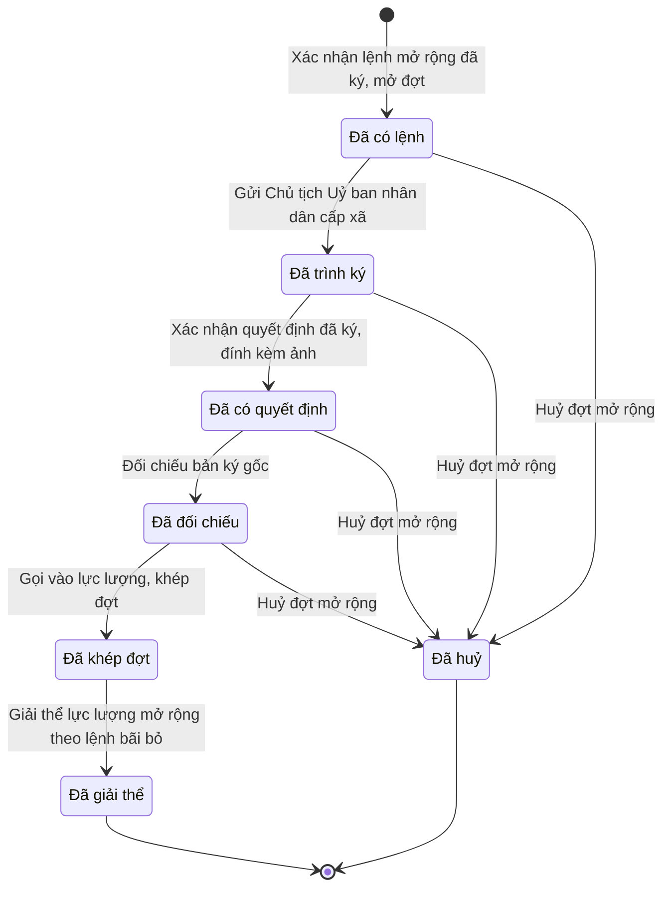

# qt-D5 · Mở rộng lực lượng DQTV

<!-- máy sinh: tom-tat -->
> **Hồ sơ:** Đợt mở rộng lực lượng (`ForceExpansion`)
>
> **Trong sổ phạm vi:** D5 · Mở rộng lực lượng DQTV (tầng 3)
>
> 9 bước · 7 chặng · 3 vai · 1 bảng quyết định · 0 hạn · 8 khớp nối.
>
> **Nguồn:** sổ nghiệp vụ `qt-D5` · khai báo của app: `dqtv-app/core/processes/force-expansion/workflow/force-expansion.yaml`. Các bảng do máy sinh từ nguồn này.
<!-- hết: tom-tat -->

<!-- viết tay: dien-giai -->
## Diễn giải

*Phần này viết tay, diễn giải lại điều các bảng bên dưới ghi.*

### Quy trình này để làm gì

Ban CHQS xã theo dõi một **đợt mở rộng lực lượng** từ lúc nhận lệnh tới lúc lực lượng mở rộng giải thể: mở đợt theo lệnh, chọn người từ sổ nghĩa vụ, trình Chủ tịch Uỷ ban nhân dân cấp xã danh sách, ghi quyết định về, gọi người vào lực lượng, rồi giải thể khi có lệnh bãi bỏ.

Hồ sơ đi qua chín chặng: *Đã có lệnh* → *Chờ ký tờ trình* → *Đã ký, chờ gửi Uỷ ban* → *Đã trình ký* → *Đã có quyết định* → *Đã đối chiếu* → *Đã khép đợt* → *Đã giải thể*; ngoài ra có chặng *Đã huỷ*.

### Khi nào bắt đầu

Trợ lý Quân lực bấm **Xác nhận lệnh mở rộng đã ký, mở đợt**. Bắt buộc nhập căn cứ mở rộng (tổng động viên, động viên cục bộ, hoặc ban bố tình trạng khẩn cấp), ngày nhận lệnh, `planDocumentIds`, `taskingId` và năm ô của lệnh (`decisionNumber`, `subject`, `signedBy`, `signedDate`, `legalBasis`); `scanPath`, quy mô theo quyết định, ghi chú là ô nhập nếu có. Bước này ghi một quyết định ký ngoài hệ (`expansionOrderedBy`), người ký là `president` hoặc `defence_minister`.

Khi mở, hồ sơ ghi mối nối tới **Kế hoạch, văn kiện** (quy trình 2) và tới **Nhiệm vụ trên giao** (quy trình 1). Bước mở đòi ba điều kiện về kế hoạch: phải có một hồ sơ kế hoạch (qt-2) đang ở chặng `APPROVED`, `IN_FORCE` hoặc `UNDER_REVIEW`, có `docType` bằng `force_expansion_plan`, đã có `expansionScale`, và người đang làm là người của đơn vị chủ hồ sơ kế hoạch ấy. Quy mô theo kế hoạch được đọc lúc mở đợt, tên đợt do hệ đặt theo lệnh. Bước này còn qua một bảng quyết định về mức sẵn sàng chiến đấu — xem "Điều kiện chặn".

### Diễn ra thế nào

**Chặng "Đã có lệnh"** — Trợ lý Quân lực **Chọn người từ sổ nghĩa vụ**, lặp được; mỗi lần nối thêm dòng sổ nghĩa vụ vào đợt. Khi đủ thì bấm **Chốt danh sách, trình ký**, đính tờ trình (PDF): phải đã có người được chọn; bước ghi ngày chốt danh sách, nối hồ sơ với một văn bản đi, đưa hồ sơ sang *Chờ ký tờ trình*.

**Chặng "Chờ ký tờ trình"** — Chỉ huy trưởng Ban CHQS xã bấm **Ký tờ trình** (hồ sơ sang *Đã ký, chờ gửi Uỷ ban*), hoặc **Trả lại tờ trình** kèm ghi cần sửa gì (hồ sơ về *Đã có lệnh*).

**Chặng "Đã ký, chờ gửi Uỷ ban"** — Nhân viên văn thư bấm **Gửi Chủ tịch Uỷ ban nhân dân cấp xã**, đính tờ trình đã ký, đã ghi số; nơi nhận tờ trình là `commune_chairman`. Hồ sơ sang *Đã trình ký*. Ở chặng này Chỉ huy trưởng vẫn trả lại tờ trình được.

**Chặng "Đã trình ký"** — chờ quyết định về. Trợ lý Quân lực bấm **Xác nhận quyết định đã ký, đính kèm ảnh**: bắt buộc nhập `decisionNumber`, `subject`, `signedBy`, `signedDate`, `legalBasis`, `scanPath`. Đây là quyết định ký ngoài hệ (`expansionAuthorizedBy`), người ký `commune_chairman`. Hồ sơ sang *Đã có quyết định*.

**Chặng "Đã có quyết định"** — Chỉ huy trưởng bấm **Đối chiếu bản ký gốc**, nhập `decisionId` và ngày đối chiếu. Bước này đòi đã có quyết định ký ngoài hệ `expansionAuthorizedBy` và phải có người thứ hai kiểm. Hồ sơ sang *Đã đối chiếu*, mở đường gọi người.

**Chặng "Đã đối chiếu"** — Chỉ huy trưởng bấm **Gọi vào lực lượng, khép đợt**: phải đã có `expansionAuthorizedBy` và `decisionCheckedAt`; bắt buộc nhập ai gọi vào đơn vị nào, `decisionId` và ngày khép đợt. Hồ sơ sang *Đã khép đợt*.

**Chặng "Đã khép đợt"** — hồ sơ còn chờ lệnh bãi bỏ. Khi có lệnh bãi bỏ, Chỉ huy trưởng bấm **Giải thể lực lượng mở rộng theo lệnh bãi bỏ**, nhập ngày giải thể và văn bản bãi bỏ làm căn cứ. Hồ sơ sang *Đã giải thể*.

**Kết thúc sớm:** Chỉ huy trưởng bấm **Huỷ đợt mở rộng**, bắt ghi vì sao huỷ. Làm được ở bốn chặng: *Đã có lệnh*, *Đã trình ký*, *Đã có quyết định*, *Đã đối chiếu*. *Đã huỷ* là trường hợp lệnh bị bãi bỏ khi còn trước lúc gọi người.

### Kết thúc và để lại gì

Hồ sơ kết thúc ở *Đã giải thể* hoặc *Đã huỷ*. Hồ sơ nối với:

- **Chiến sĩ dân quân tự vệ** (16.enlistment) — lần tham gia của từng người mở ra từ đợt này.
- **Sổ nghĩa vụ** (16) — dòng sổ được gọi gắn vào đợt ở bước chọn người.
- **Văn bản đi** (1.outgoing-document) — tờ trình gắn ở bước chốt danh sách.

### Điều kiện chặn

- **Mức sẵn sàng chiến đấu khi mở đợt** (bảng `expansion.readiness-gate`, dò từ trên xuống): căn cứ mở rộng còn trống thì chặn (`basis_unknown`); căn cứ là tình trạng khẩn cấp thì cho qua; động viên cục bộ thì phải có `areaReadiness.status`; tổng động viên thì phải có `areaReadinessFull`; còn lại bị chặn (`readiness_too_low`). Hai ô điều kiện ấy do hệ suy ra: `areaReadiness.status` đúng khi có hồ sơ Chuyển trạng thái SSCĐ (qt-D6) đang ở chặng `high` hoặc `full` và người đang làm là người của đơn vị chủ hồ sơ ấy; `areaReadinessFull` đúng khi có hồ sơ như thế đang ở chặng `full`.
- **Kế hoạch khi mở đợt**: ba điều kiện nêu ở "Khi nào bắt đầu" (chặng, `docType`, `expansionScale` của kế hoạch qt-2; người làm thuộc đơn vị chủ kế hoạch ấy).
- Mọi bước sau bước mở: người làm phải là người của đơn vị chủ hồ sơ.
- Chốt danh sách phải có ít nhất một dòng sổ nghĩa vụ đã nối. Đối chiếu và gọi vào lực lượng đòi đã có quyết định ký ngoài hệ `expansionAuthorizedBy`.
- Huỷ đợt chỉ làm được ở bốn chặng nêu trên; ở *Chờ ký tờ trình* và *Đã ký, chờ gửi Uỷ ban* phải trả lại tờ trình trước, còn sau khi đã khép đợt thì chỉ còn đường giải thể.
- Sai người, sai chặng, thiếu thứ phải có trước thì bước bị chặn, hồ sơ giữ nguyên.
<!-- hết viết tay -->

## 1. Đường đi ngắn nhất qua các chặng

<!-- máy sinh: luong-chinh -->
Đường ít bước nhất từ lúc mở hồ sơ tới chặng kết thúc xa nhất. Máy chọn theo số chặng, không theo ý nghĩa nghiệp vụ — trình tự công việc thật xem phần Diễn giải và bảng "Việc làm ở từng chặng" ở mục 6.

| # | Ai làm | Làm gì | Hồ sơ sang chặng |
|---|---|---|---|
| 1 | Trợ lý Quân lực | Xác nhận lệnh mở rộng đã ký, mở đợt | Đã có lệnh |
| 2 | Nhân viên văn thư | Gửi Chủ tịch Uỷ ban nhân dân cấp xã | Đã trình ký |
| 3 | Trợ lý Quân lực | Xác nhận quyết định đã ký, đính kèm ảnh | Đã có quyết định |
| 4 | Chỉ huy trưởng Ban CHQS xã | Đối chiếu bản ký gốc | Đã đối chiếu |
| 5 | Chỉ huy trưởng Ban CHQS xã | Gọi vào lực lượng, khép đợt | Đã khép đợt |
| 6 | Chỉ huy trưởng Ban CHQS xã | Giải thể lực lượng mở rộng theo lệnh bãi bỏ | Đã giải thể |

<!-- hết: luong-chinh -->

## 2. Hồ sơ và việc nó để lại

<!-- máy sinh: muc-tieu -->
**App gọi quy trình này là:** Đợt mở rộng lực lượng.

**Khi mở, hồ sơ này ghi mối nối tới:**
- Kế hoạch, văn kiện (2) — bước `recordExpansionOrder`, khớp nối `expansionUnderPlan`
- Nhiệm vụ trên giao (1) — bước `recordExpansionOrder`, khớp nối `forceExpansionServesTasking`
- Văn bản đến (1.incoming-document) — bước `recordExpansionOrder`, khớp nối `recordExpansionOrderFromIncomingDocument`

**Hồ sơ này để lại cho quy trình khác** (bước tạo hồ sơ của quy trình kia ghi mối nối về đây):
- Chiến sĩ dân quân tự vệ (16.enlistment) — bước `admitInExpansion`, khớp nối `memberCalledInExpansion`
- Đề nghị cấp kinh phí (4.funding-request) — bước `estimateCommuneFundingRequest`, khớp nối `fundingRequestFromExpansion`
- Đề nghị cấp kinh phí (4.funding-request) — bước `estimateProvinceFundingRequest`, khớp nối `fundingRequestFromExpansion`
<!-- hết: muc-tieu -->

## 3. Khởi phát và kết thúc

<!-- máy sinh: khoi-phat -->
**1 cửa vào** — bước mở hồ sơ:

| Bước mở | Ai mở | Hồ sơ vào chặng | App bắt buộc nhập |
|---|---|---|---|
| Xác nhận lệnh mở rộng đã ký, mở đợt | Trợ lý Quân lực | Đã có lệnh | căn cứ mở rộng, ngày nhận lệnh, `planDocumentIds`, `incomingDocumentId`, `signedBy`, `taskingId` |

**Kết thúc:** *Đã giải thể* (`DISSOLVED`), *Đã huỷ* (`CANCELLED`)
<!-- hết: khoi-phat -->

## 4. Vai trò

<!-- máy sinh: vai-tro -->
| Vai trong sổ | Tên trong app | Điều kiện | Làm những bước |
|---|---|---|---|
| `operator` | Trợ lý Quân lực |  | Xác nhận lệnh mở rộng đã ký, mở đợt · Chọn người từ sổ nghĩa vụ · Chốt danh sách, trình ký · Xác nhận quyết định đã ký, đính kèm ảnh |
| `clerk` | Nhân viên văn thư |  | Gửi Chủ tịch Uỷ ban nhân dân cấp xã |
| `verifier` | Chỉ huy trưởng Ban CHQS xã |  | Đối chiếu bản ký gốc · Gọi vào lực lượng, khép đợt · Giải thể lực lượng mở rộng theo lệnh bãi bỏ · Huỷ đợt mở rộng |

*"Tên trong app" là tên app đặt cho mã chủ thể của vai. Hồ sơ thuộc đơn vị cấp khác thì người làm là người giữ vai ấy ở đơn vị nêu trong cột "Điều kiện" (nếu sổ có ghi) và ở cột "Người làm phải thuộc" của bảng "Theo khai báo của app" (mục 7).*
<!-- hết: vai-tro -->

## 5. Nhánh phụ

<!-- máy sinh: nhanh-phu -->
**Bước khác đưa hồ sơ sang chặng mới** — đường song song, rẽ nhánh hoặc kết thúc sớm:

| Bước | Ai làm | Từ chặng | Sang chặng |
|---|---|---|---|
| Huỷ đợt mở rộng | Chỉ huy trưởng Ban CHQS xã | Đã có lệnh, Đã trình ký, Đã có quyết định, Đã đối chiếu | Đã huỷ |

**Làm trong lúc hồ sơ đứng yên ở một chặng** — ghi nhận, bổ sung:

| Bước | Ai làm | Ở chặng |
|---|---|---|
| Chọn người từ sổ nghĩa vụ *(lặp được)* | Trợ lý Quân lực | Đã có lệnh |
| Chốt danh sách, trình ký | Trợ lý Quân lực | Đã có lệnh |

<!-- hết: nhanh-phu -->

## 6. Các chặng và việc làm ở từng chặng

<!-- máy sinh: chang -->
| Chặng | Tên hiển thị | Vào bằng bước | Kết thúc? |
|---|---|---|---|
| `ORDERED` | Đã có lệnh | Xác nhận lệnh mở rộng đã ký, mở đợt |  |
| `LISTED` | Đã trình ký | Gửi Chủ tịch Uỷ ban nhân dân cấp xã |  |
| `DECIDED` | Đã có quyết định | Xác nhận quyết định đã ký, đính kèm ảnh |  |
| `VERIFIED` | Đã đối chiếu | Đối chiếu bản ký gốc |  |
| `CLOSED` | Đã khép đợt | Gọi vào lực lượng, khép đợt |  |
| `DISSOLVED` | Đã giải thể | Giải thể lực lượng mở rộng theo lệnh bãi bỏ | **kết thúc** |
| `CANCELLED` | Đã huỷ | Huỷ đợt mở rộng | **kết thúc** |

### Việc làm ở từng chặng

Hồ sơ đang ở chặng nào thì làm được những bước nào.

| Hồ sơ đang ở chặng | Bước làm tại chặng (hồ sơ đứng yên) | Bước đưa hồ sơ sang chặng khác |
|---|---|---|
| **Đã có lệnh** | Chọn người từ sổ nghĩa vụ (lặp được) — Trợ lý Quân lực Chốt danh sách, trình ký — Trợ lý Quân lực | Gửi Chủ tịch Uỷ ban nhân dân cấp xã — Nhân viên văn thư → *Đã trình ký* Huỷ đợt mở rộng — Chỉ huy trưởng Ban CHQS xã → *Đã huỷ* |
| **Đã trình ký** | — | Xác nhận quyết định đã ký, đính kèm ảnh — Trợ lý Quân lực → *Đã có quyết định* Huỷ đợt mở rộng — Chỉ huy trưởng Ban CHQS xã → *Đã huỷ* |
| **Đã có quyết định** | — | Đối chiếu bản ký gốc — Chỉ huy trưởng Ban CHQS xã → *Đã đối chiếu* Huỷ đợt mở rộng — Chỉ huy trưởng Ban CHQS xã → *Đã huỷ* |
| **Đã đối chiếu** | — | Gọi vào lực lượng, khép đợt — Chỉ huy trưởng Ban CHQS xã → *Đã khép đợt* Huỷ đợt mở rộng — Chỉ huy trưởng Ban CHQS xã → *Đã huỷ* |
| **Đã khép đợt** | — | Giải thể lực lượng mở rộng theo lệnh bãi bỏ — Chỉ huy trưởng Ban CHQS xã → *Đã giải thể* |
| **Đã giải thể** | — | — (kết thúc) |
| **Đã huỷ** | — | — (kết thúc) |
<!-- hết: chang -->

## 7. Bảng bước

<!-- máy sinh: buoc -->
| # | Bước | Mã bước | Ai thực hiện | Từ chặng | Sang chặng | Phải có trước | Ghi lại |
|---|---|---|---|---|---|---|---|
| 1 | Xác nhận lệnh mở rộng đã ký, mở đợt | `recordExpansionOrder` | Trợ lý Quân lực | — (mở hồ sơ) | `ORDERED` | `planDocument.status`, `planDocument.docType`, `planDocument.expansionScale`, `recordExpansionOrderFromIncomingDocumentUsable`, `organizerAtCommune`, `orderedAtNotFuture` | nối tới Kế hoạch, văn kiện, nối tới Nhiệm vụ trên giao, mã tỉnh, mã xã, đợt mở rộng, căn cứ mở rộng, mức sẵn sàng chiến đấu ghi trong lệnh, ngày nhận lệnh, `subject`, `signedBy`, ngày ký (để trống thì lấy ngày ghi trên văn bản đến), `legalBasis`, quy mô theo kế hoạch, quy mô theo quyết định, ghi chú, đơn vị chủ hồ sơ, cấp trên của chủ hồ sơ, `id`, nối tới Văn bản đến, `organizerUnitLevel` |
| 2 | Chọn người từ sổ nghĩa vụ | `addExpansionCandidates` | Trợ lý Quân lực | `ORDERED` | giữ nguyên | người làm thuộc đơn vị chủ hồ sơ, `candidatesCallableInExpansion` | nối tới Sổ nghĩa vụ |
| 3 | Chốt danh sách, trình ký | `requestExpansionListSignature` | Trợ lý Quân lực | `ORDERED` | giữ nguyên | người làm thuộc đơn vị chủ hồ sơ, nối tới Sổ nghĩa vụ, `noForceExpansionSubmittedDocumentOpen` | ngày chốt danh sách, nối tới Văn bản đi |
| 4 | Gửi Chủ tịch Uỷ ban nhân dân cấp xã | `closeExpansionList` | Nhân viên văn thư | `ORDERED` | `LISTED` | người làm thuộc đơn vị chủ hồ sơ, `forceExpansionSubmittedDocumentIssued` | — |
| 5 | Xác nhận quyết định đã ký, đính kèm ảnh | `recordExpansionDecision` | Trợ lý Quân lực | `LISTED` | `DECIDED` | người làm thuộc đơn vị chủ hồ sơ, `recordExpansionDecisionFromIncomingDocumentUsable` | `expansionAuthorizedBy`, `chairmanDecisionSignedAt`, nối tới Văn bản đến |
| 6 | Đối chiếu bản ký gốc | `verifyExpansionDecision` | Chỉ huy trưởng Ban CHQS xã | `DECIDED` | `VERIFIED` | người làm thuộc đơn vị chủ hồ sơ | `decisionCheckedAt` |
| 7 | Gọi vào lực lượng, khép đợt | `callUpBatch` | Chỉ huy trưởng Ban CHQS xã | `VERIFIED` | `CLOSED` | `expansionAuthorizedBy`, `decisionCheckedAt`, người làm thuộc đơn vị chủ hồ sơ, `closedAtNotFuture` | ngày khép đợt |
| 8 | Giải thể lực lượng mở rộng theo lệnh bãi bỏ | `dissolveExpansion` | Chỉ huy trưởng Ban CHQS xã | `CLOSED` | `DISSOLVED` | người làm thuộc đơn vị chủ hồ sơ, `dissolvedAtNotFuture` | ngày giải thể |
| 9 | Huỷ đợt mở rộng | `cancelExpansion` | Chỉ huy trưởng Ban CHQS xã | `ORDERED`, `LISTED`, `DECIDED`, `VERIFIED` | `CANCELLED` | người làm thuộc đơn vị chủ hồ sơ | vì sao huỷ đợt |

### Khi không đạt điều kiện

Mặc định: không đúng người, hồ sơ không ở đúng chặng, hoặc thiếu thứ "phải có trước" thì bước bị chặn, hồ sơ giữ nguyên. Bảng dưới chỉ kê những bước có kết quả riêng.

| # | Bước | Kết quả riêng |
|---|---|---|
| 1 | Xác nhận lệnh mở rộng đã ký, mở đợt | bước dừng lại, hồ sơ giữ nguyên khi kết quả xét là: `basis_unknown`, `readiness_too_low` |

### Điều kiện "phải có trước" bằng lời

Cột "Phải có trước" ở bảng bước có hai loại: ô dữ liệu thường (bước chỉ đòi ô ấy đã có giá trị) và điều kiện hệ tự xét. Bảng này diễn các điều kiện hệ tự xét theo đúng công thức sổ ghi; số ở cột cuối là số thứ tự bước.

| Điều kiện | Đúng khi | Bước đòi |
|---|---|---|
| `planDocument.status` | có hồ sơ Kế hoạch lập → thẩm định → phê chuẩn → rà soát (qt-2) (gọi là r) mà hồ sơ ấy đang ở chặng `APPROVED` hoặc `IN_FORCE` hoặc `UNDER_REVIEW` VÀ `docType` của hồ sơ r ấy bằng `force_expansion_plan` VÀ người đang làm là người của đơn vị ghi ở ô đơn vị chủ hồ sơ của hồ sơ r ấy (theo danh mục người của đơn vị, `dm.unit-staff`) | 1 |
| `planDocument.docType` | có hồ sơ Kế hoạch lập → thẩm định → phê chuẩn → rà soát (qt-2) (gọi là r) mà `docType` của hồ sơ r ấy bằng `force_expansion_plan` VÀ người đang làm là người của đơn vị ghi ở ô đơn vị chủ hồ sơ của hồ sơ r ấy (theo danh mục người của đơn vị, `dm.unit-staff`) | 1 |
| `planDocument.expansionScale` | có hồ sơ Kế hoạch lập → thẩm định → phê chuẩn → rà soát (qt-2) (gọi là r) mà hồ sơ ấy đang ở chặng `APPROVED` hoặc `IN_FORCE` hoặc `UNDER_REVIEW` VÀ `docType` của hồ sơ r ấy bằng `force_expansion_plan` VÀ đã có `expansionScale` VÀ người đang làm là người của đơn vị ghi ở ô đơn vị chủ hồ sơ của hồ sơ r ấy (theo danh mục người của đơn vị, `dm.unit-staff`) | 1 |
| `recordExpansionOrderFromIncomingDocumentUsable` | có hồ sơ Việc luật giao kèm văn bản đến, đi — Văn bản đến (qt-1.incoming-document) chính là hồ sơ ghi ở ô nối `recordExpansionOrderFromIncomingDocument` của hồ sơ đang làm mà hồ sơ ấy đang ở chặng `RECEIVED` hoặc `DISTRIBUTED` | 1 |
| `organizerAtCommune` | KHÔNG (`organizerUnitLevel` là `province` hoặc `region`) | 1 |
| `actorInOwnerUnit` | người đang làm là người của đơn vị ghi ở ô đơn vị chủ hồ sơ của hồ sơ này (theo danh mục người của đơn vị, `dm.unit-staff`) | 2, 3, 4, 5, 6, 7, 8, 9 |
| `candidatesCallableInExpansion` | mọi hồ sơ Sổ đăng ký người theo diện (qt-16) chính là hồ sơ ghi ở ô nối `calledInExpansion` của hồ sơ đang làm đều thoả: đã có `callableInExpansion` | 2 |
| `noForceExpansionSubmittedDocumentOpen` | KHÔNG (có hồ sơ Việc luật giao kèm văn bản đến, đi — Văn bản đi (qt-1.outgoing-document) chính là hồ sơ ghi ở ô nối `forceExpansionSubmittedByDocument` của hồ sơ đang làm mà hồ sơ ấy đang ở chặng `DRAFT` hoặc `PENDING_SIGNATURE` hoặc `SIGNED`) | 3 |
| `forceExpansionSubmittedDocumentIssued` | có hồ sơ Việc luật giao kèm văn bản đến, đi — Văn bản đi (qt-1.outgoing-document) chính là hồ sơ ghi ở ô nối `forceExpansionSubmittedByDocument` của hồ sơ đang làm mà hồ sơ ấy đang ở chặng `ISSUED` | 4 |
| `recordExpansionDecisionFromIncomingDocumentUsable` | có hồ sơ Việc luật giao kèm văn bản đến, đi — Văn bản đến (qt-1.incoming-document) chính là hồ sơ ghi ở ô nối `recordExpansionDecisionFromIncomingDocument` của hồ sơ đang làm mà hồ sơ ấy đang ở chặng `RECEIVED` hoặc `DISTRIBUTED` | 5 |
| `areaReadiness.status` | có hồ sơ Chuyển trạng thái SSCĐ (qt-D6) (gọi là r) mà hồ sơ ấy đang ở chặng `high` hoặc `full` VÀ người đang làm là người của đơn vị ghi ở ô đơn vị chủ hồ sơ của hồ sơ r ấy (theo danh mục người của đơn vị, `dm.unit-staff`) | đầu vào bảng quyết định (mục 8) |
| `areaReadinessFull` | có hồ sơ Chuyển trạng thái SSCĐ (qt-D6) (gọi là r) mà hồ sơ ấy đang ở chặng `full` VÀ người đang làm là người của đơn vị ghi ở ô đơn vị chủ hồ sơ của hồ sơ r ấy (theo danh mục người của đơn vị, `dm.unit-staff`) | đầu vào bảng quyết định (mục 8) |

### Theo khai báo của app

Người làm phải thuộc đơn vị nào, ô người dùng phải nhập, bước có lặp được không, và căn cứ pháp lý — lấy từ khai báo quy trình trong app.

| # | Bước | Người làm phải thuộc | Bắt buộc nhập | Nhập nếu có | Lặp được | Căn cứ |
|---|---|---|---|---|---|---|
| 1 | Xác nhận lệnh mở rộng đã ký, mở đợt |  | căn cứ mở rộng, ngày nhận lệnh, `planDocumentIds`, văn bản đến là lệnh mở rộng lực lượng, `signedBy`, `taskingId` | ngày ký (để trống thì lấy ngày ghi trên văn bản đến), `subject`, quy mô theo quyết định, ghi chú |  | L48/2019/QH14 Đ.16 k1 · L22/2018/QH14 Đ.19 k3, k4 · Đ.18 · TT77/2020/TT-BQP Đ.10 k3 🔒 |
| 2 | Chọn người từ sổ nghĩa vụ | đơn vị chủ hồ sơ | `registrationIds` | — | có | L48/2019/QH14 Đ.13 k2 · Đ.10 k1, k3 |
| 3 | Chốt danh sách, trình ký | đơn vị chủ hồ sơ | tờ trình (PDF) | — |  | L48/2019/QH14 Đ.10 k4; NĐ30/2020/NĐ-CP Đ.10, Đ.13 |
| 4 | Gửi Chủ tịch Uỷ ban nhân dân cấp xã | đơn vị chủ hồ sơ | — | — |  | L48/2019/QH14 Đ.10 k4; NĐ30/2020/NĐ-CP Đ.18, Đ.19 |
| 5 | Xác nhận quyết định đã ký, đính kèm ảnh | đơn vị chủ hồ sơ | văn bản đến là quyết định của Chủ tịch UBND cấp xã | ngày ký (để trống thì lấy ngày ghi trên văn bản đến) |  | 50_MAU_KY_NGOAI_HE_THONG.md §D · L48/2019/QH14 Đ.10 k4 |
| 6 | Đối chiếu bản ký gốc | đơn vị chủ hồ sơ | `decisionId`, ngày đối chiếu | — |  | 50_MAU_KY_NGOAI_HE_THONG.md §C biện pháp 2 · §D |
| 7 | Gọi vào lực lượng, khép đợt | đơn vị chủ hồ sơ | ai gọi vào đơn vị nào, `decisionId`, ngày khép đợt | — |  | L48/2019/QH14 Đ.16 k1 · Đ.10 k4 |
| 8 | Giải thể lực lượng mở rộng theo lệnh bãi bỏ | đơn vị chủ hồ sơ | ngày giải thể, văn bản bãi bỏ làm căn cứ | — |  | L22/2018/QH14 Đ.19 k5, k6 · Đ.18 · L48/2019/QH14 Đ.22 · TT77/2020/TT-BQP Đ.13 k2 🔒 |
| 9 | Huỷ đợt mở rộng | đơn vị chủ hồ sơ | vì sao huỷ đợt | — |  | L22/2018/QH14 Đ.19 k5, k6 |

### Điều kiện và ghi chú app khai cho từng bước

Lấy từ khai báo quy trình trong app. Lời trong ngoặc kép là câu app hiện cho người dùng. Chức danh người ký ngoài hệ app chỉ khai bằng mã.

| # | Bước | Điều kiện, ghi chú |
|---|---|---|
| 1 | Xác nhận lệnh mở rộng đã ký, mở đợt | · bước này ghi một quyết định ký NGOÀI hệ (`expansionOrderedBy`), người ký: `president`, `defence_minister` · không đòi bản chụp — app ghi: "bản số hoá lấy từ văn bản đến văn thư đã vào sổ (tầng đọc chép `scanPath` của văn bản ấy), không tải ảnh ở bước này" |
| 3 | Chốt danh sách, trình ký | · tạo thêm một hồ sơ con: Văn bản đi (`OutgoingDocument`) |
| 4 | Gửi Chủ tịch Uỷ ban nhân dân cấp xã | · app khai nơi nhận: `commune_chairman` |
| 5 | Xác nhận quyết định đã ký, đính kèm ảnh | · bước này ghi một quyết định ký NGOÀI hệ (`expansionAuthorizedBy`), người ký: `commune_chairman` · không đòi bản chụp — app ghi: "bản số hoá lấy từ văn bản đến văn thư đã vào sổ (tầng đọc chép `scanPath` của văn bản ấy), không tải ảnh ở bước này" |
| 6 | Đối chiếu bản ký gốc | · phải có quyết định ký ngoài hệ `expansionAuthorizedBy`, người ký: `commune_chairman`; phải có người thứ hai kiểm |
| 7 | Gọi vào lực lượng, khép đợt | · phải có quyết định ký ngoài hệ `expansionAuthorizedBy`, người ký: `commune_chairman` |
<!-- hết: buoc -->

## 8. Bảng quyết định, hạn, việc ngoài hệ

<!-- máy sinh: quyet-dinh -->
**Bảng `expansion.readiness-gate`** — xét ở bước *Xác nhận lệnh mở rộng đã ký, mở đợt*; đầu vào: căn cứ mở rộng, `areaReadiness.status`, `areaReadinessFull`. 5 dòng, dò từ trên xuống, dòng đầu tiên khớp thì dừng.

| Thứ tự dò (số sổ ghi) | Dòng | Khi | Thì |
|---|---|---|---|
| 1 | `basis-unset` | chưa có căn cứ mở rộng | `basis_unknown` |
| 2 | `emergency` | căn cứ mở rộng là Ban bố tình trạng khẩn cấp (`emergency`) | cho qua |
| 3 | `partial-high-or-full` | căn cứ mở rộng là Động viên cục bộ (`partial_mobilization`) và đã có `areaReadiness.status` | cho qua |
| 4 | `total-full` | căn cứ mở rộng là Tổng động viên (`total_mobilization`) và đã có `areaReadinessFull` | cho qua |
| 5 | `otherwise` | mọi trường hợp còn lại | `readiness_too_low` |

<!-- hết: quyet-dinh -->

## 9. Dữ liệu của hồ sơ

<!-- máy sinh: du-lieu -->
Các ô mà bước trong sổ ghi hoặc đòi. Số trong hai cột cuối là số thứ tự bước ở bảng bước (mục 7).

| Ô dữ liệu | Mã | Kiểu (app) | Giá trị cho phép | Loại ô (sổ) | Bước ghi | Bước đòi | Mô tả trong app |
|---|---|---|---|---|---|---|---|
| mã tỉnh | `provinceCode` | chữ |  | lưu trên hồ sơ (`stored`) | 1 | — | Mã tỉnh — dùng lọc phạm vi theo hàng |
| mã xã | `communeCode` | chữ |  | lưu trên hồ sơ (`stored`) | 1 | — | Mã xã |
| đợt mở rộng | `expansionName` | chữ |  | lưu trên hồ sơ (`stored`) | 1 | — | Tên đợt — hệ đặt theo lệnh, vd Đợt mở rộng theo Lệnh 12/LĐV ngày 03/9/2026 |
| căn cứ mở rộng | `basis` | chọn một | Tổng động viên (`total_mobilization`), Động viên cục bộ (`partial_mobilization`), Ban bố tình trạng khẩn cấp (`emergency`) | đưa vào ở bước (`input`) | 1 | — | Căn cứ mở rộng — Luật Đ.16 k1, tách theo trigger của L22 Đ.19 k3, k4 và Đ.18 |
| mức sẵn sàng chiến đấu ghi trong lệnh | `readinessLevel` | chọn một | Thường xuyên (`routine`), Tăng cường (`enhanced`), Cao (`high`), Toàn bộ (`full`) | lưu trên hồ sơ (`stored`) | 1 | — | Mức sẵn sàng chiến đấu của địa bàn lúc có lệnh, luôn ghi — hệ số mở rộng của TT77 Đ.8 đọc theo mức này |
| ngày nhận lệnh | `orderedAt` | ngày |  | đưa vào ở bước (`input`) | 1 | — | Ngày nhận lệnh, mở đợt |
| — | `subject` |  |  | lưu trên hồ sơ (`stored`) | 1 | — |  |
| — | `signedBy` |  |  | đưa vào ở bước (`input`) | 1 | — |  |
| ngày ký (để trống thì lấy ngày ghi trên văn bản đến) | `signedDate` |  |  | lưu trên hồ sơ (`stored`) | 1 | — |  |
| — | `legalBasis` |  |  | lưu trên hồ sơ (`stored`) | 1 | — |  |
| quy mô theo kế hoạch | `assignedScale` | số |  | lưu trên hồ sơ (`stored`) | 1 | — | Quy mô của đợt theo kế hoạch mở rộng đã phê chuẩn — tổng quân số, đọc lúc mở đợt |
| quy mô theo quyết định | `factorNote` | chữ |  | đưa vào ở bước (`input`) | 1 | — | Quy mô mở rộng theo quyết định — con số cấp có thẩm quyền đã chọn trong khoảng luật cho |
| ghi chú | `note` | chữ |  | đưa vào ở bước (`input`) | 1 | — | Ghi chú |
| đơn vị chủ hồ sơ | `ownerUnit` |  |  | lưu trên hồ sơ (`stored`) | 1 | — |  |
| cấp trên của chủ hồ sơ | `superiorUnits` |  |  | lưu trên hồ sơ (`stored`) | 1 | — |  |
| — | `id` |  |  | lưu trên hồ sơ (`stored`) | 1 | — |  |
| — | `organizerUnitLevel` |  | `commune`, `province`, `region` | lưu trên hồ sơ (`stored`) | 1 | — |  |
| ngày chốt danh sách | `listClosedAt` | ngày |  | lưu trên hồ sơ (`stored`) | 3 | — | Ngày chốt danh sách để trình ký |
| — | `expansionAuthorizedBy` |  |  | lưu trên hồ sơ (`stored`) | 5 | 7 |  |
| — | `chairmanDecisionSignedAt` |  |  | lưu trên hồ sơ (`stored`) | 5 | — |  |
| — | `decisionCheckedAt` | ngày |  | lưu trên hồ sơ (`stored`) | 6 | 7 | Ngày Chỉ huy trưởng đối chiếu bản ký gốc của quyết định — 50_ §C biện pháp 2 |
| ngày khép đợt | `closedAt` | ngày |  | đưa vào ở bước (`input`) | 7 | — | Ngày khép đợt, đã gọi xong |
| ngày giải thể lực lượng mở rộng | `dissolvedAt` | ngày |  | đưa vào ở bước (`input`) | 8 | — | Ngày giải thể lực lượng mở rộng theo lệnh bãi bỏ |
| vì sao huỷ đợt | `cancelReason` | chữ |  | đưa vào ở bước (`input`) | 9 | — | Vì sao huỷ đợt |
| — | `planDocument.status` |  | có hay chưa | hệ suy ra (`derived`) | — | 1 |  |
| — | `planDocument.docType` |  | có hay chưa | hệ suy ra (`derived`) | — | 1 |  |
| — | `planDocument.expansionScale` |  | có hay chưa | hệ suy ra (`derived`) | — | 1 |  |
| — | `recordExpansionOrderFromIncomingDocumentUsable` |  | có hay chưa | hệ suy ra (`derived`) | — | 1 |  |
| — | `organizerAtCommune` |  | có hay chưa | hệ suy ra (`derived`) | — | 1 |  |
| — | `orderedAtNotFuture` |  | có hay chưa | đưa vào ở bước (`input`) | — | 1 |  |
| người làm thuộc đơn vị chủ hồ sơ | `actorInOwnerUnit` |  | có hay chưa | hệ suy ra (`derived`) | — | 2, 3, 4, 5, 6, 7, 8, 9 |  |
| — | `candidatesCallableInExpansion` |  | có hay chưa | hệ suy ra (`derived`) | — | 2 |  |
| — | `noForceExpansionSubmittedDocumentOpen` |  | có hay chưa | hệ suy ra (`derived`) | — | 3 |  |
| — | `forceExpansionSubmittedDocumentIssued` |  | có hay chưa | hệ suy ra (`derived`) | — | 4 |  |
| — | `recordExpansionDecisionFromIncomingDocumentUsable` |  | có hay chưa | hệ suy ra (`derived`) | — | 5 |  |
| — | `closedAtNotFuture` |  | có hay chưa | đưa vào ở bước (`input`) | — | 7 |  |
| — | `dissolvedAtNotFuture` |  | có hay chưa | đưa vào ở bước (`input`) | — | 8 |  |
| — | `areaReadiness.status` |  | có hay chưa | hệ suy ra (`derived`) | — | — |  |
| — | `areaReadinessFull` |  | có hay chưa | hệ suy ra (`derived`) | — | — |  |

39 ô. Cột "Loại ô" là cách sổ phân loại ô, in kèm đúng chữ của sổ; ô nào người dùng phải nhập xem bảng "Theo khai báo của app" ở mục 7.
<!-- hết: du-lieu -->

## 10. Khớp nối với quy trình khác

<!-- máy sinh: khop-noi -->
| Quy trình kia | Hồ sơ kia | Quan hệ | Nội dung (mô tả trong app) | Bước ghi mối nối | Tên ô nối |
|---|---|---|---|---|---|
| 1 | Nhiệm vụ trên giao | hồ sơ này **mở ra có nối tới** hồ sơ kia | Việc gốc mà đợt mở rộng lực lượng này thực hiện — KHÔNG suy từ `expansionUnderPlan` vì kế hoạch dẫn là SỐ NHI… | D5·recordExpansionOrder ⊕ | `forceExpansionServesTasking` |
| 1.incoming-document | Văn bản đến | gắn với nhau ở một bước giữa chừng | Quyết định của Chủ tịch UBND cấp xã đưa danh sách vào lực lượng — văn bản đến đã vào sổ (L48/2019 Đ.10 k4) | D5·recordExpansionDecision | `recordExpansionDecisionFromIncomingDocument` |
| 1.incoming-document | Văn bản đến | hồ sơ này **mở ra có nối tới** hồ sơ kia | Lệnh động viên, lệnh ban bố tình trạng khẩn cấp làm căn cứ mở đợt — văn bản đến đã vào sổ (L48/2019 Đ.16 k1,… | D5·recordExpansionOrder ⊕ | `recordExpansionOrderFromIncomingDocument` |
| 1.outgoing-document | Văn bản đi | gắn với nhau ở một bước giữa chừng | Tờ trình đi kèm mỗi lượt trình đợt mở rộng lực lượng — văn bản đi của Ban CHQS, đã ký và vào sổ (NĐ30/2020/NĐ… | D5·requestExpansionListSignature | `forceExpansionSubmittedByDocument` |
| 16 | Sổ nghĩa vụ | gắn với nhau ở một bước giữa chừng | Dòng sổ nghĩa vụ được gọi trong đợt mở rộng nào — Luật Đ.13 k2 lập ra sổ ấy đúng để sẵn sàng mở rộng | D5·addExpansionCandidates · đòi: D5·requestExpansionListSignature | `calledInExpansion` |
| 16.enlistment | Chiến sĩ dân quân tự vệ | hồ sơ kia **mở ra từ** hồ sơ này | Lần tham gia Dân quân tự vệ này vào từ đợt mở rộng lực lượng nào | 16.enlistment·admitInExpansion ⊕ | `memberCalledInExpansion` |
| 2 | Kế hoạch, văn kiện | hồ sơ này **mở ra có nối tới** hồ sơ kia | Đợt mở rộng thực hiện kế hoạch mở rộng đã được phê chuẩn — TT77 Đ.10 k3 🔒 | D5·recordExpansionOrder ⊕ | `expansionUnderPlan` |
| 4.funding-request | Đề nghị cấp kinh phí | hồ sơ kia **mở ra từ** hồ sơ này | Dự trù/đề nghị kinh phí phát sinh từ đợt mở rộng lực lượng nào — doc 112 §8.2 A5, L48 Đ.38 k2 | 4.funding-request·estimateCommuneFundingRequest ⊕, 4.funding-request·estimateProvinceFundingRequest ⊕ | `fundingRequestFromExpansion` |

8 khớp nối. ⊕ là bước tạo hồ sơ.
<!-- hết: khop-noi -->

## 11. Thông tin chung

<!-- máy sinh: thong-tin -->
| | |
|---|---|
| **Mã trong sổ** | `qt-D5` |
| **Quy trình trong app** | `force-expansion` (`workflow/force-expansion.yaml`) — mặt công tác: `operations` |
| **Hồ sơ** | Đợt mở rộng lực lượng (`ForceExpansion`) |
| **Căn cứ pháp lý từng bước** | cột "Căn cứ" ở bảng "Theo khai báo của app", mục 7 |
<!-- hết: thong-tin -->
