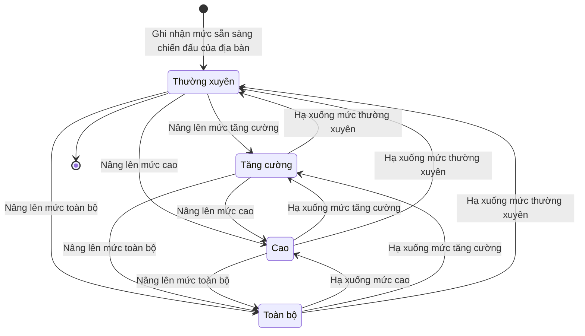

# qt-D6 · Chuyển trạng thái SSCĐ

<!-- máy sinh: tom-tat -->
> **Hồ sơ:** Trạng thái sẵn sàng chiến đấu của địa bàn (`AreaReadiness`)
>
> **Trong sổ phạm vi:** D6 · Chuyển trạng thái SSCĐ (tầng 2)
>
> 10 bước · 4 chặng · 3 vai · 1 bảng quyết định · 0 hạn · 7 khớp nối.
>
> **Nguồn:** sổ nghiệp vụ `qt-D6` · khai báo của app: `dqtv-app/core/processes/combat-readiness/workflow/area-readiness.yaml`. Các bảng do máy sinh từ nguồn này.
<!-- hết: tom-tat -->

<!-- viết tay: dien-giai -->
## Diễn giải

*Phần này viết tay, diễn giải lại điều các bảng bên dưới ghi.*

### Quy trình này để làm gì

Mỗi địa bàn (xã, tỉnh, quân khu, toàn quốc) có một hồ sơ ghi **trạng thái sẵn sàng chiến đấu** hiện tại của nó. Hồ sơ không đi từ đầu tới cuối rồi khép, mà chuyển qua lại giữa bốn mức: *Thường xuyên*, *Tăng cường*, *Cao*, *Toàn bộ*. Mỗi lần chuyển mức phải theo một lệnh; hồ sơ ghi lại lệnh, hai hạn chuyển xong, giờ chuyển xong thực tế, và ở mức cao, toàn bộ thì có bước mở việc lập kế hoạch.

Các bước do vai `assistant` làm, trừ bước mở việc lập kế hoạch do hệ thống tự làm.

### Khi nào bắt đầu

Bước **Ghi nhận mức sẵn sàng chiến đấu của địa bàn** mở hồ sơ, đặt địa bàn ở mức *Thường xuyên*. Bắt buộc nhập ngày chuyển; ghi chú nhập nếu có. Bước ghi mã tỉnh, mã xã, địa bàn, cấp của địa bàn, `transitionOrdered` và đơn vị chủ hồ sơ.

### Diễn ra thế nào

**Nâng mức** — ba bước:

- `raiseAreaReadinessToEnhanced` — từ *Thường xuyên* lên *Tăng cường*.
- `raiseAreaReadinessToHigh` — từ *Thường xuyên* hoặc *Tăng cường* lên *Cao*.
- `raiseAreaReadinessToFull` — từ bất kỳ mức nào thấp hơn lên *Toàn bộ*.

Tức là nâng được vượt cấp, không buộc đi từng nấc. Mỗi bước ghi lại lệnh chuyển trạng thái: số hiệu, `orderSignedBy`, tên cơ quan ra lệnh, ảnh bản lệnh, giờ nhận lệnh, loại nhiệm vụ, ngày chuyển, và `unitReadinessLevels` (mức sẵn sàng của từng đơn vị trên địa bàn). Ba bước nâng còn ghi hai hạn chuyển xong — của Ban chỉ huy quân sự và của phân đội dân quân.

**Hạ mức** — ba bước:

- `lowerAreaReadinessToHigh` — từ *Toàn bộ* xuống *Cao*.
- `lowerAreaReadinessToEnhanced` — từ *Cao* hoặc *Toàn bộ* xuống *Tăng cường*.
- `lowerAreaReadinessToRoutine` — từ bất kỳ mức nào cao hơn về *Thường xuyên*.

Hạ mức ghi lệnh giống nâng mức, nhưng không ghi hai hạn chuyển xong mà xoá hai hạn ấy cùng giờ chuyển xong.

**Làm ở mọi mức, hồ sơ đứng yên:**

- **Ghi giờ chuyển xong trạng thái** — nhập giờ đơn vị chuyển xong theo lệnh gần nhất, nhập theo giờ thực tế chứ không lấy giờ bấm.
- `setReadiness` — đổi mức sẵn sàng của từng đơn vị trên địa bàn. Phải có số lệnh và ảnh lệnh của đơn vị (`unitOrderRef`, `unitOrderScan`).

**Chỉ ở mức "Cao" và "Toàn bộ":** **Mở việc lập kế hoạch của mức cao, toàn bộ** — do hệ thống tự làm, đòi đã có mức chuyển sang; bước ghi lại là đã mở việc lập kế hoạch theo mức.

### Kết thúc và để lại gì

Chặng kết thúc là *Thường xuyên* — cũng chính là chặng hồ sơ mở vào và về lại sau bước `lowerAreaReadinessToRoutine`. Hồ sơ giữ lại lệnh của từng lần chuyển mức, mức sẵn sàng của từng đơn vị trên địa bàn và giờ chuyển xong.

### Điều kiện chặn

- **Ghi giờ chuyển xong** (bảng `transition.completion-gate`): `transitionOrdered` là `no` thì bị chặn (`never_ordered`); là `yes` thì cho qua. Ô `transitionOrdered` được ghi ở bước mở và ở sáu bước chuyển mức. Phải đã có giờ nhận lệnh, thiếu thì báo "chưa ghi lệnh chuyển trạng thái nào có giờ nhận lệnh — ghi lệnh trước rồi mới ghi giờ chuyển xong"; đã có giờ chuyển xong thì báo "lệnh này đã ghi giờ chuyển xong rồi".
- **`setReadiness`**: đòi đã có `unitOrderRef` và `unitOrderScan`.
- **Mở việc lập kế hoạch**: đòi đã có mức chuyển sang; đã mở rồi thì chặn, báo "lệnh này đã mở việc lập kế hoạch rồi".
- Tám bước của vai `assistant` sau bước mở: người làm phải là người của đơn vị chủ hồ sơ.
- Sai người, sai chặng, thiếu thứ phải có trước thì bước bị chặn, hồ sơ giữ nguyên.
<!-- hết viết tay -->

## 1. Đường đi ngắn nhất qua các chặng

<!-- máy sinh: luong-chinh -->
Đường ít bước nhất từ lúc mở hồ sơ tới chặng kết thúc xa nhất. Máy chọn theo số chặng, không theo ý nghĩa nghiệp vụ — trình tự công việc thật xem phần Diễn giải và bảng "Việc làm ở từng chặng" ở mục 6.

| # | Ai làm | Làm gì | Hồ sơ sang chặng |
|---|---|---|---|
| 1 | Chỉ huy trưởng Ban CHQS xã | Ghi nhận mức sẵn sàng chiến đấu của địa bàn | Thường xuyên |

<!-- hết: luong-chinh -->

## 2. Hồ sơ và việc nó để lại

<!-- máy sinh: muc-tieu -->
**App gọi quy trình này là:** Trạng thái sẵn sàng chiến đấu.
<!-- hết: muc-tieu -->

## 3. Khởi phát và kết thúc

<!-- máy sinh: khoi-phat -->
**1 cửa vào** — bước mở hồ sơ:

| Bước mở | Ai mở | Hồ sơ vào chặng | App bắt buộc nhập |
|---|---|---|---|
| Ghi nhận mức sẵn sàng chiến đấu của địa bàn | Chỉ huy trưởng Ban CHQS xã | Thường xuyên | ngày chuyển |

**Kết thúc:** *Thường xuyên* (`routine`)
<!-- hết: khoi-phat -->

## 4. Vai trò

<!-- máy sinh: vai-tro -->
| Vai trong sổ | Tên trong app | Điều kiện | Làm những bước |
|---|---|---|---|
| `commander` | Chỉ huy trưởng Ban CHQS xã |  | Ghi nhận mức sẵn sàng chiến đấu của địa bàn · Nâng lên mức tăng cường · Nâng lên mức cao · Nâng lên mức toàn bộ · Hạ xuống mức cao · Hạ xuống mức tăng cường · Hạ xuống mức thường xuyên |
| `assistant` | Trợ lý Tác huấn |  | Ghi giờ chuyển xong trạng thái · `setReadiness` |
| `system` | Hệ thống tự làm |  | Mở việc lập kế hoạch của mức cao, toàn bộ |

*"Tên trong app" là tên app đặt cho mã chủ thể của vai. Hồ sơ thuộc đơn vị cấp khác thì người làm là người giữ vai ấy ở đơn vị nêu trong cột "Điều kiện" (nếu sổ có ghi) và ở cột "Người làm phải thuộc" của bảng "Theo khai báo của app" (mục 7).*
<!-- hết: vai-tro -->

## 5. Nhánh phụ

<!-- máy sinh: nhanh-phu -->
**Bước khác đưa hồ sơ sang chặng mới** — đường song song, rẽ nhánh hoặc kết thúc sớm:

| Bước | Ai làm | Từ chặng | Sang chặng |
|---|---|---|---|
| Nâng lên mức tăng cường | Chỉ huy trưởng Ban CHQS xã | Thường xuyên | Tăng cường |
| Nâng lên mức cao | Chỉ huy trưởng Ban CHQS xã | Thường xuyên, Tăng cường | Cao |
| Nâng lên mức toàn bộ | Chỉ huy trưởng Ban CHQS xã | Thường xuyên, Tăng cường, Cao | Toàn bộ |
| Hạ xuống mức cao | Chỉ huy trưởng Ban CHQS xã | Toàn bộ | Cao |
| Hạ xuống mức tăng cường | Chỉ huy trưởng Ban CHQS xã | Cao, Toàn bộ | Tăng cường |

**Quay lại một chặng hồ sơ đã đi qua** (tính theo đường ngắn nhất từ lúc mở):

| Bước | Ai làm | Từ chặng | Về chặng |
|---|---|---|---|
| Hạ xuống mức thường xuyên | Chỉ huy trưởng Ban CHQS xã | Tăng cường, Cao, Toàn bộ | Thường xuyên |

**Làm trong lúc hồ sơ đứng yên ở một chặng** — ghi nhận, bổ sung:

| Bước | Ai làm | Ở chặng |
|---|---|---|
| Ghi giờ chuyển xong trạng thái | Trợ lý Tác huấn | Thường xuyên, Tăng cường, Cao, Toàn bộ |
| Mở việc lập kế hoạch của mức cao, toàn bộ | Hệ thống tự làm | Cao, Toàn bộ |
| `setReadiness` | Trợ lý Tác huấn | Thường xuyên, Tăng cường, Cao, Toàn bộ |

<!-- hết: nhanh-phu -->

## 6. Các chặng và việc làm ở từng chặng

<!-- máy sinh: chang -->
| Chặng | Tên hiển thị | Vào bằng bước | Kết thúc? |
|---|---|---|---|
| `routine` | Thường xuyên | Ghi nhận mức sẵn sàng chiến đấu của địa bàn · Hạ xuống mức thường xuyên | **kết thúc** — vẫn còn bước làm được |
| `enhanced` | Tăng cường | Nâng lên mức tăng cường · Hạ xuống mức tăng cường |  |
| `high` | Cao | Nâng lên mức cao · Hạ xuống mức cao |  |
| `full` | Toàn bộ | Nâng lên mức toàn bộ |  |

### Việc làm ở từng chặng

Hồ sơ đang ở chặng nào thì làm được những bước nào.

| Hồ sơ đang ở chặng | Bước làm tại chặng (hồ sơ đứng yên) | Bước đưa hồ sơ sang chặng khác |
|---|---|---|
| **Thường xuyên** | Ghi giờ chuyển xong trạng thái — Trợ lý Tác huấn `setReadiness` — Trợ lý Tác huấn | Nâng lên mức tăng cường — Chỉ huy trưởng Ban CHQS xã → *Tăng cường* Nâng lên mức cao — Chỉ huy trưởng Ban CHQS xã → *Cao* Nâng lên mức toàn bộ — Chỉ huy trưởng Ban CHQS xã → *Toàn bộ* |
| **Tăng cường** | Ghi giờ chuyển xong trạng thái — Trợ lý Tác huấn `setReadiness` — Trợ lý Tác huấn | Nâng lên mức cao — Chỉ huy trưởng Ban CHQS xã → *Cao* Nâng lên mức toàn bộ — Chỉ huy trưởng Ban CHQS xã → *Toàn bộ* Hạ xuống mức thường xuyên — Chỉ huy trưởng Ban CHQS xã → *Thường xuyên* |
| **Cao** | Ghi giờ chuyển xong trạng thái — Trợ lý Tác huấn Mở việc lập kế hoạch của mức cao, toàn bộ — Hệ thống tự làm `setReadiness` — Trợ lý Tác huấn | Nâng lên mức toàn bộ — Chỉ huy trưởng Ban CHQS xã → *Toàn bộ* Hạ xuống mức tăng cường — Chỉ huy trưởng Ban CHQS xã → *Tăng cường* Hạ xuống mức thường xuyên — Chỉ huy trưởng Ban CHQS xã → *Thường xuyên* |
| **Toàn bộ** | Ghi giờ chuyển xong trạng thái — Trợ lý Tác huấn Mở việc lập kế hoạch của mức cao, toàn bộ — Hệ thống tự làm `setReadiness` — Trợ lý Tác huấn | Hạ xuống mức cao — Chỉ huy trưởng Ban CHQS xã → *Cao* Hạ xuống mức tăng cường — Chỉ huy trưởng Ban CHQS xã → *Tăng cường* Hạ xuống mức thường xuyên — Chỉ huy trưởng Ban CHQS xã → *Thường xuyên* |
<!-- hết: chang -->

## 7. Bảng bước

<!-- máy sinh: buoc -->
| # | Bước | Mã bước | Ai thực hiện | Từ chặng | Sang chặng | Phải có trước | Ghi lại |
|---|---|---|---|---|---|---|---|
| 1 | Ghi nhận mức sẵn sàng chiến đấu của địa bàn | `openAreaReadiness` | Chỉ huy trưởng Ban CHQS xã | — (mở hồ sơ) | `routine` | — | mã tỉnh, mã xã, địa bàn, cấp, ngày chuyển, ghi chú, đơn vị chủ hồ sơ |
| 2 | Nâng lên mức tăng cường | `raiseAreaReadinessToEnhanced` | Chỉ huy trưởng Ban CHQS xã | `routine` | `enhanced` | người làm thuộc đơn vị chủ hồ sơ, `raiseAreaReadinessToEnhancedFromIncomingDocumentUsable` | mức chuyển sang, tên cơ quan ra lệnh, ngày chuyển, ghi chú, `unitReadinessLevels`, giờ nhận lệnh, loại nhiệm vụ, hạn chuyển xong — Ban chỉ huy quân sự, hạn chuyển xong — phân đội dân quân, nối tới Văn bản đến |
| 3 | Nâng lên mức cao | `raiseAreaReadinessToHigh` | Chỉ huy trưởng Ban CHQS xã | `routine`, `enhanced` | `high` | người làm thuộc đơn vị chủ hồ sơ, `raiseAreaReadinessToHighFromIncomingDocumentUsable` | mức chuyển sang, tên cơ quan ra lệnh, ngày chuyển, ghi chú, `unitReadinessLevels`, giờ nhận lệnh, loại nhiệm vụ, hạn chuyển xong — Ban chỉ huy quân sự, hạn chuyển xong — phân đội dân quân, nối tới Văn bản đến |
| 4 | Nâng lên mức toàn bộ | `raiseAreaReadinessToFull` | Chỉ huy trưởng Ban CHQS xã | `routine`, `enhanced`, `high` | `full` | người làm thuộc đơn vị chủ hồ sơ, `raiseAreaReadinessToFullFromIncomingDocumentUsable` | mức chuyển sang, tên cơ quan ra lệnh, ngày chuyển, ghi chú, `unitReadinessLevels`, giờ nhận lệnh, loại nhiệm vụ, hạn chuyển xong — Ban chỉ huy quân sự, hạn chuyển xong — phân đội dân quân, nối tới Văn bản đến |
| 5 | Hạ xuống mức cao | `lowerAreaReadinessToHigh` | Chỉ huy trưởng Ban CHQS xã | `full` | `high` | người làm thuộc đơn vị chủ hồ sơ, `lowerAreaReadinessToHighFromIncomingDocumentUsable` | mức chuyển sang, tên cơ quan ra lệnh, ngày chuyển, ghi chú, `unitReadinessLevels`, giờ nhận lệnh, loại nhiệm vụ, nối tới Văn bản đến; **xoá:** giờ chuyển xong, hạn chuyển xong — Ban chỉ huy quân sự, hạn chuyển xong — phân đội dân quân |
| 6 | Hạ xuống mức tăng cường | `lowerAreaReadinessToEnhanced` | Chỉ huy trưởng Ban CHQS xã | `high`, `full` | `enhanced` | người làm thuộc đơn vị chủ hồ sơ, `lowerAreaReadinessToEnhancedFromIncomingDocumentUsable` | mức chuyển sang, tên cơ quan ra lệnh, ngày chuyển, ghi chú, `unitReadinessLevels`, giờ nhận lệnh, loại nhiệm vụ, nối tới Văn bản đến; **xoá:** giờ chuyển xong, hạn chuyển xong — Ban chỉ huy quân sự, hạn chuyển xong — phân đội dân quân |
| 7 | Hạ xuống mức thường xuyên | `lowerAreaReadinessToRoutine` | Chỉ huy trưởng Ban CHQS xã | `enhanced`, `high`, `full` | `routine` | người làm thuộc đơn vị chủ hồ sơ, `lowerAreaReadinessToRoutineFromIncomingDocumentUsable` | mức chuyển sang, tên cơ quan ra lệnh, ngày chuyển, ghi chú, `unitReadinessLevels`, giờ nhận lệnh, loại nhiệm vụ, nối tới Văn bản đến; **xoá:** giờ chuyển xong, hạn chuyển xong — Ban chỉ huy quân sự, hạn chuyển xong — phân đội dân quân |
| 8 | Ghi giờ chuyển xong trạng thái | `recordTransitionComplete` | Trợ lý Tác huấn | `routine`, `enhanced`, `high`, `full` | giữ nguyên | người làm thuộc đơn vị chủ hồ sơ, `transitionNotYetCompleted` | giờ chuyển xong |
| 9 | Mở việc lập kế hoạch của mức cao, toàn bộ | `spawnReadinessChildTasks` | Hệ thống tự làm | `high`, `full` | giữ nguyên | mức chuyển sang | đã mở việc lập kế hoạch theo mức |
| 10 | `setReadiness` | `setReadiness` | Trợ lý Tác huấn | `routine`, `enhanced`, `high`, `full` | giữ nguyên | người làm thuộc đơn vị chủ hồ sơ, `unitOrderRef`, `unitOrderScan` | `unitReadinessLevels`, ngày chuyển, ghi chú |

### Khi không đạt điều kiện

Mặc định: không đúng người, hồ sơ không ở đúng chặng, hoặc thiếu thứ "phải có trước" thì bước bị chặn, hồ sơ giữ nguyên. Bảng dưới chỉ kê những bước có kết quả riêng.

| # | Bước | Kết quả riêng |
|---|---|---|
| 8 | Ghi giờ chuyển xong trạng thái | bước dừng lại, hồ sơ giữ nguyên khi kết quả xét là: `never_ordered` |
| 9 | Mở việc lập kế hoạch của mức cao, toàn bộ | bước này không do người nào bấm |

### Điều kiện "phải có trước" bằng lời

Cột "Phải có trước" ở bảng bước có hai loại: ô dữ liệu thường (bước chỉ đòi ô ấy đã có giá trị) và điều kiện hệ tự xét. Bảng này diễn các điều kiện hệ tự xét theo đúng công thức sổ ghi; số ở cột cuối là số thứ tự bước.

| Điều kiện | Đúng khi | Bước đòi |
|---|---|---|
| `actorInOwnerUnit` | người đang làm là người của đơn vị ghi ở ô đơn vị chủ hồ sơ của hồ sơ này (theo danh mục người của đơn vị, `dm.unit-staff`) | 2, 3, 4, 5, 6, 7, 8, 10 |
| `raiseAreaReadinessToEnhancedFromIncomingDocumentUsable` | có hồ sơ Việc luật giao kèm văn bản đến, đi — Văn bản đến (qt-1.incoming-document) chính là hồ sơ ghi ở ô nối `raiseAreaReadinessToEnhancedFromIncomingDocument` của hồ sơ đang làm mà hồ sơ ấy đang ở chặng `RECEIVED` hoặc `DISTRIBUTED` | 2 |
| `raiseAreaReadinessToHighFromIncomingDocumentUsable` | có hồ sơ Việc luật giao kèm văn bản đến, đi — Văn bản đến (qt-1.incoming-document) chính là hồ sơ ghi ở ô nối `raiseAreaReadinessToHighFromIncomingDocument` của hồ sơ đang làm mà hồ sơ ấy đang ở chặng `RECEIVED` hoặc `DISTRIBUTED` | 3 |
| `raiseAreaReadinessToFullFromIncomingDocumentUsable` | có hồ sơ Việc luật giao kèm văn bản đến, đi — Văn bản đến (qt-1.incoming-document) chính là hồ sơ ghi ở ô nối `raiseAreaReadinessToFullFromIncomingDocument` của hồ sơ đang làm mà hồ sơ ấy đang ở chặng `RECEIVED` hoặc `DISTRIBUTED` | 4 |
| `lowerAreaReadinessToHighFromIncomingDocumentUsable` | có hồ sơ Việc luật giao kèm văn bản đến, đi — Văn bản đến (qt-1.incoming-document) chính là hồ sơ ghi ở ô nối `lowerAreaReadinessToHighFromIncomingDocument` của hồ sơ đang làm mà hồ sơ ấy đang ở chặng `RECEIVED` hoặc `DISTRIBUTED` | 5 |
| `lowerAreaReadinessToEnhancedFromIncomingDocumentUsable` | có hồ sơ Việc luật giao kèm văn bản đến, đi — Văn bản đến (qt-1.incoming-document) chính là hồ sơ ghi ở ô nối `lowerAreaReadinessToEnhancedFromIncomingDocument` của hồ sơ đang làm mà hồ sơ ấy đang ở chặng `RECEIVED` hoặc `DISTRIBUTED` | 6 |
| `lowerAreaReadinessToRoutineFromIncomingDocumentUsable` | có hồ sơ Việc luật giao kèm văn bản đến, đi — Văn bản đến (qt-1.incoming-document) chính là hồ sơ ghi ở ô nối `lowerAreaReadinessToRoutineFromIncomingDocument` của hồ sơ đang làm mà hồ sơ ấy đang ở chặng `RECEIVED` hoặc `DISTRIBUTED` | 7 |
| `transitionNotYetCompleted` | KHÔNG (đã có giờ chuyển xong) | 8 |
| `transitionOrdered` | đã có giờ nhận lệnh | đầu vào bảng quyết định (mục 8) |

### Theo khai báo của app

Người làm phải thuộc đơn vị nào, ô người dùng phải nhập, bước có lặp được không, và căn cứ pháp lý — lấy từ khai báo quy trình trong app.

| # | Bước | Người làm phải thuộc | Bắt buộc nhập | Nhập nếu có | Lặp được | Căn cứ |
|---|---|---|---|---|---|---|
| 1 | Ghi nhận mức sẵn sàng chiến đấu của địa bàn |  | ngày chuyển | ghi chú |  | L48/2019/QH14 Đ.29 k1 |
| 2 | Nâng lên mức tăng cường | đơn vị chủ hồ sơ | lệnh chuyển trạng thái trong sổ văn bản đến, mức chuyển sang, số hiệu lệnh chuyển trạng thái, `signedBy`, tên cơ quan ra lệnh, ảnh bản lệnh chuyển trạng thái, ngày chuyển, giờ nhận lệnh, loại nhiệm vụ | ghi chú | có | L48/2019/QH14 Đ.29 k1 · NĐ01/2019/NĐ-CP Đ.12 |
| 3 | Nâng lên mức cao | đơn vị chủ hồ sơ | lệnh chuyển trạng thái trong sổ văn bản đến, mức chuyển sang, số hiệu lệnh chuyển trạng thái, `signedBy`, tên cơ quan ra lệnh, ảnh bản lệnh chuyển trạng thái, ngày chuyển, giờ nhận lệnh, loại nhiệm vụ | ghi chú | có | L48/2019/QH14 Đ.29 k1 · NĐ01/2019/NĐ-CP Đ.12 |
| 4 | Nâng lên mức toàn bộ | đơn vị chủ hồ sơ | lệnh chuyển trạng thái trong sổ văn bản đến, mức chuyển sang, số hiệu lệnh chuyển trạng thái, `signedBy`, tên cơ quan ra lệnh, ảnh bản lệnh chuyển trạng thái, ngày chuyển, giờ nhận lệnh, loại nhiệm vụ | ghi chú | có | L48/2019/QH14 Đ.29 k1 · NĐ01/2019/NĐ-CP Đ.12 |
| 5 | Hạ xuống mức cao | đơn vị chủ hồ sơ | lệnh chuyển trạng thái trong sổ văn bản đến, mức chuyển sang, số hiệu lệnh chuyển trạng thái, `signedBy`, tên cơ quan ra lệnh, ảnh bản lệnh chuyển trạng thái, ngày chuyển, giờ nhận lệnh, loại nhiệm vụ | ghi chú | có | L48/2019/QH14 Đ.29 k1 · NĐ01/2019/NĐ-CP Đ.12 |
| 6 | Hạ xuống mức tăng cường | đơn vị chủ hồ sơ | lệnh chuyển trạng thái trong sổ văn bản đến, mức chuyển sang, số hiệu lệnh chuyển trạng thái, `signedBy`, tên cơ quan ra lệnh, ảnh bản lệnh chuyển trạng thái, ngày chuyển, giờ nhận lệnh, loại nhiệm vụ | ghi chú | có | L48/2019/QH14 Đ.29 k1 · NĐ01/2019/NĐ-CP Đ.12 |
| 7 | Hạ xuống mức thường xuyên | đơn vị chủ hồ sơ | lệnh chuyển trạng thái trong sổ văn bản đến, mức chuyển sang, số hiệu lệnh chuyển trạng thái, `signedBy`, tên cơ quan ra lệnh, ảnh bản lệnh chuyển trạng thái, ngày chuyển, giờ nhận lệnh, loại nhiệm vụ | ghi chú | có | L48/2019/QH14 Đ.29 k1 · NĐ01/2019/NĐ-CP Đ.12 |
| 8 | Ghi giờ chuyển xong trạng thái | đơn vị chủ hồ sơ | giờ chuyển xong | — |  | L48/2019/QH14 Đ.29 k1 |
| 9 | Mở việc lập kế hoạch của mức cao, toàn bộ |  | — | — |  | L48/2019/QH14 Đ.29 k2 · TT43/2020/TT-BQP Đ.9 k3, k4 |
| — | Chuyển mức sẵn sàng chiến đấu của một đơn vị (`setUnitReadiness`) | đơn vị chủ hồ sơ | đơn vị, mức chuyển sang, số lệnh, văn bản chỉ đạo, ảnh chụp hoặc tệp lệnh chuyển mức của đơn vị, ngày chuyển | ghi chú | có | L48/2019/QH14 Đ.29 k1 |

### Điều kiện và ghi chú app khai cho từng bước

Lấy từ khai báo quy trình trong app. Lời trong ngoặc kép là câu app hiện cho người dùng. Chức danh người ký ngoài hệ app chỉ khai bằng mã.

| # | Bước | Điều kiện, ghi chú |
|---|---|---|
| 2 | Nâng lên mức tăng cường | · bước này ghi một quyết định ký NGOÀI hệ (`readinessOrderedBy`), người ký: `defence_minister`, `general_staff_chief`, `military_region_commander`, `province_military_command` |
| 3 | Nâng lên mức cao | · bước này ghi một quyết định ký NGOÀI hệ (`readinessOrderedBy`), người ký: `defence_minister`, `general_staff_chief`, `military_region_commander`, `province_military_command` |
| 4 | Nâng lên mức toàn bộ | · bước này ghi một quyết định ký NGOÀI hệ (`readinessOrderedBy`), người ký: `defence_minister`, `general_staff_chief`, `military_region_commander`, `province_military_command` |
| 5 | Hạ xuống mức cao | · bước này ghi một quyết định ký NGOÀI hệ (`readinessOrderedBy`), người ký: `defence_minister`, `general_staff_chief`, `military_region_commander`, `province_military_command` |
| 6 | Hạ xuống mức tăng cường | · bước này ghi một quyết định ký NGOÀI hệ (`readinessOrderedBy`), người ký: `defence_minister`, `general_staff_chief`, `military_region_commander`, `province_military_command` |
| 7 | Hạ xuống mức thường xuyên | · bước này ghi một quyết định ký NGOÀI hệ (`readinessOrderedBy`), người ký: `defence_minister`, `general_staff_chief`, `military_region_commander`, `province_military_command` |
| 8 | Ghi giờ chuyển xong trạng thái | · phải đã có ô "giờ nhận lệnh" — thiếu thì app báo: "chưa ghi lệnh chuyển trạng thái nào có giờ nhận lệnh — ghi lệnh trước rồi mới ghi giờ chuyển xong" · không làm được khi đã có ô "giờ chuyển xong" — app báo: "lệnh này đã ghi giờ chuyển xong rồi" |
| 9 | Mở việc lập kế hoạch của mức cao, toàn bộ | · không làm được khi đã có ô "đã mở việc lập kế hoạch theo mức" — app báo: "lệnh này đã mở việc lập kế hoạch rồi" |
<!-- hết: buoc -->

## 8. Bảng quyết định, hạn, việc ngoài hệ

<!-- máy sinh: quyet-dinh -->
**Bảng `transition.completion-gate`** — xét ở bước *Ghi giờ chuyển xong trạng thái*; đầu vào: `transitionOrdered`. 2 dòng, dò từ trên xuống, dòng đầu tiên khớp thì dừng.

| Thứ tự dò (số sổ ghi) | Dòng | Khi | Thì |
|---|---|---|---|
| 1 | `never-ordered` | chưa có `transitionOrdered` | `never_ordered` |
| 2 | `ordered` | đã có `transitionOrdered` | cho qua |

<!-- hết: quyet-dinh -->

## 9. Dữ liệu của hồ sơ

<!-- máy sinh: du-lieu -->
Các ô mà bước trong sổ ghi hoặc đòi. Số trong hai cột cuối là số thứ tự bước ở bảng bước (mục 7).

| Ô dữ liệu | Mã | Kiểu (app) | Giá trị cho phép | Loại ô (sổ) | Bước ghi | Bước đòi | Mô tả trong app |
|---|---|---|---|---|---|---|---|
| mã tỉnh | `provinceCode` | chữ |  | lưu trên hồ sơ (`stored`) | 1 | — | Mã tỉnh — rỗng khi địa bàn là quân khu hoặc toàn quốc |
| mã xã | `communeCode` | chữ |  | lưu trên hồ sơ (`stored`) | 1 | — | Mã xã — rỗng khi địa bàn ở cấp trên |
| địa bàn | `areaName` | chữ |  | lưu trên hồ sơ (`stored`) | 1 | — | Tên địa bàn — đọc được, không phải mã |
| cấp | `areaLevel` | chọn một | Toàn quốc (`central`), Quân khu (`region`), Cấp tỉnh (`province`), Cấp xã (`commune`) | lưu trên hồ sơ (`stored`) | 1 | — | Cấp của địa bàn |
| ngày chuyển | `changedAt` | ngày |  | đưa vào ở bước (`input`) | 1, 2, 3, 4, 5, 6, 7, 10 | — | Ngày chuyển mức |
| ghi chú | `note` | chữ |  | đưa vào ở bước (`input`) | 1, 2, 3, 4, 5, 6, 7, 10 | — | Ghi chú |
| đơn vị chủ hồ sơ | `ownerUnit` |  |  | lưu trên hồ sơ (`stored`) | 1 | — |  |
| mức chuyển sang | `readinessLevel` |  | `routine`, `enhanced`, `high`, `full` | lưu trên hồ sơ (`stored`) | 2, 3, 4, 5, 6, 7 | 9 |  |
| tên cơ quan ra lệnh | `orderedBy` | chữ |  | lưu trên hồ sơ (`stored`) | 2, 3, 4, 5, 6, 7 | — | Cấp ra lệnh chuyển trạng thái |
| — | `unitReadinessLevels` | bảng |  | lưu trên hồ sơ (`stored`) | 2, 3, 4, 5, 6, 7, 10 | — | Ảnh chụp mức sẵn sàng của từng đơn vị trên địa bàn — id đơn vị, tên, mức, số lệnh, ngày chuyển |
| giờ nhận lệnh | `orderReceivedAt` | ngày giờ | có hay chưa | lưu trên hồ sơ (`stored`) | 2, 3, 4, 5, 6, 7 | — | Giờ đơn vị nhận lệnh chuyển trạng thái — mốc tính hạn chuyển xong |
| loại nhiệm vụ | `missionKind` | chọn một | Nhiệm vụ A (`A`), Nhiệm vụ A2 (`A2`), Nhiệm vụ A3 (`A3`), Nhiệm vụ A4 (`A4`) | lưu trên hồ sơ (`stored`) | 2, 3, 4, 5, 6, 7 | — | Loại nhiệm vụ ghi trên lệnh — chọn cột thời gian trong kế hoạch chuyển trạng thái |
| hạn chuyển xong — Ban chỉ huy quân sự | `transitionDueAtCommand` | ngày giờ | có hay chưa | lưu trên hồ sơ (`stored`) | 2, 3, 4 | — | Hạn Ban chỉ huy quân sự chuyển xong — giờ nhận lệnh cộng thời gian trong kế hoạch chuyển trạng thái |
| hạn chuyển xong — phân đội dân quân | `transitionDueAtSquads` | ngày giờ | có hay chưa | lưu trên hồ sơ (`stored`) | 2, 3, 4 | — | Hạn phân đội dân quân chuyển xong — giờ nhận lệnh cộng thời gian trong kế hoạch chuyển trạng thái |
| giờ chuyển xong | `transitionCompletedAt` | ngày giờ | có hay chưa | lưu trên hồ sơ (`stored`) | 8 | — | Giờ đơn vị chuyển xong trạng thái theo lệnh gần nhất — nhập theo giờ thực tế, không lấy giờ bấm |
| đã mở việc lập kế hoạch theo mức | `planReviewTaskingsRaised` | ngày giờ |  | lưu trên hồ sơ (`stored`) | 9 | — | Lúc hệ mở việc lập các kế hoạch của mức cao, toàn bộ theo lệnh gần nhất — có rồi thì không mở lần hai |
| người làm thuộc đơn vị chủ hồ sơ | `actorInOwnerUnit` |  | có hay chưa | hệ suy ra (`derived`) | — | 2, 3, 4, 5, 6, 7, 8, 10 |  |
| — | `raiseAreaReadinessToEnhancedFromIncomingDocumentUsable` |  | có hay chưa | hệ suy ra (`derived`) | — | 2 |  |
| — | `raiseAreaReadinessToHighFromIncomingDocumentUsable` |  | có hay chưa | hệ suy ra (`derived`) | — | 3 |  |
| — | `raiseAreaReadinessToFullFromIncomingDocumentUsable` |  | có hay chưa | hệ suy ra (`derived`) | — | 4 |  |
| — | `lowerAreaReadinessToHighFromIncomingDocumentUsable` |  | có hay chưa | hệ suy ra (`derived`) | — | 5 |  |
| — | `lowerAreaReadinessToEnhancedFromIncomingDocumentUsable` |  | có hay chưa | hệ suy ra (`derived`) | — | 6 |  |
| — | `lowerAreaReadinessToRoutineFromIncomingDocumentUsable` |  | có hay chưa | hệ suy ra (`derived`) | — | 7 |  |
| — | `transitionNotYetCompleted` |  | có hay chưa | hệ suy ra (`derived`) | — | 8 |  |
| — | `unitOrderRef` |  |  | đưa vào ở bước (`input`) | — | 10 |  |
| — | `unitOrderScan` |  |  | đưa vào ở bước (`input`) | — | 10 |  |
| — | `transitionOrdered` |  | có hay chưa | hệ suy ra (`derived`) | — | — |  |

27 ô. Cột "Loại ô" là cách sổ phân loại ô, in kèm đúng chữ của sổ; ô nào người dùng phải nhập xem bảng "Theo khai báo của app" ở mục 7.
<!-- hết: du-lieu -->

## 10. Khớp nối với quy trình khác

<!-- máy sinh: khop-noi -->
| Quy trình kia | Hồ sơ kia | Quan hệ | Nội dung (mô tả trong app) | Bước ghi mối nối | Tên ô nối |
|---|---|---|---|---|---|
| 1.incoming-document | Văn bản đến | có nối | Dòng sổ văn bản đến của lệnh chuyển mức này | — | `areaChangeInIncomingDocument` |
| 1.incoming-document | Văn bản đến | gắn với nhau ở một bước giữa chừng | Văn bản đến là lệnh của lần chuyển mức này (bước lowerAreaReadinessToEnhanced) | D6·lowerAreaReadinessToEnhanced | `lowerAreaReadinessToEnhancedFromIncomingDocument` |
| 1.incoming-document | Văn bản đến | gắn với nhau ở một bước giữa chừng | Văn bản đến là lệnh của lần chuyển mức này (bước lowerAreaReadinessToHigh) | D6·lowerAreaReadinessToHigh | `lowerAreaReadinessToHighFromIncomingDocument` |
| 1.incoming-document | Văn bản đến | gắn với nhau ở một bước giữa chừng | Văn bản đến là lệnh của lần chuyển mức này (bước lowerAreaReadinessToRoutine) | D6·lowerAreaReadinessToRoutine | `lowerAreaReadinessToRoutineFromIncomingDocument` |
| 1.incoming-document | Văn bản đến | gắn với nhau ở một bước giữa chừng | Văn bản đến là lệnh của lần chuyển mức này (bước raiseAreaReadinessToEnhanced) | D6·raiseAreaReadinessToEnhanced | `raiseAreaReadinessToEnhancedFromIncomingDocument` |
| 1.incoming-document | Văn bản đến | gắn với nhau ở một bước giữa chừng | Văn bản đến là lệnh của lần chuyển mức này (bước raiseAreaReadinessToFull) | D6·raiseAreaReadinessToFull | `raiseAreaReadinessToFullFromIncomingDocument` |
| 1.incoming-document | Văn bản đến | gắn với nhau ở một bước giữa chừng | Văn bản đến là lệnh của lần chuyển mức này (bước raiseAreaReadinessToHigh) | D6·raiseAreaReadinessToHigh | `raiseAreaReadinessToHighFromIncomingDocument` |

7 khớp nối. ⊕ là bước tạo hồ sơ.
<!-- hết: khop-noi -->

## 11. Thông tin chung

<!-- máy sinh: thong-tin -->
| | |
|---|---|
| **Mã trong sổ** | `qt-D6` |
| **Quy trình trong app** | `combat-readiness` (`workflow/area-readiness.yaml`) — mặt công tác: `operations` |
| **Hồ sơ** | Trạng thái sẵn sàng chiến đấu của địa bàn (`AreaReadiness`) |
| **Căn cứ pháp lý từng bước** | cột "Căn cứ" ở bảng "Theo khai báo của app", mục 7 |
<!-- hết: thong-tin -->
