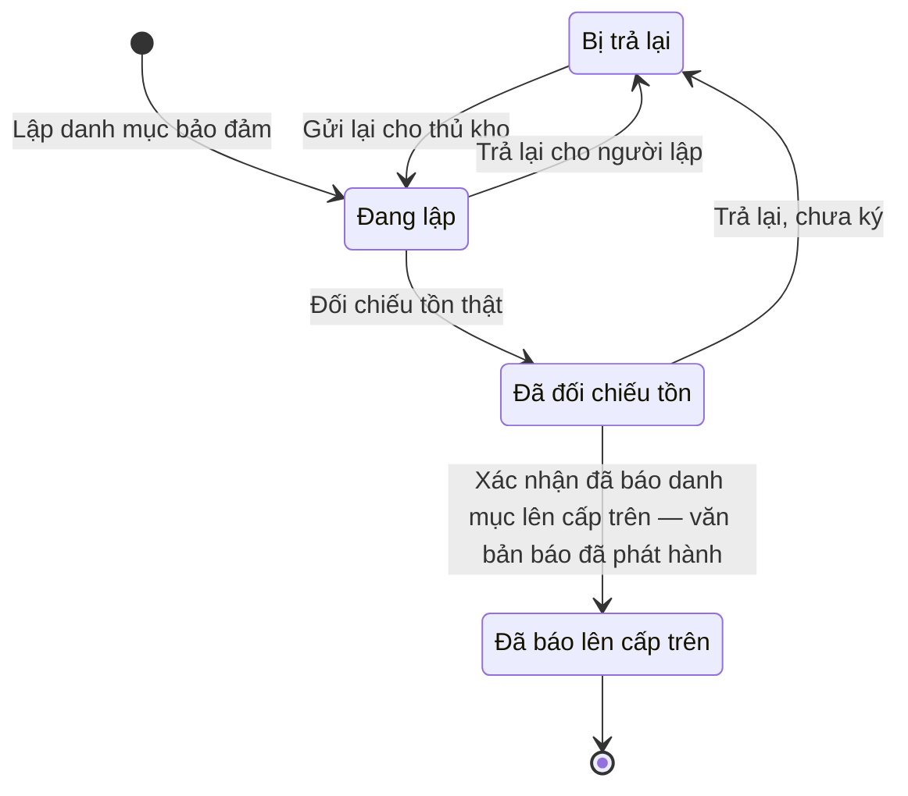

# qt-D7 · Nhu cầu, đề nghị bảo đảm vật chất

<!-- máy sinh: tom-tat -->
> **Hồ sơ:** Danh mục bảo đảm (`ProvisionDemand`)
>
> **Trong sổ phạm vi:** D7 · Nhu cầu, đề nghị bảo đảm vật chất (tầng 2)
>
> 10 bước · 4 chặng · 4 vai · 0 bảng quyết định · 0 hạn · 4 khớp nối.
>
> **Nguồn:** sổ nghiệp vụ `qt-D7` · khai báo của app: `dqtv-app/core/processes/provision-demand/workflow/provision-demand.yaml`. Các bảng do máy sinh từ nguồn này.
<!-- hết: tom-tat -->

<!-- viết tay: dien-giai -->
## Diễn giải

*Phần này viết tay, diễn giải lại điều các bảng bên dưới ghi.*

### Quy trình này để làm gì

Một đơn vị lập **danh mục bảo đảm** cho một năm ngân sách, mỗi thứ một dòng. Có ba loại danh mục — quân phục, vũ khí trang bị, trang thiết bị làm việc — mỗi loại một bảng định mức. Trợ lý Quân lực lập, Nhân viên quân khí kiêm thủ kho đối chiếu với tồn thật, Chỉ huy trưởng Ban CHQS xã ký; cả ba là người của đơn vị chủ hồ sơ.

Hồ sơ đi qua ba chặng: *Đang lập* → *Đã đối chiếu tồn* → *Đã ký*. Người dùng đã chốt đây là một khuôn chung cho xã, tỉnh, quân khu, trung tâm GDQP và Cục; cấp là một ô của hồ sơ. Cấp trên mở danh mục của chính mình, cộng các danh mục đã ký của cấp dưới vào, rồi báo lên cấp trên.

### Khi nào bắt đầu

Trợ lý Quân lực bấm **Lập danh mục bảo đảm**, bắt buộc nhập năm ngân sách và loại; đơn vị chủ hồ sơ, cấp, chủ hồ sơ cấp trên là ô nhập nếu có. Số danh mục tự sinh. Hồ sơ vào chặng *Đang lập*.

### Diễn ra thế nào

**Chặng "Đang lập"** — trợ lý và thủ kho làm qua lại, các việc sau đều lặp được:

1. **Thêm dòng danh mục** (Trợ lý Quân lực) — tạo một hồ sơ con Dòng danh mục bảo đảm; bắt buộc nhập `itemName`, `needed`, `held`, `shortfall`, `mechanism`.
2. **Ghi chú dòng danh mục** (thủ kho) — ghi chú đối chiếu vào một dòng cụ thể.
3. **Trả lại cho người lập** (thủ kho) — phải ghi lý do trả lại. Từ lúc này danh mục "đang bị trả lại": thủ kho không đối chiếu tồn hay trả lại lần nữa được cho tới khi trợ lý gửi lại.
4. **Gửi lại cho thủ kho** (Trợ lý Quân lực) — chỉ bấm được khi danh mục đang bị trả lại; gửi lại xong thì hết bị trả lại, lý do trả lại được xoá.
5. **Tổng hợp danh mục cấp dưới** (Trợ lý Quân lực) — nối tới các danh mục cấp dưới đã ký được cộng, ghi lại tổng thiếu cấp dưới và cấp dưới chưa nộp.
6. **Nhắc cấp dưới chưa nộp** (Trợ lý Quân lực) — bước ghi "nhắc cấp dưới lúc" (lần nhắc gần nhất). Theo lời đã chốt, còn cấp dưới chưa nộp thì cấp trên vẫn ký và báo lên được.

**Chuyển chặng:** thủ kho bấm **Đối chiếu tồn thật** để đưa hồ sơ sang *Đã đối chiếu tồn* — không bấm được khi danh mục đang bị trả lại. Bước ghi lúc đối chiếu, nhận xét đối chiếu, phần tồn kho của cấp mình tự cấp được và phần còn thiếu báo lên (bằng tổng thiếu cấp dưới trừ phần tự cấp được).

**Chặng "Đã đối chiếu tồn"** — Chỉ huy trưởng chọn một trong hai:

- **Ký danh mục bảo đảm** → *Đã ký*; bước ghi người ký, ký lúc.
- **Trả lại, chưa ký** → về *Đang lập*, phải ghi lý do trả lại. Bước ghi lại "trả lại lúc", nên danh mục lại "đang bị trả lại": trợ lý phải gửi lại thì thủ kho mới đối chiếu được.

**Chặng "Đã ký"** — Trợ lý Quân lực bấm **Báo danh mục lên cấp trên**; bước ghi lúc báo và ô nối `demandReportDocument`. Hồ sơ đứng yên.

### Kết thúc và để lại gì

Hồ sơ kết thúc ở chặng *Đã ký*; ở chặng này vẫn còn bước báo lên cấp trên. **Đợt mua sắm** (D9) mở ra từ một danh mục bảo đảm đã ký.

### Điều kiện chặn

- Mọi bước trừ bước mở: người làm phải là người của đơn vị chủ hồ sơ. Sai người, sai chặng, thiếu thứ phải có trước thì bước bị chặn, hồ sơ giữ nguyên.
- Gửi lại cho thủ kho: phải đang bị trả lại (`demandReturned` — đã có "trả lại lúc"). Đối chiếu tồn thật và Trả lại cho người lập: phải không đang bị trả lại (`demandNotAwaitingDrafter` — "trả lại lúc" còn trống).
- Hạn nộp là mốc kế hoạch năm, không chặn bước nào.
<!-- hết viết tay -->

## 1. Đường đi ngắn nhất qua các chặng

<!-- máy sinh: luong-chinh -->
Đường ít bước nhất từ lúc mở hồ sơ tới chặng kết thúc xa nhất. Máy chọn theo số chặng, không theo ý nghĩa nghiệp vụ — trình tự công việc thật xem phần Diễn giải và bảng "Việc làm ở từng chặng" ở mục 6.

| # | Ai làm | Làm gì | Hồ sơ sang chặng |
|---|---|---|---|
| 1 | Trợ lý Quân lực | Lập danh mục bảo đảm | Đang lập |
| 2 | Nhân viên quân khí kiêm thủ kho | Đối chiếu tồn thật | Đã đối chiếu tồn |
| 3 | Hệ thống tự làm | Xác nhận đã báo danh mục lên cấp trên — văn bản báo đã phát hành | Đã báo lên cấp trên |

<!-- hết: luong-chinh -->

## 2. Hồ sơ và việc nó để lại

<!-- máy sinh: muc-tieu -->
**App gọi quy trình này là:** Danh mục bảo đảm.

**Khi mở, hồ sơ này ghi mối nối tới:**
- Nhiệm vụ trên giao (1) — bước `openProvisionDemand`, khớp nối `provisionDemandServesTasking`

**Hồ sơ này để lại cho quy trình khác** (bước tạo hồ sơ của quy trình kia ghi mối nối về đây):
- Đợt mua sắm (D9) — bước `openProcurement`, khớp nối `procurementFromDemand`
<!-- hết: muc-tieu -->

## 3. Khởi phát và kết thúc

<!-- máy sinh: khoi-phat -->
**1 cửa vào** — bước mở hồ sơ:

| Bước mở | Ai mở | Hồ sơ vào chặng | App bắt buộc nhập |
|---|---|---|---|
| Lập danh mục bảo đảm | Trợ lý Quân lực | Đang lập | năm ngân sách, loại, việc gốc |

**Kết thúc:** *Đã báo lên cấp trên* (`REPORTED`)
<!-- hết: khoi-phat -->

## 4. Vai trò

<!-- máy sinh: vai-tro -->
| Vai trong sổ | Tên trong app | Điều kiện | Làm những bước |
|---|---|---|---|
| `registrar` | Trợ lý Quân lực |  | Lập danh mục bảo đảm · Gửi lại cho thủ kho · Tổng hợp danh mục cấp dưới · Nhắc cấp dưới chưa nộp |
| `quartermaster` | Nhân viên quân khí kiêm thủ kho |  | Ghi chú dòng danh mục · Đối chiếu tồn thật · Trả lại cho người lập · Trình ký văn bản báo danh mục |
| `commander` | Chỉ huy trưởng Ban CHQS xã |  | Trả lại, chưa ký |
| `system` | Hệ thống tự làm |  | Xác nhận đã báo danh mục lên cấp trên — văn bản báo đã phát hành |

*"Tên trong app" là tên app đặt cho mã chủ thể của vai. Hồ sơ thuộc đơn vị cấp khác thì người làm là người giữ vai ấy ở đơn vị nêu trong cột "Điều kiện" (nếu sổ có ghi) và ở cột "Người làm phải thuộc" của bảng "Theo khai báo của app" (mục 7).*
<!-- hết: vai-tro -->

## 5. Nhánh phụ

<!-- máy sinh: nhanh-phu -->
**Bước khác đưa hồ sơ sang chặng mới** — đường song song, rẽ nhánh hoặc kết thúc sớm:

| Bước | Ai làm | Từ chặng | Sang chặng |
|---|---|---|---|
| Trả lại cho người lập | Nhân viên quân khí kiêm thủ kho | Đang lập | Bị trả lại |
| Trả lại, chưa ký | Chỉ huy trưởng Ban CHQS xã | Đã đối chiếu tồn | Bị trả lại |

**Quay lại một chặng hồ sơ đã đi qua** (tính theo đường ngắn nhất từ lúc mở):

| Bước | Ai làm | Từ chặng | Về chặng |
|---|---|---|---|
| Gửi lại cho thủ kho | Trợ lý Quân lực | Bị trả lại | Đang lập |

**Làm trong lúc hồ sơ đứng yên ở một chặng** — ghi nhận, bổ sung:

| Bước | Ai làm | Ở chặng |
|---|---|---|
| Ghi chú dòng danh mục *(lặp được)* | Nhân viên quân khí kiêm thủ kho | Đang lập |
| Trình ký văn bản báo danh mục | Nhân viên quân khí kiêm thủ kho | Đã đối chiếu tồn |
| Tổng hợp danh mục cấp dưới *(lặp được)* | Trợ lý Quân lực | Đang lập, Bị trả lại |
| Nhắc cấp dưới chưa nộp *(lặp được)* | Trợ lý Quân lực | Đang lập, Bị trả lại |

<!-- hết: nhanh-phu -->

## 6. Các chặng và việc làm ở từng chặng

<!-- máy sinh: chang -->
| Chặng | Tên hiển thị | Vào bằng bước | Kết thúc? |
|---|---|---|---|
| `RETURNED` | Bị trả lại | Trả lại cho người lập · Trả lại, chưa ký |  |
| `DRAFT` | Đang lập | Lập danh mục bảo đảm · Gửi lại cho thủ kho |  |
| `RECONCILED` | Đã đối chiếu tồn | Đối chiếu tồn thật |  |
| `REPORTED` | Đã báo lên cấp trên | Xác nhận đã báo danh mục lên cấp trên — văn bản báo đã phát hành | **kết thúc** |

### Việc làm ở từng chặng

Hồ sơ đang ở chặng nào thì làm được những bước nào.

| Hồ sơ đang ở chặng | Bước làm tại chặng (hồ sơ đứng yên) | Bước đưa hồ sơ sang chặng khác |
|---|---|---|
| **Bị trả lại** | Tổng hợp danh mục cấp dưới (lặp được) — Trợ lý Quân lực Nhắc cấp dưới chưa nộp (lặp được) — Trợ lý Quân lực | Gửi lại cho thủ kho — Trợ lý Quân lực → *Đang lập* |
| **Đang lập** | Ghi chú dòng danh mục (lặp được) — Nhân viên quân khí kiêm thủ kho Tổng hợp danh mục cấp dưới (lặp được) — Trợ lý Quân lực Nhắc cấp dưới chưa nộp (lặp được) — Trợ lý Quân lực | Đối chiếu tồn thật — Nhân viên quân khí kiêm thủ kho → *Đã đối chiếu tồn* Trả lại cho người lập — Nhân viên quân khí kiêm thủ kho → *Bị trả lại* |
| **Đã đối chiếu tồn** | Trình ký văn bản báo danh mục — Nhân viên quân khí kiêm thủ kho | Trả lại, chưa ký — Chỉ huy trưởng Ban CHQS xã → *Bị trả lại* Xác nhận đã báo danh mục lên cấp trên — văn bản báo đã phát hành — Hệ thống tự làm → *Đã báo lên cấp trên* |
| **Đã báo lên cấp trên** | — | — (kết thúc) |
<!-- hết: chang -->

## 7. Bảng bước

<!-- máy sinh: buoc -->
| # | Bước | Mã bước | Ai thực hiện | Từ chặng | Sang chặng | Phải có trước | Ghi lại |
|---|---|---|---|---|---|---|---|
| 1 | Lập danh mục bảo đảm | `openProvisionDemand` | Trợ lý Quân lực | — (mở hồ sơ) | `DRAFT` | `taskingAssigned`, `fiscalYearCurrentOrNext` | mã tỉnh, mã xã, số danh mục, năm ngân sách, loại, đơn vị chủ hồ sơ, cấp, nối tới Nhiệm vụ trên giao, nối tới Dòng danh mục bảo đảm |
| 2 | Ghi chú dòng danh mục | `noteProvisionDemandLine` | Nhân viên quân khí kiêm thủ kho | `DRAFT` | giữ nguyên | người làm thuộc đơn vị chủ hồ sơ | — |
| 3 | Gửi lại cho thủ kho | `resubmitProvisionDemand` | Trợ lý Quân lực | `RETURNED` | `DRAFT` | người làm thuộc đơn vị chủ hồ sơ | —; **xoá:** lý do trả lại |
| 4 | Đối chiếu tồn thật | `reconcileProvisionDemand` | Nhân viên quân khí kiêm thủ kho | `DRAFT` | `RECONCILED` | người làm thuộc đơn vị chủ hồ sơ | đối chiếu tồn lúc, nhận xét đối chiếu, phần tồn kho tự cấp được, còn thiếu báo lên |
| 5 | Trả lại cho người lập | `returnProvisionDemand` | Nhân viên quân khí kiêm thủ kho | `DRAFT` | `RETURNED` | người làm thuộc đơn vị chủ hồ sơ | lý do trả lại |
| 6 | Trình ký văn bản báo danh mục | `requestProvisionDemandSignature` | Nhân viên quân khí kiêm thủ kho | `RECONCILED` | giữ nguyên | người làm thuộc đơn vị chủ hồ sơ, `aggregatedDemandsMatchYearAndKind`, `noReportAggregatedDemandDocumentOpen` | nối tới Văn bản đi |
| 7 | Trả lại, chưa ký | `rejectProvisionDemand` | Chỉ huy trưởng Ban CHQS xã | `RECONCILED` | `RETURNED` | người làm thuộc đơn vị chủ hồ sơ | lý do trả lại, đối chiếu tồn lúc, nhận xét đối chiếu |
| 8 | Tổng hợp danh mục cấp dưới | `aggregateSubordinateDemand` | Trợ lý Quân lực | `DRAFT`, `RETURNED` | giữ nguyên | người làm thuộc đơn vị chủ hồ sơ | nối tới Danh mục bảo đảm, tổng thiếu cấp dưới, cấp dưới chưa nộp |
| 9 | Nhắc cấp dưới chưa nộp | `remindMissingSubordinateDemand` | Trợ lý Quân lực | `DRAFT`, `RETURNED` | giữ nguyên | người làm thuộc đơn vị chủ hồ sơ | nhắc cấp dưới lúc |
| 10 | Xác nhận đã báo danh mục lên cấp trên — văn bản báo đã phát hành | `reportAggregatedDemand` | Hệ thống tự làm | `RECONCILED` | `REPORTED` | `reportAggregatedDemandDocumentIssued` | báo lên cấp trên lúc, nối tới Văn bản đến |

### Khi không đạt điều kiện

Mặc định: không đúng người, hồ sơ không ở đúng chặng, hoặc thiếu thứ "phải có trước" thì bước bị chặn, hồ sơ giữ nguyên. Bảng dưới chỉ kê những bước có kết quả riêng.

| # | Bước | Kết quả riêng |
|---|---|---|
| 10 | Xác nhận đã báo danh mục lên cấp trên — văn bản báo đã phát hành | bước này không do người nào bấm |

### Điều kiện "phải có trước" bằng lời

Cột "Phải có trước" ở bảng bước có hai loại: ô dữ liệu thường (bước chỉ đòi ô ấy đã có giá trị) và điều kiện hệ tự xét. Bảng này diễn các điều kiện hệ tự xét theo đúng công thức sổ ghi; số ở cột cuối là số thứ tự bước.

| Điều kiện | Đúng khi | Bước đòi |
|---|---|---|
| `taskingAssigned` | có hồ sơ Việc luật giao kèm văn bản đến, đi (qt-1) chính là hồ sơ ghi ở ô nối `provisionDemandServesTasking` của hồ sơ đang làm mà hồ sơ ấy đang ở chặng `ASSIGNED` hoặc `BROKEN_DOWN` | 1 |
| `actorInOwnerUnit` | người đang làm là người của đơn vị ghi ở ô đơn vị chủ hồ sơ của hồ sơ này (theo danh mục người của đơn vị, `dm.unit-staff`) | 2, 3, 4, 5, 6, 7, 8, 9 |
| `aggregatedDemandsMatchYearAndKind` | KHÔNG (có hồ sơ Nhu cầu, đề nghị bảo đảm vật chất (qt-D7) chính là hồ sơ ghi ở ô nối `aggregatesSubordinateDemand` của hồ sơ đang làm mà KHÔNG (năm ngân sách của hồ sơ đang xét bằng năm ngân sách của hồ sơ này) HOẶC KHÔNG (loại của hồ sơ đang xét bằng loại của hồ sơ này)) | 6 |
| `noReportAggregatedDemandDocumentOpen` | KHÔNG (có hồ sơ Việc luật giao kèm văn bản đến, đi — Văn bản đi (qt-1.outgoing-document) chính là hồ sơ ghi ở ô nối `reportAggregatedDemandByDocument` của hồ sơ đang làm mà hồ sơ ấy đang ở chặng `DRAFT` hoặc `PENDING_SIGNATURE` hoặc `SIGNED`) | 6 |
| `reportAggregatedDemandDocumentIssued` | có hồ sơ Việc luật giao kèm văn bản đến, đi — Văn bản đi (qt-1.outgoing-document) chính là hồ sơ ghi ở ô nối `reportAggregatedDemandByDocument` của hồ sơ đang làm mà hồ sơ ấy đang ở chặng `ISSUED` | 10 |

### Theo khai báo của app

Người làm phải thuộc đơn vị nào, ô người dùng phải nhập, bước có lặp được không, và căn cứ pháp lý — lấy từ khai báo quy trình trong app.

| # | Bước | Người làm phải thuộc | Bắt buộc nhập | Nhập nếu có | Lặp được | Căn cứ |
|---|---|---|---|---|---|---|
| 1 | Lập danh mục bảo đảm |  | năm ngân sách, loại, việc gốc | đơn vị chủ hồ sơ, cấp, chủ hồ sơ cấp trên |  | TT77/2020/TT-BQP Đ.10 k1; NĐ72/2020/NĐ-CP Phụ lục II |
| 2 | Ghi chú dòng danh mục |  | `lineId`, ghi chú đối chiếu | — | có | QĐ1126/QĐ-TM Đ.12 k4 |
| 3 | Gửi lại cho thủ kho |  | — | — | có | QĐ1126/QĐ-TM Đ.12 k4 |
| 4 | Đối chiếu tồn thật |  | — | nhận xét đối chiếu, phần tồn kho tự cấp được, còn thiếu báo lên |  | QĐ1126/QĐ-TM Đ.12 k4 |
| 5 | Trả lại cho người lập |  | lý do trả lại | — | có | QĐ1126/QĐ-TM Đ.12 k4 |
| 6 | Trình ký văn bản báo danh mục |  | — | văn bản báo danh mục (PDF, nếu có) |  | TT77/2020/TT-BQP Đ.10 k2 |
| 7 | Trả lại, chưa ký |  | lý do trả lại | — |  | TT77/2020/TT-BQP Đ.10 k2 |
| 8 | Tổng hợp danh mục cấp dưới |  | tổng thiếu cấp dưới | danh mục cấp dưới đã ký được cộng, cấp dưới chưa nộp | có | sổ nghiệp vụ qt-D7 · step:aggregateSubordinateDemand |
| 9 | Nhắc cấp dưới chưa nộp |  | — | — | có | sổ nghiệp vụ qt-D7 · step:remindMissingSubordinateDemand |
| 10 | Xác nhận đã báo danh mục lên cấp trên — văn bản báo đã phát hành |  | — | văn bản báo đã phát hành, bản đã vào sổ đến cấp trên |  | sổ nghiệp vụ qt-D7 · step:reportAggregatedDemand |
| — | Thêm dòng danh mục (`addDemandLine`) |  | `itemName`, `needed`, `held`, `shortfall`, `mechanism` | `uniformType`, `groupCode`, `groupLabel`, `sizeCode`, ghi chú | có | TT77/2020/TT-BQP Đ.10 k1 |

### Điều kiện và ghi chú app khai cho từng bước

Lấy từ khai báo quy trình trong app. Lời trong ngoặc kép là câu app hiện cho người dùng. Chức danh người ký ngoài hệ app chỉ khai bằng mã.

| # | Bước | Điều kiện, ghi chú |
|---|---|---|
| — | Thêm dòng danh mục | · tạo thêm một hồ sơ con: Dòng danh mục bảo đảm (`ProvisionDemandLine`) |
<!-- hết: buoc -->

## 8. Bảng quyết định, hạn, việc ngoài hệ

<!-- máy sinh: quyet-dinh -->

<!-- hết: quyet-dinh -->

## 9. Dữ liệu của hồ sơ

<!-- máy sinh: du-lieu -->
Các ô mà bước trong sổ ghi hoặc đòi. Số trong hai cột cuối là số thứ tự bước ở bảng bước (mục 7).

| Ô dữ liệu | Mã | Kiểu (app) | Giá trị cho phép | Loại ô (sổ) | Bước ghi | Bước đòi | Mô tả trong app |
|---|---|---|---|---|---|---|---|
| mã tỉnh | `provinceCode` | chữ |  | lưu trên hồ sơ (`stored`) | 1 | — | Mã tỉnh — lọc phạm vi theo hàng |
| mã xã | `communeCode` | chữ |  | lưu trên hồ sơ (`stored`) | 1 | — | Mã xã — rỗng khi danh mục của cấp trên |
| số danh mục | `demandNumber` | chữ |  | lưu trên hồ sơ (`stored`) | 1 | — | Số danh mục tự sinh (vd DMBĐ-2027-01) |
| năm ngân sách | `fiscalYear` | số |  | đưa vào ở bước (`input`) | 1 | — | Năm ngân sách |
| loại | `demandKind` | chọn một | Quân phục (`uniform`), Vũ khí, trang bị (`weapon`), Trang thiết bị làm việc (`working_equipment`) | đưa vào ở bước (`input`) | 1 | — | Loại danh mục: quân phục / vũ khí trang bị / trang thiết bị làm việc (mỗi loại một bảng định mức) |
| đơn vị chủ hồ sơ | `ownerUnit` | chữ |  | lưu trên hồ sơ (`stored`) | 1 | — | Đơn vị chủ danh mục — id đơn vị của người đã lập |
| cấp | `demandLevel` | chọn một | Cấp xã (`commune`), Cấp tỉnh (`province`), Quân khu (`region`), Trung tâm GDQP (`gdqp_centre`), Cục (`department`) | lưu trên hồ sơ (`stored`) | 1 | — | Cấp lập danh mục — xã, tỉnh, quân khu, trung tâm GDQP, Cục |
| đối chiếu tồn lúc | `reconciledAt` | ngày giờ |  | lưu trên hồ sơ (`stored`) | 4, 7 | — | Thời điểm thủ kho đối chiếu tồn |
| nhận xét đối chiếu | `reconcileNote` | chữ |  | đưa vào ở bước (`input`) | 4, 7 | — | Nhận xét của thủ kho khi đối chiếu tồn (thực lực ngoài sổ, hàng hỏng, hàng đã hứa việc khác) |
| trừ tồn tự cấp được | `stockDeducted` | số | có hay chưa | lưu trên hồ sơ (`stored`) | 4 | — | Phần tồn kho của cấp mình tự cấp được — thủ kho trừ ra khi đối chiếu |
| còn thiếu báo lên | `netShortfall` | số | có hay chưa | lưu trên hồ sơ (`stored`) | 4 | — | Còn thiếu thật báo lên cấp trên = tổng thiếu cấp dưới − phần tự cấp được |
| lý do trả lại | `returnReason` | chữ |  | đưa vào ở bước (`input`) | 5, 7 | — | Lý do trả lại cho người lập — của thủ kho hoặc của Chỉ huy trưởng |
| tổng thiếu cấp dưới | `subordinateShortfallTotal` | số | có hay chưa | lưu trên hồ sơ (`stored`) | 8 | — | Tổng còn thiếu của các danh mục cấp dưới đã ký đã cộng vào |
| cấp dưới chưa nộp | `missingSubordinates` | chữ | có hay chưa | lưu trên hồ sơ (`stored`) | 8 | — | Đơn vị cấp dưới chưa có danh mục đã ký lúc tổng hợp (mã, cách nhau dấu phẩy) |
| nhắc cấp dưới lúc | `remindedAt` | ngày giờ | có hay chưa | lưu trên hồ sơ (`stored`) | 9 | — | Lần nhắc cấp dưới chưa nộp gần nhất |
| báo lên cấp trên lúc | `demandReportedAt` | ngày giờ | có hay chưa | lưu trên hồ sơ (`stored`) | 10 | — | Thời điểm báo danh mục đã ký lên cấp trên |
| — | `taskingAssigned` |  | có hay chưa | hệ suy ra (`derived`) | — | 1 |  |
| — | `fiscalYearCurrentOrNext` |  | có hay chưa | đưa vào ở bước (`input`) | — | 1 |  |
| người làm thuộc đơn vị chủ hồ sơ | `actorInOwnerUnit` |  | có hay chưa | hệ suy ra (`derived`) | — | 2, 3, 4, 5, 6, 7, 8, 9 |  |
| — | `aggregatedDemandsMatchYearAndKind` |  | có hay chưa | hệ suy ra (`derived`) | — | 6 |  |
| — | `noReportAggregatedDemandDocumentOpen` |  | có hay chưa | hệ suy ra (`derived`) | — | 6 |  |
| — | `reportAggregatedDemandDocumentIssued` |  | có hay chưa | hệ suy ra (`derived`) | — | 10 |  |

22 ô. Cột "Loại ô" là cách sổ phân loại ô, in kèm đúng chữ của sổ; ô nào người dùng phải nhập xem bảng "Theo khai báo của app" ở mục 7.
<!-- hết: du-lieu -->

## 10. Khớp nối với quy trình khác

<!-- máy sinh: khop-noi -->
| Quy trình kia | Hồ sơ kia | Quan hệ | Nội dung (mô tả trong app) | Bước ghi mối nối | Tên ô nối |
|---|---|---|---|---|---|
| 1 | Nhiệm vụ trên giao | hồ sơ này **mở ra có nối tới** hồ sơ kia | Việc gốc mà danh mục bảo đảm này thực hiện — nhiệm vụ dự toán ngân sách năm của đơn vị (sổ qt-D7, 21/10/2026) | D7·openProvisionDemand ⊕ | `provisionDemandServesTasking` |
| 1.incoming-document | Văn bản đến | gắn với nhau ở một bước giữa chừng | Bản văn bản báo danh mục đã vào sổ văn bản đến của cấp trên trực tiếp (sổ qt-D7, N3/N7) | D7·reportAggregatedDemand | `provisionDemandSubmissionDeliveredAs` |
| 1.outgoing-document | Văn bản đi | gắn với nhau ở một bước giữa chừng | Văn bản báo danh mục bảo đảm đã ký lên cấp trên — văn bản đi của đơn vị lập (sổ qt-D7) | D7·requestProvisionDemandSignature | `reportAggregatedDemandByDocument` |
| D9 | Đợt mua sắm | hồ sơ kia **mở ra từ** hồ sơ này | Đợt mua sắm lấy từ danh mục bảo đảm đã ký nào — rẽ đường nhánh MUA (L48 Đ.38 k6) | D9·openProcurement ⊕ | `procurementFromDemand` |

4 khớp nối. ⊕ là bước tạo hồ sơ.

**Ô nối giữa các hồ sơ cùng mã quy trình, hoặc tới danh mục nền:** `aggregatesSubordinateDemand` (Danh mục bảo đảm → Danh mục bảo đảm) — bước Tổng hợp danh mục cấp dưới.
<!-- hết: khop-noi -->

## 11. Thông tin chung

<!-- máy sinh: thong-tin -->
| | |
|---|---|
| **Mã trong sổ** | `qt-D7` |
| **Quy trình trong app** | `provision-demand` (`workflow/provision-demand.yaml`) — mặt công tác: `logistics-technical` |
| **Hồ sơ** | Danh mục bảo đảm (`ProvisionDemand`) |
| **Cùng mã quy trình** | [qt-D7.provision-request](qt-D7.provision-request.html) |
| **Căn cứ pháp lý từng bước** | cột "Căn cứ" ở bảng "Theo khai báo của app", mục 7 |
<!-- hết: thong-tin -->
