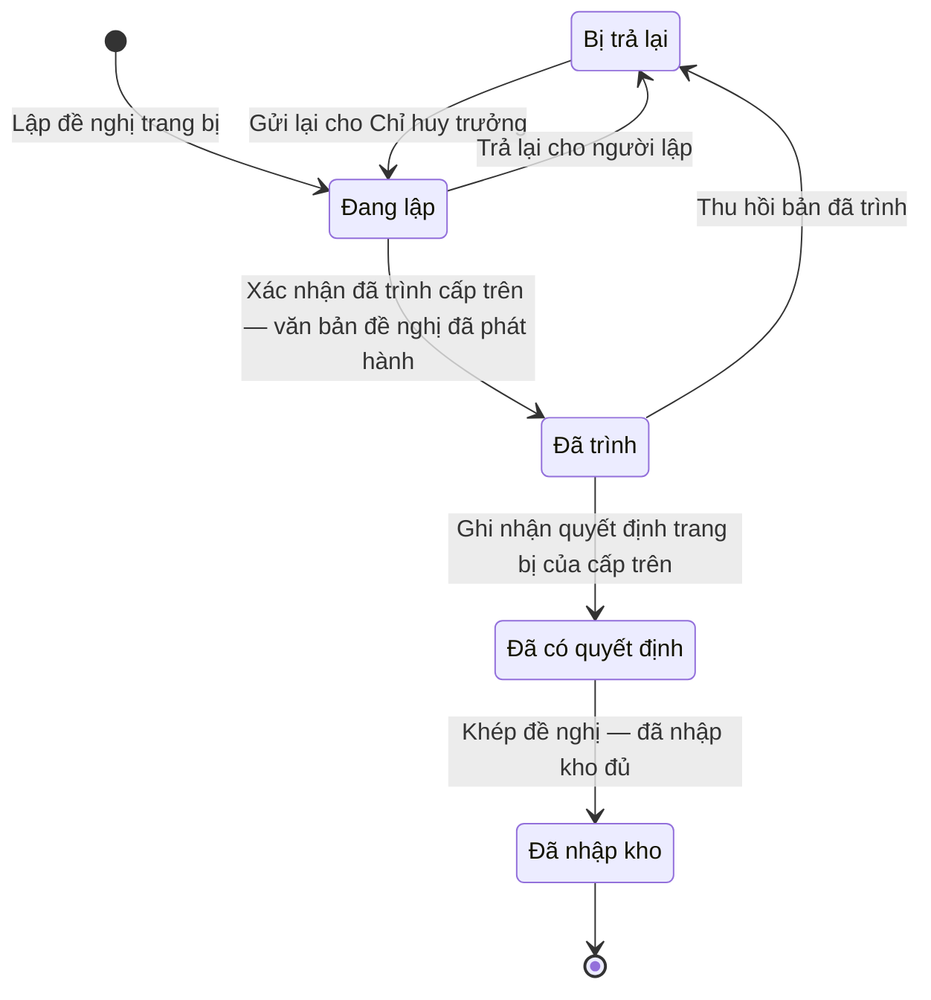

# qt-D7.provision-request · Nhu cầu, đề nghị bảo đảm vật chất — Đề nghị trang bị

<!-- máy sinh: tom-tat -->
> **Hồ sơ:** Đề nghị trang bị (`ProvisionRequest`)
>
> **Trong sổ phạm vi:** D7 · Nhu cầu, đề nghị bảo đảm vật chất — hồ sơ phụ provision-request (tầng 2)
>
> 9 bước · 5 chặng · 4 vai · 1 bảng quyết định · 0 hạn · 4 khớp nối.
>
> **Nguồn:** sổ nghiệp vụ `qt-D7.provision-request` · khai báo của app: `dqtv-app/core/processes/provision-demand/workflow/provision-request.yaml`. Các bảng do máy sinh từ nguồn này.
<!-- hết: tom-tat -->

<!-- viết tay: dien-giai -->
## Diễn giải

*Phần này viết tay, diễn giải lại điều các bảng bên dưới ghi.*

### Quy trình này để làm gì

Đơn vị lập một **đề nghị trang bị** từ một danh mục bảo đảm đã có (đơn vị chủ hồ sơ là xã đã lập đề nghị). Trợ lý Quân lực soạn, Chỉ huy trưởng Ban CHQS xã soát và trình, quyết định trang bị ký ngoài hệ rồi được ghi lại kèm ảnh, Nhân viên quân khí kiêm thủ kho khép đề nghị khi đã nhập kho đủ.

Hồ sơ đi qua bốn chặng: *Đang lập* → *Đã trình* → *Đã có quyết định* → *Đã nhập kho*. Mỗi đề nghị chỉ xin một loại vật chất.

### Khi nào bắt đầu

Trợ lý Quân lực bấm **Lập đề nghị trang bị**. Phải nhập `demandId` và năm ngân sách; đơn vị chủ hồ sơ, loại vật chất và mục đích dùng là ô nhập nếu có, bước ghi cả ba ô lên hồ sơ. Hồ sơ mở ra có nối tới Danh mục bảo đảm (quy trình D7) và vào chặng *Đang lập*.

Bước mở không đòi gì trước: đã có một đề nghị rồi vẫn lập thêm đề nghị nữa được, lượt nào tính lượt đó, các lượt không phụ thuộc vào nhau.

### Diễn ra thế nào

**Chặng "Đang lập"** — trợ lý và Chỉ huy trưởng làm qua lại, các việc đều lặp được:

1. **Thêm dòng đề nghị** (Trợ lý Quân lực) — tạo một hồ sơ con Dòng đề nghị trang bị. Bước đòi bốn điều kiện hệ tự xét (`lineItemFromBasisDemand`, `lineQuantityWithinShortfall`, `lineItemNotDuplicated`, `lineItemMatchesRequestCategory`): mặt hàng lấy từ dòng "xin cấp" của danh mục căn cứ; số xin lớn hơn 0 và không vượt số còn thiếu thật; mỗi mặt hàng chỉ một dòng trong một đề nghị; mặt hàng đúng loại vật chất của đề nghị.
2. **Bỏ dòng đề nghị** (Trợ lý Quân lực).
3. **Trả lại cho người lập** (Chỉ huy trưởng) — phải ghi lý do trả lại. Trả lại xong thì Chỉ huy trưởng không trình được, cũng không trả lại lần nữa được, cho tới khi trợ lý gửi lại.
4. **Gửi lại cho Chỉ huy trưởng** (Trợ lý Quân lực) — chỉ bấm được khi đề nghị đang bị trả về; gửi xong đề nghị vẫn ở *Đang lập*, lý do trả lại được xoá.

**Chuyển chặng:** Chỉ huy trưởng bấm **Trình cấp trên** → *Đã trình*; bước ghi "trình lúc". Không trình được khi đề nghị đang bị trả lại.

**Chặng "Đã trình"** — Chỉ huy trưởng làm một trong hai:

- **Thu hồi bản đã trình** → về *Đang lập*, phải ghi lý do thu hồi. Bước ghi "trả lại lúc" và xoá "trình lúc", nên đề nghị lại tính là đang bị trả lại. Dùng khi trình nhầm hoặc cấp trên trả về.
- **Nhận quyết định trang bị của cấp trên, đính kèm ảnh** → *Đã có quyết định*. Phải đã có loại vật chất. Phải nhập `decisionNumber`, `subject`, `signedBy`, `signedDate`, `legalBasis`, `scanPath`; loại vật chất, mục đích dùng nhập nếu có. Đây là quyết định ký ngoài hệ (`provisionRequestAuthorizedBy`), người ký `commune_military_commander`, `province_military_command` hoặc `general_staff_chief`. Bước này bị xét theo bảng `equipment-authorization.decider` (xem Điều kiện chặn).

**Chặng "Đã có quyết định"** — thủ kho bấm **Khép đề nghị — đã nhập kho đủ** → *Đã nhập kho*. Mốc này là lúc phiếu nhập kho đã cộng đủ số lượng theo đề nghị.

### Kết thúc và để lại gì

Hồ sơ kết thúc ở chặng *Đã nhập kho*. **Phiếu nhập kho** (D10) mở ra từ một đề nghị trang bị đã có quyết định.

### Điều kiện chặn

- Mọi bước trừ bước mở: người làm phải là người của đơn vị chủ hồ sơ. Sai người, sai chặng, thiếu thứ phải có trước thì bước bị chặn, hồ sơ giữ nguyên.
- Gửi lại cho Chỉ huy trưởng: phải đã có "trả lại lúc" (`requestReturned`). Trình cấp trên và Trả lại cho người lập: phải chưa có "trả lại lúc" (`requestNotAwaitingDrafter`).
- Nhận quyết định: chặn khi đã có "có quyết định lúc", báo "Đề nghị này đã có quyết định trang bị của cấp trên rồi".
- Bảng `equipment-authorization.decider` (12 dòng) xét lúc nhận quyết định, theo loại vật chất, mục đích dùng và `decisionSignerLevel`:
  - Chưa có loại vật chất → chặn (`category_unknown`). Đã có loại mà chưa có `decisionSignerLevel` → chặn (`signer_unknown`).
  - Vũ khí quân dụng, vật liệu nổ, đã có `decisionSignerLevel` mà chưa có mục đích dùng → chặn (`use_unknown`).
  - Vũ khí quân dụng, vật liệu nổ dùng thường trực: chỉ `general_staff`. Dùng cho huấn luyện, hoạt động: `province_commander` hoặc `general_staff`.
  - Công cụ hỗ trợ và trang bị kỹ thuật: chỉ `province_commander`.
  - Vũ khí thể thao: cả ba mã đều được.
  - Các trường hợp còn lại của bốn nhóm trên → chặn (`wrong_authority`).
<!-- hết viết tay -->

## 1. Đường đi ngắn nhất qua các chặng

<!-- máy sinh: luong-chinh -->
Đường ít bước nhất từ lúc mở hồ sơ tới chặng kết thúc xa nhất. Máy chọn theo số chặng, không theo ý nghĩa nghiệp vụ — trình tự công việc thật xem phần Diễn giải và bảng "Việc làm ở từng chặng" ở mục 6.

| # | Ai làm | Làm gì | Hồ sơ sang chặng |
|---|---|---|---|
| 1 | Trợ lý Quân lực | Lập đề nghị trang bị | Đang lập |
| 2 | Hệ thống tự làm | Xác nhận đã trình cấp trên — văn bản đề nghị đã phát hành | Đã trình |
| 3 | Chỉ huy trưởng Ban CHQS xã | Ghi nhận quyết định trang bị của cấp trên | Đã có quyết định |
| 4 | Nhân viên quân khí kiêm thủ kho | Khép đề nghị — đã nhập kho đủ | Đã nhập kho |

<!-- hết: luong-chinh -->

## 2. Hồ sơ và việc nó để lại

<!-- máy sinh: muc-tieu -->
**App gọi quy trình này là:** Đề nghị trang bị.

**Hồ sơ này để lại cho quy trình khác** (bước tạo hồ sơ của quy trình kia ghi mối nối về đây):
- Phiếu nhập kho (D10) — bước `openStockInSlip`, khớp nối `stockInFromRequest`
<!-- hết: muc-tieu -->

## 3. Khởi phát và kết thúc

<!-- máy sinh: khoi-phat -->
**1 cửa vào** — bước mở hồ sơ:

| Bước mở | Ai mở | Hồ sơ vào chặng | App bắt buộc nhập |
|---|---|---|---|
| Lập đề nghị trang bị | Trợ lý Quân lực | Đang lập | `demandId`, năm ngân sách |

**Kết thúc:** *Đã nhập kho* (`STOCKED`)
<!-- hết: khoi-phat -->

## 4. Vai trò

<!-- máy sinh: vai-tro -->
| Vai trong sổ | Tên trong app | Điều kiện | Làm những bước |
|---|---|---|---|
| `registrar` | Trợ lý Quân lực |  | Lập đề nghị trang bị · Bỏ dòng đề nghị · Gửi lại cho Chỉ huy trưởng · Trình ký văn bản đề nghị trang bị |
| `system` | Hệ thống tự làm |  | Xác nhận đã trình cấp trên — văn bản đề nghị đã phát hành |
| `commander` | Chỉ huy trưởng Ban CHQS xã |  | Trả lại cho người lập · Thu hồi bản đã trình · Ghi nhận quyết định trang bị của cấp trên |
| `keeper` | Nhân viên quân khí kiêm thủ kho |  | Khép đề nghị — đã nhập kho đủ |

*"Tên trong app" là tên app đặt cho mã chủ thể của vai. Hồ sơ thuộc đơn vị cấp khác thì người làm là người giữ vai ấy ở đơn vị nêu trong cột "Điều kiện" (nếu sổ có ghi) và ở cột "Người làm phải thuộc" của bảng "Theo khai báo của app" (mục 7).*
<!-- hết: vai-tro -->

## 5. Nhánh phụ

<!-- máy sinh: nhanh-phu -->
**Bước khác đưa hồ sơ sang chặng mới** — đường song song, rẽ nhánh hoặc kết thúc sớm:

| Bước | Ai làm | Từ chặng | Sang chặng |
|---|---|---|---|
| Trả lại cho người lập | Chỉ huy trưởng Ban CHQS xã | Đang lập | Bị trả lại |
| Thu hồi bản đã trình | Chỉ huy trưởng Ban CHQS xã | Đã trình | Bị trả lại |

**Quay lại một chặng hồ sơ đã đi qua** (tính theo đường ngắn nhất từ lúc mở):

| Bước | Ai làm | Từ chặng | Về chặng |
|---|---|---|---|
| Gửi lại cho Chỉ huy trưởng | Trợ lý Quân lực | Bị trả lại | Đang lập |

**Làm trong lúc hồ sơ đứng yên ở một chặng** — ghi nhận, bổ sung:

| Bước | Ai làm | Ở chặng |
|---|---|---|
| Bỏ dòng đề nghị *(lặp được)* | Trợ lý Quân lực | Đang lập, Bị trả lại |
| Trình ký văn bản đề nghị trang bị | Trợ lý Quân lực | Đang lập |

<!-- hết: nhanh-phu -->

## 6. Các chặng và việc làm ở từng chặng

<!-- máy sinh: chang -->
| Chặng | Tên hiển thị | Vào bằng bước | Kết thúc? |
|---|---|---|---|
| `RETURNED` | Bị trả lại | Trả lại cho người lập · Thu hồi bản đã trình |  |
| `DRAFT` | Đang lập | Lập đề nghị trang bị · Gửi lại cho Chỉ huy trưởng |  |
| `SUBMITTED` | Đã trình | Xác nhận đã trình cấp trên — văn bản đề nghị đã phát hành |  |
| `AUTHORIZED` | Đã có quyết định | Ghi nhận quyết định trang bị của cấp trên |  |
| `STOCKED` | Đã nhập kho | Khép đề nghị — đã nhập kho đủ | **kết thúc** |

### Việc làm ở từng chặng

Hồ sơ đang ở chặng nào thì làm được những bước nào.

| Hồ sơ đang ở chặng | Bước làm tại chặng (hồ sơ đứng yên) | Bước đưa hồ sơ sang chặng khác |
|---|---|---|
| **Bị trả lại** | Bỏ dòng đề nghị (lặp được) — Trợ lý Quân lực | Gửi lại cho Chỉ huy trưởng — Trợ lý Quân lực → *Đang lập* |
| **Đang lập** | Bỏ dòng đề nghị (lặp được) — Trợ lý Quân lực Trình ký văn bản đề nghị trang bị — Trợ lý Quân lực | Xác nhận đã trình cấp trên — văn bản đề nghị đã phát hành — Hệ thống tự làm → *Đã trình* Trả lại cho người lập — Chỉ huy trưởng Ban CHQS xã → *Bị trả lại* |
| **Đã trình** | — | Thu hồi bản đã trình — Chỉ huy trưởng Ban CHQS xã → *Bị trả lại* Ghi nhận quyết định trang bị của cấp trên — Chỉ huy trưởng Ban CHQS xã → *Đã có quyết định* |
| **Đã có quyết định** | — | Khép đề nghị — đã nhập kho đủ — Nhân viên quân khí kiêm thủ kho → *Đã nhập kho* |
| **Đã nhập kho** | — | — (kết thúc) |
<!-- hết: chang -->

## 7. Bảng bước

<!-- máy sinh: buoc -->
| # | Bước | Mã bước | Ai thực hiện | Từ chặng | Sang chặng | Phải có trước | Ghi lại |
|---|---|---|---|---|---|---|---|
| 1 | Lập đề nghị trang bị | `openProvisionRequest` | Trợ lý Quân lực | — (mở hồ sơ) | `DRAFT` | — | mã tỉnh, mã xã, số đề nghị, năm ngân sách, nối tới Danh mục bảo đảm, đơn vị chủ hồ sơ, loại vật chất, mục đích dùng, nối tới Dòng đề nghị trang bị |
| 2 | Bỏ dòng đề nghị | `removeRequestLine` | Trợ lý Quân lực | `DRAFT`, `RETURNED` | giữ nguyên | người làm thuộc đơn vị chủ hồ sơ | — |
| 3 | Gửi lại cho Chỉ huy trưởng | `resubmitProvisionRequest` | Trợ lý Quân lực | `RETURNED` | `DRAFT` | người làm thuộc đơn vị chủ hồ sơ | —; **xoá:** lý do trả lại |
| 4 | Trình ký văn bản đề nghị trang bị | `requestSubmitProvisionRequestSignature` | Trợ lý Quân lực | `DRAFT` | giữ nguyên | `noSubmitProvisionRequestDocumentOpen`, người làm thuộc đơn vị chủ hồ sơ | nối tới Văn bản đi |
| 5 | Xác nhận đã trình cấp trên — văn bản đề nghị đã phát hành | `submitProvisionRequest` | Hệ thống tự làm | `DRAFT` | `SUBMITTED` | `submitProvisionRequestDocumentIssued` | trình lúc, nối tới Văn bản đến |
| 6 | Trả lại cho người lập | `returnProvisionRequest` | Chỉ huy trưởng Ban CHQS xã | `DRAFT` | `RETURNED` | người làm thuộc đơn vị chủ hồ sơ, lý do trả lại | lý do trả lại |
| 7 | Thu hồi bản đã trình | `withdrawProvisionRequest` | Chỉ huy trưởng Ban CHQS xã | `SUBMITTED` | `RETURNED` | người làm thuộc đơn vị chủ hồ sơ, lý do thu hồi | lý do thu hồi; **xoá:** trình lúc |
| 8 | Ghi nhận quyết định trang bị của cấp trên | `recordProvisionDecision` | Chỉ huy trưởng Ban CHQS xã | `SUBMITTED` | `AUTHORIZED` | loại vật chất, người làm thuộc đơn vị chủ hồ sơ, `submissionDistributedAtReceiver`, `recordProvisionDecisionFromIncomingDocumentUsable` | có quyết định lúc, nối tới Văn bản đến, cấp người ký quyết định |
| 9 | Khép đề nghị — đã nhập kho đủ | `stockProvisionRequest` | Nhân viên quân khí kiêm thủ kho | `AUTHORIZED` | `STOCKED` | người làm thuộc đơn vị chủ hồ sơ | nhập kho lúc |

### Khi không đạt điều kiện

Mặc định: không đúng người, hồ sơ không ở đúng chặng, hoặc thiếu thứ "phải có trước" thì bước bị chặn, hồ sơ giữ nguyên. Bảng dưới chỉ kê những bước có kết quả riêng.

| # | Bước | Kết quả riêng |
|---|---|---|
| 5 | Xác nhận đã trình cấp trên — văn bản đề nghị đã phát hành | bước này không do người nào bấm |
| 8 | Ghi nhận quyết định trang bị của cấp trên | bước dừng lại, hồ sơ giữ nguyên khi kết quả xét là: `category_unknown`, `signer_unknown`, `use_unknown`, `wrong_authority` |

### Điều kiện "phải có trước" bằng lời

Cột "Phải có trước" ở bảng bước có hai loại: ô dữ liệu thường (bước chỉ đòi ô ấy đã có giá trị) và điều kiện hệ tự xét. Bảng này diễn các điều kiện hệ tự xét theo đúng công thức sổ ghi; số ở cột cuối là số thứ tự bước.

| Điều kiện | Đúng khi | Bước đòi |
|---|---|---|
| `actorInOwnerUnit` | người đang làm là người của đơn vị ghi ở ô đơn vị chủ hồ sơ của hồ sơ này (theo danh mục người của đơn vị, `dm.unit-staff`) | 2, 3, 4, 6, 7, 8, 9 |
| `noSubmitProvisionRequestDocumentOpen` | KHÔNG (có hồ sơ Việc luật giao kèm văn bản đến, đi — Văn bản đi (qt-1.outgoing-document) chính là hồ sơ ghi ở ô nối `submitProvisionRequestByDocument` của hồ sơ đang làm mà hồ sơ ấy đang ở chặng `DRAFT` hoặc `PENDING_SIGNATURE` hoặc `SIGNED`) | 4 |
| `submitProvisionRequestDocumentIssued` | có hồ sơ Việc luật giao kèm văn bản đến, đi — Văn bản đi (qt-1.outgoing-document) chính là hồ sơ ghi ở ô nối `submitProvisionRequestByDocument` của hồ sơ đang làm mà hồ sơ ấy đang ở chặng `ISSUED` | 5 |
| `submissionDistributedAtReceiver` | có hồ sơ Việc luật giao kèm văn bản đến, đi — Văn bản đến (qt-1.incoming-document) chính là hồ sơ ghi ở ô nối `provisionRequestSubmissionDeliveredAs` của hồ sơ đang làm mà hồ sơ ấy đang ở chặng `DISTRIBUTED` | 8 |
| `recordProvisionDecisionFromIncomingDocumentUsable` | có hồ sơ Việc luật giao kèm văn bản đến, đi — Văn bản đến (qt-1.incoming-document) chính là hồ sơ ghi ở ô nối `recordProvisionDecisionFromIncomingDocument` của hồ sơ đang làm mà hồ sơ ấy đang ở chặng `RECEIVED` hoặc `DISTRIBUTED` | 8 |

### Theo khai báo của app

Người làm phải thuộc đơn vị nào, ô người dùng phải nhập, bước có lặp được không, và căn cứ pháp lý — lấy từ khai báo quy trình trong app.

| # | Bước | Người làm phải thuộc | Bắt buộc nhập | Nhập nếu có | Lặp được | Căn cứ |
|---|---|---|---|---|---|---|
| 1 | Lập đề nghị trang bị |  | `demandId`, năm ngân sách | đơn vị chủ hồ sơ, loại vật chất, mục đích dùng |  | L48/2019/QH14 Đ.25; TT77/2020/TT-BQP Đ.10 k1 |
| 2 | Bỏ dòng đề nghị |  | `lineId` | — | có | TT77/2020/TT-BQP Đ.10 k1 |
| 3 | Gửi lại cho Chỉ huy trưởng |  | — | — | có | TT77/2020/TT-BQP Đ.10 k1 |
| 4 | Trình ký văn bản đề nghị trang bị |  | — | dự thảo văn bản đề nghị (PDF) |  | NĐ30/2020/NĐ-CP Đ.13; L48/2019/QH14 Đ.25 |
| 5 | Xác nhận đã trình cấp trên — văn bản đề nghị đã phát hành |  | — | văn bản đề nghị đã phát hành, bản đã vào sổ đến cấp trên |  | L48/2019/QH14 Đ.25 |
| 6 | Trả lại cho người lập |  | lý do trả lại | — | có | TT77/2020/TT-BQP Đ.10 k1 |
| 7 | Thu hồi bản đã trình |  | lý do thu hồi | — |  | TT77/2020/TT-BQP Đ.10 k1 |
| 8 | Ghi nhận quyết định trang bị của cấp trên |  | văn bản đến là quyết định cấp trang bị đã ký, `legalBasis` | loại vật chất, mục đích dùng, `signedBy` |  | L48/2019/QH14 Đ.25; 50_MAU_KY_NGOAI_HE_THONG.md §D |
| 9 | Khép đề nghị — đã nhập kho đủ |  | — | — |  | L48/2019/QH14 Đ.25 |
| — | Thêm dòng đề nghị (`addRequestLine`) |  | `itemName`, `needed`, `held`, `shortfall` | `groupLabel`, ghi chú | có | TT77/2020/TT-BQP Đ.10 k1 |

### Điều kiện và ghi chú app khai cho từng bước

Lấy từ khai báo quy trình trong app. Lời trong ngoặc kép là câu app hiện cho người dùng. Chức danh người ký ngoài hệ app chỉ khai bằng mã.

| # | Bước | Điều kiện, ghi chú |
|---|---|---|
| 8 | Ghi nhận quyết định trang bị của cấp trên | · không làm được khi đã có ô "có quyết định lúc" — app báo: "Đề nghị này đã có quyết định trang bị của cấp trên rồi" · bước này ghi một quyết định ký NGOÀI hệ (`provisionRequestAuthorizedBy`), người ký: `commune_military_commander`, `province_military_command`, `general_staff_chief` · không đòi bản chụp — app ghi: "bản số hoá lấy từ văn bản đến văn thư đã vào sổ (tầng đọc chép `scanPath` của văn bản ấy), không tải ảnh ở bước này" |
| — | Thêm dòng đề nghị | · tạo thêm một hồ sơ con: Dòng đề nghị trang bị (`ProvisionRequestLine`) |
<!-- hết: buoc -->

## 8. Bảng quyết định, hạn, việc ngoài hệ

<!-- máy sinh: quyet-dinh -->
**Bảng `equipment-authorization.decider`** — xét ở bước *Ghi nhận quyết định trang bị của cấp trên*; đầu vào: loại vật chất, mục đích dùng, cấp người ký quyết định. 12 dòng, dòng đầu tiên khớp thì dừng.

| Thứ tự dò (số sổ ghi) | Dòng | Khi | Thì |
|---|---|---|---|
| — | `category-unknown` | chưa có loại vật chất | `category_unknown` |
| — | `cct-ok` | loại vật chất là Công cụ hỗ trợ (`support_tool`) và cấp người ký quyết định là `province_commander` | cho qua |
| — | `cct-wrong` | loại vật chất là Công cụ hỗ trợ (`support_tool`) và cấp người ký quyết định là `commune_commander` hoặc `general_staff` | `wrong_authority` |
| — | `mil-standing-ok` | loại vật chất là Vũ khí quân dụng (`military_weapon`) hoặc Vật liệu nổ (`explosive`) và mục đích dùng là Thường trực (`standing`) và cấp người ký quyết định là `general_staff` | cho qua |
| — | `mil-standing-wrong` | loại vật chất là Vũ khí quân dụng (`military_weapon`) hoặc Vật liệu nổ (`explosive`) và mục đích dùng là Thường trực (`standing`) và cấp người ký quyết định là `commune_commander` hoặc `province_commander` | `wrong_authority` |
| — | `mil-training-ok` | loại vật chất là Vũ khí quân dụng (`military_weapon`) hoặc Vật liệu nổ (`explosive`) và mục đích dùng là Huấn luyện, hoạt động (`training_or_operation`) và cấp người ký quyết định là `province_commander` hoặc `general_staff` | cho qua |
| — | `mil-training-wrong` | loại vật chất là Vũ khí quân dụng (`military_weapon`) hoặc Vật liệu nổ (`explosive`) và mục đích dùng là Huấn luyện, hoạt động (`training_or_operation`) và cấp người ký quyết định là `commune_commander` | `wrong_authority` |
| — | `mil-use-unknown` | loại vật chất là Vũ khí quân dụng (`military_weapon`) hoặc Vật liệu nổ (`explosive`) và chưa có mục đích dùng và cấp người ký quyết định là `commune_commander` hoặc `province_commander` hoặc `general_staff` | `use_unknown` |
| — | `signer-unknown` | loại vật chất là Vũ khí quân dụng (`military_weapon`) hoặc Vật liệu nổ (`explosive`) hoặc Công cụ hỗ trợ (`support_tool`) hoặc Vũ khí thể thao (`sport_weapon`) hoặc Trang bị kỹ thuật (`technical_equipment`) và chưa có cấp người ký quyết định | `signer_unknown` |
| — | `sport-any` | loại vật chất là Vũ khí thể thao (`sport_weapon`) và cấp người ký quyết định là `commune_commander` hoặc `province_commander` hoặc `general_staff` | cho qua |
| — | `technical-any` | loại vật chất là Trang bị kỹ thuật (`technical_equipment`) và cấp người ký quyết định là `province_commander` | cho qua |
| — | `technical-wrong` | loại vật chất là Trang bị kỹ thuật (`technical_equipment`) và cấp người ký quyết định là `commune_commander` hoặc `general_staff` | `wrong_authority` |

<!-- hết: quyet-dinh -->

## 9. Dữ liệu của hồ sơ

<!-- máy sinh: du-lieu -->
Các ô mà bước trong sổ ghi hoặc đòi. Số trong hai cột cuối là số thứ tự bước ở bảng bước (mục 7).

| Ô dữ liệu | Mã | Kiểu (app) | Giá trị cho phép | Loại ô (sổ) | Bước ghi | Bước đòi | Mô tả trong app |
|---|---|---|---|---|---|---|---|
| mã tỉnh | `provinceCode` | chữ |  | lưu trên hồ sơ (`stored`) | 1 | — | Mã tỉnh — lọc phạm vi theo hàng |
| mã xã | `communeCode` | chữ |  | lưu trên hồ sơ (`stored`) | 1 | — | Mã xã |
| số đề nghị | `requestNumber` | chữ |  | lưu trên hồ sơ (`stored`) | 1 | — | Số đề nghị tự sinh (vd ĐNTB-2027-01) |
| năm ngân sách | `fiscalYear` | số |  | lưu trên hồ sơ (`stored`) | 1 | — | Năm ngân sách |
| đơn vị chủ hồ sơ | `ownerUnit` | chữ |  | lưu trên hồ sơ (`stored`) | 1 | — | Đơn vị chủ hồ sơ — id đơn vị của xã đã lập đề nghị |
| loại vật chất | `itemCategory` | chọn một | Vũ khí quân dụng (`military_weapon`), Vật liệu nổ (`explosive`), Công cụ hỗ trợ (`support_tool`), Vũ khí thể thao (`sport_weapon`), Trang bị kỹ thuật (`technical_equipment`) | lưu trên hồ sơ (`stored`) | 1 | 8 | Loại vật chất đề nghị — quyết định ai có thẩm quyền trang bị (TT76 Đ.8) |
| mục đích dùng | `useMode` | chọn một | Thường trực (`standing`), Huấn luyện, hoạt động (`training_or_operation`) | lưu trên hồ sơ (`stored`) | 1 | — | Mục đích dùng — thường trực, hay huấn luyện / hoạt động (chỉ vũ khí quân dụng, vật liệu nổ cần) |
| trình lúc | `submittedAt` | ngày giờ |  | lưu trên hồ sơ (`stored`) | 5 | — | Thời điểm Chỉ huy trưởng trình lên cấp trên |
| lý do trả lại | `returnReason` | chữ |  | đưa vào ở bước (`input`) | 6, 7 | 6, 7 | Lý do trả lại cho người lập — của Chỉ huy trưởng khi soát bản nháp hoặc khi thu hồi bản đã trình |
| có quyết định lúc | `authorizedAt` | ngày giờ |  | lưu trên hồ sơ (`stored`) | 8 | — | Thời điểm ghi nhận quyết định trang bị của cấp trên |
| cấp người ký quyết định | `decisionSignerLevel` | chọn một | `commune_commander`, `province_commander`, `general_staff` | đưa vào ở bước (`input`) | 8 | — | Cấp người ký quyết định trang bị — suy từ chức danh cán bộ chọn lúc ghi nhận; bảng thẩm quyền đọc ô này (sổ qt-D7.provision-request) |
| nhập kho lúc | `stockedAt` | ngày giờ |  | lưu trên hồ sơ (`stored`) | 9 | — | Thời điểm nhập kho đủ theo đề nghị (phiếu nhập cộng đủ số lượng) |
| người làm thuộc đơn vị chủ hồ sơ | `actorInOwnerUnit` |  | có hay chưa | hệ suy ra (`derived`) | — | 2, 3, 4, 6, 7, 8, 9 |  |
| — | `noSubmitProvisionRequestDocumentOpen` |  | có hay chưa | hệ suy ra (`derived`) | — | 4 |  |
| — | `submitProvisionRequestDocumentIssued` |  | có hay chưa | hệ suy ra (`derived`) | — | 5 |  |
| — | `submissionDistributedAtReceiver` |  | có hay chưa | hệ suy ra (`derived`) | — | 8 |  |
| — | `recordProvisionDecisionFromIncomingDocumentUsable` |  | có hay chưa | hệ suy ra (`derived`) | — | 8 |  |

17 ô. Cột "Loại ô" là cách sổ phân loại ô, in kèm đúng chữ của sổ; ô nào người dùng phải nhập xem bảng "Theo khai báo của app" ở mục 7.
<!-- hết: du-lieu -->

## 10. Khớp nối với quy trình khác

<!-- máy sinh: khop-noi -->
| Quy trình kia | Hồ sơ kia | Quan hệ | Nội dung (mô tả trong app) | Bước ghi mối nối | Tên ô nối |
|---|---|---|---|---|---|
| 1.incoming-document | Văn bản đến | gắn với nhau ở một bước giữa chừng | Bản văn bản đề nghị trang bị đã vào sổ văn bản đến của cấp trên trực tiếp (sổ qt-D7.provision-request, N2/N7) | D7.provision-request·submitProvisionRequest | `provisionRequestSubmissionDeliveredAs` |
| 1.incoming-document | Văn bản đến | gắn với nhau ở một bước giữa chừng | Quyết định cấp trang bị của cấp trên — văn bản đến đã vào sổ (L48/2019/QH14 Đ.25) | D7.provision-request·recordProvisionDecision | `recordProvisionDecisionFromIncomingDocument` |
| 1.outgoing-document | Văn bản đi | gắn với nhau ở một bước giữa chừng | Văn bản đề nghị trang bị gửi cấp trên — văn bản đi của đơn vị lập (sổ qt-D7.provision-request) | D7.provision-request·requestSubmitProvisionRequestSignature | `submitProvisionRequestByDocument` |
| D10 | Phiếu nhập kho | hồ sơ kia **mở ra từ** hồ sơ này | Phiếu nhập kho lập từ đề nghị trang bị (QT-2) đã có quyết định nào — truy vết + đối chiếu theo số QĐ | D10·openStockInSlip ⊕ | `stockInFromRequest` |

4 khớp nối. ⊕ là bước tạo hồ sơ.

**Ô nối giữa các hồ sơ cùng mã quy trình, hoặc tới danh mục nền:** `requestFromDemand` (Đề nghị trang bị → Danh mục bảo đảm) — bước Lập đề nghị trang bị.
<!-- hết: khop-noi -->

## 11. Thông tin chung

<!-- máy sinh: thong-tin -->
| | |
|---|---|
| **Mã trong sổ** | `qt-D7.provision-request` |
| **Quy trình trong app** | `provision-demand` (`workflow/provision-request.yaml`) — mặt công tác: `logistics-technical` |
| **Hồ sơ** | Đề nghị trang bị (`ProvisionRequest`) |
| **Cùng mã quy trình** | [qt-D7](qt-D7.html) |
| **Căn cứ pháp lý từng bước** | cột "Căn cứ" ở bảng "Theo khai báo của app", mục 7 |
<!-- hết: thong-tin -->
