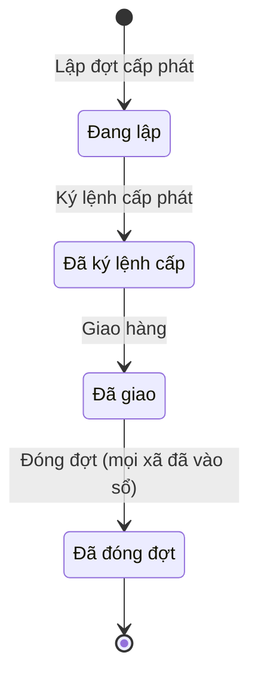

# qt-D8 · Cấp phát xuống cấp dưới

<!-- máy sinh: tom-tat -->
> **Hồ sơ:** Đợt cấp phát xuống dưới (`ProvisionIssueBatch`)
>
> **Trong sổ phạm vi:** D8 · Cấp phát xuống cấp dưới (tầng 2)
>
> 6 bước · 4 chặng · 2 vai · 0 bảng quyết định · 0 hạn · 3 khớp nối.
>
> **Nguồn:** sổ nghiệp vụ `qt-D8` · khai báo của app: `dqtv-app/core/processes/provision-issue/workflow/provision-issue.yaml`. Các bảng do máy sinh từ nguồn này.
<!-- hết: tom-tat -->

<!-- viết tay: dien-giai -->
## Diễn giải

*Phần này viết tay, diễn giải lại điều các bảng bên dưới ghi.*

### Quy trình này để làm gì

Cấp trên theo dõi một **đợt cấp phát xuống dưới**: chia hàng theo từng xã nhận, ký lệnh cấp, giao hàng, rồi đóng đợt khi bên nhận đã vào sổ. Có ba loại hàng (quân trang; vũ khí, CCHT; mẫu biểu, vật chất huấn luyện) và ba căn cứ của đợt (kế hoạch năm, quyết định trang bị, đề nghị của cấp dưới).

Hồ sơ đi qua bốn chặng, chỉ đi tới: *Đang lập* → *Đã ký lệnh cấp* → *Đã giao* → *Đã đóng đợt*.

### Khi nào bắt đầu

Ban Dân quân tự vệ, Bộ CHQS cấp tỉnh bấm **Lập đợt cấp phát**. Bắt buộc nhập loại hàng và căn cứ đợt; số đợt tự sinh. Hồ sơ vào chặng *Đang lập*.

### Diễn ra thế nào

**Chặng "Đang lập"** — Ban Dân quân tự vệ bấm **Thêm dòng cấp cho xã**, lặp được; mỗi lần tạo một hồ sơ con Dòng đợt cấp phát, bắt buộc nhập `receiverScope`, `itemName`, `quantity`. Bộ CHQS cấp tỉnh bấm **Ký lệnh cấp phát**, hồ sơ sang *Đã ký lệnh cấp*; bước ghi ngày ký lệnh.

**Chặng "Đã ký lệnh cấp"** — Ban Dân quân tự vệ bấm **Giao hàng**, nhập ngày giao và số vận đơn hoặc công văn kèm hàng. Hồ sơ sang *Đã giao*, chờ bên nhận vào sổ.

**Chặng "Đã giao"** — hai việc của Ban Dân quân tự vệ:

- **Xử lý phần nhận thiếu** (lặp được) — dùng khi có xã nhận thiếu. Tỉnh chọn một trong hai cách: cấp bù bằng một đợt khác, hoặc chuyển sang sự cố mất, hỏng; hồ sơ nối tới đợt cấp bù hoặc tới sự cố ấy. Xã nhập đúng số thực nhận kèm biên bản thiếu, tỉnh chọn cách xử lý rồi mới đóng đợt.
- **Đóng đợt (mọi xã đã vào sổ)** — đưa hồ sơ sang *Đã đóng đợt*. Bước đòi `allReceiversReceived`: mọi hồ sơ Nhập kho, vào sổ (qt-D10) đang ở chặng `REGISTERED` hoặc `CONFIRMED`.

### Kết thúc và để lại gì

Hồ sơ kết thúc ở chặng *Đã đóng đợt*. Các hồ sơ của quy trình khác nối vào đợt:

- **Phiếu nhập kho** (D10) và **Phiếu nhập kho trang phục** (D10.uniform-stock-in) của xã mở ra theo dòng cấp phát của đợt — nền để đối chiếu "đã giao với đã nhận".
- **Sự cố mất, hư hỏng** (D13) gắn vào đợt ở bước xử lý phần nhận thiếu.

### Điều kiện chặn

- Mọi bước trừ bước mở: người làm phải là người của đơn vị chủ hồ sơ. Sai người, sai chặng, thiếu thứ phải có trước thì bước bị chặn, hồ sơ giữ nguyên.
- Đóng đợt: phải đạt `allReceiversReceived` như nêu trên.
<!-- hết viết tay -->

## 1. Đường đi ngắn nhất qua các chặng

<!-- máy sinh: luong-chinh -->
Đường ít bước nhất từ lúc mở hồ sơ tới chặng kết thúc xa nhất. Máy chọn theo số chặng, không theo ý nghĩa nghiệp vụ — trình tự công việc thật xem phần Diễn giải và bảng "Việc làm ở từng chặng" ở mục 6.

| # | Ai làm | Làm gì | Hồ sơ sang chặng |
|---|---|---|---|
| 1 | Ban Dân quân tự vệ, Bộ CHQS cấp tỉnh | Lập đợt cấp phát | Đang lập |
| 2 | Bộ CHQS cấp tỉnh | Ký lệnh cấp phát | Đã ký lệnh cấp |
| 3 | Ban Dân quân tự vệ, Bộ CHQS cấp tỉnh | Giao hàng | Đã giao |
| 4 | Ban Dân quân tự vệ, Bộ CHQS cấp tỉnh | Đóng đợt (mọi xã đã vào sổ) | Đã đóng đợt |

<!-- hết: luong-chinh -->

## 2. Hồ sơ và việc nó để lại

<!-- máy sinh: muc-tieu -->
**App gọi quy trình này là:** Đợt cấp phát xuống dưới.

**Hồ sơ này để lại cho quy trình khác** (bước tạo hồ sơ của quy trình kia ghi mối nối về đây):
- Phiếu nhập kho (D10) — bước `openStockInSlip`, khớp nối `stockInFromIssue`
- Phiếu nhập kho trang phục (D10.uniform-stock-in) — bước `openUniformStockIn`, khớp nối `uniformStockFromIssue`
<!-- hết: muc-tieu -->

## 3. Khởi phát và kết thúc

<!-- máy sinh: khoi-phat -->
**1 cửa vào** — bước mở hồ sơ:

| Bước mở | Ai mở | Hồ sơ vào chặng | App bắt buộc nhập |
|---|---|---|---|
| Lập đợt cấp phát | Ban Dân quân tự vệ, Bộ CHQS cấp tỉnh | Đang lập | loại hàng, căn cứ đợt |

**Kết thúc:** *Đã đóng đợt* (`CLOSED`)
<!-- hết: khoi-phat -->

## 4. Vai trò

<!-- máy sinh: vai-tro -->
| Vai trong sổ | Tên trong app | Điều kiện | Làm những bước |
|---|---|---|---|
| `operator` | Ban Dân quân tự vệ, Bộ CHQS cấp tỉnh |  | Lập đợt cấp phát · Thêm dòng cấp cho xã · Giao hàng · Xử lý phần nhận thiếu · Đóng đợt (mọi xã đã vào sổ) |
| `commander` | Bộ CHQS cấp tỉnh |  | Ký lệnh cấp phát |

*"Tên trong app" là tên app đặt cho mã chủ thể của vai. Hồ sơ thuộc đơn vị cấp khác thì người làm là người giữ vai ấy ở đơn vị nêu trong cột "Điều kiện" (nếu sổ có ghi) và ở cột "Người làm phải thuộc" của bảng "Theo khai báo của app" (mục 7).*
<!-- hết: vai-tro -->

## 5. Nhánh phụ

<!-- máy sinh: nhanh-phu -->
**Làm trong lúc hồ sơ đứng yên ở một chặng** — ghi nhận, bổ sung:

| Bước | Ai làm | Ở chặng |
|---|---|---|
| Thêm dòng cấp cho xã *(lặp được)* | Ban Dân quân tự vệ, Bộ CHQS cấp tỉnh | Đang lập |
| Xử lý phần nhận thiếu *(lặp được)* | Ban Dân quân tự vệ, Bộ CHQS cấp tỉnh | Đã giao |

<!-- hết: nhanh-phu -->

## 6. Các chặng và việc làm ở từng chặng

<!-- máy sinh: chang -->
| Chặng | Tên hiển thị | Vào bằng bước | Kết thúc? |
|---|---|---|---|
| `DRAFT` | Đang lập | Lập đợt cấp phát |  |
| `APPROVED` | Đã ký lệnh cấp | Ký lệnh cấp phát |  |
| `DELIVERED` | Đã giao | Giao hàng |  |
| `CLOSED` | Đã đóng đợt | Đóng đợt (mọi xã đã vào sổ) | **kết thúc** |

### Việc làm ở từng chặng

Hồ sơ đang ở chặng nào thì làm được những bước nào.

| Hồ sơ đang ở chặng | Bước làm tại chặng (hồ sơ đứng yên) | Bước đưa hồ sơ sang chặng khác |
|---|---|---|
| **Đang lập** | Thêm dòng cấp cho xã (lặp được) — Ban Dân quân tự vệ, Bộ CHQS cấp tỉnh | Ký lệnh cấp phát — Bộ CHQS cấp tỉnh → *Đã ký lệnh cấp* |
| **Đã ký lệnh cấp** | — | Giao hàng — Ban Dân quân tự vệ, Bộ CHQS cấp tỉnh → *Đã giao* |
| **Đã giao** | Xử lý phần nhận thiếu (lặp được) — Ban Dân quân tự vệ, Bộ CHQS cấp tỉnh | Đóng đợt (mọi xã đã vào sổ) — Ban Dân quân tự vệ, Bộ CHQS cấp tỉnh → *Đã đóng đợt* |
| **Đã đóng đợt** | — | — (kết thúc) |
<!-- hết: chang -->

## 7. Bảng bước

<!-- máy sinh: buoc -->
| # | Bước | Mã bước | Ai thực hiện | Từ chặng | Sang chặng | Phải có trước | Ghi lại |
|---|---|---|---|---|---|---|---|
| 1 | Lập đợt cấp phát | `openProvisionIssue` | Ban Dân quân tự vệ, Bộ CHQS cấp tỉnh | — (mở hồ sơ) | `DRAFT` | — | mã tỉnh, `ownerScope`, số đợt, loại hàng, căn cứ đợt, đơn vị chủ hồ sơ |
| 2 | Thêm dòng cấp cho xã | `addIssueLine` | Ban Dân quân tự vệ, Bộ CHQS cấp tỉnh | `DRAFT` | giữ nguyên | người làm thuộc đơn vị chủ hồ sơ | nối tới Dòng đợt cấp phát |
| 3 | Ký lệnh cấp phát | `signIssueOrder` | Bộ CHQS cấp tỉnh | `DRAFT` | `APPROVED` | người làm thuộc đơn vị chủ hồ sơ | ngày ký lệnh |
| 4 | Giao hàng | `deliverProvisionIssue` | Ban Dân quân tự vệ, Bộ CHQS cấp tỉnh | `APPROVED` | `DELIVERED` | người làm thuộc đơn vị chủ hồ sơ | ngày giao, số vận đơn / công văn |
| 5 | Xử lý phần nhận thiếu | `resolveIssueShortfall` | Ban Dân quân tự vệ, Bộ CHQS cấp tỉnh | `DELIVERED` | giữ nguyên | người làm thuộc đơn vị chủ hồ sơ | xử lý phần nhận thiếu, ghi xử lý thiếu lúc, nối tới Đợt cấp phát xuống dưới, nối tới Sự cố mất, hư hỏng |
| 6 | Đóng đợt (mọi xã đã vào sổ) | `closeProvisionIssue` | Ban Dân quân tự vệ, Bộ CHQS cấp tỉnh | `DELIVERED` | `CLOSED` | `allReceiversReceived`, người làm thuộc đơn vị chủ hồ sơ | đóng đợt lúc, ghi chú |

### Khi không đạt điều kiện

Mặc định: không đúng người, hồ sơ không ở đúng chặng, hoặc thiếu thứ "phải có trước" thì bước bị chặn, hồ sơ giữ nguyên. Bảng dưới chỉ kê những bước có kết quả riêng.

Không bước nào có kết quả riêng — tất cả theo mặc định.

### Điều kiện "phải có trước" bằng lời

Cột "Phải có trước" ở bảng bước có hai loại: ô dữ liệu thường (bước chỉ đòi ô ấy đã có giá trị) và điều kiện hệ tự xét. Bảng này diễn các điều kiện hệ tự xét theo đúng công thức sổ ghi; số ở cột cuối là số thứ tự bước.

| Điều kiện | Đúng khi | Bước đòi |
|---|---|---|
| `actorInOwnerUnit` | người đang làm là người của đơn vị ghi ở ô đơn vị chủ hồ sơ của hồ sơ này (theo danh mục người của đơn vị, `dm.unit-staff`) | 2, 3, 4, 5, 6 |
| `allReceiversReceived` | mọi hồ sơ Nhập kho, vào sổ (qt-D10) đang ở chặng `REGISTERED` hoặc `CONFIRMED` | 6 |

### Theo khai báo của app

Người làm phải thuộc đơn vị nào, ô người dùng phải nhập, bước có lặp được không, và căn cứ pháp lý — lấy từ khai báo quy trình trong app.

| # | Bước | Người làm phải thuộc | Bắt buộc nhập | Nhập nếu có | Lặp được | Căn cứ |
|---|---|---|---|---|---|---|
| 1 | Lập đợt cấp phát |  | loại hàng, căn cứ đợt | — |  | L48/2019/QH14 Đ.37 k8; TT76/2020/TT-BQP Đ.12 k1 |
| 2 | Thêm dòng cấp cho xã | đơn vị chủ hồ sơ | `receiverScope`, `itemName`, `quantity` | `receiverName`, ghi chú, loại hàng | có | TT76/2020/TT-BQP Đ.12 k1 |
| 3 | Ký lệnh cấp phát | đơn vị chủ hồ sơ | — | — |  | TT76/2020/TT-BQP Đ.12 k1 |
| 4 | Giao hàng | đơn vị chủ hồ sơ | ngày giao, số vận đơn / công văn | các dòng của đợt (tầng đọc tra sẵn) |  | TT76/2020/TT-BQP Đ.12 k2 |
| 5 | Xử lý phần nhận thiếu | đơn vị chủ hồ sơ | xử lý phần nhận thiếu | `reissueBatchId`, `incidentId` | có | TT76/2020/TT-BQP Đ.12 k2 |
| 6 | Đóng đợt (mọi xã đã vào sổ) | đơn vị chủ hồ sơ | — | ghi chú |  | QĐ1126/QĐ-TM :282; TT76/2020/TT-BQP Đ.12 k2 |

### Điều kiện và ghi chú app khai cho từng bước

Lấy từ khai báo quy trình trong app. Lời trong ngoặc kép là câu app hiện cho người dùng. Chức danh người ký ngoài hệ app chỉ khai bằng mã.

| # | Bước | Điều kiện, ghi chú |
|---|---|---|
| 2 | Thêm dòng cấp cho xã | · tạo thêm một hồ sơ con: Dòng đợt cấp phát (`ProvisionIssueLine`) |
<!-- hết: buoc -->

## 8. Bảng quyết định, hạn, việc ngoài hệ

<!-- máy sinh: quyet-dinh -->

<!-- hết: quyet-dinh -->

## 9. Dữ liệu của hồ sơ

<!-- máy sinh: du-lieu -->
Các ô mà bước trong sổ ghi hoặc đòi. Số trong hai cột cuối là số thứ tự bước ở bảng bước (mục 7).

| Ô dữ liệu | Mã | Kiểu (app) | Giá trị cho phép | Loại ô (sổ) | Bước ghi | Bước đòi | Mô tả trong app |
|---|---|---|---|---|---|---|---|
| mã tỉnh | `provinceCode` | chữ |  | lưu trên hồ sơ (`stored`) | 1 | — | Mã tỉnh chủ đợt — lọc phạm vi theo hàng; rỗng nếu đợt của Cục/Quân khu |
| — | `ownerScope` | chữ |  | lưu trên hồ sơ (`stored`) | 1 | — | Chủ đợt khi ở cấp trên xã — 'central' hoặc mã quân khu; rỗng với đợt cấp tỉnh |
| số đợt | `batchNumber` | chữ |  | lưu trên hồ sơ (`stored`) | 1 | — | Số đợt cấp phát tự sinh (vd CPX-2027-01) |
| loại hàng | `issueKind` | chọn một | Quân trang (sao mũ, mẫu) (`uniform`), Vũ khí, CCHT (`weapon`), Mẫu biểu, vật chất huấn luyện (`other`) | đưa vào ở bước (`input`) | 1 | — | Loại hàng cấp: quân trang (sao mũ, mẫu) / vũ khí, CCHT theo quyết định trang bị / khác (mẫu biểu, vật chất huấn luyện) |
| căn cứ đợt | `issueBasis` | chọn một | Theo kế hoạch năm (`annual_plan`), Theo quyết định trang bị (`equipment_decision`), Theo đề nghị của dưới (`lower_request`) | đưa vào ở bước (`input`) | 1 | — | Căn cứ đợt: kế hoạch năm / quyết định trang bị / đề nghị của cấp dưới |
| đơn vị chủ hồ sơ | `ownerUnit` |  |  | lưu trên hồ sơ (`stored`) | 1 | — |  |
| ngày ký lệnh | `signedDate` | ngày |  | đưa vào ở bước (`input`) | 3 | — | Ngày ký lệnh cấp phát |
| ngày giao | `deliveredDate` | ngày |  | đưa vào ở bước (`input`) | 4 | — | Ngày giao hàng |
| số vận đơn / công văn | `deliveryRef` | chữ |  | đưa vào ở bước (`input`) | 4 | — | Số vận đơn / công văn kèm hàng |
| xử lý phần nhận thiếu | `shortfallResolution` | chọn một | Cấp bù (`reissue`), Chuyển sự cố mất, hỏng (`incident`) | lưu trên hồ sơ (`stored`) | 5 | — | Cách tỉnh xử lý phần xã nhận thiếu: cấp bù bằng đợt khác / chuyển sự cố mất, hỏng |
| ghi xử lý thiếu lúc | `shortfallResolvedAt` | ngày giờ |  | lưu trên hồ sơ (`stored`) | 5 | — | Thời điểm tỉnh ghi cách xử lý phần nhận thiếu |
| đóng đợt lúc | `closedAt` | ngày giờ |  | đưa vào ở bước (`input`) | 6 | — | Thời điểm đóng đợt (bên nhận đã ký nhận) |
| ghi chú | `note` | chữ |  | đưa vào ở bước (`input`) | 6 | — | Ghi chú |
| người làm thuộc đơn vị chủ hồ sơ | `actorInOwnerUnit` |  | có hay chưa | hệ suy ra (`derived`) | — | 2, 3, 4, 5, 6 |  |
| — | `allReceiversReceived` |  |  | hệ tổng hợp (`aggregate`) | — | 6 |  |

15 ô. Cột "Loại ô" là cách sổ phân loại ô, in kèm đúng chữ của sổ; ô nào người dùng phải nhập xem bảng "Theo khai báo của app" ở mục 7.
<!-- hết: du-lieu -->

## 10. Khớp nối với quy trình khác

<!-- máy sinh: khop-noi -->
| Quy trình kia | Hồ sơ kia | Quan hệ | Nội dung (mô tả trong app) | Bước ghi mối nối | Tên ô nối |
|---|---|---|---|---|---|
| D10 | Phiếu nhập kho | hồ sơ kia **mở ra từ** hồ sơ này | Phiếu nhập kho của xã nhận theo dòng cấp phát nào của tỉnh (QT-3) — nền của đối chiếu 'đã giao vs đã nhận' | D10·openStockInSlip ⊕ | `stockInFromIssue` |
| D10.uniform-stock-in | Phiếu nhập kho trang phục | hồ sơ kia **mở ra từ** hồ sơ này | Phiếu nhập KHO TRANG PHỤC của xã nhận theo dòng cấp phát nào của tỉnh (QT-3) | D10.uniform-stock-in·openUniformStockIn ⊕ | `uniformStockFromIssue` |
| D13 | Sự cố mất, hư hỏng | gắn với nhau ở một bước giữa chừng | Sự cố mất, hỏng mà phần xã nhận thiếu của đợt này được chuyển sang — sổ qt-D8 (30/9/2026) | D8·resolveIssueShortfall | `shortfallIncident` |

3 khớp nối. ⊕ là bước tạo hồ sơ.

**Ô nối giữa các hồ sơ cùng mã quy trình, hoặc tới danh mục nền:** `shortfallReissueBatch` (Đợt cấp phát xuống dưới → Đợt cấp phát xuống dưới) — bước Xử lý phần nhận thiếu.
<!-- hết: khop-noi -->

## 11. Thông tin chung

<!-- máy sinh: thong-tin -->
| | |
|---|---|
| **Mã trong sổ** | `qt-D8` |
| **Quy trình trong app** | `provision-issue` (`workflow/provision-issue.yaml`) — mặt công tác: `logistics-technical` |
| **Hồ sơ** | Đợt cấp phát xuống dưới (`ProvisionIssueBatch`) |
| **Căn cứ pháp lý từng bước** | cột "Căn cứ" ở bảng "Theo khai báo của app", mục 7 |
<!-- hết: thong-tin -->
