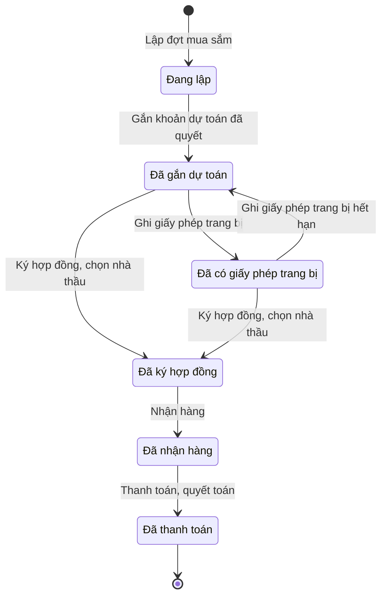

# qt-D9 · Mua sắm

<!-- máy sinh: tom-tat -->
> **Hồ sơ:** Đợt mua sắm (`ProcurementBatch`)
>
> **Trong sổ phạm vi:** D9 · Mua sắm (tầng 2)
>
> 10 bước · 6 chặng · 4 vai · 1 bảng quyết định · 1 hạn · 7 khớp nối.
>
> **Nguồn:** sổ nghiệp vụ `qt-D9` · khai báo của app: `dqtv-app/core/processes/procurement/workflow/procurement.yaml`. Các bảng do máy sinh từ nguồn này.
<!-- hết: tom-tat -->

<!-- viết tay: dien-giai -->
## Diễn giải

*Phần này viết tay, diễn giải lại điều các bảng bên dưới ghi.*

### Quy trình này để làm gì

Đơn vị theo dõi một **đợt mua sắm** phần còn thiếu trong danh mục bảo đảm đã ký: kê dòng mua và đơn giá, gắn vào khoản dự toán đã quyết, ghi phê duyệt danh mục mua sắm, xin giấy phép trang bị nếu loại hàng cần, ký hợp đồng, nhận hàng, thanh toán. Nhân viên tài chính kiêm hậu cần làm chín bước; Chỉ huy trưởng Ban CHQS xã ký hợp đồng; Nhân viên quân khí kiêm thủ kho nhận hàng. Người làm phải là người của đơn vị chủ hồ sơ.

Hồ sơ đi qua sáu chặng: *Đang lập* → *Đã gắn dự toán* → *Đã có giấy phép trang bị* → *Đã ký hợp đồng* → *Đã nhận hàng* → *Đã thanh toán*. Chặng *Đã có giấy phép trang bị* chỉ là nhánh của loại hàng phải có phép; loại khác ký hợp đồng thẳng từ *Đã gắn dự toán*.

### Khi nào bắt đầu

Nhân viên tài chính kiêm hậu cần bấm **Lập đợt mua sắm**. Phải nhập `demandId` và năm ngân sách; loại hàng, cấp mua sắm, nhà cung cấp, số hợp đồng, tổng giá trị là ô nhập nếu có; bước ghi loại hàng và cấp mua sắm lên hồ sơ. Ở bước này không ký gì, số hợp đồng chỉ là ô tuỳ chọn. Hồ sơ mở ra có nối tới Danh mục bảo đảm (quy trình D7) và vào chặng *Đang lập*.

### Diễn ra thế nào

**Chặng "Đang lập"** (Nhân viên tài chính kiêm hậu cần):

- **Thêm dòng mua** (lặp được) — tạo một hồ sơ con Dòng đợt mua sắm. Bước đòi điều kiện `lineItemFromBasisDemand`: dòng hàng "chỉ lấy từ danh mục đã ký, cán bộ không tự thêm dòng".
- **Ghi đơn giá dòng mua** (lặp được) — làm được ở chặng này và cả chặng sau.
- **Gắn khoản dự toán đã quyết** → *Đã gắn dự toán*. Phải nhập `budgetLineDetailId`. Bước nối tới Khoản con của dự toán, ghi khoản dự toán đã gắn, nghị quyết / khoản dự toán, và đặt ô giấy phép trang bị về giá trị ban đầu.

**Chặng "Đã gắn dự toán"** (Nhân viên tài chính kiêm hậu cần), các việc đi theo thứ tự:

1. **Ghi phê duyệt danh mục mua sắm** — số văn bản phê duyệt, người phê duyệt (thủ trưởng đơn vị, Chủ tịch UBND xã, hoặc Chủ tịch UBND tỉnh), bản chụp. Bước này áp dụng cho mọi loại hàng. Ghi lần hai thì hồ sơ hiện lần mới nhất, lịch sử giữ đủ.
2. **Gửi đề nghị cấp giấy phép trang bị** — phải đã ghi phê duyệt danh mục; gắn một văn bản đi.
3. **Ghi giấy phép trang bị** → *Đã có giấy phép trang bị* — phải đã gửi đề nghị và đã ghi phê duyệt danh mục; gắn một văn bản đến, ghi số giấy phép và ngày hết hiệu lực.

**Chặng "Đã có giấy phép trang bị"** — **Ghi giấy phép trang bị hết hạn** đưa hồ sơ về lại *Đã gắn dự toán*. Hệ tự chuyển khi quá ngày hiệu lực; nút bấm tay chỉ để dự phòng.

**Ký hợp đồng:** Chỉ huy trưởng bấm **Ký hợp đồng, chọn nhà thầu** từ *Đã gắn dự toán* hoặc *Đã có giấy phép trang bị* → *Đã ký hợp đồng*. Phải đã ghi phê duyệt danh mục (thiếu thì báo "Chưa ghi phê duyệt danh mục mua sắm — chưa ký hợp đồng được"), và qua được bảng xét giấy phép (xem Điều kiện chặn). Phải nhập số hợp đồng, ngày ký, nhà cung cấp, bản hợp đồng.

**Chặng "Đã ký hợp đồng"** — thủ kho bấm **Nhận hàng** → *Đã nhận hàng*.

**Chặng "Đã nhận hàng"** — Nhân viên tài chính kiêm hậu cần bấm **Thanh toán, quyết toán** → *Đã thanh toán*; nhập số tiền đã trả, số chứng từ chi, ngày chi trả.

### Kết thúc và để lại gì

Hồ sơ kết thúc ở chặng *Đã thanh toán*. Các mối nối:

- **Phiếu nhập kho** (D10) và **Phiếu nhập kho trang phục** (D10.uniform-stock-in) mở ra từ đợt mua đã nhận hàng.
- Gắn ở bước giữa chừng: **Khoản con** của dự toán (quy trình 4), **Văn bản đi** đề nghị cấp phép và **Văn bản đến** là giấy phép (quy trình 1).

### Điều kiện chặn

- Mọi bước trừ bước mở: người làm phải là người của đơn vị chủ hồ sơ. Sai người, sai chặng, thiếu thứ phải có trước thì bước bị chặn, hồ sơ giữ nguyên.
- Thứ tự ở chặng *Đã gắn dự toán*: gửi đề nghị cấp phép và ký hợp đồng đòi đã có "duyệt danh mục lúc"; ghi giấy phép đòi đã có "gửi đề nghị cấp phép lúc" và "duyệt danh mục lúc".
- Bảng `purchase-permit-required` (11 dòng) xét lúc ký hợp đồng, theo loại hàng, cấp mua sắm, giấy phép trang bị:
  - Thiếu loại hàng → chặn (`category_unknown`).
  - Vũ khí quân dụng → không mua được (`not_purchasable`).
  - Vũ khí thô sơ, quân trang, trang bị, đồ dùng dạy học → cho qua, không xét giấy phép.
  - Công cụ hỗ trợ (`support_tool`): thiếu cấp mua sắm → chặn (`level_unknown`); cấp không phải tỉnh → chặn (`not_authorized`); cấp tỉnh mà giấy phép chưa được cấp → chặn (`needs_permit`); cấp tỉnh đã có giấy phép → cho qua.
  - Vũ khí thể thao: giấy phép chưa được cấp → chặn (`needs_permit`); đã cấp → cho qua; không xét cấp mua sắm.
- Hạn: một hạn tính từ bước Ghi giấy phép trang bị, quá hạn thì chạy bước Ghi giấy phép trang bị hết hạn.
<!-- hết viết tay -->

## 1. Đường đi ngắn nhất qua các chặng

<!-- máy sinh: luong-chinh -->
Đường ít bước nhất từ lúc mở hồ sơ tới chặng kết thúc xa nhất. Máy chọn theo số chặng, không theo ý nghĩa nghiệp vụ — trình tự công việc thật xem phần Diễn giải và bảng "Việc làm ở từng chặng" ở mục 6.

| # | Ai làm | Làm gì | Hồ sơ sang chặng |
|---|---|---|---|
| 1 | Nhân viên tài chính kiêm hậu cần | Lập đợt mua sắm | Đang lập |
| 2 | Nhân viên tài chính kiêm hậu cần | Gắn khoản dự toán đã quyết | Đã gắn dự toán |
| 3 | Chỉ huy trưởng Ban CHQS xã | Ký hợp đồng, chọn nhà thầu | Đã ký hợp đồng |
| 4 | Nhân viên quân khí kiêm thủ kho | Nhận hàng | Đã nhận hàng |
| 5 | Nhân viên tài chính kiêm hậu cần | Thanh toán, quyết toán | Đã thanh toán |

<!-- hết: luong-chinh -->

## 2. Hồ sơ và việc nó để lại

<!-- máy sinh: muc-tieu -->
**App gọi quy trình này là:** Đợt mua sắm.

**Khi mở, hồ sơ này ghi mối nối tới:**
- Danh mục bảo đảm (D7) — bước `openProcurement`, khớp nối `procurementFromDemand`

**Hồ sơ này để lại cho quy trình khác** (bước tạo hồ sơ của quy trình kia ghi mối nối về đây):
- Phiếu nhập kho (D10) — bước `openStockInSlip`, khớp nối `stockInFromProcurement`
- Phiếu nhập kho trang phục (D10.uniform-stock-in) — bước `openUniformStockIn`, khớp nối `uniformStockFromProcurement`
<!-- hết: muc-tieu -->

## 3. Khởi phát và kết thúc

<!-- máy sinh: khoi-phat -->
**1 cửa vào** — bước mở hồ sơ:

| Bước mở | Ai mở | Hồ sơ vào chặng | App bắt buộc nhập |
|---|---|---|---|
| Lập đợt mua sắm | Nhân viên tài chính kiêm hậu cần | Đang lập | `demandId`, năm ngân sách |

**Kết thúc:** *Đã thanh toán* (`SETTLED`)
<!-- hết: khoi-phat -->

## 4. Vai trò

<!-- máy sinh: vai-tro -->
| Vai trong sổ | Tên trong app | Điều kiện | Làm những bước |
|---|---|---|---|
| `financier` | Nhân viên tài chính kiêm hậu cần |  | Lập đợt mua sắm · Ghi đơn giá dòng mua · Gắn khoản dự toán đã quyết · Ghi phê duyệt danh mục mua sắm · Trình ký văn bản đề nghị cấp giấy phép trang bị · Ghi giấy phép trang bị · Thanh toán, quyết toán |
| `system` | Hệ thống tự làm |  | Ghi giấy phép trang bị hết hạn |
| `commander` | Chỉ huy trưởng Ban CHQS xã |  | Ký hợp đồng, chọn nhà thầu |
| `quartermaster` | Nhân viên quân khí kiêm thủ kho |  | Nhận hàng |

*"Tên trong app" là tên app đặt cho mã chủ thể của vai. Hồ sơ thuộc đơn vị cấp khác thì người làm là người giữ vai ấy ở đơn vị nêu trong cột "Điều kiện" (nếu sổ có ghi) và ở cột "Người làm phải thuộc" của bảng "Theo khai báo của app" (mục 7).*
<!-- hết: vai-tro -->

## 5. Nhánh phụ

<!-- máy sinh: nhanh-phu -->
**Bước khác đưa hồ sơ sang chặng mới** — đường song song, rẽ nhánh hoặc kết thúc sớm:

| Bước | Ai làm | Từ chặng | Sang chặng |
|---|---|---|---|
| Ghi giấy phép trang bị | Nhân viên tài chính kiêm hậu cần | Đã gắn dự toán | Đã có giấy phép trang bị |

**Quay lại một chặng hồ sơ đã đi qua** (tính theo đường ngắn nhất từ lúc mở):

| Bước | Ai làm | Từ chặng | Về chặng |
|---|---|---|---|
| Ghi giấy phép trang bị hết hạn | Hệ thống tự làm | Đã có giấy phép trang bị | Đã gắn dự toán |

**Làm trong lúc hồ sơ đứng yên ở một chặng** — ghi nhận, bổ sung:

| Bước | Ai làm | Ở chặng |
|---|---|---|
| Ghi đơn giá dòng mua *(lặp được)* | Nhân viên tài chính kiêm hậu cần | Đang lập, Đã gắn dự toán |
| Ghi phê duyệt danh mục mua sắm | Nhân viên tài chính kiêm hậu cần | Đã gắn dự toán |
| Trình ký văn bản đề nghị cấp giấy phép trang bị | Nhân viên tài chính kiêm hậu cần | Đã gắn dự toán |

<!-- hết: nhanh-phu -->

## 6. Các chặng và việc làm ở từng chặng

<!-- máy sinh: chang -->
| Chặng | Tên hiển thị | Vào bằng bước | Kết thúc? |
|---|---|---|---|
| `DRAFT` | Đang lập | Lập đợt mua sắm |  |
| `BUDGETED` | Đã gắn dự toán | Gắn khoản dự toán đã quyết · Ghi giấy phép trang bị hết hạn |  |
| `PERMITTED` | Đã có giấy phép trang bị | Ghi giấy phép trang bị |  |
| `CONTRACTED` | Đã ký hợp đồng | Ký hợp đồng, chọn nhà thầu |  |
| `RECEIVED` | Đã nhận hàng | Nhận hàng |  |
| `SETTLED` | Đã thanh toán | Thanh toán, quyết toán | **kết thúc** |

### Việc làm ở từng chặng

Hồ sơ đang ở chặng nào thì làm được những bước nào.

| Hồ sơ đang ở chặng | Bước làm tại chặng (hồ sơ đứng yên) | Bước đưa hồ sơ sang chặng khác |
|---|---|---|
| **Đang lập** | Ghi đơn giá dòng mua (lặp được) — Nhân viên tài chính kiêm hậu cần | Gắn khoản dự toán đã quyết — Nhân viên tài chính kiêm hậu cần → *Đã gắn dự toán* |
| **Đã gắn dự toán** | Ghi đơn giá dòng mua (lặp được) — Nhân viên tài chính kiêm hậu cần Ghi phê duyệt danh mục mua sắm — Nhân viên tài chính kiêm hậu cần Trình ký văn bản đề nghị cấp giấy phép trang bị — Nhân viên tài chính kiêm hậu cần | Ghi giấy phép trang bị — Nhân viên tài chính kiêm hậu cần → *Đã có giấy phép trang bị* Ký hợp đồng, chọn nhà thầu — Chỉ huy trưởng Ban CHQS xã → *Đã ký hợp đồng* |
| **Đã có giấy phép trang bị** | — | Ghi giấy phép trang bị hết hạn — Hệ thống tự làm → *Đã gắn dự toán* Ký hợp đồng, chọn nhà thầu — Chỉ huy trưởng Ban CHQS xã → *Đã ký hợp đồng* |
| **Đã ký hợp đồng** | — | Nhận hàng — Nhân viên quân khí kiêm thủ kho → *Đã nhận hàng* |
| **Đã nhận hàng** | — | Thanh toán, quyết toán — Nhân viên tài chính kiêm hậu cần → *Đã thanh toán* |
| **Đã thanh toán** | — | — (kết thúc) |
<!-- hết: chang -->

## 7. Bảng bước

<!-- máy sinh: buoc -->
| # | Bước | Mã bước | Ai thực hiện | Từ chặng | Sang chặng | Phải có trước | Ghi lại |
|---|---|---|---|---|---|---|---|
| 1 | Lập đợt mua sắm | `openProcurement` | Nhân viên tài chính kiêm hậu cần | — (mở hồ sơ) | `DRAFT` | — | nối tới Danh mục bảo đảm, mã tỉnh, mã xã, số đợt mua, ngày lập, năm ngân sách, nhà cung cấp, nhà thầu, số hợp đồng, tổng giá trị, đơn vị chủ hồ sơ, loại hàng, cấp mua sắm, nối tới Dòng đợt mua sắm |
| 2 | Ghi đơn giá dòng mua | `priceProcurementLine` | Nhân viên tài chính kiêm hậu cần | `DRAFT`, `BUDGETED` | giữ nguyên | người làm thuộc đơn vị chủ hồ sơ | — |
| 3 | Gắn khoản dự toán đã quyết | `budgetProcurement` | Nhân viên tài chính kiêm hậu cần | `DRAFT` | `BUDGETED` | người làm thuộc đơn vị chủ hồ sơ, `budgetPlanExecuting`, `budgetLineSameUnit`, `budgetPlanSameYear` | khoản dự toán đã gắn, nghị quyết / khoản dự toán, gắn dự toán lúc, nối tới Khoản con, giấy phép trang bị |
| 4 | Ghi phê duyệt danh mục mua sắm | `recordPurchaseListApproval` | Nhân viên tài chính kiêm hậu cần | `BUDGETED` | giữ nguyên | người làm thuộc đơn vị chủ hồ sơ | số văn bản phê duyệt danh mục mua sắm, người phê duyệt danh mục, duyệt danh mục lúc, bản phê duyệt danh mục mua sắm |
| 5 | Trình ký văn bản đề nghị cấp giấy phép trang bị | `requestRequestEquipmentPermitSignature` | Nhân viên tài chính kiêm hậu cần | `BUDGETED` | giữ nguyên | `taskingAssigned`, duyệt danh mục lúc, `noPermitRequestDocumentOpen`, người làm thuộc đơn vị chủ hồ sơ | nối tới Nhiệm vụ trên giao, nối tới Văn bản đi |
| 6 | Ghi giấy phép trang bị | `recordPurchasePermit` | Nhân viên tài chính kiêm hậu cần | `BUDGETED` | `PERMITTED` | `attachedOutgoingDocumentIssued`, duyệt danh mục lúc, người làm thuộc đơn vị chủ hồ sơ, `permitFromIncomingDocumentUsable` | có giấy phép lúc, giấy phép trang bị, giấy phép có hiệu lực đến, nối tới Văn bản đến |
| 7 | Ghi giấy phép trang bị hết hạn | `markEquipmentPermitExpired` | Hệ thống tự làm | `PERMITTED` | `BUDGETED` | — | giấy phép hết hạn lúc, giấy phép trang bị; **xoá:** số giấy phép trang bị, có giấy phép lúc, giấy phép có hiệu lực đến, nối tới Văn bản đến |
| 8 | Ký hợp đồng, chọn nhà thầu | `signProcurementContract` | Chỉ huy trưởng Ban CHQS xã | `BUDGETED`, `PERMITTED` | `CONTRACTED` | duyệt danh mục lúc, người làm thuộc đơn vị chủ hồ sơ | số hợp đồng, ngày ký hợp đồng, nhà cung cấp, nhà thầu, người ký hợp đồng, ký hợp đồng lúc, bản hợp đồng |
| 9 | Nhận hàng | `receiveProcurement` | Nhân viên quân khí kiêm thủ kho | `CONTRACTED` | `RECEIVED` | người làm thuộc đơn vị chủ hồ sơ | nhận hàng lúc |
| 10 | Thanh toán, quyết toán | `settleProcurement` | Nhân viên tài chính kiêm hậu cần | `RECEIVED` | `SETTLED` | người làm thuộc đơn vị chủ hồ sơ | thanh toán lúc, số tiền đã trả, số chứng từ chi, ngày chi trả, ảnh chứng từ chi |

### Khi không đạt điều kiện

Mặc định: không đúng người, hồ sơ không ở đúng chặng, hoặc thiếu thứ "phải có trước" thì bước bị chặn, hồ sơ giữ nguyên. Bảng dưới chỉ kê những bước có kết quả riêng.

| # | Bước | Kết quả riêng |
|---|---|---|
| 7 | Ghi giấy phép trang bị hết hạn | bước này không do người nào bấm |
| 8 | Ký hợp đồng, chọn nhà thầu | bước dừng lại, hồ sơ giữ nguyên khi kết quả xét là: `category_unknown`, `not_purchasable`, `needs_permit`, `level_unknown`, `not_authorized` |

### Điều kiện "phải có trước" bằng lời

Cột "Phải có trước" ở bảng bước có hai loại: ô dữ liệu thường (bước chỉ đòi ô ấy đã có giá trị) và điều kiện hệ tự xét. Bảng này diễn các điều kiện hệ tự xét theo đúng công thức sổ ghi; số ở cột cuối là số thứ tự bước.

| Điều kiện | Đúng khi | Bước đòi |
|---|---|---|
| `actorInOwnerUnit` | người đang làm là người của đơn vị ghi ở ô đơn vị chủ hồ sơ của hồ sơ này (theo danh mục người của đơn vị, `dm.unit-staff`) | 2, 3, 4, 5, 6, 8, 9, 10 |
| `taskingAssigned` | đã có nối tới Nhiệm vụ trên giao | 5 |
| `noPermitRequestDocumentOpen` | KHÔNG (có hồ sơ Việc luật giao kèm văn bản đến, đi — Văn bản đi (qt-1.outgoing-document) chính là hồ sơ ghi ở ô nối `permitRequestDocument` của hồ sơ đang làm mà hồ sơ ấy đang ở chặng `DRAFT` hoặc `PENDING_SIGNATURE` hoặc `SIGNED`) | 5 |
| `attachedOutgoingDocumentIssued` | có hồ sơ Việc luật giao kèm văn bản đến, đi — Văn bản đi (qt-1.outgoing-document) chính là hồ sơ ghi ở ô nối `permitRequestDocument` của hồ sơ đang làm mà hồ sơ ấy đang ở chặng `ISSUED` | 6 |
| `permitFromIncomingDocumentUsable` | có hồ sơ Việc luật giao kèm văn bản đến, đi — Văn bản đến (qt-1.incoming-document) chính là hồ sơ ghi ở ô nối `permitFromIncomingDocument` của hồ sơ đang làm mà hồ sơ ấy đang ở chặng `RECEIVED` hoặc `DISTRIBUTED` | 6 |
| `permitGranted` | hồ sơ đang ở chặng `PERMITTED` | đầu vào bảng quyết định (mục 8) |

### Theo khai báo của app

Người làm phải thuộc đơn vị nào, ô người dùng phải nhập, bước có lặp được không, và căn cứ pháp lý — lấy từ khai báo quy trình trong app.

| # | Bước | Người làm phải thuộc | Bắt buộc nhập | Nhập nếu có | Lặp được | Căn cứ |
|---|---|---|---|---|---|---|
| 1 | Lập đợt mua sắm |  | `demandId`, năm ngân sách | nhà cung cấp, nhà thầu, số hợp đồng, tổng giá trị, loại hàng, cấp mua sắm |  | L48/2019/QH14 Đ.38 k6; TT288/2017/TT-BQP |
| 2 | Ghi đơn giá dòng mua |  | `lineId`, đơn giá | — | có | TT288/2017/TT-BQP |
| 3 | Gắn khoản dự toán đã quyết |  | `budgetLineDetailId` | khoản dự toán đã gắn, nghị quyết / khoản dự toán |  | TT288/2017/TT-BQP; TT77/2020/TT-BQP Đ.10 |
| 4 | Ghi phê duyệt danh mục mua sắm |  | số văn bản phê duyệt danh mục mua sắm, người phê duyệt danh mục, bản phê duyệt danh mục mua sắm | — |  | TT288/2017/TT-BQP |
| 5 | Trình ký văn bản đề nghị cấp giấy phép trang bị | đơn vị chủ hồ sơ | văn bản đề nghị cấp giấy phép trang bị (PDF) | `taskingId` |  | Luật 42/2024/QH15 Đ.53; NĐ30/2020/NĐ-CP Đ.13 |
| 6 | Ghi giấy phép trang bị |  | `incomingDocumentId`, số giấy phép trang bị, giấy phép có hiệu lực đến | — |  | Luật 42/2024/QH15 Đ.53 |
| 7 | Ghi giấy phép trang bị hết hạn |  | — | — |  | Luật 42/2024/QH15 Đ.53 |
| 8 | Ký hợp đồng, chọn nhà thầu |  | số hợp đồng, ngày ký hợp đồng, nhà cung cấp, nhà thầu, bản hợp đồng | người ký hợp đồng, loại hàng, cấp mua sắm, giấy phép trang bị |  | TT288/2017/TT-BQP; L48/2019/QH14 Đ.38 k6; Luật 42/2024/QH15 Đ.53 |
| 9 | Nhận hàng |  | — | — |  | QĐ1126/QĐ-TM Đ.12 k2 |
| 10 | Thanh toán, quyết toán |  | số tiền đã trả, số chứng từ chi, ngày chi trả | ảnh chứng từ chi |  | TT288/2017/TT-BQP |
| — | Thêm dòng mua (`addProcurementLine`) |  | `itemName`, `quantity` | `uniformType`, `sizeCode`, đơn giá, ghi chú | có | TT288/2017/TT-BQP |

### Điều kiện và ghi chú app khai cho từng bước

Lấy từ khai báo quy trình trong app. Lời trong ngoặc kép là câu app hiện cho người dùng. Chức danh người ký ngoài hệ app chỉ khai bằng mã.

| # | Bước | Điều kiện, ghi chú |
|---|---|---|
| 1 | Lập đợt mua sắm | · không đòi bản chụp — app ghi: "Bước LẬP đợt mua, chưa ký gì. `contractNo` ở đây là ô TUỲ CHỌN để ghi trước số hợp đồng đã biết; bản gốc đã ký đính ở bước `signProcurementContract` (params.required, siết 9/9/2026)." |
| 5 | Trình ký văn bản đề nghị cấp giấy phép trang bị | · phải đã có ô "duyệt danh mục lúc" — thiếu thì app báo: "Chưa ghi phê duyệt danh mục mua sắm — chưa đề nghị cấp giấy phép được" |
| 8 | Ký hợp đồng, chọn nhà thầu | · phải đã có ô "duyệt danh mục lúc" — thiếu thì app báo: "Chưa ghi phê duyệt danh mục mua sắm — chưa ký hợp đồng được" |
| — | Thêm dòng mua | · tạo thêm một hồ sơ con: Dòng đợt mua sắm (`ProcurementLine`) |
<!-- hết: buoc -->

## 8. Bảng quyết định, hạn, việc ngoài hệ

<!-- máy sinh: quyet-dinh -->
**Bảng `purchase-permit-required`** — xét ở bước *Ký hợp đồng, chọn nhà thầu*; đầu vào: loại hàng, cấp mua sắm, `permitGranted`. 9 dòng, dòng đầu tiên khớp thì dừng.

| Thứ tự dò (số sổ ghi) | Dòng | Khi | Thì |
|---|---|---|---|
| — | `category-unknown` | chưa có loại hàng | `category_unknown` |
| — | `cct-level-unknown` | loại hàng là Công cụ hỗ trợ (`support_tool`) và chưa có cấp mua sắm | `level_unknown` |
| — | `cct-no-permit` | loại hàng là Công cụ hỗ trợ (`support_tool`) và cấp mua sắm là Cấp tỉnh (`province`) và chưa có `permitGranted` | `needs_permit` |
| — | `cct-not-province` | loại hàng là Công cụ hỗ trợ (`support_tool`) và cấp mua sắm là Cấp xã (`commune`) hoặc Quân khu (`region`) hoặc Trung tâm GDQP&AN (`gdqp_centre`) hoặc Cục (`department`) | `not_authorized` |
| — | `cct-permitted` | loại hàng là Công cụ hỗ trợ (`support_tool`) và cấp mua sắm là Cấp tỉnh (`province`) và đã có `permitGranted` | cho qua |
| — | `direct` | loại hàng là Vũ khí thô sơ (`primitive_weapon`) hoặc Quân trang (`uniform`) hoặc Trang bị (`equipment`) hoặc Đồ dùng dạy học (`teaching_aid`) | cho qua |
| — | `military` | loại hàng là Vũ khí quân dụng (`military_weapon`) | `not_purchasable` |
| — | `sport-no-permit` | loại hàng là Vũ khí thể thao (`sport_weapon`) và chưa có `permitGranted` | `needs_permit` |
| — | `sport-permitted` | loại hàng là Vũ khí thể thao (`sport_weapon`) và đã có `permitGranted` | cho qua |

| Hạn | Tính từ | Thời hạn | Quá hạn thì |
|---|---|---|---|
| `recordPurchasePermit.deadline` | `{"fact": "permitValidUntil"}` | 0 ngày | hệ làm bước Ghi giấy phép trang bị hết hạn |

<!-- hết: quyet-dinh -->

## 9. Dữ liệu của hồ sơ

<!-- máy sinh: du-lieu -->
Các ô mà bước trong sổ ghi hoặc đòi. Số trong hai cột cuối là số thứ tự bước ở bảng bước (mục 7).

| Ô dữ liệu | Mã | Kiểu (app) | Giá trị cho phép | Loại ô (sổ) | Bước ghi | Bước đòi | Mô tả trong app |
|---|---|---|---|---|---|---|---|
| mã tỉnh | `provinceCode` | chữ |  | lưu trên hồ sơ (`stored`) | 1 | — | Mã tỉnh — lọc phạm vi theo hàng |
| mã xã | `communeCode` | chữ |  | lưu trên hồ sơ (`stored`) | 1 | — | Mã xã — rỗng ở đợt mua cấp tỉnh |
| số đợt mua | `batchNumber` | chữ |  | lưu trên hồ sơ (`stored`) | 1 | — | Số đợt mua tự sinh (vd MST-2027-01) |
| ngày lập | `openedAt` | ngày |  | lưu trên hồ sơ (`stored`) | 1 | — | Ngày lập đợt mua |
| năm ngân sách | `fiscalYear` | số |  | đưa vào ở bước (`input`) | 1 | — | Năm ngân sách |
| nhà cung cấp, nhà thầu | `supplier` | chữ |  | đưa vào ở bước (`input`) | 1, 8 | — | Nhà cung cấp, nhà thầu |
| số hợp đồng | `contractNo` | chữ |  | đưa vào ở bước (`input`) | 1, 8 | — | Số hợp đồng |
| tổng giá trị | `totalAmount` | số |  | đưa vào ở bước (`input`) | 1 | — | Tổng giá trị đợt mua (₫) |
| đơn vị chủ hồ sơ | `ownerUnit` |  |  | lưu trên hồ sơ (`stored`) | 1 | — |  |
| loại hàng | `itemCategory` | chọn một | Công cụ hỗ trợ (`support_tool`), Vũ khí thô sơ (`primitive_weapon`), Vũ khí thể thao (`sport_weapon`), Quân trang (`uniform`), Trang bị (`equipment`), Đồ dùng dạy học (`teaching_aid`), Vũ khí quân dụng (`military_weapon`) | lưu trên hồ sơ (`stored`) | 1 | — | Loại hàng của đợt mua — quyết định có phải có giấy phép trang bị trước khi ký hợp đồng (Luật 42/2024 Đ.53) |
| cấp mua sắm | `procurementLevel` | chọn một | Cấp xã (`commune`), Cấp tỉnh (`province`), Quân khu (`region`), Trung tâm GDQP&AN (`gdqp_centre`), Cục (`department`) | lưu trên hồ sơ (`stored`) | 1 | — | Cấp mua sắm — xã, tỉnh, quân khu, trung tâm GDQP, Cục |
| khoản dự toán đã gắn | `budgetLineLabel` | chữ |  | lưu trên hồ sơ (`stored`) | 3 | — | Khoản dự toán đã gắn (hiển thị, vd Khoản 8 — TTB làm việc) |
| nghị quyết / khoản dự toán | `budgetRef` | chữ |  | lưu trên hồ sơ (`stored`) | 3 | — | Số nghị quyết HĐND của dự toán đã gắn — SUY từ khoản ở bước gắn dự toán, không gõ tay |
| gắn dự toán lúc | `budgetedAt` | ngày giờ |  | lưu trên hồ sơ (`stored`) | 3 | — | Thời điểm gắn khoản dự toán |
| giấy phép trang bị | `permitStatus` | chọn một | Chưa có (`pending`), Đã cấp (`granted`) | lưu trên hồ sơ (`stored`) | 3, 6, 7 | — | Giấy phép trang bị — pending chưa có · granted đã cấp. Ghi 'chưa có' khi gắn dự toán |
| số văn bản phê duyệt danh mục mua sắm | `purchaseListApprovalRef` | chữ |  | lưu trên hồ sơ (`stored`) | 4 | — | Số văn bản phê duyệt danh mục mua sắm |
| người phê duyệt danh mục | `purchaseListApprover` | chọn một | Thủ trưởng đơn vị (`unit_head`), Chủ tịch UBND xã (`commune_chairman`), Chủ tịch UBND tỉnh (`province_chairman`) | lưu trên hồ sơ (`stored`) | 4 | — | Người phê duyệt danh mục mua sắm |
| duyệt danh mục lúc | `purchaseListApprovedAt` | ngày giờ |  | lưu trên hồ sơ (`stored`) | 4 | 5, 6, 8 | Thời điểm ghi phê duyệt danh mục mua sắm |
| bản phê duyệt danh mục mua sắm | `purchaseListScanPath` | tệp |  | lưu trên hồ sơ (`stored`) | 4 | — | Ảnh/bản quét văn bản phê duyệt danh mục mua sắm |
| có giấy phép lúc | `permittedAt` | ngày giờ |  | lưu trên hồ sơ (`stored`) | 6 | — | Thời điểm ghi giấy phép trang bị |
| giấy phép có hiệu lực đến | `permitValidUntil` | ngày |  | đưa vào ở bước (`input`) | 6 | — | Giấy phép trang bị có hiệu lực đến ngày |
| giấy phép hết hạn lúc | `permitExpiredAt` | ngày giờ |  | lưu trên hồ sơ (`stored`) | 7 | — | Thời điểm ghi giấy phép trang bị hết hạn |
| ngày ký hợp đồng | `contractDate` | ngày |  | đưa vào ở bước (`input`) | 8 | — | Ngày ký hợp đồng |
| người ký hợp đồng | `contractSignedBy` | chữ |  | lưu trên hồ sơ (`stored`) | 8 | — | Người ký hợp đồng |
| ký hợp đồng lúc | `contractedAt` | ngày giờ |  | lưu trên hồ sơ (`stored`) | 8 | — | Thời điểm ký hợp đồng vào hệ |
| bản hợp đồng | `contractScanPath` | tệp |  | đưa vào ở bước (`input`) | 8 | — | Ảnh/bản quét hợp đồng đã ký (lưu qua FileStore ở tầng route) |
| nhận hàng lúc | `receivedAt` | ngày giờ |  | lưu trên hồ sơ (`stored`) | 9 | — | Thời điểm nhận hàng |
| thanh toán lúc | `settledAt` | ngày giờ |  | lưu trên hồ sơ (`stored`) | 10 | — | Thời điểm thanh toán, quyết toán |
| số tiền đã trả | `paidAmount` | số |  | đưa vào ở bước (`input`) | 10 | — | Số tiền thực trả (₫) — chốt lúc thanh toán, không đổi theo đơn giá sửa sau |
| số chứng từ chi | `paymentRef` | chữ |  | đưa vào ở bước (`input`) | 10 | — | Số chứng từ chi / ủy nhiệm chi |
| ngày chi trả | `paidDate` | ngày |  | đưa vào ở bước (`input`) | 10 | — | Ngày chi trả thực tế |
| ảnh chứng từ chi | `paymentScanPath` | chữ |  | đưa vào ở bước (`input`) | 10 | — | Ảnh chứng từ chi đã ký (đường dẫn tệp) |
| người làm thuộc đơn vị chủ hồ sơ | `actorInOwnerUnit` |  | có hay chưa | hệ suy ra (`derived`) | — | 2, 3, 4, 5, 6, 8, 9, 10 |  |
| — | `budgetPlanExecuting` |  | có hay chưa | đưa vào ở bước (`input`) | — | 3 |  |
| — | `budgetLineSameUnit` |  | có hay chưa | đưa vào ở bước (`input`) | — | 3 |  |
| — | `budgetPlanSameYear` |  | có hay chưa | đưa vào ở bước (`input`) | — | 3 |  |
| — | `taskingAssigned` |  | có hay chưa | hệ suy ra (`derived`) | — | 5 |  |
| — | `noPermitRequestDocumentOpen` |  | có hay chưa | hệ suy ra (`derived`) | — | 5 |  |
| — | `attachedOutgoingDocumentIssued` |  | có hay chưa | hệ suy ra (`derived`) | — | 6 |  |
| — | `permitFromIncomingDocumentUsable` |  | có hay chưa | hệ suy ra (`derived`) | — | 6 |  |
| — | `permitGranted` |  | có hay chưa | hệ suy ra (`derived`) | — | — |  |

41 ô. Cột "Loại ô" là cách sổ phân loại ô, in kèm đúng chữ của sổ; ô nào người dùng phải nhập xem bảng "Theo khai báo của app" ở mục 7.
<!-- hết: du-lieu -->

## 10. Khớp nối với quy trình khác

<!-- máy sinh: khop-noi -->
| Quy trình kia | Hồ sơ kia | Quan hệ | Nội dung (mô tả trong app) | Bước ghi mối nối | Tên ô nối |
|---|---|---|---|---|---|
| 1 | Nhiệm vụ trên giao | gắn với nhau ở một bước giữa chừng | Nhiệm vụ mà đợt mua sắm này thực hiện — việc gốc của văn bản đề nghị cấp giấy phép trang bị | D9·requestRequestEquipmentPermitSignature | `procurementServesTasking` |
| 1.incoming-document | Văn bản đến | gắn với nhau ở một bước giữa chừng | Giấy phép trang bị của đợt mua — tờ trong sổ văn bản đến (Luật 42/2024 Đ.53) | D9·recordPurchasePermit | `permitFromIncomingDocument` |
| 1.outgoing-document | Văn bản đi | gắn với nhau ở một bước giữa chừng | Văn bản đề nghị cấp giấy phép trang bị của đợt mua — tờ trong sổ văn bản đi | D9·requestRequestEquipmentPermitSignature | `permitRequestDocument` |
| 4 | Khoản con | gắn với nhau ở một bước giữa chừng | Đợt mua gắn vào khoản dự toán đã quyết nào — chặn mua khi dự toán chưa quyết định (TT288/2017) | D9·budgetProcurement | `procurementFromBudget` |
| D10 | Phiếu nhập kho | hồ sơ kia **mở ra từ** hồ sơ này | Phiếu nhập Sổ trang bị lập từ đợt mua sắm (QT-5) trang bị đã nhận hàng nào — truy vết + đối chiếu 'đã mua vs… | D10·openStockInSlip ⊕ | `stockInFromProcurement` |
| D10.uniform-stock-in | Phiếu nhập kho trang phục | hồ sơ kia **mở ra từ** hồ sơ này | Phiếu nhập kho trang phục lập từ đợt mua sắm (QT-5) đã nhận hàng nào — truy vết + đối chiếu 'đã mua vs đã nhậ… | D10.uniform-stock-in·openUniformStockIn ⊕ | `uniformStockFromProcurement` |
| D7 | Danh mục bảo đảm | hồ sơ này **mở ra có nối tới** hồ sơ kia | Đợt mua sắm lấy từ danh mục bảo đảm đã ký nào — rẽ đường nhánh MUA (L48 Đ.38 k6) | D9·openProcurement ⊕ | `procurementFromDemand` |

7 khớp nối. ⊕ là bước tạo hồ sơ.
<!-- hết: khop-noi -->

## 11. Thông tin chung

<!-- máy sinh: thong-tin -->
| | |
|---|---|
| **Mã trong sổ** | `qt-D9` |
| **Quy trình trong app** | `procurement` (`workflow/procurement.yaml`) — mặt công tác: `logistics-technical` |
| **Hồ sơ** | Đợt mua sắm (`ProcurementBatch`) |
| **Căn cứ pháp lý từng bước** | cột "Căn cứ" ở bảng "Theo khai báo của app", mục 7 |
<!-- hết: thong-tin -->
