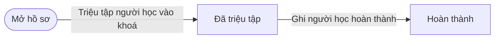
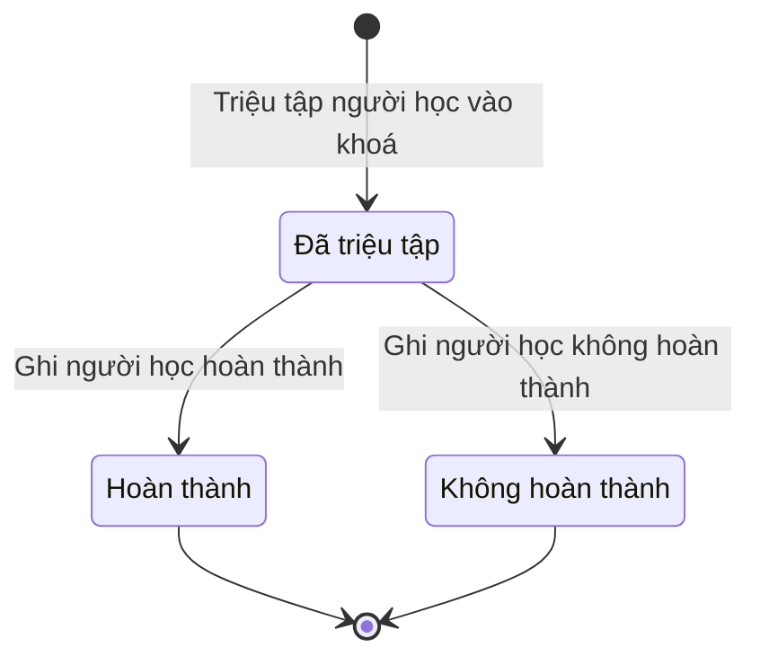

# qt-G1.course-attendance · Học viên của khoá bồi dưỡng

<!-- máy sinh: tom-tat -->
> **Hồ sơ:** Học viên của khoá bồi dưỡng (`CourseLearner`)
>
> 3 bước · 3 chặng · 1 vai · 1 bảng quyết định · 0 hạn · 0 khớp nối.
>
> **Nguồn:** sổ nghiệp vụ `qt-G1.course-attendance` · khai báo của app: `dqtv-app/core/processes/gdqp-refresher/workflow/course-learner.yaml`. Các bảng do máy sinh từ nguồn này.
<!-- hết: tom-tat -->

<!-- viết tay: dien-giai -->
## Diễn giải

*Phần này viết tay, diễn giải lại điều các bảng bên dưới ghi.*

### Quy trình này để làm gì

Mỗi hồ sơ là **một người học trong một khoá bồi dưỡng** — "dòng tham gia" của từng người được triệu tập: thông tin của khoá nằm ở hồ sơ khoá (qt-G1), còn nhóm đối tượng và kết quả của từng người nằm ở dòng này. Trợ lý Tác huấn là người duy nhất thao tác. Hồ sơ có ba chặng: *Đã triệu tập*, rồi *Hoàn thành* hoặc *Không hoàn thành*.

### Khi nào bắt đầu

Trợ lý Tác huấn bấm **Triệu tập người học vào khoá**, nhập `courseId`, `traineeId`, họ và tên, nhóm đối tượng, chương trình, cấp lập và mã đơn vị; chức vụ lúc triệu tập là ô nhập nếu có. Chương trình là chương trình của khoá, chép từ khoá lúc triệu tập. Bước này nối dòng học viên tới khoá bồi dưỡng và tới một *Người thuộc diện bồi dưỡng kiến thức QP&AN*.

### Diễn ra thế nào

**Chặng "Đã triệu tập"** — hồ sơ không có việc gì làm tại chỗ, chỉ có hai lối ra, đều do Trợ lý Tác huấn bấm:

- **Ghi người học hoàn thành** → *Hoàn thành*. Ghi chú kết quả, thu hoạch là ô nhập nếu có.
- **Ghi người học không hoàn thành** → *Không hoàn thành*, bắt buộc ghi lý do.

Cả hai chặng này đều là chặng kết thúc, không có bước nào đi tiếp từ đó.

### Kết thúc và để lại gì

Hồ sơ kết thúc ở *Hoàn thành* hoặc *Không hoàn thành*, để lại nhóm đối tượng, chương trình và kết quả của người học trong khoá ấy.

### Điều kiện chặn

- Cả ba bước, kể cả bước mở: người làm phải là người của đơn vị chủ hồ sơ **của khoá** (qt-G1).
- Bước triệu tập còn đòi hai điều kiện hệ tự xét:
  - `learnerInGroup`: người học — hồ sơ qt-16 ghi ở mối nối tới Người thuộc diện bồi dưỡng của dòng học viên này — có một hồ sơ con nhóm đối tượng (`qt-16.gdqp-category`) đang ở chặng `ACTIVE`, trùng với nhóm đối tượng ghi trên dòng học viên này.
  - `learnerNotYetCertified`: người học ấy không có hồ sơ con giấy chứng nhận (`qt-16.gdqp-certificate`) nào đang ở chặng `ISSUED` của chương trình ứng với nhóm đối tượng ghi trên dòng này.
- Bảng `group-fits-programme` (xét ở bước triệu tập): thiếu nhóm đối tượng hoặc thiếu chương trình thì chặn; nhóm đối tượng phải ứng với chương trình — đối tượng 3 và tương đương 3 học chương trình đối tượng 3 và tương đương; đối tượng 4 ở xã, ở cơ quan và tương đương 4 học chương trình đối tượng 4 và tương đương; các nhóm còn lại mỗi nhóm một chương trình cùng tên. Không khớp thì chặn (`group_not_for_programme`).
<!-- hết viết tay -->

## 1. Đường đi ngắn nhất qua các chặng

<!-- máy sinh: luong-chinh -->
Đường ít bước nhất từ lúc mở hồ sơ tới chặng kết thúc xa nhất. Máy chọn theo số chặng, không theo ý nghĩa nghiệp vụ — trình tự công việc thật xem phần Diễn giải và bảng "Việc làm ở từng chặng" ở mục 6.

| # | Ai làm | Làm gì | Hồ sơ sang chặng |
|---|---|---|---|
| 1 | Trợ lý Tác huấn | Triệu tập người học vào khoá | Đã triệu tập |
| 2 | Trợ lý Tác huấn | Ghi người học hoàn thành | Hoàn thành |

<!-- hết: luong-chinh -->

## 2. Hồ sơ và việc nó để lại

<!-- máy sinh: muc-tieu -->
**App gọi quy trình này là:** Học viên của khoá bồi dưỡng.
<!-- hết: muc-tieu -->

## 3. Khởi phát và kết thúc

<!-- máy sinh: khoi-phat -->
**1 cửa vào** — bước mở hồ sơ:

| Bước mở | Ai mở | Hồ sơ vào chặng | App bắt buộc nhập |
|---|---|---|---|
| Triệu tập người học vào khoá | Trợ lý Tác huấn | Đã triệu tập | `courseId`, `traineeId`, họ và tên, nhóm đối tượng, chương trình, cấp lập, mã đơn vị |

**Kết thúc:** *Hoàn thành* (`COMPLETED`), *Không hoàn thành* (`NOT_COMPLETED`)
<!-- hết: khoi-phat -->

## 4. Vai trò

<!-- máy sinh: vai-tro -->
| Vai trong sổ | Tên trong app | Điều kiện | Làm những bước |
|---|---|---|---|
| `operator` | Trợ lý Tác huấn |  | Triệu tập người học vào khoá · Ghi người học hoàn thành · Ghi người học không hoàn thành |

*"Tên trong app" là tên app đặt cho mã chủ thể của vai. Hồ sơ thuộc đơn vị cấp khác thì người làm là người giữ vai ấy ở đơn vị nêu trong cột "Điều kiện" (nếu sổ có ghi) và ở cột "Người làm phải thuộc" của bảng "Theo khai báo của app" (mục 7).*
<!-- hết: vai-tro -->

## 5. Nhánh phụ

<!-- máy sinh: nhanh-phu -->
**Bước khác đưa hồ sơ sang chặng mới** — đường song song, rẽ nhánh hoặc kết thúc sớm:

| Bước | Ai làm | Từ chặng | Sang chặng |
|---|---|---|---|
| Ghi người học không hoàn thành | Trợ lý Tác huấn | Đã triệu tập | Không hoàn thành |

<!-- hết: nhanh-phu -->

## 6. Các chặng và việc làm ở từng chặng

<!-- máy sinh: chang -->
| Chặng | Tên hiển thị | Vào bằng bước | Kết thúc? |
|---|---|---|---|
| `SUMMONED` | Đã triệu tập | Triệu tập người học vào khoá |  |
| `COMPLETED` | Hoàn thành | Ghi người học hoàn thành | **kết thúc** |
| `NOT_COMPLETED` | Không hoàn thành | Ghi người học không hoàn thành | **kết thúc** |

### Việc làm ở từng chặng

Hồ sơ đang ở chặng nào thì làm được những bước nào.

| Hồ sơ đang ở chặng | Bước làm tại chặng (hồ sơ đứng yên) | Bước đưa hồ sơ sang chặng khác |
|---|---|---|
| **Đã triệu tập** | — | Ghi người học hoàn thành — Trợ lý Tác huấn → *Hoàn thành* Ghi người học không hoàn thành — Trợ lý Tác huấn → *Không hoàn thành* |
| **Hoàn thành** | — | — (kết thúc) |
| **Không hoàn thành** | — | — (kết thúc) |
<!-- hết: chang -->

## 7. Bảng bước

<!-- máy sinh: buoc -->
| # | Bước | Mã bước | Ai thực hiện | Từ chặng | Sang chặng | Phải có trước | Ghi lại |
|---|---|---|---|---|---|---|---|
| 1 | Triệu tập người học vào khoá | `summonLearner` | Trợ lý Tác huấn | — (mở hồ sơ) | `SUMMONED` | người làm thuộc đơn vị chủ hồ sơ, `learnerInGroup`, `learnerNotYetCertified`, `courseNotYetSummoned` | nối tới Người thuộc diện bồi dưỡng kiến thức QP&AN, nhóm đối tượng, chương trình, chức vụ lúc triệu tập |
| 2 | Ghi người học hoàn thành | `recordLearnerCompletion` | Trợ lý Tác huấn | `SUMMONED` | `COMPLETED` | người làm thuộc đơn vị chủ hồ sơ | ghi chú kết quả, thu hoạch |
| 3 | Ghi người học không hoàn thành | `recordLearnerNotCompleted` | Trợ lý Tác huấn | `SUMMONED` | `NOT_COMPLETED` | người làm thuộc đơn vị chủ hồ sơ | lý do không hoàn thành |

### Khi không đạt điều kiện

Mặc định: không đúng người, hồ sơ không ở đúng chặng, hoặc thiếu thứ "phải có trước" thì bước bị chặn, hồ sơ giữ nguyên. Bảng dưới chỉ kê những bước có kết quả riêng.

| # | Bước | Kết quả riêng |
|---|---|---|
| 1 | Triệu tập người học vào khoá | bước dừng lại, hồ sơ giữ nguyên khi kết quả xét là: `group_missing`, `programme_missing`, `group_not_for_programme` |

### Điều kiện "phải có trước" bằng lời

Cột "Phải có trước" ở bảng bước có hai loại: ô dữ liệu thường (bước chỉ đòi ô ấy đã có giá trị) và điều kiện hệ tự xét. Bảng này diễn các điều kiện hệ tự xét theo đúng công thức sổ ghi; số ở cột cuối là số thứ tự bước.

| Điều kiện | Đúng khi | Bước đòi |
|---|---|---|
| `actorInOwnerUnit` | người đang làm là người của đơn vị ghi ở ô đơn vị chủ hồ sơ của Khoá bồi dưỡng kiến thức QP&AN, cấp giấy chứng nhận (qt-G1) (theo danh mục người của đơn vị, `dm.unit-staff`) | 1, 2, 3 |
| `learnerInGroup` | có hồ sơ Sổ đăng ký người theo diện (qt-16) chính là hồ sơ ghi ở ô nối `learnerPerson` của hồ sơ đang làm mà có hồ sơ Nhóm đối tượng bồi dưỡng của người (qt-16.gdqp-category) (gọi là c) là hồ sơ con của hồ sơ vừa nêu mà hồ sơ ấy đang ở chặng `ACTIVE` VÀ nhóm đối tượng của hồ sơ c ấy bằng nhóm đối tượng của hồ sơ này | 1 |
| `learnerNotYetCertified` | (nhóm đối tượng của hồ sơ này bằng `group_1` VÀ có hồ sơ Sổ đăng ký người theo diện (qt-16) chính là hồ sơ ghi ở ô nối `learnerPerson` của hồ sơ đang làm mà không có hồ sơ Giấy chứng nhận hoàn thành bồi dưỡng kiến thức QP&AN (qt-16.gdqp-certificate) (gọi là k) là hồ sơ con của hồ sơ vừa nêu mà hồ sơ ấy đang ở chặng `ISSUED` VÀ chương trình của hồ sơ k ấy bằng `group_1`) HOẶC (nhóm đối tượng của hồ sơ này bằng `group_2` VÀ có hồ sơ Sổ đăng ký người theo diện (qt-16) chính là hồ sơ ghi ở ô nối `learnerPerson` của hồ sơ đang làm mà không có hồ sơ Giấy chứng nhận hoàn thành bồi dưỡng kiến thức QP&AN (qt-16.gdqp-certificate) (gọi là k) là hồ sơ con của hồ sơ vừa nêu mà hồ sơ ấy đang ở chặng `ISSUED` VÀ chương trình của hồ sơ k ấy bằng `group_2`) HOẶC (nhóm đối tượng của hồ sơ này bằng `group_3` VÀ có hồ sơ Sổ đăng ký người theo diện (qt-16) chính là hồ sơ ghi ở ô nối `learnerPerson` của hồ sơ đang làm mà không có hồ sơ Giấy chứng nhận hoàn thành bồi dưỡng kiến thức QP&AN (qt-16.gdqp-certificate) (gọi là k) là hồ sơ con của hồ sơ vừa nêu mà hồ sơ ấy đang ở chặng `ISSUED` VÀ chương trình của hồ sơ k ấy bằng `group_3_and_equivalent`) HOẶC (nhóm đối tượng của hồ sơ này bằng `equivalent_3` VÀ có hồ sơ Sổ đăng ký người theo diện (qt-16) chính là hồ sơ ghi ở ô nối `learnerPerson` của hồ sơ đang làm mà không có hồ sơ Giấy chứng nhận hoàn thành bồi dưỡng kiến thức QP&AN (qt-16.gdqp-certificate) (gọi là k) là hồ sơ con của hồ sơ vừa nêu mà hồ sơ ấy đang ở chặng `ISSUED` VÀ chương trình của hồ sơ k ấy bằng `group_3_and_equivalent`) HOẶC (nhóm đối tượng của hồ sơ này bằng `group_4_commune` VÀ có hồ sơ Sổ đăng ký người theo diện (qt-16) chính là hồ sơ ghi ở ô nối `learnerPerson` của hồ sơ đang làm mà không có hồ sơ Giấy chứng nhận hoàn thành bồi dưỡng kiến thức QP&AN (qt-16.gdqp-certificate) (gọi là k) là hồ sơ con của hồ sơ vừa nêu mà hồ sơ ấy đang ở chặng `ISSUED` VÀ chương trình của hồ sơ k ấy bằng `group_4_and_equivalent`) HOẶC (nhóm đối tượng của hồ sơ này bằng `group_4_agency` VÀ có hồ sơ Sổ đăng ký người theo diện (qt-16) chính là hồ sơ ghi ở ô nối `learnerPerson` của hồ sơ đang làm mà không có hồ sơ Giấy chứng nhận hoàn thành bồi dưỡng kiến thức QP&AN (qt-16.gdqp-certificate) (gọi là k) là hồ sơ con của hồ sơ vừa nêu mà hồ sơ ấy đang ở chặng `ISSUED` VÀ chương trình của hồ sơ k ấy bằng `group_4_and_equivalent`) HOẶC (nhóm đối tượng của hồ sơ này bằng `equivalent_4` VÀ có hồ sơ Sổ đăng ký người theo diện (qt-16) chính là hồ sơ ghi ở ô nối `learnerPerson` của hồ sơ đang làm mà không có hồ sơ Giấy chứng nhận hoàn thành bồi dưỡng kiến thức QP&AN (qt-16.gdqp-certificate) (gọi là k) là hồ sơ con của hồ sơ vừa nêu mà hồ sơ ấy đang ở chặng `ISSUED` VÀ chương trình của hồ sơ k ấy bằng `group_4_and_equivalent`) HOẶC (nhóm đối tượng của hồ sơ này bằng `religious_or_cultural_figure` VÀ có hồ sơ Sổ đăng ký người theo diện (qt-16) chính là hồ sơ ghi ở ô nối `learnerPerson` của hồ sơ đang làm mà không có hồ sơ Giấy chứng nhận hoàn thành bồi dưỡng kiến thức QP&AN (qt-16.gdqp-certificate) (gọi là k) là hồ sơ con của hồ sơ vừa nêu mà hồ sơ ấy đang ở chặng `ISSUED` VÀ chương trình của hồ sơ k ấy bằng `religious_or_cultural_figure`) HOẶC (nhóm đối tượng của hồ sơ này bằng `village_elder_or_clan_head` VÀ có hồ sơ Sổ đăng ký người theo diện (qt-16) chính là hồ sơ ghi ở ô nối `learnerPerson` của hồ sơ đang làm mà không có hồ sơ Giấy chứng nhận hoàn thành bồi dưỡng kiến thức QP&AN (qt-16.gdqp-certificate) (gọi là k) là hồ sơ con của hồ sơ vừa nêu mà hồ sơ ấy đang ở chặng `ISSUED` VÀ chương trình của hồ sơ k ấy bằng `village_elder_or_clan_head`) | 1 |
| `courseNotYetSummoned` | hồ sơ Khoá bồi dưỡng kiến thức QP&AN, cấp giấy chứng nhận (qt-G1) đang ở chặng `APPROVED` hoặc `SUMMONS_PROPOSED` | 1 |

### Theo khai báo của app

Người làm phải thuộc đơn vị nào, ô người dùng phải nhập, bước có lặp được không, và căn cứ pháp lý — lấy từ khai báo quy trình trong app.

| # | Bước | Người làm phải thuộc | Bắt buộc nhập | Nhập nếu có | Lặp được | Căn cứ |
|---|---|---|---|---|---|---|
| 1 | Triệu tập người học vào khoá |  | `courseId`, `traineeId`, họ và tên, nhóm đối tượng, chương trình, cấp lập, mã đơn vị | chức vụ lúc triệu tập, mã tỉnh, mã xã, chủ hồ sơ cấp trên |  | VBHN53/VBHN-BQP Đ.2 |
| 2 | Ghi người học hoàn thành |  | — | ghi chú kết quả, thu hoạch |  | Luật GDQPAN Đ.18 k4 |
| 3 | Ghi người học không hoàn thành |  | lý do không hoàn thành | — |  | QĐ1861/QĐ-TTg — vắng mặt phải tham gia khoá tiếp theo |
<!-- hết: buoc -->

## 8. Bảng quyết định, hạn, việc ngoài hệ

<!-- máy sinh: quyet-dinh -->
**Bảng `group-fits-programme`** — xét ở bước *Triệu tập người học vào khoá*; đầu vào: nhóm đối tượng, chương trình. 9 dòng, dò từ trên xuống, dòng đầu tiên khớp thì dừng.

| Thứ tự dò (số sổ ghi) | Dòng | Khi | Thì |
|---|---|---|---|
| 1 | `group-unset` | chưa có nhóm đối tượng | `group_missing` |
| 2 | `programme-unset` | chưa có chương trình | `programme_missing` |
| 3 | `group-1` | chương trình là Chương trình đối tượng 1 (`group_1`) và nhóm đối tượng là Đối tượng 1 (`group_1`) | cho qua |
| 4 | `group-2` | chương trình là Chương trình đối tượng 2 (`group_2`) và nhóm đối tượng là Đối tượng 2 (`group_2`) | cho qua |
| 5 | `group-3-and-equivalent` | chương trình là Chương trình đối tượng 3 và tương đương (`group_3_and_equivalent`) và nhóm đối tượng là Đối tượng 3 (`group_3`) hoặc Tương đương đối tượng 3 (`equivalent_3`) | cho qua |
| 6 | `group-4-and-equivalent` | chương trình là Chương trình đối tượng 4 và tương đương (`group_4_and_equivalent`) và nhóm đối tượng là Đối tượng 4 — trên địa bàn xã (`group_4_commune`) hoặc Đối tượng 4 — thuộc quyền cơ quan đóng trên xã (`group_4_agency`) hoặc Tương đương đối tượng 4 (`equivalent_4`) | cho qua |
| 7 | `religious-or-cultural-figure` | chương trình là Chương trình cho chức sắc, chức việc tôn giáo, nhà hoạt động văn hoá, xã hội (`religious_or_cultural_figure`) và nhóm đối tượng là Chức sắc, chức việc tôn giáo; nhà hoạt động văn hoá, xã hội, khoa học, nghệ thuật (`religious_or_cultural_figure`) | cho qua |
| 8 | `village-elder-or-clan-head` | chương trình là Chương trình cho già làng, trưởng họ tộc (`village_elder_or_clan_head`) và nhóm đối tượng là Già làng, trưởng họ tộc (`village_elder_or_clan_head`) | cho qua |
| 20 | `otherwise` | mọi trường hợp còn lại | `group_not_for_programme` |

<!-- hết: quyet-dinh -->

## 9. Dữ liệu của hồ sơ

<!-- máy sinh: du-lieu -->
Các ô mà bước trong sổ ghi hoặc đòi. Số trong hai cột cuối là số thứ tự bước ở bảng bước (mục 7).

| Ô dữ liệu | Mã | Kiểu (app) | Giá trị cho phép | Loại ô (sổ) | Bước ghi | Bước đòi | Mô tả trong app |
|---|---|---|---|---|---|---|---|
| nhóm đối tượng | `traineeGroup` | chọn một | Đối tượng 1 (`group_1`), Đối tượng 2 (`group_2`), Đối tượng 3 (`group_3`), Đối tượng 4 — trên địa bàn xã (`group_4_commune`), Đối tượng 4 — thuộc quyền cơ quan đóng trên xã (`group_4_agency`), Tương đương đối tượng 3 (`equivalent_3`), Tương đương đối tượng 4 (`equivalent_4`), Chức sắc, chức việc tôn giáo; nhà hoạt động văn hoá, xã hội, khoa học, nghệ thuật (`religious_or_cultural_figure`), Già làng, trưởng họ tộc (`village_elder_or_clan_head`) | đưa vào ở bước (`input`) | 1 | — | Nhóm đối tượng lúc triệu tập |
| chương trình | `programme` | chọn một | Chương trình đối tượng 1 (`group_1`), Chương trình đối tượng 2 (`group_2`), Chương trình đối tượng 3 và tương đương (`group_3_and_equivalent`), Chương trình đối tượng 4 và tương đương (`group_4_and_equivalent`), Chương trình cho chức sắc, chức việc tôn giáo, nhà hoạt động văn hoá, xã hội (`religious_or_cultural_figure`), Chương trình cho già làng, trưởng họ tộc (`village_elder_or_clan_head`) | lưu trên hồ sơ (`stored`) | 1 | — | Chương trình của khoá — chép từ khoá lúc triệu tập |
| chức vụ lúc triệu tập | `positionAtSummons` | chữ |  | lưu trên hồ sơ (`stored`) | 1 | — | Chức vụ lúc triệu tập |
| ghi chú kết quả, thu hoạch | `resultNote` | chữ |  | đưa vào ở bước (`input`) | 2 | — | Kết quả, thu hoạch |
| lý do không hoàn thành | `notCompletedReason` | chữ |  | đưa vào ở bước (`input`) | 3 | — | Lý do không hoàn thành |
| người làm thuộc đơn vị chủ hồ sơ | `actorInOwnerUnit` |  | có hay chưa | hệ suy ra (`derived`) | — | 1, 2, 3 |  |
| — | `learnerInGroup` |  | có hay chưa | hệ suy ra (`derived`) | — | 1 |  |
| — | `learnerNotYetCertified` |  | có hay chưa | hệ suy ra (`derived`) | — | 1 |  |
| — | `courseNotYetSummoned` |  | có hay chưa | hệ suy ra (`derived`) | — | 1 |  |

9 ô. Cột "Loại ô" là cách sổ phân loại ô, in kèm đúng chữ của sổ; ô nào người dùng phải nhập xem bảng "Theo khai báo của app" ở mục 7.
<!-- hết: du-lieu -->

## 10. Khớp nối với quy trình khác

<!-- máy sinh: khop-noi -->

**Ô nối giữa các hồ sơ cùng mã quy trình, hoặc tới danh mục nền:** `learnerOfCourse` (Học viên của khoá bồi dưỡng → Khoá bồi dưỡng kiến thức QP&AN) — bước Triệu tập người học vào khoá; `learnerPerson` (Học viên của khoá bồi dưỡng → Người thuộc diện bồi dưỡng kiến thức QP&AN) — bước Triệu tập người học vào khoá.
<!-- hết: khop-noi -->

## 11. Thông tin chung

<!-- máy sinh: thong-tin -->
| | |
|---|---|
| **Mã trong sổ** | `qt-G1.course-attendance` |
| **Quy trình trong app** | `gdqp-refresher` (`workflow/course-learner.yaml`) — mặt công tác: `personnel` |
| **Hồ sơ** | Học viên của khoá bồi dưỡng (`CourseLearner`) |
| **Cùng mã quy trình** | [qt-G1](qt-G1.html) |
| **Căn cứ pháp lý từng bước** | cột "Căn cứ" ở bảng "Theo khai báo của app", mục 7 |
<!-- hết: thong-tin -->
