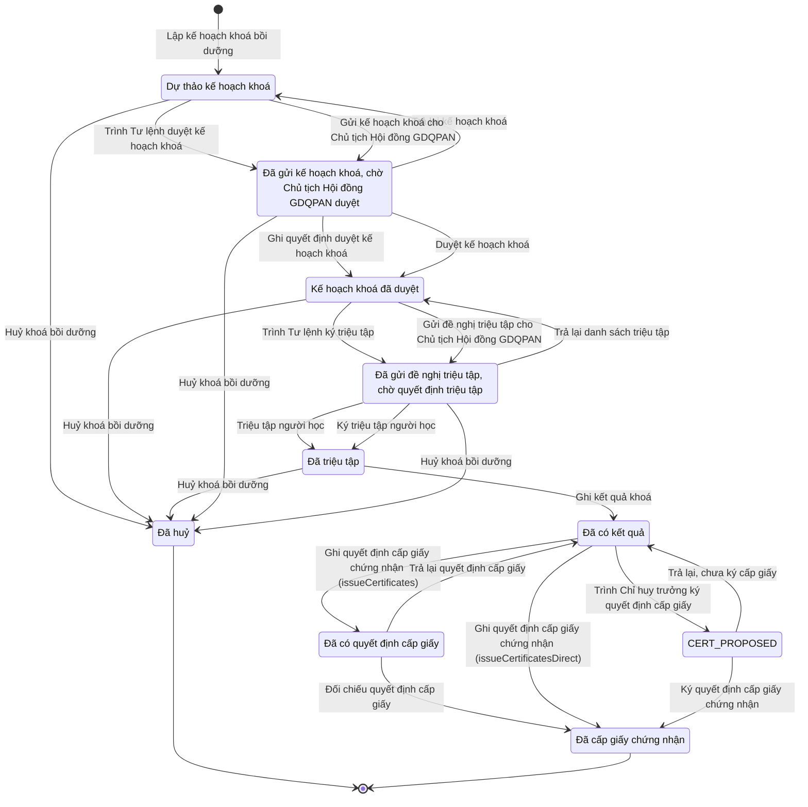

# qt-G1 · Khoá bồi dưỡng kiến thức QP&AN, cấp giấy chứng nhận

<!-- máy sinh: tom-tat -->
> **Hồ sơ:** Khoá bồi dưỡng kiến thức QP&AN (`RefresherCourse`)
>
> **Trong sổ phạm vi:** G1 · Khoá bồi dưỡng kiến thức QP&AN, cấp giấy chứng nhận (tầng 3)
>
> 22 bước · 10 chặng · 4 vai · 8 bảng quyết định · 0 hạn · 17 khớp nối.
>
> **Nguồn:** sổ nghiệp vụ `qt-G1` · khai báo của app: `dqtv-app/core/processes/gdqp-refresher/workflow/refresher-course.yaml`. Các bảng do máy sinh từ nguồn này.
<!-- hết: tom-tat -->

<!-- viết tay: dien-giai -->
## Diễn giải

*Phần này viết tay, diễn giải lại điều các bảng bên dưới ghi.*

### Quy trình này để làm gì

Theo dõi một **khoá bồi dưỡng kiến thức QP&AN** từ lúc lập kế hoạch khoá tới lúc cấp giấy chứng nhận cho người hoàn thành. Có bảy cấp lập khoá, ghi ở ô `level`: `commune`, `agencyOnCommune`, `province`, `militaryRegion`, `capitalCommand`, `hcmCommand`, `central`; một khoá chỉ có một chương trình.

Hồ sơ đi qua các chặng: *Dự thảo kế hoạch khoá* → *Kế hoạch khoá đã duyệt* → *Đã triệu tập* (đang học) → *Đã có kết quả* → *Đã có quyết định cấp giấy* → *Đã cấp giấy chứng nhận*; hoặc rẽ sang *Đã huỷ*. Ở ba chỗ (duyệt kế hoạch khoá, triệu tập, cấp giấy) đường đi rẽ theo `level`: có cấp thì Trợ lý Tác huấn ghi lại quyết định đã ký, có cấp thì trợ lý trình rồi vai `commander` duyệt hoặc ký ngay trên hệ. Lời người dùng: "nếu không có thì mới kí ngoài, nếu có trong tài khoản của hệ thống thì ko cần".

Người làm mọi bước sau bước mở là người của đơn vị chủ hồ sơ; dưới đây hai vai duyệt, ký và đối chiếu được gọi theo mã vai `commander` và `verifier`.

### Khi nào bắt đầu

Trợ lý Tác huấn bấm **Lập kế hoạch khoá bồi dưỡng**, bắt buộc nhập `annualPlanId`, tên khoá, chương trình, ngày khai giảng, bế giảng, địa điểm, cấp lập và mã đơn vị. Hồ sơ mở ra có nối tới một **Kế hoạch, văn kiện** của quy trình 2 — kế hoạch bồi dưỡng năm.

Bước này đòi `annualPlanApproved`: hồ sơ kế hoạch (qt-2) ghi ở mối nối tới Kế hoạch, văn kiện của chính khoá đang lập phải có `planType` là `gdqp_refresher_annual` và đang ở chặng `APPROVED` hoặc `IN_FORCE`. Người dùng đã chốt: không có khoá ngoài kế hoạch, cần thêm khoá thì điều chỉnh kế hoạch năm; khoá của cơ quan đóng trên xã bám vào kế hoạch của xã và do trợ lý xã nhập hộ. Bước này còn bị chặn nếu chương trình không hợp với cấp lập (bảng `programme-at-level`).

### Diễn ra thế nào

**Chặng "Dự thảo kế hoạch khoá"** — hai đường sang *Kế hoạch khoá đã duyệt*:

- `level` không phải `militaryRegion` (`notMilitaryRegionCourse`): Trợ lý Tác huấn bấm **Ghi quyết định duyệt kế hoạch khoá**, nhập số quyết định, người duyệt, ngày duyệt và bản quét kế hoạch đã duyệt. Việc duyệt do Chủ tịch Hội đồng GDQPAN cùng cấp làm ngoài hệ.
- `level` là `militaryRegion` (`militaryRegionCourse`): trợ lý bấm **Trình Tư lệnh duyệt kế hoạch khoá** (đã trình rồi thì không trình nữa); sau khi đã trình, vai `commander` bấm **Duyệt kế hoạch khoá**, hoặc **Trả lại kế hoạch khoá** kèm lý do (hồ sơ vẫn ở dự thảo; bước này ghi lại cả ô "trình duyệt kế hoạch khoá lúc"; lặp được). Người duyệt ở cấp này là Tư lệnh quân khu, Chủ tịch Hội đồng GDQPAN quân khu.

**Chặng "Kế hoạch khoá đã duyệt"** — cũng hai đường sang *Đã triệu tập*:

- `level` không phải `militaryRegion`: trợ lý bấm **Triệu tập người học**, nhập số quyết định triệu tập, người ký, ngày ký, bản quét và người được triệu tập.
- `level` là `militaryRegion`: trợ lý bấm **Trình Tư lệnh ký triệu tập** kèm người được trình triệu tập; sau khi đã trình, vai `commander` bấm **Ký triệu tập người học**, hoặc **Trả lại danh sách triệu tập** kèm lý do (lặp được).

**Chặng "Đã triệu tập"** — trợ lý bấm **Ghi kết quả khoá**: nhập kết quả từng người học và bắt buộc kèm bảng kết quả khoá của cơ sở đào tạo (ảnh hoặc PDF). Người dùng đã chốt tệp này bắt buộc ở mọi cấp.

**Chặng "Đã có kết quả"** — ba đường cấp giấy, tách bằng ba điều kiện:

- `level` không phải `militaryRegion` và không phải `province` (`certSignedOutsideCourse`): trợ lý bấm **Ghi quyết định cấp giấy chứng nhận** (mã `issueCertificates`; số quyết định, người quyết định, ngày ký, bản quét), hồ sơ sang *Đã có quyết định cấp giấy*. Ở đó vai `verifier` bấm **Đối chiếu quyết định cấp giấy** để sang *Đã cấp giấy chứng nhận*, hoặc **Trả lại quyết định cấp giấy** để hồ sơ về lại *Đã có kết quả*, bốn ô quyết định bị xoá.
- `level` là `militaryRegion`: trợ lý bấm một bước khác cũng mang nhãn **Ghi quyết định cấp giấy chứng nhận** (mã `issueCertificatesDirect`), hồ sơ sang thẳng *Đã cấp giấy chứng nhận*, không qua đối chiếu.
- `level` là `province` (`provinceCourse`): trợ lý bấm **Trình Chỉ huy trưởng ký quyết định cấp giấy**; sau khi đã trình, vai `commander` bấm **Ký quyết định cấp giấy chứng nhận** để sang thẳng *Đã cấp giấy chứng nhận*, hoặc **Trả lại, chưa ký cấp giấy** kèm lý do (lặp được). Người ký ở cấp này là Chỉ huy trưởng Bộ CHQS tỉnh.

Ba bước đưa hồ sơ sang *Đã cấp giấy chứng nhận* (đối chiếu, `issueCertificatesDirect`, ký trên hệ) đều tạo thêm hồ sơ con Giấy chứng nhận hoàn thành bồi dưỡng kiến thức QP&AN.

**Kết thúc sớm:** vai `verifier` bấm **Huỷ khoá bồi dưỡng** khi hồ sơ còn ở dự thảo, đã duyệt hoặc đã triệu tập, bắt buộc ghi lý do huỷ.

### Kết thúc và để lại gì

Hồ sơ kết thúc ở *Đã cấp giấy chứng nhận* (hệ đã cấp giấy cho từng người hoàn thành) hoặc *Đã huỷ*. Lúc mở, hồ sơ ghi mối nối tới kế hoạch bồi dưỡng năm của quy trình 2.

### Điều kiện chặn

- Mọi bước trừ bước mở: người làm phải là người của đơn vị chủ hồ sơ. Sai người, sai chặng, thiếu thứ phải có trước thì bước bị chặn, hồ sơ giữ nguyên.
- Lập khoá: kế hoạch bồi dưỡng năm ghi ở mối nối của khoá phải đã ở chặng `APPROVED` hoặc `IN_FORCE`.
- Rẽ theo `level`: bước ghi quyết định duyệt, bước triệu tập chỉ cho `level` không phải `militaryRegion`; sáu bước trình – duyệt – ký – trả lại của kế hoạch khoá và triệu tập, cùng bước `issueCertificatesDirect`, chỉ cho `militaryRegion`; ba bước trình – ký – trả lại cấp giấy chỉ cho `province`; ba bước ghi – trả lại – đối chiếu quyết định cấp giấy cho các cấp còn lại.
- Duyệt, ký, trả lại trên hệ: phải đã trình trước (đã có ô "trình … lúc"). Đã trình rồi thì không trình lần hai.
- Ghi kết quả khoá: phải có bảng kết quả khoá (ảnh hoặc PDF).
- Chương trình theo cấp (`programme-at-level`): thiếu chương trình, thiếu cấp, hoặc chương trình không dành cho cấp ấy thì không lập được khoá. Ví dụ xã chỉ mở khoá đối tượng 4 và già làng, trưởng họ; quân khu chỉ đối tượng 2; trung ương chỉ đối tượng 1.
- Ba bảng người ký — duyệt kế hoạch khoá (`course-plan-approver`), triệu tập (`summons-signer`), cấp giấy (`certificate-issuer`) — xét ở ba bước "ghi quyết định ký ngoài": thiếu người ký thì chặn (`authority_unknown`), người ký không đúng với cấp và chương trình thì chặn (`wrong_authority`).
<!-- hết viết tay -->

## 1. Đường đi ngắn nhất qua các chặng

<!-- máy sinh: luong-chinh -->
Đường ít bước nhất từ lúc mở hồ sơ tới chặng kết thúc xa nhất. Máy chọn theo số chặng, không theo ý nghĩa nghiệp vụ — trình tự công việc thật xem phần Diễn giải và bảng "Việc làm ở từng chặng" ở mục 6.

| # | Ai làm | Làm gì | Hồ sơ sang chặng |
|---|---|---|---|
| 1 | Trợ lý Tác huấn | Lập kế hoạch khoá bồi dưỡng | Dự thảo kế hoạch khoá |
| 2 | Hệ thống tự làm | Trình Tư lệnh duyệt kế hoạch khoá | Đã gửi kế hoạch khoá, chờ Chủ tịch Hội đồng GDQPAN duyệt |
| 3 | Trợ lý Tác huấn | Ghi quyết định duyệt kế hoạch khoá | Kế hoạch khoá đã duyệt |
| 4 | Hệ thống tự làm | Trình Tư lệnh ký triệu tập | Đã gửi đề nghị triệu tập, chờ quyết định triệu tập |
| 5 | Trợ lý Tác huấn | Triệu tập người học | Đã triệu tập |
| 6 | Trợ lý Tác huấn | Ghi kết quả khoá | Đã có kết quả |
| 7 | Trợ lý Tác huấn | Ghi quyết định cấp giấy chứng nhận (`issueCertificatesDirect`) | Đã cấp giấy chứng nhận |

```mermaid
flowchart LR
    S0(["Mở hồ sơ"])
    S1["Dự thảo kế hoạch khoá"]
    S0 -->|"Lập kế hoạch khoá bồi dưỡng"| S1
    S2["Đã gửi kế hoạch khoá, chờ Chủ tịch Hội đồng GDQPAN duyệt"]
    S1 -->|"Trình Tư lệnh duyệt kế hoạch khoá"| S2
    S3["Kế hoạch khoá đã duyệt"]
    S2 -->|"Ghi quyết định duyệt kế hoạch khoá"| S3
    S4["Đã gửi đề nghị triệu tập, chờ quyết định triệu tập"]
    S3 -->|"Trình Tư lệnh ký triệu tập"| S4
    S5["Đã triệu tập"]
    S4 -->|"Triệu tập người học"| S5
    S6["Đã có kết quả"]
    S5 -->|"Ghi kết quả khoá"| S6
    S7["Đã cấp giấy chứng nhận"]
    S6 -->|"Ghi quyết định cấp giấy chứng nhận ( issueCertificatesDirect )"| S7
```

<!-- hết: luong-chinh -->

## 2. Hồ sơ và việc nó để lại

<!-- máy sinh: muc-tieu -->
**App gọi quy trình này là:** Khoá bồi dưỡng kiến thức QP&AN.

**Khi mở, hồ sơ này ghi mối nối tới:**
- Kế hoạch, văn kiện (2) — bước `createCoursePlan`, khớp nối `courseUnderAnnualPlan`

**Hồ sơ này để lại cho quy trình khác** (bước tạo hồ sơ của quy trình kia ghi mối nối về đây):
- Công dân trong độ tuổi (16) — bước `registerFromTrainingList`, khớp nối `gdqpTraineeIsCitizen`
- Giấy chứng nhận hoàn thành bồi dưỡng kiến thức QP&AN (16.gdqp-certificate) — bước `recordPriorCertificate`, khớp nối `certificateOfTrainee`
- Hồ sơ lưu trữ (D16) — bước `openRecordArchiveFile`, khớp nối `dossierOfRefresherCourse`
- Nhóm đối tượng bồi dưỡng của người (16.gdqp-category) — bước `deriveTrainingCategory`, khớp nối `groupOfTrainee`
- Tệp lưu trữ (D16) — bước `recordArchiveFile`, khớp nối `fileOfRefresherCourse`
<!-- hết: muc-tieu -->

## 3. Khởi phát và kết thúc

<!-- máy sinh: khoi-phat -->
**1 cửa vào** — bước mở hồ sơ:

| Bước mở | Ai mở | Hồ sơ vào chặng | App bắt buộc nhập |
|---|---|---|---|
| Lập kế hoạch khoá bồi dưỡng | Trợ lý Tác huấn | Dự thảo kế hoạch khoá | `annualPlanId`, tên khoá, chương trình, khai giảng, bế giảng, địa điểm, cấp lập, mã đơn vị |

**Kết thúc:** *Đã huỷ* (`CANCELLED`), *Đã cấp giấy chứng nhận* (`CERTIFIED`)
<!-- hết: khoi-phat -->

## 4. Vai trò

<!-- máy sinh: vai-tro -->
| Vai trong sổ | Tên trong app | Điều kiện | Làm những bước |
|---|---|---|---|
| `operator` | Trợ lý Tác huấn |  | Lập kế hoạch khoá bồi dưỡng · Ghi quyết định duyệt kế hoạch khoá · Triệu tập người học · Trình ký văn bản trình duyệt kế hoạch khoá · Trình ký văn bản đề nghị triệu tập · Ghi kết quả khoá · Ghi quyết định cấp giấy chứng nhận (`issueCertificates`) · Ghi quyết định cấp giấy chứng nhận (`issueCertificatesDirect`) · Trình Chỉ huy trưởng ký quyết định cấp giấy |
| `system` | Hệ thống tự làm |  | Trình Tư lệnh duyệt kế hoạch khoá · Trình Tư lệnh ký triệu tập · Gửi kế hoạch khoá cho Chủ tịch Hội đồng GDQPAN · Gửi đề nghị triệu tập cho Chủ tịch Hội đồng GDQPAN |
| `commander` | Chỉ huy trưởng Ban CHQS xã (`commander`) |  | Duyệt kế hoạch khoá · Trả lại kế hoạch khoá · Ký triệu tập người học · Trả lại danh sách triệu tập · Ký quyết định cấp giấy chứng nhận · Trả lại, chưa ký cấp giấy |
| `verifier` | Chỉ huy trưởng Ban CHQS xã (`verifier`) |  | Trả lại quyết định cấp giấy · Đối chiếu quyết định cấp giấy · Huỷ khoá bồi dưỡng |

*"Tên trong app" là tên app đặt cho mã chủ thể của vai. Hồ sơ thuộc đơn vị cấp khác thì người làm là người giữ vai ấy ở đơn vị nêu trong cột "Điều kiện" (nếu sổ có ghi) và ở cột "Người làm phải thuộc" của bảng "Theo khai báo của app" (mục 7).*
<!-- hết: vai-tro -->

## 5. Nhánh phụ

<!-- máy sinh: nhanh-phu -->
**Bước khác đưa hồ sơ sang chặng mới** — đường song song, rẽ nhánh hoặc kết thúc sớm:

| Bước | Ai làm | Từ chặng | Sang chặng |
|---|---|---|---|
| Duyệt kế hoạch khoá | Chỉ huy trưởng Ban CHQS xã (`commander`) | Đã gửi kế hoạch khoá, chờ Chủ tịch Hội đồng GDQPAN duyệt | Kế hoạch khoá đã duyệt |
| Gửi kế hoạch khoá cho Chủ tịch Hội đồng GDQPAN | Hệ thống tự làm | Dự thảo kế hoạch khoá | Đã gửi kế hoạch khoá, chờ Chủ tịch Hội đồng GDQPAN duyệt |
| Gửi đề nghị triệu tập cho Chủ tịch Hội đồng GDQPAN | Hệ thống tự làm | Kế hoạch khoá đã duyệt | Đã gửi đề nghị triệu tập, chờ quyết định triệu tập |
| Ký triệu tập người học | Chỉ huy trưởng Ban CHQS xã (`commander`) | Đã gửi đề nghị triệu tập, chờ quyết định triệu tập | Đã triệu tập |
| Ghi quyết định cấp giấy chứng nhận (`issueCertificates`) | Trợ lý Tác huấn | Đã có kết quả | Đã có quyết định cấp giấy |
| Đối chiếu quyết định cấp giấy | Chỉ huy trưởng Ban CHQS xã (`verifier`) | Đã có quyết định cấp giấy | Đã cấp giấy chứng nhận |
| Trình Chỉ huy trưởng ký quyết định cấp giấy | Trợ lý Tác huấn | Đã có kết quả | `CERT_PROPOSED` |
| Ký quyết định cấp giấy chứng nhận | Chỉ huy trưởng Ban CHQS xã (`commander`) | `CERT_PROPOSED` | Đã cấp giấy chứng nhận |
| Huỷ khoá bồi dưỡng | Chỉ huy trưởng Ban CHQS xã (`verifier`) | Dự thảo kế hoạch khoá, Kế hoạch khoá đã duyệt, Đã triệu tập, Đã gửi kế hoạch khoá, chờ Chủ tịch Hội đồng GDQPAN duyệt, Đã gửi đề nghị triệu tập, chờ quyết định triệu tập | Đã huỷ |

**Quay lại một chặng hồ sơ đã đi qua** (tính theo đường ngắn nhất từ lúc mở):

| Bước | Ai làm | Từ chặng | Về chặng |
|---|---|---|---|
| Trả lại kế hoạch khoá | Chỉ huy trưởng Ban CHQS xã (`commander`) | Đã gửi kế hoạch khoá, chờ Chủ tịch Hội đồng GDQPAN duyệt | Dự thảo kế hoạch khoá |
| Trả lại danh sách triệu tập | Chỉ huy trưởng Ban CHQS xã (`commander`) | Đã gửi đề nghị triệu tập, chờ quyết định triệu tập | Kế hoạch khoá đã duyệt |
| Trả lại quyết định cấp giấy | Chỉ huy trưởng Ban CHQS xã (`verifier`) | Đã có quyết định cấp giấy | Đã có kết quả |
| Trả lại, chưa ký cấp giấy | Chỉ huy trưởng Ban CHQS xã (`commander`) | `CERT_PROPOSED` | Đã có kết quả |

**Làm trong lúc hồ sơ đứng yên ở một chặng** — ghi nhận, bổ sung:

| Bước | Ai làm | Ở chặng |
|---|---|---|
| Trình ký văn bản trình duyệt kế hoạch khoá | Trợ lý Tác huấn | Dự thảo kế hoạch khoá |
| Trình ký văn bản đề nghị triệu tập | Trợ lý Tác huấn | Kế hoạch khoá đã duyệt |

<!-- hết: nhanh-phu -->

## 6. Các chặng và việc làm ở từng chặng

<!-- máy sinh: chang -->
| Chặng | Tên hiển thị | Vào bằng bước | Kết thúc? |
|---|---|---|---|
| `DRAFT` | Dự thảo kế hoạch khoá | Lập kế hoạch khoá bồi dưỡng · Trả lại kế hoạch khoá |  |
| `PLAN_SUBMITTED` | Đã gửi kế hoạch khoá, chờ Chủ tịch Hội đồng GDQPAN duyệt | Trình Tư lệnh duyệt kế hoạch khoá · Gửi kế hoạch khoá cho Chủ tịch Hội đồng GDQPAN |  |
| `CANCELLED` | Đã huỷ | Huỷ khoá bồi dưỡng | **kết thúc** |
| `APPROVED` | Kế hoạch khoá đã duyệt | Ghi quyết định duyệt kế hoạch khoá · Duyệt kế hoạch khoá · Trả lại danh sách triệu tập |  |
| `SUMMONS_PROPOSED` | Đã gửi đề nghị triệu tập, chờ quyết định triệu tập | Trình Tư lệnh ký triệu tập · Gửi đề nghị triệu tập cho Chủ tịch Hội đồng GDQPAN |  |
| `SUMMONED` | Đã triệu tập | Triệu tập người học · Ký triệu tập người học |  |
| `RESULTED` | Đã có kết quả | Ghi kết quả khoá · Trả lại quyết định cấp giấy · Trả lại, chưa ký cấp giấy |  |
| `DECIDED` | Đã có quyết định cấp giấy | Ghi quyết định cấp giấy chứng nhận (`issueCertificates`) |  |
| `CERTIFIED` | Đã cấp giấy chứng nhận | Đối chiếu quyết định cấp giấy · Ghi quyết định cấp giấy chứng nhận (`issueCertificatesDirect`) · Ký quyết định cấp giấy chứng nhận | **kết thúc** |
| `CERT_PROPOSED` | — | Trình Chỉ huy trưởng ký quyết định cấp giấy |  |

### Việc làm ở từng chặng

Hồ sơ đang ở chặng nào thì làm được những bước nào.

| Hồ sơ đang ở chặng | Bước làm tại chặng (hồ sơ đứng yên) | Bước đưa hồ sơ sang chặng khác |
|---|---|---|
| **Dự thảo kế hoạch khoá** | Trình ký văn bản trình duyệt kế hoạch khoá — Trợ lý Tác huấn | Trình Tư lệnh duyệt kế hoạch khoá — Hệ thống tự làm → *Đã gửi kế hoạch khoá, chờ Chủ tịch Hội đồng GDQPAN duyệt* Gửi kế hoạch khoá cho Chủ tịch Hội đồng GDQPAN — Hệ thống tự làm → *Đã gửi kế hoạch khoá, chờ Chủ tịch Hội đồng GDQPAN duyệt* Huỷ khoá bồi dưỡng — Chỉ huy trưởng Ban CHQS xã (`verifier`) → *Đã huỷ* |
| **Đã gửi kế hoạch khoá, chờ Chủ tịch Hội đồng GDQPAN duyệt** | — | Ghi quyết định duyệt kế hoạch khoá — Trợ lý Tác huấn → *Kế hoạch khoá đã duyệt* Duyệt kế hoạch khoá — Chỉ huy trưởng Ban CHQS xã (`commander`) → *Kế hoạch khoá đã duyệt* Trả lại kế hoạch khoá — Chỉ huy trưởng Ban CHQS xã (`commander`) → *Dự thảo kế hoạch khoá* Huỷ khoá bồi dưỡng — Chỉ huy trưởng Ban CHQS xã (`verifier`) → *Đã huỷ* |
| **Đã huỷ** | — | — (kết thúc) |
| **Kế hoạch khoá đã duyệt** | Trình ký văn bản đề nghị triệu tập — Trợ lý Tác huấn | Trình Tư lệnh ký triệu tập — Hệ thống tự làm → *Đã gửi đề nghị triệu tập, chờ quyết định triệu tập* Gửi đề nghị triệu tập cho Chủ tịch Hội đồng GDQPAN — Hệ thống tự làm → *Đã gửi đề nghị triệu tập, chờ quyết định triệu tập* Huỷ khoá bồi dưỡng — Chỉ huy trưởng Ban CHQS xã (`verifier`) → *Đã huỷ* |
| **Đã gửi đề nghị triệu tập, chờ quyết định triệu tập** | — | Triệu tập người học — Trợ lý Tác huấn → *Đã triệu tập* Ký triệu tập người học — Chỉ huy trưởng Ban CHQS xã (`commander`) → *Đã triệu tập* Trả lại danh sách triệu tập — Chỉ huy trưởng Ban CHQS xã (`commander`) → *Kế hoạch khoá đã duyệt* Huỷ khoá bồi dưỡng — Chỉ huy trưởng Ban CHQS xã (`verifier`) → *Đã huỷ* |
| **Đã triệu tập** | — | Ghi kết quả khoá — Trợ lý Tác huấn → *Đã có kết quả* Huỷ khoá bồi dưỡng — Chỉ huy trưởng Ban CHQS xã (`verifier`) → *Đã huỷ* |
| **Đã có kết quả** | — | Ghi quyết định cấp giấy chứng nhận (`issueCertificates`) — Trợ lý Tác huấn → *Đã có quyết định cấp giấy* Ghi quyết định cấp giấy chứng nhận (`issueCertificatesDirect`) — Trợ lý Tác huấn → *Đã cấp giấy chứng nhận* Trình Chỉ huy trưởng ký quyết định cấp giấy — Trợ lý Tác huấn → *`CERT_PROPOSED`* |
| **Đã có quyết định cấp giấy** | — | Trả lại quyết định cấp giấy — Chỉ huy trưởng Ban CHQS xã (`verifier`) → *Đã có kết quả* Đối chiếu quyết định cấp giấy — Chỉ huy trưởng Ban CHQS xã (`verifier`) → *Đã cấp giấy chứng nhận* |
| **Đã cấp giấy chứng nhận** | — | — (kết thúc) |
| **`CERT_PROPOSED`** | — | Ký quyết định cấp giấy chứng nhận — Chỉ huy trưởng Ban CHQS xã (`commander`) → *Đã cấp giấy chứng nhận* Trả lại, chưa ký cấp giấy — Chỉ huy trưởng Ban CHQS xã (`commander`) → *Đã có kết quả* |
<!-- hết: chang -->

## 7. Bảng bước

<!-- máy sinh: buoc -->
| # | Bước | Mã bước | Ai thực hiện | Từ chặng | Sang chặng | Phải có trước | Ghi lại |
|---|---|---|---|---|---|---|---|
| 1 | Lập kế hoạch khoá bồi dưỡng | `createCoursePlan` | Trợ lý Tác huấn | — (mở hồ sơ) | `DRAFT` | `annualPlanApproved` | đơn vị chủ hồ sơ, `level`, nối tới Kế hoạch, văn kiện, tên khoá, chương trình, khai giảng, bế giảng, địa điểm, loại cơ sở học, báo cáo viên, `agencyUnit`, `id` |
| 2 | Ghi quyết định duyệt kế hoạch khoá | `approveCoursePlan` | Trợ lý Tác huấn | `PLAN_SUBMITTED` | `APPROVED` | `notMilitaryRegionCourse`, người làm thuộc đơn vị chủ hồ sơ, `coursePlanApprovedByIncomingDocumentUsable` | nối tới Văn bản đến, người duyệt kế hoạch khoá |
| 3 | Triệu tập người học | `summonLearners` | Trợ lý Tác huấn | `SUMMONS_PROPOSED` | `SUMMONED` | `notMilitaryRegionCourse`, người làm thuộc đơn vị chủ hồ sơ, `learnersDueForCourse`, `summonsByIncomingDocumentUsable`, `noLearnerOverlaps` | `summonsDecision`, nối `courseSummonsLearner`, nối tới Văn bản đến, người ký triệu tập |
| 4 | Trình ký văn bản trình duyệt kế hoạch khoá | `requestCoursePlanSubmissionSignature` | Trợ lý Tác huấn | `DRAFT` | giữ nguyên | `noCoursePlanSubmittedDocumentOpen`, người làm thuộc đơn vị chủ hồ sơ | nối tới Văn bản đi |
| 5 | Trình Tư lệnh duyệt kế hoạch khoá | `submitCoursePlan` | Hệ thống tự làm | `DRAFT` | `PLAN_SUBMITTED` | `militaryRegionCourse`, `coursePlanSubmissionIssued` | nối tới Văn bản đến |
| 6 | Duyệt kế hoạch khoá | `approveCoursePlanInSystem` | Chỉ huy trưởng Ban CHQS xã (`commander`) | `PLAN_SUBMITTED` | `APPROVED` | `militaryRegionCourse`, người làm thuộc đơn vị chủ hồ sơ, `coursePlanDistributedAtReceiver` | người duyệt kế hoạch khoá |
| 7 | Trả lại kế hoạch khoá | `returnCoursePlan` | Chỉ huy trưởng Ban CHQS xã (`commander`) | `PLAN_SUBMITTED` | `DRAFT` | `militaryRegionCourse`, người làm thuộc đơn vị chủ hồ sơ, `coursePlanDistributedAtReceiver` | lý do trả lại |
| 8 | Trình ký văn bản đề nghị triệu tập | `requestSummonsProposalSignature` | Trợ lý Tác huấn | `APPROVED` | giữ nguyên | `noSummonsProposedDocumentOpen`, người làm thuộc đơn vị chủ hồ sơ | người được trình triệu tập, nối tới Văn bản đi |
| 9 | Trình Tư lệnh ký triệu tập | `proposeSummons` | Hệ thống tự làm | `APPROVED` | `SUMMONS_PROPOSED` | `militaryRegionCourse`, `proposedTraineesDue`, `summonsProposalIssued` | nối tới Văn bản đến |
| 10 | Gửi kế hoạch khoá cho Chủ tịch Hội đồng GDQPAN | `sendCoursePlanToChairman` | Hệ thống tự làm | `DRAFT` | `PLAN_SUBMITTED` | `notMilitaryRegionCourse`, `coursePlanSubmissionIssued` | — |
| 11 | Gửi đề nghị triệu tập cho Chủ tịch Hội đồng GDQPAN | `sendSummonsProposalToChairman` | Hệ thống tự làm | `APPROVED` | `SUMMONS_PROPOSED` | `notMilitaryRegionCourse`, `summonsProposalIssued` | — |
| 12 | Ký triệu tập người học | `signSummonsInSystem` | Chỉ huy trưởng Ban CHQS xã (`commander`) | `SUMMONS_PROPOSED` | `SUMMONED` | `militaryRegionCourse`, người làm thuộc đơn vị chủ hồ sơ, `summonsProposalDistributedAtReceiver`, `noLearnerOverlaps` | số người triệu tập, người ký quyết định triệu tập |
| 13 | Trả lại danh sách triệu tập | `returnSummons` | Chỉ huy trưởng Ban CHQS xã (`commander`) | `SUMMONS_PROPOSED` | `APPROVED` | `militaryRegionCourse`, người làm thuộc đơn vị chủ hồ sơ, `summonsProposalDistributedAtReceiver` | người được trình triệu tập, lý do trả lại |
| 14 | Ghi kết quả khoá | `recordCourseResult` | Trợ lý Tác huấn | `SUMMONED` | `RESULTED` | bảng kết quả khoá (ảnh hoặc PDF), người làm thuộc đơn vị chủ hồ sơ | kết quả từng người học, bảng kết quả khoá (ảnh hoặc PDF) |
| 15 | Ghi quyết định cấp giấy chứng nhận (`issueCertificates`) | `issueCertificates` | Trợ lý Tác huấn | `RESULTED` | `DECIDED` | `certSignedOutsideCourse`, người làm thuộc đơn vị chủ hồ sơ, `issueCertificatesFromIncomingDocumentUsable` | nối tới Văn bản đến, người quyết định cấp giấy |
| 16 | Trả lại quyết định cấp giấy | `returnCertificateDecision` | Chỉ huy trưởng Ban CHQS xã (`verifier`) | `DECIDED` | `RESULTED` | `certSignedOutsideCourse`, người làm thuộc đơn vị chủ hồ sơ | —; **xoá:** người quyết định cấp giấy, nối tới Văn bản đến |
| 17 | Đối chiếu quyết định cấp giấy | `verifyCertificates` | Chỉ huy trưởng Ban CHQS xã (`verifier`) | `DECIDED` | `CERTIFIED` | `certSignedOutsideCourse`, người làm thuộc đơn vị chủ hồ sơ | ngày đối chiếu |
| 18 | Ghi quyết định cấp giấy chứng nhận (`issueCertificatesDirect`) | `issueCertificatesDirect` | Trợ lý Tác huấn | `RESULTED` | `CERTIFIED` | `militaryRegionCourse`, người làm thuộc đơn vị chủ hồ sơ, `issueCertificatesDirectFromIncomingDocumentUsable` | nối tới Văn bản đến, người quyết định cấp giấy |
| 19 | Trình Chỉ huy trưởng ký quyết định cấp giấy | `proposeCertificates` | Trợ lý Tác huấn | `RESULTED` | `CERT_PROPOSED` | `provinceCourse`, người làm thuộc đơn vị chủ hồ sơ | trình ký cấp giấy lúc |
| 20 | Ký quyết định cấp giấy chứng nhận | `signCertificatesInSystem` | Chỉ huy trưởng Ban CHQS xã (`commander`) | `CERT_PROPOSED` | `CERTIFIED` | `provinceCourse`, người làm thuộc đơn vị chủ hồ sơ | người ký quyết định cấp giấy, ngày ký (để trống thì lấy hôm nay) |
| 21 | Trả lại, chưa ký cấp giấy | `returnCertificateProposal` | Chỉ huy trưởng Ban CHQS xã (`commander`) | `CERT_PROPOSED` | `RESULTED` | `provinceCourse`, người làm thuộc đơn vị chủ hồ sơ | lý do trả lại |
| 22 | Huỷ khoá bồi dưỡng | `cancelCourse` | Chỉ huy trưởng Ban CHQS xã (`verifier`) | `DRAFT`, `APPROVED`, `SUMMONED`, `PLAN_SUBMITTED`, `SUMMONS_PROPOSED` | `CANCELLED` | người làm thuộc đơn vị chủ hồ sơ | lý do huỷ |

### Khi không đạt điều kiện

Mặc định: không đúng người, hồ sơ không ở đúng chặng, hoặc thiếu thứ "phải có trước" thì bước bị chặn, hồ sơ giữ nguyên. Bảng dưới chỉ kê những bước có kết quả riêng.

| # | Bước | Kết quả riêng |
|---|---|---|
| 1 | Lập kế hoạch khoá bồi dưỡng | bước dừng lại, hồ sơ giữ nguyên khi kết quả xét là: `programme_missing`, `level_missing`, `programme_not_for_level` |
| 2 | Ghi quyết định duyệt kế hoạch khoá | bước dừng lại, hồ sơ giữ nguyên khi kết quả xét là: `authority_unknown`, `wrong_authority` |
| 3 | Triệu tập người học | bước dừng lại, hồ sơ giữ nguyên khi kết quả xét là: `authority_unknown`, `wrong_authority` |
| 5 | Trình Tư lệnh duyệt kế hoạch khoá | bước này không do người nào bấm |
| 6 | Duyệt kế hoạch khoá | bước dừng lại, hồ sơ giữ nguyên khi kết quả xét là: `authority_unknown`, `wrong_authority` |
| 9 | Trình Tư lệnh ký triệu tập | bước này không do người nào bấm |
| 10 | Gửi kế hoạch khoá cho Chủ tịch Hội đồng GDQPAN | bước này không do người nào bấm |
| 11 | Gửi đề nghị triệu tập cho Chủ tịch Hội đồng GDQPAN | bước này không do người nào bấm |
| 12 | Ký triệu tập người học | bước dừng lại, hồ sơ giữ nguyên khi kết quả xét là: `authority_unknown`, `wrong_authority` |
| 15 | Ghi quyết định cấp giấy chứng nhận (`issueCertificates`) | bước dừng lại, hồ sơ giữ nguyên khi kết quả xét là: `authority_unknown`, `wrong_authority` |
| 18 | Ghi quyết định cấp giấy chứng nhận (`issueCertificatesDirect`) | bước dừng lại, hồ sơ giữ nguyên khi kết quả xét là: `authority_unknown`, `wrong_authority` |
| 20 | Ký quyết định cấp giấy chứng nhận | bước dừng lại, hồ sơ giữ nguyên khi kết quả xét là: `authority_unknown`, `wrong_authority` |

### Điều kiện "phải có trước" bằng lời

Cột "Phải có trước" ở bảng bước có hai loại: ô dữ liệu thường (bước chỉ đòi ô ấy đã có giá trị) và điều kiện hệ tự xét. Bảng này diễn các điều kiện hệ tự xét theo đúng công thức sổ ghi; số ở cột cuối là số thứ tự bước.

| Điều kiện | Đúng khi | Bước đòi |
|---|---|---|
| `annualPlanApproved` | có hồ sơ Kế hoạch lập → thẩm định → phê chuẩn → rà soát (qt-2) chính là hồ sơ ghi ở ô nối `courseUnderAnnualPlan` của hồ sơ đang làm mà `planType` là `gdqp_refresher_annual` VÀ hồ sơ ấy đang ở chặng `APPROVED` hoặc `IN_FORCE` | 1 |
| `notMilitaryRegionCourse` | KHÔNG (`level` là `militaryRegion`) | 2, 3, 10, 11 |
| `actorInOwnerUnit` | người đang làm là người của đơn vị ghi ở ô đơn vị chủ hồ sơ của hồ sơ này (theo danh mục người của đơn vị, `dm.unit-staff`) | 2, 3, 4, 6, 7, 8, 12, 13, 14, 15, 16, 17, 18, 19, 20, 21, 22 |
| `coursePlanApprovedByIncomingDocumentUsable` | có hồ sơ Việc luật giao kèm văn bản đến, đi — Văn bản đến (qt-1.incoming-document) chính là hồ sơ ghi ở ô nối `coursePlanApprovedByIncomingDocument` của hồ sơ đang làm mà hồ sơ ấy đang ở chặng `RECEIVED` hoặc `DISTRIBUTED` | 2 |
| `learnersDueForCourse` | mọi hồ sơ Sổ đăng ký người theo diện (qt-16) chính là hồ sơ ghi ở ô nối `courseSummonsLearner` của hồ sơ đang làm đều thoả: (chương trình của hồ sơ này bằng `group_1` VÀ có hồ sơ Nhóm đối tượng bồi dưỡng của người (qt-16.gdqp-category) (gọi là c) là hồ sơ con của hồ sơ vừa nêu mà hồ sơ ấy đang ở chặng `ACTIVE` VÀ nhóm đối tượng triệu tập theo (để trống thì hệ lấy theo chương trình) của hồ sơ c ấy bằng `group_1` VÀ không có hồ sơ Giấy chứng nhận hoàn thành bồi dưỡng kiến thức QP&AN (qt-16.gdqp-certificate) (gọi là k) là hồ sơ con của hồ sơ vừa nêu mà hồ sơ ấy đang ở chặng `ISSUED` VÀ chương trình của hồ sơ k ấy bằng `group_1`) HOẶC (chương trình của hồ sơ này bằng `group_2` VÀ có hồ sơ Nhóm đối tượng bồi dưỡng của người (qt-16.gdqp-category) (gọi là c) là hồ sơ con của hồ sơ vừa nêu mà hồ sơ ấy đang ở chặng `ACTIVE` VÀ nhóm đối tượng triệu tập theo (để trống thì hệ lấy theo chương trình) của hồ sơ c ấy bằng `group_2` VÀ không có hồ sơ Giấy chứng nhận hoàn thành bồi dưỡng kiến thức QP&AN (qt-16.gdqp-certificate) (gọi là k) là hồ sơ con của hồ sơ vừa nêu mà hồ sơ ấy đang ở chặng `ISSUED` VÀ chương trình của hồ sơ k ấy bằng `group_2`) HOẶC (chương trình của hồ sơ này bằng `group_3_and_equivalent` VÀ có hồ sơ Nhóm đối tượng bồi dưỡng của người (qt-16.gdqp-category) (gọi là c) là hồ sơ con của hồ sơ vừa nêu mà hồ sơ ấy đang ở chặng `ACTIVE` VÀ nhóm đối tượng triệu tập theo (để trống thì hệ lấy theo chương trình) của hồ sơ c ấy bằng `group_3` VÀ không có hồ sơ Giấy chứng nhận hoàn thành bồi dưỡng kiến thức QP&AN (qt-16.gdqp-certificate) (gọi là k) là hồ sơ con của hồ sơ vừa nêu mà hồ sơ ấy đang ở chặng `ISSUED` VÀ chương trình của hồ sơ k ấy bằng `group_3_and_equivalent`) HOẶC (chương trình của hồ sơ này bằng `group_4_and_equivalent` VÀ có hồ sơ Nhóm đối tượng bồi dưỡng của người (qt-16.gdqp-category) (gọi là c) là hồ sơ con của hồ sơ vừa nêu mà hồ sơ ấy đang ở chặng `ACTIVE` VÀ nhóm đối tượng triệu tập theo (để trống thì hệ lấy theo chương trình) của hồ sơ c ấy bằng `group_4_commune` VÀ không có hồ sơ Giấy chứng nhận hoàn thành bồi dưỡng kiến thức QP&AN (qt-16.gdqp-certificate) (gọi là k) là hồ sơ con của hồ sơ vừa nêu mà hồ sơ ấy đang ở chặng `ISSUED` VÀ chương trình của hồ sơ k ấy bằng `group_4_and_equivalent`) HOẶC (chương trình của hồ sơ này bằng `group_4_and_equivalent` VÀ có hồ sơ Nhóm đối tượng bồi dưỡng của người (qt-16.gdqp-category) (gọi là c) là hồ sơ con của hồ sơ vừa nêu mà hồ sơ ấy đang ở chặng `ACTIVE` VÀ nhóm đối tượng triệu tập theo (để trống thì hệ lấy theo chương trình) của hồ sơ c ấy bằng `group_4_agency` VÀ không có hồ sơ Giấy chứng nhận hoàn thành bồi dưỡng kiến thức QP&AN (qt-16.gdqp-certificate) (gọi là k) là hồ sơ con của hồ sơ vừa nêu mà hồ sơ ấy đang ở chặng `ISSUED` VÀ chương trình của hồ sơ k ấy bằng `group_4_and_equivalent`) HOẶC (chương trình của hồ sơ này bằng `group_3_and_equivalent` VÀ có hồ sơ Nhóm đối tượng bồi dưỡng của người (qt-16.gdqp-category) (gọi là c) là hồ sơ con của hồ sơ vừa nêu mà hồ sơ ấy đang ở chặng `ACTIVE` VÀ nhóm đối tượng triệu tập theo (để trống thì hệ lấy theo chương trình) của hồ sơ c ấy bằng `equivalent_3` VÀ không có hồ sơ Giấy chứng nhận hoàn thành bồi dưỡng kiến thức QP&AN (qt-16.gdqp-certificate) (gọi là k) là hồ sơ con của hồ sơ vừa nêu mà hồ sơ ấy đang ở chặng `ISSUED` VÀ chương trình của hồ sơ k ấy bằng `group_3_and_equivalent`) HOẶC (chương trình của hồ sơ này bằng `group_4_and_equivalent` VÀ có hồ sơ Nhóm đối tượng bồi dưỡng của người (qt-16.gdqp-category) (gọi là c) là hồ sơ con của hồ sơ vừa nêu mà hồ sơ ấy đang ở chặng `ACTIVE` VÀ nhóm đối tượng triệu tập theo (để trống thì hệ lấy theo chương trình) của hồ sơ c ấy bằng `equivalent_4` VÀ không có hồ sơ Giấy chứng nhận hoàn thành bồi dưỡng kiến thức QP&AN (qt-16.gdqp-certificate) (gọi là k) là hồ sơ con của hồ sơ vừa nêu mà hồ sơ ấy đang ở chặng `ISSUED` VÀ chương trình của hồ sơ k ấy bằng `group_4_and_equivalent`) HOẶC (chương trình của hồ sơ này bằng `religious_or_cultural_figure` VÀ có hồ sơ Nhóm đối tượng bồi dưỡng của người (qt-16.gdqp-category) (gọi là c) là hồ sơ con của hồ sơ vừa nêu mà hồ sơ ấy đang ở chặng `ACTIVE` VÀ nhóm đối tượng triệu tập theo (để trống thì hệ lấy theo chương trình) của hồ sơ c ấy bằng `religious_or_cultural_figure` VÀ không có hồ sơ Giấy chứng nhận hoàn thành bồi dưỡng kiến thức QP&AN (qt-16.gdqp-certificate) (gọi là k) là hồ sơ con của hồ sơ vừa nêu mà hồ sơ ấy đang ở chặng `ISSUED` VÀ chương trình của hồ sơ k ấy bằng `religious_or_cultural_figure`) HOẶC (chương trình của hồ sơ này bằng `village_elder_or_clan_head` VÀ có hồ sơ Nhóm đối tượng bồi dưỡng của người (qt-16.gdqp-category) (gọi là c) là hồ sơ con của hồ sơ vừa nêu mà hồ sơ ấy đang ở chặng `ACTIVE` VÀ nhóm đối tượng triệu tập theo (để trống thì hệ lấy theo chương trình) của hồ sơ c ấy bằng `village_elder_or_clan_head` VÀ không có hồ sơ Giấy chứng nhận hoàn thành bồi dưỡng kiến thức QP&AN (qt-16.gdqp-certificate) (gọi là k) là hồ sơ con của hồ sơ vừa nêu mà hồ sơ ấy đang ở chặng `ISSUED` VÀ chương trình của hồ sơ k ấy bằng `village_elder_or_clan_head`) | 3 |
| `summonsByIncomingDocumentUsable` | có hồ sơ Việc luật giao kèm văn bản đến, đi — Văn bản đến (qt-1.incoming-document) chính là hồ sơ ghi ở ô nối `summonsByIncomingDocument` của hồ sơ đang làm mà hồ sơ ấy đang ở chặng `RECEIVED` hoặc `DISTRIBUTED` | 3 |
| `noLearnerOverlaps` | không có hồ sơ Học viên của khoá bồi dưỡng (qt-G1.course-attendance) (gọi là a) là hồ sơ con của hồ sơ đang làm mà hồ sơ ấy đang ở chặng `SUMMONED` VÀ đã có `learnerOverlapsSummonedCourse` | 3, 12 |
| `noCoursePlanSubmittedDocumentOpen` | KHÔNG (có hồ sơ Việc luật giao kèm văn bản đến, đi — Văn bản đi (qt-1.outgoing-document) chính là hồ sơ ghi ở ô nối `coursePlanSubmittedByDocument` của hồ sơ đang làm mà hồ sơ ấy đang ở chặng `DRAFT` hoặc `PENDING_SIGNATURE` hoặc `SIGNED`) | 4 |
| `militaryRegionCourse` | `level` là `militaryRegion` | 5, 6, 7, 9, 12, 13, 18 |
| `coursePlanSubmissionIssued` | có hồ sơ Việc luật giao kèm văn bản đến, đi — Văn bản đi (qt-1.outgoing-document) chính là hồ sơ ghi ở ô nối `coursePlanSubmittedByDocument` của hồ sơ đang làm mà hồ sơ ấy đang ở chặng `ISSUED` | 5, 10 |
| `coursePlanDistributedAtReceiver` | có hồ sơ Việc luật giao kèm văn bản đến, đi — Văn bản đến (qt-1.incoming-document) chính là hồ sơ ghi ở ô nối `coursePlanDeliveredAs` của hồ sơ đang làm mà hồ sơ ấy đang ở chặng `DISTRIBUTED` | 6, 7 |
| `noSummonsProposedDocumentOpen` | KHÔNG (có hồ sơ Việc luật giao kèm văn bản đến, đi — Văn bản đi (qt-1.outgoing-document) chính là hồ sơ ghi ở ô nối `summonsProposedByDocument` của hồ sơ đang làm mà hồ sơ ấy đang ở chặng `DRAFT` hoặc `PENDING_SIGNATURE` hoặc `SIGNED`) | 8 |
| `proposedTraineesDue` | mọi hồ sơ Sổ đăng ký người theo diện (qt-16) chính là hồ sơ ghi ở người được trình triệu tập của hồ sơ đang làm đều thoả: (chương trình của hồ sơ này bằng `group_1` VÀ có hồ sơ Nhóm đối tượng bồi dưỡng của người (qt-16.gdqp-category) (gọi là c) là hồ sơ con của hồ sơ vừa nêu mà hồ sơ ấy đang ở chặng `ACTIVE` VÀ nhóm đối tượng triệu tập theo (để trống thì hệ lấy theo chương trình) của hồ sơ c ấy bằng `group_1` VÀ không có hồ sơ Giấy chứng nhận hoàn thành bồi dưỡng kiến thức QP&AN (qt-16.gdqp-certificate) (gọi là k) là hồ sơ con của hồ sơ vừa nêu mà hồ sơ ấy đang ở chặng `ISSUED` VÀ chương trình của hồ sơ k ấy bằng `group_1`) HOẶC (chương trình của hồ sơ này bằng `group_2` VÀ có hồ sơ Nhóm đối tượng bồi dưỡng của người (qt-16.gdqp-category) (gọi là c) là hồ sơ con của hồ sơ vừa nêu mà hồ sơ ấy đang ở chặng `ACTIVE` VÀ nhóm đối tượng triệu tập theo (để trống thì hệ lấy theo chương trình) của hồ sơ c ấy bằng `group_2` VÀ không có hồ sơ Giấy chứng nhận hoàn thành bồi dưỡng kiến thức QP&AN (qt-16.gdqp-certificate) (gọi là k) là hồ sơ con của hồ sơ vừa nêu mà hồ sơ ấy đang ở chặng `ISSUED` VÀ chương trình của hồ sơ k ấy bằng `group_2`) HOẶC (chương trình của hồ sơ này bằng `group_3_and_equivalent` VÀ có hồ sơ Nhóm đối tượng bồi dưỡng của người (qt-16.gdqp-category) (gọi là c) là hồ sơ con của hồ sơ vừa nêu mà hồ sơ ấy đang ở chặng `ACTIVE` VÀ nhóm đối tượng triệu tập theo (để trống thì hệ lấy theo chương trình) của hồ sơ c ấy bằng `group_3` VÀ không có hồ sơ Giấy chứng nhận hoàn thành bồi dưỡng kiến thức QP&AN (qt-16.gdqp-certificate) (gọi là k) là hồ sơ con của hồ sơ vừa nêu mà hồ sơ ấy đang ở chặng `ISSUED` VÀ chương trình của hồ sơ k ấy bằng `group_3_and_equivalent`) HOẶC (chương trình của hồ sơ này bằng `group_4_and_equivalent` VÀ có hồ sơ Nhóm đối tượng bồi dưỡng của người (qt-16.gdqp-category) (gọi là c) là hồ sơ con của hồ sơ vừa nêu mà hồ sơ ấy đang ở chặng `ACTIVE` VÀ nhóm đối tượng triệu tập theo (để trống thì hệ lấy theo chương trình) của hồ sơ c ấy bằng `group_4_commune` VÀ không có hồ sơ Giấy chứng nhận hoàn thành bồi dưỡng kiến thức QP&AN (qt-16.gdqp-certificate) (gọi là k) là hồ sơ con của hồ sơ vừa nêu mà hồ sơ ấy đang ở chặng `ISSUED` VÀ chương trình của hồ sơ k ấy bằng `group_4_and_equivalent`) HOẶC (chương trình của hồ sơ này bằng `group_4_and_equivalent` VÀ có hồ sơ Nhóm đối tượng bồi dưỡng của người (qt-16.gdqp-category) (gọi là c) là hồ sơ con của hồ sơ vừa nêu mà hồ sơ ấy đang ở chặng `ACTIVE` VÀ nhóm đối tượng triệu tập theo (để trống thì hệ lấy theo chương trình) của hồ sơ c ấy bằng `group_4_agency` VÀ không có hồ sơ Giấy chứng nhận hoàn thành bồi dưỡng kiến thức QP&AN (qt-16.gdqp-certificate) (gọi là k) là hồ sơ con của hồ sơ vừa nêu mà hồ sơ ấy đang ở chặng `ISSUED` VÀ chương trình của hồ sơ k ấy bằng `group_4_and_equivalent`) HOẶC (chương trình của hồ sơ này bằng `group_3_and_equivalent` VÀ có hồ sơ Nhóm đối tượng bồi dưỡng của người (qt-16.gdqp-category) (gọi là c) là hồ sơ con của hồ sơ vừa nêu mà hồ sơ ấy đang ở chặng `ACTIVE` VÀ nhóm đối tượng triệu tập theo (để trống thì hệ lấy theo chương trình) của hồ sơ c ấy bằng `equivalent_3` VÀ không có hồ sơ Giấy chứng nhận hoàn thành bồi dưỡng kiến thức QP&AN (qt-16.gdqp-certificate) (gọi là k) là hồ sơ con của hồ sơ vừa nêu mà hồ sơ ấy đang ở chặng `ISSUED` VÀ chương trình của hồ sơ k ấy bằng `group_3_and_equivalent`) HOẶC (chương trình của hồ sơ này bằng `group_4_and_equivalent` VÀ có hồ sơ Nhóm đối tượng bồi dưỡng của người (qt-16.gdqp-category) (gọi là c) là hồ sơ con của hồ sơ vừa nêu mà hồ sơ ấy đang ở chặng `ACTIVE` VÀ nhóm đối tượng triệu tập theo (để trống thì hệ lấy theo chương trình) của hồ sơ c ấy bằng `equivalent_4` VÀ không có hồ sơ Giấy chứng nhận hoàn thành bồi dưỡng kiến thức QP&AN (qt-16.gdqp-certificate) (gọi là k) là hồ sơ con của hồ sơ vừa nêu mà hồ sơ ấy đang ở chặng `ISSUED` VÀ chương trình của hồ sơ k ấy bằng `group_4_and_equivalent`) HOẶC (chương trình của hồ sơ này bằng `religious_or_cultural_figure` VÀ có hồ sơ Nhóm đối tượng bồi dưỡng của người (qt-16.gdqp-category) (gọi là c) là hồ sơ con của hồ sơ vừa nêu mà hồ sơ ấy đang ở chặng `ACTIVE` VÀ nhóm đối tượng triệu tập theo (để trống thì hệ lấy theo chương trình) của hồ sơ c ấy bằng `religious_or_cultural_figure` VÀ không có hồ sơ Giấy chứng nhận hoàn thành bồi dưỡng kiến thức QP&AN (qt-16.gdqp-certificate) (gọi là k) là hồ sơ con của hồ sơ vừa nêu mà hồ sơ ấy đang ở chặng `ISSUED` VÀ chương trình của hồ sơ k ấy bằng `religious_or_cultural_figure`) HOẶC (chương trình của hồ sơ này bằng `village_elder_or_clan_head` VÀ có hồ sơ Nhóm đối tượng bồi dưỡng của người (qt-16.gdqp-category) (gọi là c) là hồ sơ con của hồ sơ vừa nêu mà hồ sơ ấy đang ở chặng `ACTIVE` VÀ nhóm đối tượng triệu tập theo (để trống thì hệ lấy theo chương trình) của hồ sơ c ấy bằng `village_elder_or_clan_head` VÀ không có hồ sơ Giấy chứng nhận hoàn thành bồi dưỡng kiến thức QP&AN (qt-16.gdqp-certificate) (gọi là k) là hồ sơ con của hồ sơ vừa nêu mà hồ sơ ấy đang ở chặng `ISSUED` VÀ chương trình của hồ sơ k ấy bằng `village_elder_or_clan_head`) | 9 |
| `summonsProposalIssued` | có hồ sơ Việc luật giao kèm văn bản đến, đi — Văn bản đi (qt-1.outgoing-document) chính là hồ sơ ghi ở ô nối `summonsProposedByDocument` của hồ sơ đang làm mà hồ sơ ấy đang ở chặng `ISSUED` | 9, 11 |
| `summonsProposalDistributedAtReceiver` | có hồ sơ Việc luật giao kèm văn bản đến, đi — Văn bản đến (qt-1.incoming-document) chính là hồ sơ ghi ở ô nối `summonsProposalDeliveredAs` của hồ sơ đang làm mà hồ sơ ấy đang ở chặng `DISTRIBUTED` | 12, 13 |
| `certSignedOutsideCourse` | KHÔNG (`level` là `militaryRegion` hoặc `province`) | 15, 16, 17 |
| `issueCertificatesFromIncomingDocumentUsable` | có hồ sơ Việc luật giao kèm văn bản đến, đi — Văn bản đến (qt-1.incoming-document) chính là hồ sơ ghi ở ô nối `issueCertificatesFromIncomingDocument` của hồ sơ đang làm mà hồ sơ ấy đang ở chặng `RECEIVED` hoặc `DISTRIBUTED` | 15 |
| `issueCertificatesDirectFromIncomingDocumentUsable` | có hồ sơ Việc luật giao kèm văn bản đến, đi — Văn bản đến (qt-1.incoming-document) chính là hồ sơ ghi ở ô nối `issueCertificatesDirectFromIncomingDocument` của hồ sơ đang làm mà hồ sơ ấy đang ở chặng `RECEIVED` hoặc `DISTRIBUTED` | 18 |
| `provinceCourse` | `level` là `province` | 19, 20, 21 |

### Theo khai báo của app

Người làm phải thuộc đơn vị nào, ô người dùng phải nhập, bước có lặp được không, và căn cứ pháp lý — lấy từ khai báo quy trình trong app.

| # | Bước | Người làm phải thuộc | Bắt buộc nhập | Nhập nếu có | Lặp được | Căn cứ |
|---|---|---|---|---|---|---|
| 1 | Lập kế hoạch khoá bồi dưỡng |  | `annualPlanId`, tên khoá, chương trình, khai giảng, bế giảng, địa điểm, cấp lập, mã đơn vị | báo cáo viên, kế hoạch năm, mã tỉnh, mã xã, chủ hồ sơ cấp trên, loại cơ sở học |  | VBHN53/VBHN-BQP Đ.4 k1 — kế hoạch từng khoá |
| 2 | Ghi quyết định duyệt kế hoạch khoá |  | văn bản đến là quyết định duyệt kế hoạch khoá, người duyệt kế hoạch khoá | ngày ký (để trống thì lấy ngày ghi trên văn bản đến) |  | VBHN53/VBHN-BQP Đ.4 k1 — Chủ tịch Hội đồng GDQPAN cùng cấp duyệt (ngoài hệ) |
| 3 | Triệu tập người học |  | văn bản đến là quyết định triệu tập, người ký triệu tập, người được triệu tập | ngày ký (để trống thì lấy ngày ghi trên văn bản đến), số người triệu tập, nhóm đối tượng triệu tập theo (để trống thì hệ lấy theo chương trình) |  | VBHN53/VBHN-BQP Đ.2 — quyết định triệu tập theo kế hoạch được phê duyệt |
| 4 | Trình ký văn bản trình duyệt kế hoạch khoá |  | — | dự thảo văn bản (PDF) |  | VBHN53/VBHN-BQP Đ.4 k1 · NĐ30/2020/NĐ-CP Đ.13 |
| 5 | Trình Tư lệnh duyệt kế hoạch khoá |  | — | — | có | VBHN53/VBHN-BQP Đ.4 k1 b · người dùng chốt 9/10/2026 |
| 6 | Duyệt kế hoạch khoá |  | — | người duyệt kế hoạch khoá |  | VBHN53/VBHN-BQP Đ.4 k1 b — Chủ tịch Hội đồng GDQPAN quân khu (Tư lệnh quân khu) duyệt · người dùng chốt 9/10/2026 |
| 7 | Trả lại kế hoạch khoá |  | lý do trả lại | — | có | VBHN53/VBHN-BQP Đ.4 k1 b · người dùng chốt 9/10/2026 |
| 8 | Trình ký văn bản đề nghị triệu tập |  | người được đề nghị triệu tập | dự thảo văn bản (PDF) |  | VBHN53/VBHN-BQP Đ.2 · NĐ30/2020/NĐ-CP Đ.13 |
| 9 | Trình Tư lệnh ký triệu tập |  | — | — | có | VBHN53/VBHN-BQP Đ.2 · người dùng chốt 9/10/2026 |
| 10 | Gửi kế hoạch khoá cho Chủ tịch Hội đồng GDQPAN |  | — | — | có | VBHN53/VBHN-BQP Đ.3 · NĐ30/2020/NĐ-CP (văn bản đi) · người dùng chốt 31/10/2026 |
| 11 | Gửi đề nghị triệu tập cho Chủ tịch Hội đồng GDQPAN |  | — | — | có | VBHN53/VBHN-BQP Đ.2 · NĐ30/2020/NĐ-CP (văn bản đi) · người dùng chốt 31/10/2026 |
| 12 | Ký triệu tập người học |  | — | số người triệu tập, người ký quyết định triệu tập |  | VBHN53/VBHN-BQP Đ.2 — Chủ tịch Hội đồng GDQPAN quân khu (Tư lệnh quân khu) triệu tập · người dùng chốt 9/10/2026 |
| 13 | Trả lại danh sách triệu tập |  | lý do trả lại | — | có | VBHN53/VBHN-BQP Đ.2 · người dùng chốt 9/10/2026 |
| 14 | Ghi kết quả khoá |  | kết quả từng người học, bảng kết quả khoá (ảnh hoặc PDF) | số người hoàn thành |  | Luật GDQPAN Đ.18 k4 — người hoàn thành chương trình được cấp giấy |
| 15 | Ghi quyết định cấp giấy chứng nhận (`issueCertificates`) |  | văn bản đến là quyết định cấp giấy chứng nhận, người quyết định cấp giấy | ngày ký (để trống thì lấy ngày ghi trên văn bản đến) |  | VBHN53/VBHN-BQP Đ.5 k2 |
| 16 | Trả lại quyết định cấp giấy |  | — | văn bản đến đã chọn (hệ tự đọc) |  | Sổ qt-G1 — người đối chiếu trả lại, xoá bốn ô quyết định |
| 17 | Đối chiếu quyết định cấp giấy |  | — | — |  | Sổ qt-G1 — đối chiếu lần hai trước khi hệ cấp giấy |
| 18 | Ghi quyết định cấp giấy chứng nhận (`issueCertificatesDirect`) |  | văn bản đến là quyết định cấp giấy chứng nhận, người quyết định cấp giấy | ngày ký (để trống thì lấy ngày ghi trên văn bản đến) |  | VBHN53/VBHN-BQP Đ.5 k2 — Hiệu trưởng trường quân sự quân khu cấp giấy · người dùng chốt 9/10/2026 |
| 19 | Trình Chỉ huy trưởng ký quyết định cấp giấy |  | — | — |  | VBHN53/VBHN-BQP Đ.5 k2 · người dùng chốt 10/10/2026 |
| 20 | Ký quyết định cấp giấy chứng nhận |  | — | người ký quyết định cấp giấy, ngày ký (để trống thì lấy hôm nay) |  | VBHN53/VBHN-BQP Đ.5 k2 — Chỉ huy trưởng Bộ CHQS tỉnh cấp giấy · người dùng chốt 10/10/2026 |
| 21 | Trả lại, chưa ký cấp giấy |  | lý do trả lại | — | có | VBHN53/VBHN-BQP Đ.5 k2 · người dùng chốt 10/10/2026 |
| 22 | Huỷ khoá bồi dưỡng |  | lý do huỷ | — |  | Sổ qt-G1 |

### Điều kiện và ghi chú app khai cho từng bước

Lấy từ khai báo quy trình trong app. Lời trong ngoặc kép là câu app hiện cho người dùng. Chức danh người ký ngoài hệ app chỉ khai bằng mã.

| # | Bước | Điều kiện, ghi chú |
|---|---|---|
| 2 | Ghi quyết định duyệt kế hoạch khoá | · chỉ làm được khi ô "cấp lập" không là Quân khu (`militaryRegion`) — ngoài ra app báo: "khoá của quân khu: Tư lệnh quân khu (Chủ tịch Hội đồng GDQPAN quân khu) duyệt, ký ngay trên hệ" · không đòi bản chụp — app ghi: "bản số hoá lấy từ văn bản đến văn thư đã vào sổ (tầng đọc chép `scanPath` của văn bản ấy vào `planScanPath`), không tải ảnh ở bước này" |
| 3 | Triệu tập người học | · chỉ làm được khi ô "cấp lập" không là Quân khu (`militaryRegion`) — ngoài ra app báo: "khoá của quân khu: Tư lệnh quân khu (Chủ tịch Hội đồng GDQPAN quân khu) duyệt, ký ngay trên hệ" · không đòi bản chụp — app ghi: "bản số hoá lấy từ văn bản đến văn thư đã vào sổ (tầng đọc chép `scanPath` của văn bản ấy vào `summonsScanPath`), không tải ảnh ở bước này" |
| 5 | Trình Tư lệnh duyệt kế hoạch khoá | · chỉ làm được khi ô "cấp lập" là Quân khu (`militaryRegion`) — ngoài ra app báo: "chỉ khoá của quân khu đi bước này — Chủ tịch Hội đồng GDQPAN quân khu là Tư lệnh quân khu, có tài khoản trên hệ" |
| 6 | Duyệt kế hoạch khoá | · chỉ làm được khi ô "cấp lập" là Quân khu (`militaryRegion`) — ngoài ra app báo: "chỉ khoá của quân khu đi bước này — Chủ tịch Hội đồng GDQPAN quân khu là Tư lệnh quân khu, có tài khoản trên hệ" |
| 7 | Trả lại kế hoạch khoá | · chỉ làm được khi ô "cấp lập" là Quân khu (`militaryRegion`) — ngoài ra app báo: "chỉ khoá của quân khu đi bước này — Chủ tịch Hội đồng GDQPAN quân khu là Tư lệnh quân khu, có tài khoản trên hệ" |
| 9 | Trình Tư lệnh ký triệu tập | · chỉ làm được khi ô "cấp lập" là Quân khu (`militaryRegion`) — ngoài ra app báo: "chỉ khoá của quân khu đi bước này — Chủ tịch Hội đồng GDQPAN quân khu là Tư lệnh quân khu, có tài khoản trên hệ" |
| 10 | Gửi kế hoạch khoá cho Chủ tịch Hội đồng GDQPAN | · chỉ làm được khi ô "cấp lập" là Cấp xã (`commune`) hoặc Cơ quan, tổ chức đóng trên xã (`agencyOnCommune`) hoặc Cấp tỉnh (`province`) hoặc Bộ Tư lệnh Thủ đô Hà Nội (`capitalCommand`) hoặc Bộ Tư lệnh TP Hồ Chí Minh (`hcmCommand`) hoặc Trung ương (`central`) — ngoài ra app báo: "khoá quân khu đi bước trình Tư lệnh duyệt trên hệ" |
| 11 | Gửi đề nghị triệu tập cho Chủ tịch Hội đồng GDQPAN | · chỉ làm được khi ô "cấp lập" là Cấp xã (`commune`) hoặc Cơ quan, tổ chức đóng trên xã (`agencyOnCommune`) hoặc Cấp tỉnh (`province`) hoặc Bộ Tư lệnh Thủ đô Hà Nội (`capitalCommand`) hoặc Bộ Tư lệnh TP Hồ Chí Minh (`hcmCommand`) hoặc Trung ương (`central`) — ngoài ra app báo: "khoá quân khu đi bước trình Tư lệnh ký triệu tập trên hệ" |
| 12 | Ký triệu tập người học | · chỉ làm được khi ô "cấp lập" là Quân khu (`militaryRegion`) — ngoài ra app báo: "chỉ khoá của quân khu đi bước này — Chủ tịch Hội đồng GDQPAN quân khu là Tư lệnh quân khu, có tài khoản trên hệ" · phải đã có ô "trình ký triệu tập lúc" — thiếu thì app báo: "Phòng DQTV chưa trình danh sách triệu tập" |
| 13 | Trả lại danh sách triệu tập | · chỉ làm được khi ô "cấp lập" là Quân khu (`militaryRegion`) — ngoài ra app báo: "chỉ khoá của quân khu đi bước này — Chủ tịch Hội đồng GDQPAN quân khu là Tư lệnh quân khu, có tài khoản trên hệ" · phải đã có ô "trình ký triệu tập lúc" — thiếu thì app báo: "danh sách triệu tập chưa trình" |
| 15 | Ghi quyết định cấp giấy chứng nhận (`issueCertificates`) | · chỉ làm được khi ô "cấp lập" không là Quân khu (`militaryRegion`) hoặc Cấp tỉnh (`province`) — ngoài ra app báo: "khoá của quân khu, của tỉnh không đi lối này — quân khu ghi quyết định của Hiệu trưởng là cấp giấy ngay; tỉnh do Chỉ huy trưởng Bộ CHQS tỉnh ký trên hệ" · không đòi bản chụp — app ghi: "bản số hoá lấy từ văn bản đến văn thư đã vào sổ (tầng đọc chép `scanPath` của văn bản ấy vào `certScanPath`), không tải ảnh ở bước này" |
| 16 | Trả lại quyết định cấp giấy | · chỉ làm được khi ô "cấp lập" không là Quân khu (`militaryRegion`) hoặc Cấp tỉnh (`province`) — ngoài ra app báo: "khoá của quân khu, của tỉnh không đi lối này — quân khu ghi quyết định của Hiệu trưởng là cấp giấy ngay; tỉnh do Chỉ huy trưởng Bộ CHQS tỉnh ký trên hệ" |
| 17 | Đối chiếu quyết định cấp giấy | · chỉ làm được khi ô "cấp lập" không là Quân khu (`militaryRegion`) hoặc Cấp tỉnh (`province`) — ngoài ra app báo: "khoá của quân khu, của tỉnh không đi lối này — quân khu ghi quyết định của Hiệu trưởng là cấp giấy ngay; tỉnh do Chỉ huy trưởng Bộ CHQS tỉnh ký trên hệ" · tạo thêm một hồ sơ con: Giấy chứng nhận hoàn thành bồi dưỡng kiến thức QP&AN (`GdqpCertificate`) |
| 18 | Ghi quyết định cấp giấy chứng nhận (`issueCertificatesDirect`) | · chỉ làm được khi ô "cấp lập" là Quân khu (`militaryRegion`) — ngoài ra app báo: "chỉ khoá của quân khu đi bước này" · tạo thêm một hồ sơ con: Giấy chứng nhận hoàn thành bồi dưỡng kiến thức QP&AN (`GdqpCertificate`) · không đòi bản chụp — app ghi: "bản số hoá lấy từ văn bản đến văn thư đã vào sổ (tầng đọc chép `scanPath` của văn bản ấy vào `certScanPath`), không tải ảnh ở bước này" |
| 19 | Trình Chỉ huy trưởng ký quyết định cấp giấy | · chỉ làm được khi ô "cấp lập" là Cấp tỉnh (`province`) — ngoài ra app báo: "chỉ khoá của tỉnh đi bước này — Chỉ huy trưởng Bộ CHQS tỉnh có tài khoản trên hệ" · không làm được khi đã có ô "trình ký cấp giấy lúc" — app báo: "đã trình, chờ Chỉ huy trưởng ký" |
| 20 | Ký quyết định cấp giấy chứng nhận | · chỉ làm được khi ô "cấp lập" là Cấp tỉnh (`province`) — ngoài ra app báo: "chỉ khoá của tỉnh đi bước này — Chỉ huy trưởng Bộ CHQS tỉnh có tài khoản trên hệ" · phải đã có ô "trình ký cấp giấy lúc" — thiếu thì app báo: "Ban DQTV chưa trình" · tạo thêm một hồ sơ con: Giấy chứng nhận hoàn thành bồi dưỡng kiến thức QP&AN (`GdqpCertificate`) |
| 21 | Trả lại, chưa ký cấp giấy | · chỉ làm được khi ô "cấp lập" là Cấp tỉnh (`province`) — ngoài ra app báo: "chỉ khoá của tỉnh đi bước này — Chỉ huy trưởng Bộ CHQS tỉnh có tài khoản trên hệ" · phải đã có ô "trình ký cấp giấy lúc" — thiếu thì app báo: "chưa trình" |
<!-- hết: buoc -->

## 8. Bảng quyết định, hạn, việc ngoài hệ

<!-- máy sinh: quyet-dinh -->
**Bảng `certificate-issuer`** — xét ở bước *Ghi quyết định cấp giấy chứng nhận (`issueCertificates`)*; đầu vào: `level`, chương trình, người quyết định cấp giấy. 12 dòng, dò từ trên xuống, dòng đầu tiên khớp thì dừng.

| Thứ tự dò (số sổ ghi) | Dòng | Khi | Thì |
|---|---|---|---|
| 1 | `signer-unset` | chưa có người quyết định cấp giấy | `authority_unknown` |
| 2 | `commune` | `level` là `commune` và người quyết định cấp giấy là Chủ tịch Hội đồng GDQPAN cấp xã (`communeCouncilChair`) và chương trình là Chương trình đối tượng 4 và tương đương (`group_4_and_equivalent`) hoặc Chương trình cho già làng, trưởng họ tộc (`village_elder_or_clan_head`) | cho qua |
| 3 | `agencyOnCommune` | `level` là `agencyOnCommune` và người quyết định cấp giấy là Người đứng đầu cơ quan, tổ chức (`agencyHead`) và chương trình là Chương trình đối tượng 4 và tương đương (`group_4_and_equivalent`) | cho qua |
| 4 | `province` | `level` là `province` và người quyết định cấp giấy là Chỉ huy trưởng Bộ CHQS cấp tỉnh (`provinceMilitaryCommander`) và chương trình là Chương trình đối tượng 3 và tương đương (`group_3_and_equivalent`) hoặc Chương trình cho chức sắc, chức việc tôn giáo, nhà hoạt động văn hoá, xã hội (`religious_or_cultural_figure`) | cho qua |
| 5 | `militaryRegion` | `level` là `militaryRegion` và người quyết định cấp giấy là Hiệu trưởng trường quân sự quân khu (`regionSchoolPrincipal`) và chương trình là Chương trình đối tượng 2 (`group_2`) | cho qua |
| 6 | `capital-group-2-3` | `level` là `capitalCommand` và người quyết định cấp giấy là Hiệu trưởng trường quân sự Bộ Tư lệnh thành phố (`citySchoolPrincipal`) và chương trình là Chương trình đối tượng 2 (`group_2`) hoặc Chương trình đối tượng 3 và tương đương (`group_3_and_equivalent`) | cho qua |
| 7 | `capital-religious` | `level` là `capitalCommand` và người quyết định cấp giấy là Tư lệnh Bộ Tư lệnh thành phố (`cityCommander`) và chương trình là Chương trình cho chức sắc, chức việc tôn giáo, nhà hoạt động văn hoá, xã hội (`religious_or_cultural_figure`) | cho qua |
| 8 | `hcm-group-3` | `level` là `hcmCommand` và người quyết định cấp giấy là Hiệu trưởng trường quân sự Bộ Tư lệnh thành phố (`citySchoolPrincipal`) và chương trình là Chương trình đối tượng 3 và tương đương (`group_3_and_equivalent`) | cho qua |
| 9 | `hcm-religious` | `level` là `hcmCommand` và người quyết định cấp giấy là Tư lệnh Bộ Tư lệnh thành phố (`cityCommander`) và chương trình là Chương trình cho chức sắc, chức việc tôn giáo, nhà hoạt động văn hoá, xã hội (`religious_or_cultural_figure`) | cho qua |
| 10 | `central-group-1` | `level` là `central` và người quyết định cấp giấy là Giám đốc Học viện Quốc phòng (`defenceAcademyDirector`) và chương trình là Chương trình đối tượng 1 (`group_1`) | cho qua |
| 11 | `central-group-2` | `level` là `capitalCommand` và người quyết định cấp giấy là Giám đốc Học viện Chính trị (`politicalAcademyDirector`) và chương trình là Chương trình đối tượng 2 (`group_2`) | cho qua |
| 12 | `otherwise` | mọi trường hợp còn lại | `wrong_authority` |

**Bảng `certificate-issuer-direct`** — xét ở bước *Ghi quyết định cấp giấy chứng nhận (`issueCertificatesDirect`)*; đầu vào: `level`, chương trình, người quyết định cấp giấy. 3 dòng, dò từ trên xuống, dòng đầu tiên khớp thì dừng.

| Thứ tự dò (số sổ ghi) | Dòng | Khi | Thì |
|---|---|---|---|
| 1 | `signer-unset` | chưa có người quyết định cấp giấy | `authority_unknown` |
| 5 | `militaryRegion` | `level` là `militaryRegion` và người quyết định cấp giấy là Hiệu trưởng trường quân sự quân khu (`regionSchoolPrincipal`) và chương trình là Chương trình đối tượng 2 (`group_2`) | cho qua |
| 10 | `otherwise` | mọi trường hợp còn lại | `wrong_authority` |

**Bảng `certificate-issuer-in-system`** — xét ở bước *Ký quyết định cấp giấy chứng nhận*; đầu vào: `level`, chương trình, người quyết định cấp giấy. 3 dòng, dò từ trên xuống, dòng đầu tiên khớp thì dừng.

| Thứ tự dò (số sổ ghi) | Dòng | Khi | Thì |
|---|---|---|---|
| 1 | `signer-unset` | chưa có người quyết định cấp giấy | `authority_unknown` |
| 5 | `province` | `level` là `province` và người quyết định cấp giấy là Chỉ huy trưởng Bộ CHQS cấp tỉnh (`provinceMilitaryCommander`) và chương trình là Chương trình đối tượng 3 và tương đương (`group_3_and_equivalent`) hoặc Chương trình cho chức sắc, chức việc tôn giáo, nhà hoạt động văn hoá, xã hội (`religious_or_cultural_figure`) | cho qua |
| 10 | `otherwise` | mọi trường hợp còn lại | `wrong_authority` |

**Bảng `course-plan-approver`** — xét ở bước *Ghi quyết định duyệt kế hoạch khoá*; đầu vào: `level`, chương trình, người duyệt kế hoạch khoá. 10 dòng, dò từ trên xuống, dòng đầu tiên khớp thì dừng.

| Thứ tự dò (số sổ ghi) | Dòng | Khi | Thì |
|---|---|---|---|
| 1 | `signer-unset` | chưa có người duyệt kế hoạch khoá | `authority_unknown` |
| 2 | `commune` | `level` là `commune` và người duyệt kế hoạch khoá là Chủ tịch Hội đồng GDQPAN cấp xã (`communeCouncilChair`) và chương trình là Chương trình đối tượng 4 và tương đương (`group_4_and_equivalent`) hoặc Chương trình cho già làng, trưởng họ tộc (`village_elder_or_clan_head`) | cho qua |
| 3 | `agencyOnCommune` | `level` là `agencyOnCommune` và người duyệt kế hoạch khoá là Chủ tịch Hội đồng GDQPAN cấp xã (`communeCouncilChair`) và chương trình là Chương trình đối tượng 4 và tương đương (`group_4_and_equivalent`) | cho qua |
| 4 | `province` | `level` là `province` và người duyệt kế hoạch khoá là Chủ tịch Hội đồng GDQPAN cấp tỉnh (`provinceCouncilChair`) và chương trình là Chương trình đối tượng 3 và tương đương (`group_3_and_equivalent`) hoặc Chương trình cho chức sắc, chức việc tôn giáo, nhà hoạt động văn hoá, xã hội (`religious_or_cultural_figure`) | cho qua |
| 5 | `militaryRegion` | `level` là `militaryRegion` và người duyệt kế hoạch khoá là Chủ tịch Hội đồng GDQPAN quân khu (`regionCouncilChair`) và chương trình là Chương trình đối tượng 2 (`group_2`) | cho qua |
| 6 | `capitalCommand` | `level` là `capitalCommand` và người duyệt kế hoạch khoá là Chủ tịch Hội đồng GDQPAN cấp tỉnh (`provinceCouncilChair`) và chương trình là Chương trình đối tượng 2 (`group_2`) hoặc Chương trình đối tượng 3 và tương đương (`group_3_and_equivalent`) hoặc Chương trình cho chức sắc, chức việc tôn giáo, nhà hoạt động văn hoá, xã hội (`religious_or_cultural_figure`) | cho qua |
| 7 | `hcmCommand` | `level` là `hcmCommand` và người duyệt kế hoạch khoá là Chủ tịch Hội đồng GDQPAN cấp tỉnh (`provinceCouncilChair`) và chương trình là Chương trình đối tượng 3 và tương đương (`group_3_and_equivalent`) hoặc Chương trình cho chức sắc, chức việc tôn giáo, nhà hoạt động văn hoá, xã hội (`religious_or_cultural_figure`) | cho qua |
| 8 | `central-group-1` | `level` là `central` và người duyệt kế hoạch khoá là Chủ tịch Hội đồng GDQPAN Trung ương (`centralCouncilChair`) và chương trình là Chương trình đối tượng 1 (`group_1`) | cho qua |
| 9 | `central-group-2` | `level` là `capitalCommand` và người duyệt kế hoạch khoá là Trưởng ban Thường trực Hội đồng GDQPAN Trung ương (`centralStandingHead`) và chương trình là Chương trình đối tượng 2 (`group_2`) | cho qua |
| 10 | `otherwise` | mọi trường hợp còn lại | `wrong_authority` |

**Bảng `course-plan-approver-in-system`** — xét ở bước *Duyệt kế hoạch khoá*; đầu vào: `level`, chương trình, người duyệt kế hoạch khoá. 3 dòng, dò từ trên xuống, dòng đầu tiên khớp thì dừng.

| Thứ tự dò (số sổ ghi) | Dòng | Khi | Thì |
|---|---|---|---|
| 1 | `signer-unset` | chưa có người duyệt kế hoạch khoá | `authority_unknown` |
| 5 | `militaryRegion` | `level` là `militaryRegion` và người duyệt kế hoạch khoá là Chủ tịch Hội đồng GDQPAN quân khu (`regionCouncilChair`) và chương trình là Chương trình đối tượng 2 (`group_2`) | cho qua |
| 10 | `otherwise` | mọi trường hợp còn lại | `wrong_authority` |

**Bảng `programme-at-level`** — xét ở bước *Lập kế hoạch khoá bồi dưỡng*; đầu vào: `level`, chương trình. 10 dòng, dò từ trên xuống, dòng đầu tiên khớp thì dừng.

| Thứ tự dò (số sổ ghi) | Dòng | Khi | Thì |
|---|---|---|---|
| 1 | `programme-unset` | chưa có chương trình | `programme_missing` |
| 2 | `level-unset` | chưa có `level` | `level_missing` |
| 3 | `commune` | `level` là `commune` và chương trình là Chương trình đối tượng 4 và tương đương (`group_4_and_equivalent`) hoặc Chương trình cho già làng, trưởng họ tộc (`village_elder_or_clan_head`) | cho qua |
| 4 | `agencyOnCommune` | `level` là `agencyOnCommune` và chương trình là Chương trình đối tượng 4 và tương đương (`group_4_and_equivalent`) | cho qua |
| 5 | `province` | `level` là `province` và chương trình là Chương trình đối tượng 3 và tương đương (`group_3_and_equivalent`) hoặc Chương trình cho chức sắc, chức việc tôn giáo, nhà hoạt động văn hoá, xã hội (`religious_or_cultural_figure`) | cho qua |
| 6 | `militaryRegion` | `level` là `militaryRegion` và chương trình là Chương trình đối tượng 2 (`group_2`) | cho qua |
| 7 | `capitalCommand` | `level` là `capitalCommand` và chương trình là Chương trình đối tượng 2 (`group_2`) hoặc Chương trình đối tượng 3 và tương đương (`group_3_and_equivalent`) hoặc Chương trình cho chức sắc, chức việc tôn giáo, nhà hoạt động văn hoá, xã hội (`religious_or_cultural_figure`) | cho qua |
| 8 | `hcmCommand` | `level` là `hcmCommand` và chương trình là Chương trình đối tượng 3 và tương đương (`group_3_and_equivalent`) hoặc Chương trình cho chức sắc, chức việc tôn giáo, nhà hoạt động văn hoá, xã hội (`religious_or_cultural_figure`) | cho qua |
| 9 | `central` | `level` là `central` và chương trình là Chương trình đối tượng 1 (`group_1`) | cho qua |
| 20 | `otherwise` | mọi trường hợp còn lại | `programme_not_for_level` |

**Bảng `summons-signer`** — xét ở bước *Triệu tập người học*; đầu vào: `level`, chương trình, người ký triệu tập. 10 dòng, dò từ trên xuống, dòng đầu tiên khớp thì dừng.

| Thứ tự dò (số sổ ghi) | Dòng | Khi | Thì |
|---|---|---|---|
| 1 | `signer-unset` | chưa có người ký triệu tập | `authority_unknown` |
| 2 | `commune` | `level` là `commune` và người ký triệu tập là Chủ tịch Hội đồng GDQPAN cấp xã (`communeCouncilChair`) và chương trình là Chương trình đối tượng 4 và tương đương (`group_4_and_equivalent`) hoặc Chương trình cho già làng, trưởng họ tộc (`village_elder_or_clan_head`) | cho qua |
| 3 | `agencyOnCommune` | `level` là `agencyOnCommune` và người ký triệu tập là Người đứng đầu cơ quan, tổ chức (`agencyHead`) và chương trình là Chương trình đối tượng 4 và tương đương (`group_4_and_equivalent`) | cho qua |
| 4 | `province` | `level` là `province` và người ký triệu tập là Chủ tịch Hội đồng GDQPAN cấp tỉnh (`provinceCouncilChair`) và chương trình là Chương trình đối tượng 3 và tương đương (`group_3_and_equivalent`) hoặc Chương trình cho chức sắc, chức việc tôn giáo, nhà hoạt động văn hoá, xã hội (`religious_or_cultural_figure`) | cho qua |
| 5 | `militaryRegion` | `level` là `militaryRegion` và người ký triệu tập là Chủ tịch Hội đồng GDQPAN quân khu (`regionCouncilChair`) và chương trình là Chương trình đối tượng 2 (`group_2`) | cho qua |
| 6 | `capitalCommand` | `level` là `capitalCommand` và người ký triệu tập là Chủ tịch Hội đồng GDQPAN cấp tỉnh (`provinceCouncilChair`) và chương trình là Chương trình đối tượng 2 (`group_2`) hoặc Chương trình đối tượng 3 và tương đương (`group_3_and_equivalent`) hoặc Chương trình cho chức sắc, chức việc tôn giáo, nhà hoạt động văn hoá, xã hội (`religious_or_cultural_figure`) | cho qua |
| 7 | `hcmCommand` | `level` là `hcmCommand` và người ký triệu tập là Chủ tịch Hội đồng GDQPAN cấp tỉnh (`provinceCouncilChair`) và chương trình là Chương trình đối tượng 3 và tương đương (`group_3_and_equivalent`) hoặc Chương trình cho chức sắc, chức việc tôn giáo, nhà hoạt động văn hoá, xã hội (`religious_or_cultural_figure`) | cho qua |
| 8 | `central-group-1` | `level` là `central` và người ký triệu tập là Chủ tịch Hội đồng GDQPAN Trung ương (`centralCouncilChair`) và chương trình là Chương trình đối tượng 1 (`group_1`) | cho qua |
| 9 | `central-group-2` | `level` là `capitalCommand` và người ký triệu tập là Chủ tịch Hội đồng GDQPAN cấp tỉnh (`provinceCouncilChair`) và chương trình là Chương trình đối tượng 2 (`group_2`) | cho qua |
| 10 | `otherwise` | mọi trường hợp còn lại | `wrong_authority` |

**Bảng `summons-signer-in-system`** — xét ở bước *Ký triệu tập người học*; đầu vào: `level`, chương trình, người ký triệu tập. 3 dòng, dò từ trên xuống, dòng đầu tiên khớp thì dừng.

| Thứ tự dò (số sổ ghi) | Dòng | Khi | Thì |
|---|---|---|---|
| 1 | `signer-unset` | chưa có người ký triệu tập | `authority_unknown` |
| 5 | `militaryRegion` | `level` là `militaryRegion` và người ký triệu tập là Chủ tịch Hội đồng GDQPAN quân khu (`regionCouncilChair`) và chương trình là Chương trình đối tượng 2 (`group_2`) | cho qua |
| 10 | `otherwise` | mọi trường hợp còn lại | `wrong_authority` |

<!-- hết: quyet-dinh -->

## 9. Dữ liệu của hồ sơ

<!-- máy sinh: du-lieu -->
Các ô mà bước trong sổ ghi hoặc đòi. Số trong hai cột cuối là số thứ tự bước ở bảng bước (mục 7).

| Ô dữ liệu | Mã | Kiểu (app) | Giá trị cho phép | Loại ô (sổ) | Bước ghi | Bước đòi | Mô tả trong app |
|---|---|---|---|---|---|---|---|
| đơn vị chủ hồ sơ | `ownerUnit` |  |  | lưu trên hồ sơ (`stored`) | 1 | — |  |
| — | `level` |  | `commune`, `agencyOnCommune`, `province`, `militaryRegion`, `capitalCommand`, `hcmCommand`, `central` | đưa vào ở bước (`input`) | 1 | — |  |
| tên khoá | `courseTitle` | chữ |  | đưa vào ở bước (`input`) | 1 | — | Tên khoá bồi dưỡng |
| chương trình | `programme` | chọn một | Chương trình đối tượng 1 (`group_1`), Chương trình đối tượng 2 (`group_2`), Chương trình đối tượng 3 và tương đương (`group_3_and_equivalent`), Chương trình đối tượng 4 và tương đương (`group_4_and_equivalent`), Chương trình cho chức sắc, chức việc tôn giáo, nhà hoạt động văn hoá, xã hội (`religious_or_cultural_figure`), Chương trình cho già làng, trưởng họ tộc (`village_elder_or_clan_head`) | đưa vào ở bước (`input`) | 1 | — | Chương trình của khoá — một khoá một chương trình (82/VBHN-BQP; VBHN53 Đ.3) |
| khai giảng | `startDate` | ngày |  | đưa vào ở bước (`input`) | 1 | — | Ngày khai giảng |
| bế giảng | `endDate` | ngày |  | đưa vào ở bước (`input`) | 1 | — | Ngày bế giảng |
| địa điểm | `venue` | chữ |  | đưa vào ở bước (`input`) | 1 | — | Địa điểm |
| loại cơ sở học | `venueKind` | chọn một | Trung đoàn khung thường trực (`standing_frame_regiment`), Trung đoàn bộ binh (`infantry_regiment`), Trung tâm huấn luyện dự bị động viên (`reserve_training_centre`) | đưa vào ở bước (`input`) | 1 | — | Loại cơ sở học của khoá đối tượng 3 cấp tỉnh — VBHN53 Đ.3 k3 c |
| báo cáo viên | `lecturers` | chữ |  | đưa vào ở bước (`input`) | 1 | — | Báo cáo viên |
| — | `agencyUnit` |  |  | đưa vào ở bước (`input`) | 1 | — |  |
| — | `id` |  |  | lưu trên hồ sơ (`stored`) | 1 | — |  |
| người duyệt kế hoạch khoá | `planSignerTitle` | chọn một | Chủ tịch Hội đồng GDQPAN cấp xã (`communeCouncilChair`), Chủ tịch Hội đồng GDQPAN cấp tỉnh (`provinceCouncilChair`), Chủ tịch Hội đồng GDQPAN quân khu (`regionCouncilChair`), Chủ tịch Hội đồng GDQPAN Trung ương (`centralCouncilChair`), Trưởng ban Thường trực Hội đồng GDQPAN Trung ương (`centralStandingHead`), Người khác (`other`) | đưa vào ở bước (`input`) | 2, 6 | — | Người phê duyệt kế hoạch khoá — VBHN53 Đ.4 k1 |
| — | `summonsDecision` |  |  | đưa vào ở bước (`input`) | 3 | — |  |
| người ký triệu tập | `summonsSignerTitle` | chọn một | Chủ tịch Hội đồng GDQPAN cấp xã (`communeCouncilChair`), Người đứng đầu cơ quan, tổ chức (`agencyHead`), Chủ tịch Hội đồng GDQPAN cấp tỉnh (`provinceCouncilChair`), Chủ tịch Hội đồng GDQPAN quân khu (`regionCouncilChair`), Chủ tịch Hội đồng GDQPAN Trung ương (`centralCouncilChair`), Người khác (`other`) | đưa vào ở bước (`input`) | 3, 12 | — | Người ký quyết định triệu tập — VBHN53 Đ.2 |
| lý do trả lại | `returnNote` | chữ |  | đưa vào ở bước (`input`) | 7, 13, 21 | — | Lý do Tư lệnh trả lại kế hoạch khoá hoặc danh sách triệu tập |
| người được trình triệu tập | `proposedTraineeIds` | bảng |  | đưa vào ở bước (`input`) | 8, 13 | — | Người được trình triệu tập — chờ Tư lệnh ký |
| số người triệu tập | `learnerCount` | số |  | lưu trên hồ sơ (`stored`) | 12 | — | Số người được triệu tập |
| kết quả từng người học | `learnerOutcomes` |  |  | đưa vào ở bước (`input`) | 14 | — |  |
| bảng kết quả khoá | `resultScanPath` | tệp |  | đưa vào ở bước (`input`) | 14 | 14 | Bảng kết quả khoá của cơ sở đào tạo (ảnh hoặc PDF) |
| người quyết định cấp giấy | `certSignerTitle` | chọn một | Chủ tịch Hội đồng GDQPAN cấp xã (`communeCouncilChair`), Người đứng đầu cơ quan, tổ chức (`agencyHead`), Chỉ huy trưởng Bộ CHQS cấp tỉnh (`provinceMilitaryCommander`), Hiệu trưởng trường quân sự quân khu (`regionSchoolPrincipal`), Hiệu trưởng trường quân sự Bộ Tư lệnh thành phố (`citySchoolPrincipal`), Tư lệnh Bộ Tư lệnh thành phố (`cityCommander`), Giám đốc Học viện Quốc phòng (`defenceAcademyDirector`), Giám đốc Học viện Chính trị (`politicalAcademyDirector`), Người khác (`other`) | đưa vào ở bước (`input`) | 15, 18, 20 | — | Người quyết định cấp giấy chứng nhận — VBHN53 Đ.5 k2 |
| ngày đối chiếu | `decisionCheckedAt` | ngày |  | lưu trên hồ sơ (`stored`) | 17 | — | Ngày đối chiếu quyết định cấp giấy |
| trình ký cấp giấy lúc | `certProposedAt` | ngày giờ |  | lưu trên hồ sơ (`stored`) | 19 | — | Ban DQTV tỉnh trình Chỉ huy trưởng ký quyết định cấp giấy lúc |
| ngày ký QĐ cấp giấy | `certSignedDate` | ngày |  | đưa vào ở bước (`input`) | 20 | — | Ngày ký quyết định cấp giấy |
| lý do huỷ | `cancelReason` | chữ |  | đưa vào ở bước (`input`) | 22 | — | Lý do huỷ khoá |
| — | `annualPlanApproved` |  | có hay chưa | hệ suy ra (`derived`) | — | 1 |  |
| — | `notMilitaryRegionCourse` |  | có hay chưa | hệ suy ra (`derived`) | — | 2, 3, 10, 11 |  |
| người làm thuộc đơn vị chủ hồ sơ | `actorInOwnerUnit` |  | có hay chưa | hệ suy ra (`derived`) | — | 2, 3, 4, 6, 7, 8, 12, 13, 14, 15, 16, 17, 18, 19, 20, 21, 22 |  |
| — | `coursePlanApprovedByIncomingDocumentUsable` |  | có hay chưa | hệ suy ra (`derived`) | — | 2 |  |
| — | `learnersDueForCourse` |  | có hay chưa | hệ suy ra (`derived`) | — | 3 |  |
| — | `summonsByIncomingDocumentUsable` |  | có hay chưa | hệ suy ra (`derived`) | — | 3 |  |
| — | `noLearnerOverlaps` |  | có hay chưa | hệ suy ra (`derived`) | — | 3, 12 |  |
| — | `noCoursePlanSubmittedDocumentOpen` |  | có hay chưa | hệ suy ra (`derived`) | — | 4 |  |
| — | `militaryRegionCourse` |  | có hay chưa | hệ suy ra (`derived`) | — | 5, 6, 7, 9, 12, 13, 18 |  |
| — | `coursePlanSubmissionIssued` |  | có hay chưa | hệ suy ra (`derived`) | — | 5, 10 |  |
| — | `coursePlanDistributedAtReceiver` |  | có hay chưa | hệ suy ra (`derived`) | — | 6, 7 |  |
| — | `noSummonsProposedDocumentOpen` |  | có hay chưa | hệ suy ra (`derived`) | — | 8 |  |
| — | `proposedTraineesDue` |  | có hay chưa | hệ suy ra (`derived`) | — | 9 |  |
| — | `summonsProposalIssued` |  | có hay chưa | hệ suy ra (`derived`) | — | 9, 11 |  |
| — | `summonsProposalDistributedAtReceiver` |  | có hay chưa | hệ suy ra (`derived`) | — | 12, 13 |  |
| — | `certSignedOutsideCourse` |  | có hay chưa | hệ suy ra (`derived`) | — | 15, 16, 17 |  |
| — | `issueCertificatesFromIncomingDocumentUsable` |  | có hay chưa | hệ suy ra (`derived`) | — | 15 |  |
| — | `issueCertificatesDirectFromIncomingDocumentUsable` |  | có hay chưa | hệ suy ra (`derived`) | — | 18 |  |
| — | `provinceCourse` |  | có hay chưa | hệ suy ra (`derived`) | — | 19, 20, 21 |  |

43 ô. Cột "Loại ô" là cách sổ phân loại ô, in kèm đúng chữ của sổ; ô nào người dùng phải nhập xem bảng "Theo khai báo của app" ở mục 7.
<!-- hết: du-lieu -->

## 10. Khớp nối với quy trình khác

<!-- máy sinh: khop-noi -->
| Quy trình kia | Hồ sơ kia | Quan hệ | Nội dung (mô tả trong app) | Bước ghi mối nối | Tên ô nối |
|---|---|---|---|---|---|
| 1.incoming-document | Văn bản đến | gắn với nhau ở một bước giữa chừng | Quyết định duyệt kế hoạch khoá bồi dưỡng của Chủ tịch Hội đồng GDQPAN cùng cấp — văn bản đến đã vào sổ (VBHN5… | G1·approveCoursePlan | `coursePlanApprovedByIncomingDocument` |
| 1.incoming-document | Văn bản đến | gắn với nhau ở một bước giữa chừng | Văn bản trình duyệt kế hoạch khoá ở sổ văn bản đến của nơi nhận trong hệ — khoá quân khu (NĐ30/2020/NĐ-CP Đ.2… | G1·submitCoursePlan | `coursePlanDeliveredAs` |
| 1.incoming-document | Văn bản đến | gắn với nhau ở một bước giữa chừng | Quyết định cấp giấy chứng nhận của Hiệu trưởng trường quân sự quân khu — văn bản đến đã vào sổ (VBHN53/VBHN-B… | G1·issueCertificatesDirect | `issueCertificatesDirectFromIncomingDocument` |
| 1.incoming-document | Văn bản đến | gắn với nhau ở một bước giữa chừng | Quyết định cấp giấy chứng nhận bồi dưỡng — văn bản đến đã vào sổ (VBHN53/VBHN-BQP Đ.5 k2) | G1·issueCertificates | `issueCertificatesFromIncomingDocument` |
| 1.incoming-document | Văn bản đến | gắn với nhau ở một bước giữa chừng | Quyết định triệu tập người học — văn bản đến đã vào sổ (VBHN53/VBHN-BQP Đ.2) | G1·summonLearners | `summonsByIncomingDocument` |
| 1.incoming-document | Văn bản đến | gắn với nhau ở một bước giữa chừng | Văn bản đề nghị triệu tập ở sổ văn bản đến của nơi nhận trong hệ — khoá quân khu (NĐ30/2020/NĐ-CP Đ.20) | G1·proposeSummons | `summonsProposalDeliveredAs` |
| 1.outgoing-document | Văn bản đi | gắn với nhau ở một bước giữa chừng | Văn bản trình duyệt kế hoạch khoá bồi dưỡng — văn bản đi của đơn vị lập khoá (VBHN53/VBHN-BQP Đ.4 k1; NĐ30/20… | G1·requestCoursePlanSubmissionSignature | `coursePlanSubmittedByDocument` |
| 1.outgoing-document | Văn bản đi | gắn với nhau ở một bước giữa chừng | Văn bản đề nghị triệu tập người học — văn bản đi của đơn vị lập khoá (VBHN53/VBHN-BQP Đ.2; NĐ30/2020/NĐ-CP Đ.… | G1·requestSummonsProposalSignature | `summonsProposedByDocument` |
| 16 | Công dân trong độ tuổi | hồ sơ kia **mở ra từ** hồ sơ này | Người thuộc diện bồi dưỡng là công dân nào trong dữ liệu dân cư — tra theo số định danh, không đoán theo họ t… | 16·registerFromTrainingList ⊕ | `gdqpTraineeIsCitizen` |
| 16.gdqp-category | Nhóm đối tượng bồi dưỡng của người | hồ sơ kia **mở ra từ** hồ sơ này | Dòng nhóm đối tượng của người nào — sổ qt-16.gdqp-category là con của qt-16 | 16.gdqp-category·deriveTrainingCategory ⊕ | `groupOfTrainee` |
| 16.gdqp-certificate | Giấy chứng nhận hoàn thành bồi dưỡng kiến thức QP&AN | có nối | Giấy cấp theo khoá nào — sổ qt-16.gdqp-certificate tham chiếu qt-G1 | — | `certificateFromCourse` |
| 16.gdqp-certificate | Giấy chứng nhận hoàn thành bồi dưỡng kiến thức QP&AN | hồ sơ kia **mở ra từ** hồ sơ này | Giấy chứng nhận của người nào — sổ qt-16.gdqp-certificate là con của qt-16 | 16.gdqp-certificate·recordPriorCertificate ⊕ | `certificateOfTrainee` |
| 2 | Kế hoạch, văn kiện | hồ sơ này **mở ra có nối tới** hồ sơ kia | Khoá thuộc kế hoạch bồi dưỡng năm nào — sổ link.courseUnderAnnualPlan (VBHN53 Đ.2) | G1·createCoursePlan ⊕ | `courseUnderAnnualPlan` |
| 2 | Kế hoạch, văn kiện | có nối | Dòng chỉ tiêu thuộc kế hoạch bồi dưỡng năm nào (người dùng chốt 8/10/2026) | — | `quotaOfPlan` |
| 2 | Kế hoạch, văn kiện | có nối | Thời gian, địa điểm thuộc kế hoạch bồi dưỡng năm nào (người dùng chốt 8/10/2026) | — | `scheduleOfPlan` |
| D16 | Hồ sơ lưu trữ | hồ sơ kia **mở ra từ** hồ sơ này | Hồ sơ lưu trữ của khoá bồi dưỡng nào — hệ mở khi khoá đã cấp giấy hoặc đã huỷ | D16·openRecordArchiveFile ⊕ | `dossierOfRefresherCourse` |
| D16 | Tệp lưu trữ | hồ sơ kia **mở ra từ** hồ sơ này | Tệp thuộc khoá bồi dưỡng kiến thức QP&AN nào | D16.archive-file·recordArchiveFile ⊕ | `fileOfRefresherCourse` |

17 khớp nối. ⊕ là bước tạo hồ sơ.
<!-- hết: khop-noi -->

## 11. Thông tin chung

<!-- máy sinh: thong-tin -->
| | |
|---|---|
| **Mã trong sổ** | `qt-G1` |
| **Quy trình trong app** | `gdqp-refresher` (`workflow/refresher-course.yaml`) — mặt công tác: `personnel` |
| **Hồ sơ** | Khoá bồi dưỡng kiến thức QP&AN (`RefresherCourse`) |
| **Cùng mã quy trình** | [qt-G1.course-attendance](qt-G1.course-attendance.html) |
| **Căn cứ pháp lý từng bước** | cột "Căn cứ" ở bảng "Theo khai báo của app", mục 7 |
<!-- hết: thong-tin -->
