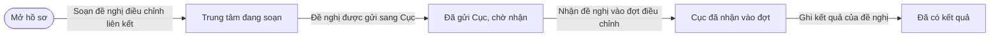
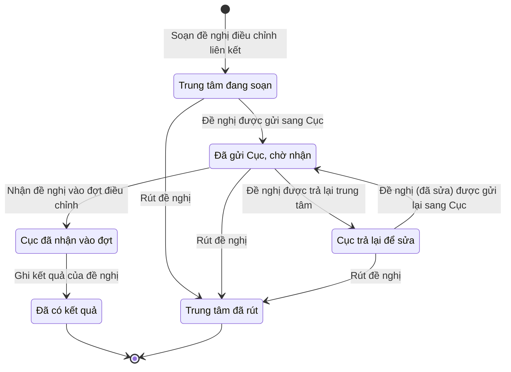

# qt-G10.centre-proposal · Đề nghị của trung tâm

<!-- máy sinh: tom-tat -->
> **Hồ sơ:** Đề nghị điều chỉnh liên kết của trung tâm (`CentreProposal`)
>
> **Trong sổ phạm vi:** G10 · Đề nghị của trung tâm — trung tâm đề nghị thêm, bỏ, chuyển trường liên kết; Cục nhận vào đợt hoặc trả lại (thêm 30/9)
>
> 9 bước · 6 chặng · 3 vai · 0 bảng quyết định · 0 hạn · 4 khớp nối.
>
> **Nguồn:** sổ nghiệp vụ `qt-G10.centre-proposal` · khai báo của app: `dqtv-app/core/processes/gdqp-linkage/workflow/centre-proposal.yaml`. Các bảng do máy sinh từ nguồn này.
<!-- hết: tom-tat -->

<!-- viết tay: dien-giai -->
## Diễn giải

*Phần này viết tay, diễn giải lại điều các bảng bên dưới ghi.*

### Quy trình này để làm gì

Trung tâm đề nghị thêm, bỏ, chuyển trường liên kết; Cục nhận đề nghị vào một đợt điều chỉnh hoặc trả lại. Ba vai: `centre` (trung tâm), `bureau` (Cục) và hệ thống tự làm. Hồ sơ có năm chặng: `PROPOSED` → `ACCEPTED` → `CLOSED`; hoặc `PROPOSED` → `RETURNED` rồi quay lại; hoặc kết thúc sớm ở `WITHDRAWN`.

### Khi nào bắt đầu

Vai `centre` làm bước `proposeLinkageChange`, hồ sơ vào chặng `PROPOSED`. Bước này ghi ô nối `linkageSchool` và ba ô đưa vào ở bước: `changeKind` (một trong `add_school`, `remove_school`, `move_school`, `suspend_centre`), `proposalReason`, `proposalScan`; bước còn ghi đơn vị chủ hồ sơ, `bureauUnits` và `proposedAt`.

### Diễn ra thế nào

**Chặng `PROPOSED`** — ba lối ra:

- Vai `bureau` làm `acceptIntoLinkageBatch`: ghi ô nối `linkageBatch` và `acceptedAt`. Hồ sơ sang `ACCEPTED`.
- Vai `bureau` làm `returnCentreProposal`: ghi `returnReason`. Hồ sơ sang `RETURNED`.
- Vai `centre` làm `withdrawCentreProposal`: ghi `withdrawNote`. Hồ sơ sang `WITHDRAWN` và kết thúc.

**Chặng `RETURNED`** — vai `centre` làm `resubmitCentreProposal`, ghi `revisionNote`, hồ sơ quay lại `PROPOSED`; hoặc làm `withdrawCentreProposal`, hồ sơ sang `WITHDRAWN`.

**Chặng `ACCEPTED`** — hệ thống tự làm `recordCentreProposalOutcome`, không ai bấm: ghi `proposalOutcome` (`approved` hoặc `rejected`). Hồ sơ sang `CLOSED`.

### Kết thúc và để lại gì

Hồ sơ kết thúc ở `CLOSED` hoặc `WITHDRAWN`. Đề nghị để lại hai ô nối: `linkageSchool` ghi ở bước mở và `linkageBatch` ghi ở bước `acceptIntoLinkageBatch`; đề nghị đã đóng còn có `proposalOutcome`.

### Điều kiện chặn

- Hai bước của `bureau` đòi `actorInBureau`: người làm là người của một đơn vị nằm trong ô `bureauUnits` của hồ sơ.
- Hai bước của `centre` sau bước mở (`withdrawCentreProposal`, `resubmitCentreProposal`) đòi người làm thuộc đơn vị chủ hồ sơ.
- Rút đề nghị chỉ làm được từ `PROPOSED` hoặc `RETURNED`; trả lại chỉ từ `PROPOSED`.
- Sai người, sai chặng thì bước bị chặn, hồ sơ giữ nguyên.
<!-- hết viết tay -->

## 1. Đường đi ngắn nhất qua các chặng

<!-- máy sinh: luong-chinh -->
Đường ít bước nhất từ lúc mở hồ sơ tới chặng kết thúc xa nhất. Máy chọn theo số chặng, không theo ý nghĩa nghiệp vụ — trình tự công việc thật xem phần Diễn giải và bảng "Việc làm ở từng chặng" ở mục 6.

| # | Ai làm | Làm gì | Hồ sơ sang chặng |
|---|---|---|---|
| 1 | Trung tâm giáo dục quốc phòng và an ninh | Soạn đề nghị điều chỉnh liên kết | Trung tâm đang soạn |
| 2 | Hệ thống tự làm | Đề nghị được gửi sang Cục | Đã gửi Cục, chờ nhận |
| 3 | Cục Dân quân tự vệ | Nhận đề nghị vào đợt điều chỉnh | Cục đã nhận vào đợt |
| 4 | Hệ thống tự làm | Ghi kết quả của đề nghị | Đã có kết quả |

<!-- hết: luong-chinh -->

## 2. Hồ sơ và việc nó để lại

<!-- máy sinh: muc-tieu -->
**App gọi quy trình này là:** Đề nghị điều chỉnh liên kết của trung tâm GDQP&AN.
<!-- hết: muc-tieu -->

## 3. Khởi phát và kết thúc

<!-- máy sinh: khoi-phat -->
**1 cửa vào** — bước mở hồ sơ:

| Bước mở | Ai mở | Hồ sơ vào chặng | App bắt buộc nhập |
|---|---|---|---|
| Soạn đề nghị điều chỉnh liên kết | Trung tâm giáo dục quốc phòng và an ninh | Trung tâm đang soạn | loại điều chỉnh đề nghị, lý do đề nghị |

**Kết thúc:** *Đã có kết quả* (`CLOSED`), *Trung tâm đã rút* (`WITHDRAWN`)
<!-- hết: khoi-phat -->

## 4. Vai trò

<!-- máy sinh: vai-tro -->
| Vai trong sổ | Tên trong app | Điều kiện | Làm những bước |
|---|---|---|---|
| `centre` | Trung tâm giáo dục quốc phòng và an ninh |  | Soạn đề nghị điều chỉnh liên kết · Trình ký văn bản đề nghị gửi Cục · Rút đề nghị |
| `system` | Hệ thống tự làm |  | Đề nghị được gửi sang Cục · Đề nghị (đã sửa) được gửi lại sang Cục · Đề nghị được trả lại trung tâm · Ghi kết quả của đề nghị |
| `bureau` | Cục Dân quân tự vệ |  | Nhận đề nghị vào đợt điều chỉnh · Trình ký văn bản trả lại đề nghị |

*"Tên trong app" là tên app đặt cho mã chủ thể của vai. Hồ sơ thuộc đơn vị cấp khác thì người làm là người giữ vai ấy ở đơn vị nêu trong cột "Điều kiện" (nếu sổ có ghi) và ở cột "Người làm phải thuộc" của bảng "Theo khai báo của app" (mục 7).*
<!-- hết: vai-tro -->

## 5. Nhánh phụ

<!-- máy sinh: nhanh-phu -->
**Bước khác đưa hồ sơ sang chặng mới** — đường song song, rẽ nhánh hoặc kết thúc sớm:

| Bước | Ai làm | Từ chặng | Sang chặng |
|---|---|---|---|
| Đề nghị được trả lại trung tâm | Hệ thống tự làm | Đã gửi Cục, chờ nhận | Cục trả lại để sửa |
| Rút đề nghị | Trung tâm giáo dục quốc phòng và an ninh | Trung tâm đang soạn, Đã gửi Cục, chờ nhận, Cục trả lại để sửa | Trung tâm đã rút |

**Quay lại một chặng hồ sơ đã đi qua** (tính theo đường ngắn nhất từ lúc mở):

| Bước | Ai làm | Từ chặng | Về chặng |
|---|---|---|---|
| Đề nghị (đã sửa) được gửi lại sang Cục | Hệ thống tự làm | Cục trả lại để sửa | Đã gửi Cục, chờ nhận |

**Làm trong lúc hồ sơ đứng yên ở một chặng** — ghi nhận, bổ sung:

| Bước | Ai làm | Ở chặng |
|---|---|---|
| Trình ký văn bản đề nghị gửi Cục | Trung tâm giáo dục quốc phòng và an ninh | Trung tâm đang soạn, Cục trả lại để sửa |
| Trình ký văn bản trả lại đề nghị | Cục Dân quân tự vệ | Đã gửi Cục, chờ nhận |

<!-- hết: nhanh-phu -->

## 6. Các chặng và việc làm ở từng chặng

<!-- máy sinh: chang -->
| Chặng | Tên hiển thị | Vào bằng bước | Kết thúc? |
|---|---|---|---|
| `DRAFT` | Trung tâm đang soạn | Soạn đề nghị điều chỉnh liên kết |  |
| `PROPOSED` | Đã gửi Cục, chờ nhận | Đề nghị được gửi sang Cục · Đề nghị (đã sửa) được gửi lại sang Cục |  |
| `RETURNED` | Cục trả lại để sửa | Đề nghị được trả lại trung tâm |  |
| `ACCEPTED` | Cục đã nhận vào đợt | Nhận đề nghị vào đợt điều chỉnh |  |
| `CLOSED` | Đã có kết quả | Ghi kết quả của đề nghị | **kết thúc** |
| `WITHDRAWN` | Trung tâm đã rút | Rút đề nghị | **kết thúc** |

### Việc làm ở từng chặng

Hồ sơ đang ở chặng nào thì làm được những bước nào.

| Hồ sơ đang ở chặng | Bước làm tại chặng (hồ sơ đứng yên) | Bước đưa hồ sơ sang chặng khác |
|---|---|---|
| **Trung tâm đang soạn** | Trình ký văn bản đề nghị gửi Cục — Trung tâm giáo dục quốc phòng và an ninh | Đề nghị được gửi sang Cục — Hệ thống tự làm → *Đã gửi Cục, chờ nhận* Rút đề nghị — Trung tâm giáo dục quốc phòng và an ninh → *Trung tâm đã rút* |
| **Đã gửi Cục, chờ nhận** | Trình ký văn bản trả lại đề nghị — Cục Dân quân tự vệ | Nhận đề nghị vào đợt điều chỉnh — Cục Dân quân tự vệ → *Cục đã nhận vào đợt* Đề nghị được trả lại trung tâm — Hệ thống tự làm → *Cục trả lại để sửa* Rút đề nghị — Trung tâm giáo dục quốc phòng và an ninh → *Trung tâm đã rút* |
| **Cục trả lại để sửa** | Trình ký văn bản đề nghị gửi Cục — Trung tâm giáo dục quốc phòng và an ninh | Đề nghị (đã sửa) được gửi lại sang Cục — Hệ thống tự làm → *Đã gửi Cục, chờ nhận* Rút đề nghị — Trung tâm giáo dục quốc phòng và an ninh → *Trung tâm đã rút* |
| **Cục đã nhận vào đợt** | — | Ghi kết quả của đề nghị — Hệ thống tự làm → *Đã có kết quả* |
| **Đã có kết quả** | — | — (kết thúc) |
| **Trung tâm đã rút** | — | — (kết thúc) |
<!-- hết: chang -->

## 7. Bảng bước

<!-- máy sinh: buoc -->
| # | Bước | Mã bước | Ai thực hiện | Từ chặng | Sang chặng | Phải có trước | Ghi lại |
|---|---|---|---|---|---|---|---|
| 1 | Soạn đề nghị điều chỉnh liên kết | `proposeLinkageChange` | Trung tâm giáo dục quốc phòng và an ninh | — (mở hồ sơ) | `DRAFT` | — | đơn vị chủ hồ sơ, đơn vị Cục nhận đề nghị — tầng đọc điền, nối tới Cơ sở giáo dục liên kết, loại điều chỉnh đề nghị, lý do đề nghị |
| 2 | Trình ký văn bản đề nghị gửi Cục | `requestCentreProposalSignature` | Trung tâm giáo dục quốc phòng và an ninh | `DRAFT`, `RETURNED` | giữ nguyên | người làm thuộc đơn vị chủ hồ sơ, `noCentreProposalDocumentOpen` | ghi chú lúc trình ký (sửa gì so với lần trước), nối tới Văn bản đi |
| 3 | Đề nghị được gửi sang Cục | `submitCentreProposal` | Hệ thống tự làm | `DRAFT` | `PROPOSED` | `centreProposalDocumentIssued` | ngày đề nghị vào hồ sơ |
| 4 | Đề nghị (đã sửa) được gửi lại sang Cục | `resubmitCentreProposal` | Hệ thống tự làm | `RETURNED` | `PROPOSED` | `centreProposalDocumentIssued` | ngày đề nghị vào hồ sơ |
| 5 | Nhận đề nghị vào đợt điều chỉnh | `acceptIntoLinkageBatch` | Cục Dân quân tự vệ | `PROPOSED` | `ACCEPTED` | `actorInBureau` | nối tới Đợt điều chỉnh danh sách liên kết GDQP&AN, ngày Cục nhận vào đợt |
| 6 | Trình ký văn bản trả lại đề nghị | `requestReturnCentreProposalSignature` | Cục Dân quân tự vệ | `PROPOSED` | giữ nguyên | `noReturnCentreProposalDocumentOpen`, `actorInBureau` | vì sao Cục trả đề nghị lại, nối tới Văn bản đi |
| 7 | Đề nghị được trả lại trung tâm | `returnCentreProposal` | Hệ thống tự làm | `PROPOSED` | `RETURNED` | `returnCentreProposalDocumentIssued` | nối `returnDeliveredAs` |
| 8 | Rút đề nghị | `withdrawCentreProposal` | Trung tâm giáo dục quốc phòng và an ninh | `DRAFT`, `PROPOSED`, `RETURNED` | `WITHDRAWN` | người làm thuộc đơn vị chủ hồ sơ | vì sao rút đề nghị |
| 9 | Ghi kết quả của đề nghị | `recordCentreProposalOutcome` | Hệ thống tự làm | `ACCEPTED` | `CLOSED` | — | kết quả của đề nghị |

### Khi không đạt điều kiện

Mặc định: không đúng người, hồ sơ không ở đúng chặng, hoặc thiếu thứ "phải có trước" thì bước bị chặn, hồ sơ giữ nguyên. Bảng dưới chỉ kê những bước có kết quả riêng.

| # | Bước | Kết quả riêng |
|---|---|---|
| 3 | Đề nghị được gửi sang Cục | bước này không do người nào bấm |
| 4 | Đề nghị (đã sửa) được gửi lại sang Cục | bước này không do người nào bấm |
| 7 | Đề nghị được trả lại trung tâm | bước này không do người nào bấm |
| 9 | Ghi kết quả của đề nghị | bước này không do người nào bấm |

### Điều kiện "phải có trước" bằng lời

Cột "Phải có trước" ở bảng bước có hai loại: ô dữ liệu thường (bước chỉ đòi ô ấy đã có giá trị) và điều kiện hệ tự xét. Bảng này diễn các điều kiện hệ tự xét theo đúng công thức sổ ghi; số ở cột cuối là số thứ tự bước.

| Điều kiện | Đúng khi | Bước đòi |
|---|---|---|
| `actorInOwnerUnit` | người đang làm là người của đơn vị ghi ở ô đơn vị chủ hồ sơ của hồ sơ này (theo danh mục người của đơn vị, `dm.unit-staff`) | 2, 8 |
| `noCentreProposalDocumentOpen` | KHÔNG (có hồ sơ Việc luật giao kèm văn bản đến, đi — Văn bản đi (qt-1.outgoing-document) chính là hồ sơ ghi ở ô nối `centreProposalByDocument` của hồ sơ đang làm mà hồ sơ ấy đang ở chặng `DRAFT` hoặc `PENDING_SIGNATURE` hoặc `SIGNED`) | 2 |
| `centreProposalDocumentIssued` | có hồ sơ Việc luật giao kèm văn bản đến, đi — Văn bản đi (qt-1.outgoing-document) chính là hồ sơ ghi ở ô nối `centreProposalByDocument` của hồ sơ đang làm mà hồ sơ ấy đang ở chặng `ISSUED` | 3, 4 |
| `actorInBureau` | người đang làm là người của một đơn vị nằm trong ô đơn vị Cục nhận đề nghị — tầng đọc điền của hồ sơ này (theo danh mục người của đơn vị, `dm.unit-staff`) | 5, 6 |
| `noReturnCentreProposalDocumentOpen` | KHÔNG (có hồ sơ Việc luật giao kèm văn bản đến, đi — Văn bản đi (qt-1.outgoing-document) chính là hồ sơ ghi ở ô nối `returnCentreProposalByDocument` của hồ sơ đang làm mà hồ sơ ấy đang ở chặng `DRAFT` hoặc `PENDING_SIGNATURE` hoặc `SIGNED`) | 6 |
| `returnCentreProposalDocumentIssued` | có hồ sơ Việc luật giao kèm văn bản đến, đi — Văn bản đi (qt-1.outgoing-document) chính là hồ sơ ghi ở ô nối `returnCentreProposalByDocument` của hồ sơ đang làm mà hồ sơ ấy đang ở chặng `ISSUED` | 7 |

### Theo khai báo của app

Người làm phải thuộc đơn vị nào, ô người dùng phải nhập, bước có lặp được không, và căn cứ pháp lý — lấy từ khai báo quy trình trong app.

| # | Bước | Người làm phải thuộc | Bắt buộc nhập | Nhập nếu có | Lặp được | Căn cứ |
|---|---|---|---|---|---|---|
| 1 | Soạn đề nghị điều chỉnh liên kết |  | loại điều chỉnh đề nghị, lý do đề nghị | cơ sở giáo dục mà đề nghị nói về, trung tâm đề nghị — tầng đọc điền từ phiên, mã trung tâm — tầng đọc điền từ phiên, đơn vị Cục nhận đề nghị — tầng đọc điền |  | QĐ10/2025/QĐ-TTg Đ.12 k3, Đ.19 |
| 2 | Trình ký văn bản đề nghị gửi Cục |  | — | ghi chú lúc trình ký (sửa gì so với lần trước), dự thảo văn bản (PDF) |  | NĐ30/2020/NĐ-CP Đ.13 (trình ký) · QĐ10/2025/QĐ-TTg Đ.19 |
| 3 | Đề nghị được gửi sang Cục |  | — | — |  | NĐ30/2020/NĐ-CP Đ.18 · QĐ10/2025/QĐ-TTg Đ.19 |
| 4 | Đề nghị (đã sửa) được gửi lại sang Cục |  | — | — |  | NĐ30/2020/NĐ-CP Đ.18 · QĐ10/2025/QĐ-TTg Đ.19 |
| 5 | Nhận đề nghị vào đợt điều chỉnh |  | đợt điều chỉnh đang lập | — |  | TT179/2019/TT-BQP Đ.2 k4 |
| 6 | Trình ký văn bản trả lại đề nghị |  | — | vì sao Cục trả đề nghị lại, dự thảo văn bản (PDF) |  | NĐ30/2020/NĐ-CP Đ.13 (trình ký) · QĐ10/2025/QĐ-TTg Đ.19 |
| 7 | Đề nghị được trả lại trung tâm |  | — | — |  | NĐ30/2020/NĐ-CP Đ.18 · QĐ10/2025/QĐ-TTg Đ.19 |
| 8 | Rút đề nghị |  | — | vì sao rút đề nghị |  | QĐ10/2025/QĐ-TTg Đ.19 |
| 9 | Ghi kết quả của đề nghị |  | kết quả của đề nghị | — |  | QĐ10/2025/QĐ-TTg Đ.19, Đ.21 |
<!-- hết: buoc -->

## 8. Bảng quyết định, hạn, việc ngoài hệ

<!-- máy sinh: quyet-dinh -->

<!-- hết: quyet-dinh -->

## 9. Dữ liệu của hồ sơ

<!-- máy sinh: du-lieu -->
Các ô mà bước trong sổ ghi hoặc đòi. Số trong hai cột cuối là số thứ tự bước ở bảng bước (mục 7).

| Ô dữ liệu | Mã | Kiểu (app) | Giá trị cho phép | Loại ô (sổ) | Bước ghi | Bước đòi | Mô tả trong app |
|---|---|---|---|---|---|---|---|
| đơn vị chủ hồ sơ | `ownerUnit` | chữ |  | lưu trên hồ sơ (`stored`) | 1 | — | Trung tâm chủ đề nghị (id trung tâm) — máy ghi từ phiên lúc soạn; chỉ cán bộ trung tâm này làm bước của trung tâm |
| đơn vị Cục nhận đề nghị — tầng đọc điền | `bureauUnits` | bảng |  | lưu trên hồ sơ (`stored`) | 1 | — | Đơn vị Cục nhận đề nghị — danh sách id OrgUnit, máy ghi lúc soạn |
| loại điều chỉnh đề nghị | `changeKind` | chọn một | Thêm trường vào trung tâm (`add_school`), Bỏ trường khỏi trung tâm (`remove_school`), Chuyển trường sang trung tâm khác (`move_school`), Tạm dừng trung tâm (`suspend_centre`) | đưa vào ở bước (`input`) | 1 | — | Trung tâm đề nghị thêm trường · bỏ trường · chuyển trường · tạm dừng trung tâm — sổ `changeKind` (ghi để xem) |
| lý do đề nghị | `proposalReason` | chữ |  | đưa vào ở bước (`input`) | 1 | — | Vì sao trung tâm đề nghị — sổ `proposalReason` |
| ghi chú lúc trình ký | `revisionNote` | chữ |  | đưa vào ở bước (`input`) | 2 | — | Ghi chú của trung tâm lúc trình ký (nhất là lúc trình lại sau khi bị trả) |
| ngày đề nghị vào hồ sơ | `proposedAt` | ngày |  | lưu trên hồ sơ (`stored`) | 3, 4 | — | Ngày văn bản đề nghị phát hành — hệ ghi (sổ proposedAt) |
| ngày Cục nhận vào đợt | `acceptedAt` | ngày |  | lưu trên hồ sơ (`stored`) | 5 | — | Ngày Cục nhận đề nghị vào đợt — hệ ghi (sổ acceptedAt) |
| lý do Cục trả lại | `returnReason` | chữ |  | đưa vào ở bước (`input`) | 6 | — | Lý do Cục trả đề nghị lại cho trung tâm |
| lý do rút | `withdrawNote` | chữ |  | đưa vào ở bước (`input`) | 8 | — | Lý do trung tâm rút đề nghị |
| kết quả đề nghị | `proposalOutcome` | chọn một | Được duyệt (`approved`), Không được duyệt (`rejected`) | lưu trên hồ sơ (`stored`) | 9 | — | Kết quả của đợt về đề nghị này: được duyệt hay không — hệ ghi (sổ proposalOutcome) |
| người làm thuộc đơn vị chủ hồ sơ | `actorInOwnerUnit` |  | có hay chưa | hệ suy ra (`derived`) | — | 2, 8 |  |
| — | `noCentreProposalDocumentOpen` |  | có hay chưa | hệ suy ra (`derived`) | — | 2 |  |
| — | `centreProposalDocumentIssued` |  | có hay chưa | hệ suy ra (`derived`) | — | 3, 4 |  |
| — | `actorInBureau` |  | có hay chưa | hệ suy ra (`derived`) | — | 5, 6 |  |
| — | `noReturnCentreProposalDocumentOpen` |  | có hay chưa | hệ suy ra (`derived`) | — | 6 |  |
| — | `returnCentreProposalDocumentIssued` |  | có hay chưa | hệ suy ra (`derived`) | — | 7 |  |

16 ô. Cột "Loại ô" là cách sổ phân loại ô, in kèm đúng chữ của sổ; ô nào người dùng phải nhập xem bảng "Theo khai báo của app" ở mục 7.
<!-- hết: du-lieu -->

## 10. Khớp nối với quy trình khác

<!-- máy sinh: khop-noi -->
| Quy trình kia | Hồ sơ kia | Quan hệ | Nội dung (mô tả trong app) | Bước ghi mối nối | Tên ô nối |
|---|---|---|---|---|---|
| 1 | Nhiệm vụ trên giao | có nối | Việc luật giao của cấp trung tâm mà đề nghị này thực hiện (dòng tt.tb.linkage-proposal; người dùng chốt 29/10… | — | `centreProposalServesTasking` |
| 1.outgoing-document | Văn bản đi | gắn với nhau ở một bước giữa chừng | Văn bản đề nghị của trung tâm gửi Cục — trình ký, phát hành ở sổ văn bản đi (NĐ30/2020 Đ.13; sổ link.centrePr… | G10.centre-proposal·requestCentreProposalSignature | `centreProposalByDocument` |
| 1.outgoing-document | Văn bản đi | gắn với nhau ở một bước giữa chừng | Văn bản Cục trả lại đề nghị cho trung tâm — trình ký, phát hành ở sổ văn bản đi của Cục (sổ link.returnCentre… | G10.centre-proposal·requestReturnCentreProposalSignature | `returnCentreProposalByDocument` |
| 29 | Trung tâm giáo dục quốc phòng và an ninh | có nối | Trung tâm đề nghị — chủ của đề nghị | — | `centreProposalOfCentre` |

4 khớp nối. ⊕ là bước tạo hồ sơ.

**Ô nối giữa các hồ sơ cùng mã quy trình, hoặc tới danh mục nền:** `linkageBatch` (Đề nghị điều chỉnh liên kết của trung tâm → Đợt điều chỉnh danh sách liên kết GDQP&AN) — bước Nhận đề nghị vào đợt điều chỉnh; `linkageSchool` (Đề nghị điều chỉnh liên kết của trung tâm → Cơ sở giáo dục liên kết) — bước Soạn đề nghị điều chỉnh liên kết.
<!-- hết: khop-noi -->

## 11. Thông tin chung

<!-- máy sinh: thong-tin -->
| | |
|---|---|
| **Mã trong sổ** | `qt-G10.centre-proposal` |
| **Quy trình trong app** | `gdqp-linkage` (`workflow/centre-proposal.yaml`) — mặt công tác: `personnel` |
| **Hồ sơ** | Đề nghị điều chỉnh liên kết của trung tâm (`CentreProposal`) |
| **Cùng mã quy trình** | [qt-G10](qt-G10.html) |
| **Căn cứ pháp lý từng bước** | cột "Căn cứ" ở bảng "Theo khai báo của app", mục 7 |
<!-- hết: thong-tin -->
