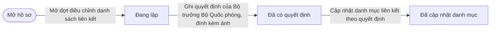
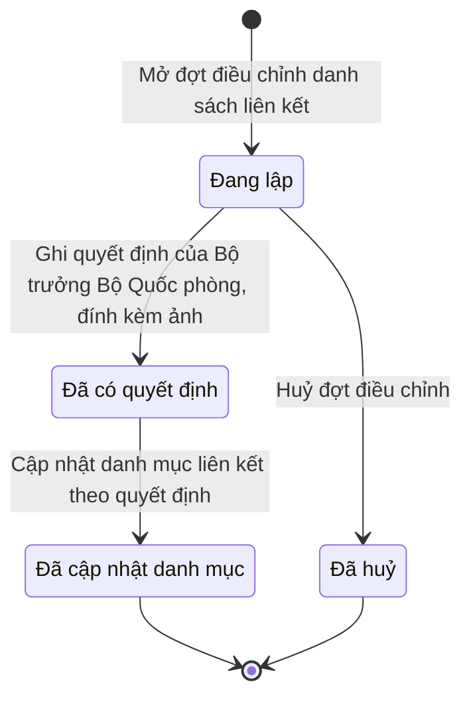

# qt-G10 · Danh sách liên kết GDQP&AN

<!-- máy sinh: tom-tat -->
> **Hồ sơ:** Đợt điều chỉnh danh sách liên kết GDQP&AN (`LinkageBatch`)
>
> **Trong sổ phạm vi:** G10 · Danh sách liên kết GDQP&AN — hồ sơ đợt điều chỉnh của Cục (thêm, bỏ, chuyển trường; ngừng trung tâm), bắt buộc có ý kiến Bộ GD&ĐT trước khi trình, Bộ trưởng quyết định ngoài hệ, hệ cập nhật danh mục liên kết (QĐ10/2025/QĐ-TTg Đ.19, Đ.21 k1b, k1d, k1e; chốt 30/9)
>
> 8 bước · 4 chặng · 2 vai · 2 bảng quyết định · 0 hạn · 9 khớp nối.
>
> **Nguồn:** sổ nghiệp vụ `qt-G10` · khai báo của app: `dqtv-app/core/processes/gdqp-linkage/workflow/linkage-batch.yaml`. Các bảng do máy sinh từ nguồn này.
<!-- hết: tom-tat -->

<!-- viết tay: dien-giai -->
## Diễn giải

*Phần này viết tay, diễn giải lại điều các bảng bên dưới ghi.*

### Quy trình này để làm gì

Cục Dân quân tự vệ theo dõi một **đợt điều chỉnh danh sách liên kết GDQP&AN** — danh sách trường nào học môn GDQP&AN ở trung tâm nào. Trong một đợt, Cục gom các dòng điều chỉnh (thêm trường, bỏ trường, chuyển trường, ngừng trung tâm), gắn ý kiến của Bộ GD&ĐT, rồi ghi lại quyết định của Bộ trưởng Bộ Quốc phòng ký ngoài hệ; tới ngày quyết định có hiệu lực thì danh mục liên kết được cập nhật.

Hồ sơ có bốn chặng: *Đang lập* → *Đã có quyết định* → *Đã cập nhật danh mục*; hoặc từ *Đang lập* rẽ sang *Đã huỷ*.

### Khi nào bắt đầu

Cục Dân quân tự vệ bấm **Mở đợt điều chỉnh danh sách liên kết**, chỉ phải nhập năm của đợt. Bước này không đòi gì trước và không nối tới hồ sơ nào.

### Diễn ra thế nào

**Chặng "Đang lập"** — mọi việc chuẩn bị đều làm ở đây, hồ sơ đứng yên:

- **Thêm dòng điều chỉnh** (lặp được): bắt buộc chọn loại điều chỉnh và ghi lý do; trường, trung tâm đang liên kết, trung tâm nhận và văn bản đến làm căn cứ là ô nhập nếu có. Dòng còn nối được tới một đề nghị của trung tâm (`centreProposal`). Thêm trường mà trường đang có liên kết thì bị chặn (`school_already_linked`).
- **Gỡ dòng điều chỉnh** (lặp được): chọn dòng cần gỡ.
- **Gắn ý kiến của Bộ GD&ĐT**: chọn văn bản đến và ghi ngày của ý kiến. Chỉ gắn được một lần: đợt đã có ngày ý kiến thì hệ báo "Đợt này đã gắn ý kiến của Bộ GD&ĐT rồi".
- **Ghi việc Bộ trưởng Bộ Quốc phòng không duyệt** (lặp được): ghi lý do, số, ngày và bản quét văn bản không duyệt. Hồ sơ vẫn ở *Đang lập*.

Hai lối ra khỏi chặng này:

- **Ghi quyết định của Bộ trưởng Bộ Quốc phòng, đính kèm ảnh** → *Đã có quyết định*. Đây là bước ghi một quyết định ký ngoài hệ, người ký mang mã `defence_minister`. Bắt buộc nhập bảy ô (kê ở mục 7), trong đó có ngày hiệu lực; có thể đánh dấu những dòng quyết định không duyệt. Đợt phải có ít nhất một dòng điều chỉnh (`atLeastOneLine`). Phải đã có ý kiến Bộ GD&ĐT (bảng `moet-opinion-required`): thiếu thì bước dừng với kết quả `missing_moet_opinion`, hệ báo "Chưa có ý kiến của Bộ GD&ĐT — gắn văn bản ý kiến trước khi ghi quyết định của Bộ trưởng". Hệ không có tài khoản của Bộ Quốc phòng nên không có bước trình Bộ trưởng, chỉ có bước ghi kết quả ký ngoài; luật "chưa có ý kiến Bộ GD&ĐT thì không trình" vì thế đặt ở bước ghi quyết định.
- **Huỷ đợt điều chỉnh** → *Đã huỷ*. Bắt buộc ghi lý do huỷ. Phải đã có lý do Bộ trưởng không duyệt — tức phải ghi việc không duyệt trước rồi mới huỷ được; thiếu thì hệ báo "Chỉ huỷ đợt khi Bộ trưởng Bộ Quốc phòng đã không duyệt — ghi văn bản không duyệt trước". Bộ trưởng không đồng ý mà phải huỷ thì Cục tự huỷ, dựa trên lý do Bộ Quốc phòng từ chối.

**Chặng "Đã có quyết định"** — chỉ có một bước: **Cập nhật danh mục liên kết theo quyết định** → *Đã cập nhật danh mục*. Bước này do hệ thống tự làm khi đã tới ngày hiệu lực (`effectiveDateReached`). Không làm được lần hai: đợt đã có thời điểm cập nhật thì hệ báo "đợt này đã cập nhật danh mục rồi — áp lần hai sẽ mở trùng dòng liên kết". Cách áp từng loại dòng: thêm trường thì mở liên kết trường – trung tâm; bỏ trường thì đóng liên kết; chuyển trường thì đóng liên kết cũ và mở liên kết với trung tâm mới cùng ngày hiệu lực; ngừng trung tâm thì trung tâm thôi nhận trường mới, liên kết đang có vẫn giữ đến khi có dòng chuyển hoặc bỏ riêng. Ngày hiệu lực từ hôm nay trở về trước thì áp ngay khi ghi quyết định.

### Kết thúc và để lại gì

Hồ sơ kết thúc ở *Đã cập nhật danh mục* hoặc *Đã huỷ*. Bước cập nhật danh mục tạo thêm hồ sơ con *Dòng danh mục liên kết*.

Có 7 khớp nối: hai tới **Văn bản đến** (văn bản ý kiến Bộ GD&ĐT, gắn ở bước gắn ý kiến; văn bản căn cứ của dòng điều chỉnh, gắn ở bước thêm dòng); ba tới **Trung tâm GDQP&AN** (quy trình 29) — trung tâm đang liên kết và trung tâm nhận trường gắn ở bước thêm dòng, dòng danh mục "trường học ở trung tâm nào" gắn ở bước cập nhật danh mục; một **Cuộc thanh tra, kiểm tra** (quy trình 9) gắn vào đợt điều chỉnh ở bước `recordLinkageReroutingDecision` của quy trình ấy; và một tới **Đợt học liên kết GDQP&AN** (G7) — hồ sơ ấy mở ra từ đây ở bước `signLinkageContract`.

### Điều kiện chặn

- Sáu bước Cục làm sau bước mở đều đòi người làm thuộc đơn vị chủ hồ sơ. Sai người, sai chặng, thiếu thứ phải có trước thì bước bị chặn, hồ sơ giữ nguyên.
- Thêm dòng (bảng `school-one-centre`, dò từ trên xuống): dòng thêm trường mà trường đang có liên kết thì chặn; chưa chọn loại điều chỉnh thì chặn; bỏ trường, chuyển trường, ngừng trung tâm thì cho qua; dòng thêm trường mà chưa biết trường có liên kết hay không thì chặn; thêm trường đang không có liên kết thì cho qua.
- Gắn ý kiến Bộ GD&ĐT: lần gắn thứ hai bị chặn.
- Ghi quyết định: thiếu ý kiến Bộ GD&ĐT thì chặn; đợt không có dòng điều chỉnh nào thì chặn.
- Huỷ đợt: thiếu lý do Bộ trưởng không duyệt thì chặn.
- Cập nhật danh mục: trước ngày hiệu lực thì chặn; đã cập nhật rồi thì chặn.
<!-- hết viết tay -->

## 1. Đường đi ngắn nhất qua các chặng

<!-- máy sinh: luong-chinh -->
Đường ít bước nhất từ lúc mở hồ sơ tới chặng kết thúc xa nhất. Máy chọn theo số chặng, không theo ý nghĩa nghiệp vụ — trình tự công việc thật xem phần Diễn giải và bảng "Việc làm ở từng chặng" ở mục 6.

| # | Ai làm | Làm gì | Hồ sơ sang chặng |
|---|---|---|---|
| 1 | Cục Dân quân tự vệ | Mở đợt điều chỉnh danh sách liên kết | Đang lập |
| 2 | Cục Dân quân tự vệ | Ghi quyết định của Bộ trưởng Bộ Quốc phòng, đính kèm ảnh | Đã có quyết định |
| 3 | Hệ thống tự làm | Cập nhật danh mục liên kết theo quyết định | Đã cập nhật danh mục |

<!-- hết: luong-chinh -->

## 2. Hồ sơ và việc nó để lại

<!-- máy sinh: muc-tieu -->
**App gọi quy trình này là:** Đợt điều chỉnh danh sách liên kết GDQP&AN.

**Hồ sơ này để lại cho quy trình khác** (bước tạo hồ sơ của quy trình kia ghi mối nối về đây):
- Đợt học liên kết GDQP&AN (G7) — bước `signLinkageContract`, khớp nối `courseForSchool`
<!-- hết: muc-tieu -->

## 3. Khởi phát và kết thúc

<!-- máy sinh: khoi-phat -->
**1 cửa vào** — bước mở hồ sơ:

| Bước mở | Ai mở | Hồ sơ vào chặng | App bắt buộc nhập |
|---|---|---|---|
| Mở đợt điều chỉnh danh sách liên kết | Cục Dân quân tự vệ | Đang lập | năm của đợt |

**Kết thúc:** *Đã cập nhật danh mục* (`CLOSED`), *Đã huỷ* (`CANCELLED`)
<!-- hết: khoi-phat -->

## 4. Vai trò

<!-- máy sinh: vai-tro -->
| Vai trong sổ | Tên trong app | Điều kiện | Làm những bước |
|---|---|---|---|
| `bureau` | Cục Dân quân tự vệ |  | Mở đợt điều chỉnh danh sách liên kết · Thêm dòng điều chỉnh · Gỡ dòng điều chỉnh · Gắn ý kiến của Bộ GD&ĐT · Ghi quyết định của Bộ trưởng Bộ Quốc phòng, đính kèm ảnh · Ghi việc Bộ trưởng Bộ Quốc phòng không duyệt · Huỷ đợt điều chỉnh |
| `system` | Hệ thống tự làm |  | Cập nhật danh mục liên kết theo quyết định |

*"Tên trong app" là tên app đặt cho mã chủ thể của vai. Hồ sơ thuộc đơn vị cấp khác thì người làm là người giữ vai ấy ở đơn vị nêu trong cột "Điều kiện" (nếu sổ có ghi) và ở cột "Người làm phải thuộc" của bảng "Theo khai báo của app" (mục 7).*
<!-- hết: vai-tro -->

## 5. Nhánh phụ

<!-- máy sinh: nhanh-phu -->
**Bước khác đưa hồ sơ sang chặng mới** — đường song song, rẽ nhánh hoặc kết thúc sớm:

| Bước | Ai làm | Từ chặng | Sang chặng |
|---|---|---|---|
| Huỷ đợt điều chỉnh | Cục Dân quân tự vệ | Đang lập | Đã huỷ |

**Làm trong lúc hồ sơ đứng yên ở một chặng** — ghi nhận, bổ sung:

| Bước | Ai làm | Ở chặng |
|---|---|---|
| Thêm dòng điều chỉnh *(lặp được)* | Cục Dân quân tự vệ | Đang lập |
| Gỡ dòng điều chỉnh *(lặp được)* | Cục Dân quân tự vệ | Đang lập |
| Gắn ý kiến của Bộ GD&ĐT | Cục Dân quân tự vệ | Đang lập |
| Ghi việc Bộ trưởng Bộ Quốc phòng không duyệt *(lặp được)* | Cục Dân quân tự vệ | Đang lập |

<!-- hết: nhanh-phu -->

## 6. Các chặng và việc làm ở từng chặng

<!-- máy sinh: chang -->
| Chặng | Tên hiển thị | Vào bằng bước | Kết thúc? |
|---|---|---|---|
| `DRAFT` | Đang lập | Mở đợt điều chỉnh danh sách liên kết |  |
| `DECIDED` | Đã có quyết định | Ghi quyết định của Bộ trưởng Bộ Quốc phòng, đính kèm ảnh |  |
| `CLOSED` | Đã cập nhật danh mục | Cập nhật danh mục liên kết theo quyết định | **kết thúc** |
| `CANCELLED` | Đã huỷ | Huỷ đợt điều chỉnh | **kết thúc** |

### Việc làm ở từng chặng

Hồ sơ đang ở chặng nào thì làm được những bước nào.

| Hồ sơ đang ở chặng | Bước làm tại chặng (hồ sơ đứng yên) | Bước đưa hồ sơ sang chặng khác |
|---|---|---|
| **Đang lập** | Thêm dòng điều chỉnh (lặp được) — Cục Dân quân tự vệ Gỡ dòng điều chỉnh (lặp được) — Cục Dân quân tự vệ Gắn ý kiến của Bộ GD&ĐT — Cục Dân quân tự vệ Ghi việc Bộ trưởng Bộ Quốc phòng không duyệt (lặp được) — Cục Dân quân tự vệ | Ghi quyết định của Bộ trưởng Bộ Quốc phòng, đính kèm ảnh — Cục Dân quân tự vệ → *Đã có quyết định* Huỷ đợt điều chỉnh — Cục Dân quân tự vệ → *Đã huỷ* |
| **Đã có quyết định** | — | Cập nhật danh mục liên kết theo quyết định — Hệ thống tự làm → *Đã cập nhật danh mục* |
| **Đã cập nhật danh mục** | — | — (kết thúc) |
| **Đã huỷ** | — | — (kết thúc) |
<!-- hết: chang -->

## 7. Bảng bước

<!-- máy sinh: buoc -->
| # | Bước | Mã bước | Ai thực hiện | Từ chặng | Sang chặng | Phải có trước | Ghi lại |
|---|---|---|---|---|---|---|---|
| 1 | Mở đợt điều chỉnh danh sách liên kết | `openLinkageBatch` | Cục Dân quân tự vệ | — (mở hồ sơ) | `DRAFT` | — | đơn vị chủ hồ sơ, năm của đợt |
| 2 | Thêm dòng điều chỉnh | `addLinkageChangeLine` | Cục Dân quân tự vệ | `DRAFT` | giữ nguyên | người làm thuộc đơn vị chủ hồ sơ, `sourceIncomingDocumentUsable` | nối `linkageSchool` (Đề nghị điều chỉnh liên kết của trung tâm → Cơ sở giáo dục liên kết), nối `fromCentre`, nối `toCentre`, `changeKind`, `changeReason`, nối `centreProposal`, nối `linkageLineFromIncomingDocument` (Dòng điều chỉnh liên kết → Văn bản đến), `schoolLinkedNow` |
| 3 | Gỡ dòng điều chỉnh | `removeLinkageChangeLine` | Cục Dân quân tự vệ | `DRAFT` | giữ nguyên | người làm thuộc đơn vị chủ hồ sơ | nối `lineToRemove` |
| 4 | Gắn ý kiến của Bộ GD&ĐT | `recordMoetOpinion` | Cục Dân quân tự vệ | `DRAFT` | giữ nguyên | người làm thuộc đơn vị chủ hồ sơ, `moetIncomingDocumentUsable` | nối tới Văn bản đến |
| 5 | Ghi quyết định của Bộ trưởng Bộ Quốc phòng, đính kèm ảnh | `recordMinisterDecision` | Cục Dân quân tự vệ | `DRAFT` | `DECIDED` | người làm thuộc đơn vị chủ hồ sơ, `atLeastOneLine`, `recordMinisterDecisionFromIncomingDocumentUsable`, `moetOpinionAttached` | `decisionDate`, hiệu lực từ, `decidedLines`, nối tới Văn bản đến |
| 6 | Ghi việc Bộ trưởng Bộ Quốc phòng không duyệt | `recordMinisterRejection` | Cục Dân quân tự vệ | `DRAFT` | giữ nguyên | người làm thuộc đơn vị chủ hồ sơ, `recordMinisterRejectionFromIncomingDocumentUsable` | lý do Bộ trưởng không duyệt, ngày văn bản (để trống thì lấy ngày ghi trên văn bản đến), nối tới Văn bản đến |
| 7 | Huỷ đợt điều chỉnh | `cancelLinkageBatch` | Cục Dân quân tự vệ | `DRAFT` | `CANCELLED` | người làm thuộc đơn vị chủ hồ sơ, lý do Bộ trưởng không duyệt | lý do huỷ đợt, ngày huỷ đợt |
| 8 | Cập nhật danh mục liên kết theo quyết định | `applyLinkageCatalogue` | Hệ thống tự làm | `DECIDED` | `CLOSED` | `effectiveDateReached` | nối `catalogueChange`, cập nhật danh mục lúc |

### Khi không đạt điều kiện

Mặc định: không đúng người, hồ sơ không ở đúng chặng, hoặc thiếu thứ "phải có trước" thì bước bị chặn, hồ sơ giữ nguyên. Bảng dưới chỉ kê những bước có kết quả riêng.

| # | Bước | Kết quả riêng |
|---|---|---|
| 2 | Thêm dòng điều chỉnh | bước dừng lại, hồ sơ giữ nguyên khi kết quả xét là: `school_already_linked`, `change_kind_missing`, `school_link_unknown` |
| 5 | Ghi quyết định của Bộ trưởng Bộ Quốc phòng, đính kèm ảnh | bước dừng lại, hồ sơ giữ nguyên khi kết quả xét là: `missing_moet_opinion` |
| 8 | Cập nhật danh mục liên kết theo quyết định | bước này không do người nào bấm |

### Điều kiện "phải có trước" bằng lời

Cột "Phải có trước" ở bảng bước có hai loại: ô dữ liệu thường (bước chỉ đòi ô ấy đã có giá trị) và điều kiện hệ tự xét. Bảng này diễn các điều kiện hệ tự xét theo đúng công thức sổ ghi; số ở cột cuối là số thứ tự bước.

| Điều kiện | Đúng khi | Bước đòi |
|---|---|---|
| `actorInOwnerUnit` | người đang làm là người của đơn vị ghi ở ô đơn vị chủ hồ sơ của hồ sơ này (theo danh mục người của đơn vị, `dm.unit-staff`) | 2, 3, 4, 5, 6, 7 |
| `sourceIncomingDocumentUsable` | KHÔNG (đã có nối `linkageLineFromIncomingDocument` (Dòng điều chỉnh liên kết → Văn bản đến)) HOẶC có hồ sơ Việc luật giao kèm văn bản đến, đi — Văn bản đến (qt-1.incoming-document) chính là hồ sơ ghi ở ô nối `linkageLineFromIncomingDocument` của hồ sơ đang làm mà hồ sơ ấy đang ở chặng `RECEIVED` hoặc `DISTRIBUTED` | 2 |
| `moetIncomingDocumentUsable` | có hồ sơ Việc luật giao kèm văn bản đến, đi — Văn bản đến (qt-1.incoming-document) chính là hồ sơ ghi ở ô nối `linkageBatchMoetOpinion` của hồ sơ đang làm mà hồ sơ ấy đang ở chặng `RECEIVED` hoặc `DISTRIBUTED` | 4 |
| `atLeastOneLine` | đã có `changeKind` | 5 |
| `recordMinisterDecisionFromIncomingDocumentUsable` | có hồ sơ Việc luật giao kèm văn bản đến, đi — Văn bản đến (qt-1.incoming-document) chính là hồ sơ ghi ở ô nối `recordMinisterDecisionFromIncomingDocument` của hồ sơ đang làm mà hồ sơ ấy đang ở chặng `RECEIVED` hoặc `DISTRIBUTED` | 5 |
| `moetOpinionAttached` | đã có nối tới Văn bản đến | 5 |
| `recordMinisterRejectionFromIncomingDocumentUsable` | có hồ sơ Việc luật giao kèm văn bản đến, đi — Văn bản đến (qt-1.incoming-document) chính là hồ sơ ghi ở ô nối `recordMinisterRejectionFromIncomingDocument` của hồ sơ đang làm mà hồ sơ ấy đang ở chặng `RECEIVED` hoặc `DISTRIBUTED` | 6 |

### Theo khai báo của app

Người làm phải thuộc đơn vị nào, ô người dùng phải nhập, bước có lặp được không, và căn cứ pháp lý — lấy từ khai báo quy trình trong app.

| # | Bước | Người làm phải thuộc | Bắt buộc nhập | Nhập nếu có | Lặp được | Căn cứ |
|---|---|---|---|---|---|---|
| 1 | Mở đợt điều chỉnh danh sách liên kết |  | năm của đợt | — |  | TT179/2019/TT-BQP Đ.2 k4 |
| 2 | Thêm dòng điều chỉnh |  | `changeKind`, `changeReason` | `schoolId`, trung tâm đang liên kết, trung tâm nhận, `incomingDocumentId`, đề nghị của trung tâm làm căn cứ (sổ link.centreProposal) | có | TT179/2019/TT-BQP Đ.2 k4 |
| 3 | Gỡ dòng điều chỉnh |  | `lineId` | — | có | TT179/2019/TT-BQP Đ.2 k4 |
| 4 | Gắn ý kiến của Bộ GD&ĐT |  | `incomingDocumentId`, ý kiến Bộ GD&ĐT ngày | — |  | QĐ10/2025/QĐ-TTg Đ.19, Đ.21 |
| 5 | Ghi quyết định của Bộ trưởng Bộ Quốc phòng, đính kèm ảnh |  | văn bản đến là quyết định của Bộ trưởng Bộ Quốc phòng, hiệu lực từ | ngày ký (để trống thì lấy ngày ghi trên văn bản đến), dòng quyết định không duyệt, `lineIds` |  | QĐ10/2025/QĐ-TTg Đ.19, Đ.21 |
| 6 | Ghi việc Bộ trưởng Bộ Quốc phòng không duyệt |  | lý do Bộ trưởng không duyệt, văn bản đến là văn bản Bộ trưởng Bộ Quốc phòng không duyệt | ngày văn bản (để trống thì lấy ngày ghi trên văn bản đến) | có | QĐ10/2025/QĐ-TTg Đ.19, Đ.21 |
| 7 | Huỷ đợt điều chỉnh |  | lý do huỷ đợt | — |  | QĐ10/2025/QĐ-TTg Đ.19, Đ.21 |
| 8 | Cập nhật danh mục liên kết theo quyết định |  | — | hiệu lực từ, dòng danh mục phải đóng, dòng danh mục phải mở, trung tâm phải tạm dừng |  | QĐ10/2025/QĐ-TTg Đ.19, Đ.21 |

### Điều kiện và ghi chú app khai cho từng bước

Lấy từ khai báo quy trình trong app. Lời trong ngoặc kép là câu app hiện cho người dùng. Chức danh người ký ngoài hệ app chỉ khai bằng mã.

| # | Bước | Điều kiện, ghi chú |
|---|---|---|
| 2 | Thêm dòng điều chỉnh | · tạo thêm một hồ sơ con: Dòng điều chỉnh liên kết (`LinkageChangeLine`) |
| 4 | Gắn ý kiến của Bộ GD&ĐT | · không làm được khi đã có ô "ý kiến Bộ GD&ĐT ngày" — app báo: "Đợt này đã gắn ý kiến của Bộ GD&ĐT rồi" |
| 5 | Ghi quyết định của Bộ trưởng Bộ Quốc phòng, đính kèm ảnh | · phải đã có ô "ý kiến Bộ GD&ĐT ngày" — thiếu thì app báo: "Chưa có ý kiến của Bộ GD&ĐT — gắn văn bản ý kiến trước khi ghi quyết định của Bộ trưởng" · bước này ghi một quyết định ký NGOÀI hệ (`linkageBatchDecidedBy`), người ký: `defence_minister` · không đòi bản chụp — app ghi: "bản số hoá lấy từ văn bản đến văn thư đã vào sổ (tầng đọc chép `scanPath` của văn bản ấy), không tải ảnh ở bước này" |
| 6 | Ghi việc Bộ trưởng Bộ Quốc phòng không duyệt | · không đòi bản chụp — app ghi: "bản số hoá lấy từ văn bản đến văn thư đã vào sổ (tầng đọc chép `scanPath` của văn bản ấy), không tải ảnh ở bước này" |
| 7 | Huỷ đợt điều chỉnh | · phải đã có ô "lý do Bộ trưởng không duyệt" — thiếu thì app báo: "Chỉ huỷ đợt khi Bộ trưởng Bộ Quốc phòng đã không duyệt — ghi văn bản không duyệt trước" |
| 8 | Cập nhật danh mục liên kết theo quyết định | · không làm được khi đã có ô "cập nhật danh mục lúc" — app báo: "đợt này đã cập nhật danh mục rồi — áp lần hai sẽ mở trùng dòng liên kết" · tạo thêm một hồ sơ con: Dòng danh mục liên kết (`LinkageEntry`) |
<!-- hết: buoc -->

## 8. Bảng quyết định, hạn, việc ngoài hệ

<!-- máy sinh: quyet-dinh -->
**Bảng `moet-opinion-required`** — xét ở bước *Ghi quyết định của Bộ trưởng Bộ Quốc phòng, đính kèm ảnh*; đầu vào: `moetOpinionOnFile`. 2 dòng, dò từ trên xuống, dòng đầu tiên khớp thì dừng.

| Thứ tự dò (số sổ ghi) | Dòng | Khi | Thì |
|---|---|---|---|
| 1 | `has-opinion` | `moetOpinionOnFile` là `yes` | cho qua |
| 2 | `otherwise` | mọi trường hợp còn lại | `missing_moet_opinion` |

**Bảng `school-one-centre`** — xét ở bước *Thêm dòng điều chỉnh*; đầu vào: `changeKind`, `schoolLinkedNow`. 4 dòng, dò từ trên xuống, dòng đầu tiên khớp thì dừng.

| Thứ tự dò (số sổ ghi) | Dòng | Khi | Thì |
|---|---|---|---|
| 1 | `already-linked` | `changeKind` là `add_school` và `schoolLinkedNow` là `yes` | `school_already_linked` |
| 2 | `kind-unset` | chưa có `changeKind` | `change_kind_missing` |
| 3 | `not-an-add` | `changeKind` là `remove_school` hoặc `move_school` hoặc `suspend_centre` | cho qua |
| 5 | `free-school` | `changeKind` là `add_school` | cho qua |

<!-- hết: quyet-dinh -->

## 9. Dữ liệu của hồ sơ

<!-- máy sinh: du-lieu -->
Các ô mà bước trong sổ ghi hoặc đòi. Số trong hai cột cuối là số thứ tự bước ở bảng bước (mục 7).

| Ô dữ liệu | Mã | Kiểu (app) | Giá trị cho phép | Loại ô (sổ) | Bước ghi | Bước đòi | Mô tả trong app |
|---|---|---|---|---|---|---|---|
| đơn vị chủ hồ sơ | `ownerUnit` |  |  | lưu trên hồ sơ (`stored`) | 1 | — |  |
| năm của đợt | `batchYear` | số |  | đưa vào ở bước (`input`) | 1 | — | Năm của đợt điều chỉnh — rà soát hằng năm |
| — | `changeKind` |  | `add_school`, `remove_school`, `move_school`, `suspend_centre` | đưa vào ở bước (`input`) | 2 | — |  |
| — | `changeReason` |  |  | đưa vào ở bước (`input`) | 2 | — |  |
| — | `schoolLinkedNow` |  | `yes`, `no` | đưa vào ở bước (`input`) | 2 | — |  |
| — | `decisionDate` |  |  | lưu trên hồ sơ (`stored`) | 5 | — |  |
| hiệu lực từ | `effectiveDate` | ngày |  | đưa vào ở bước (`input`) | 5 | — | Ngày quyết định có hiệu lực — mốc mở, đóng các dòng danh mục |
| — | `decidedLines` |  |  | lưu trên hồ sơ (`stored`) | 5 | — |  |
| lý do Bộ trưởng không duyệt | `rejectionReason` | chữ |  | đưa vào ở bước (`input`) | 6 | 7 | Lý do Bộ trưởng BQP không duyệt — lần gần nhất |
| ngày văn bản không duyệt | `rejectionDate` | ngày |  | lưu trên hồ sơ (`stored`) | 6 | — | Ngày văn bản không duyệt |
| lý do huỷ đợt | `cancelReason` | chữ |  | đưa vào ở bước (`input`) | 7 | — | Lý do Cục huỷ đợt — dựa trên lý do Bộ trưởng không duyệt |
| ngày huỷ đợt | `cancelledAt` | ngày |  | lưu trên hồ sơ (`stored`) | 7 | — | Ngày Cục huỷ đợt |
| cập nhật danh mục lúc | `appliedAt` | ngày giờ |  | lưu trên hồ sơ (`stored`) | 8 | — | Thời điểm hệ cập nhật danh mục liên kết theo quyết định |
| người làm thuộc đơn vị chủ hồ sơ | `actorInOwnerUnit` |  | có hay chưa | hệ suy ra (`derived`) | — | 2, 3, 4, 5, 6, 7 |  |
| — | `sourceIncomingDocumentUsable` |  | có hay chưa | hệ suy ra (`derived`) | — | 2 |  |
| — | `moetIncomingDocumentUsable` |  | có hay chưa | hệ suy ra (`derived`) | — | 4 |  |
| — | `atLeastOneLine` |  | có hay chưa | hệ suy ra (`derived`) | — | 5 |  |
| — | `recordMinisterDecisionFromIncomingDocumentUsable` |  | có hay chưa | hệ suy ra (`derived`) | — | 5 |  |
| — | `moetOpinionAttached` |  | có hay chưa | hệ suy ra (`derived`) | — | 5 |  |
| — | `recordMinisterRejectionFromIncomingDocumentUsable` |  | có hay chưa | hệ suy ra (`derived`) | — | 6 |  |
| — | `effectiveDateReached` |  | có hay chưa | đưa vào ở bước (`input`) | — | 8 |  |
| — | `moetOpinionOnFile` |  | `yes`, `no` | đưa vào ở bước (`input`) | — | — |  |

22 ô. Cột "Loại ô" là cách sổ phân loại ô, in kèm đúng chữ của sổ; ô nào người dùng phải nhập xem bảng "Theo khai báo của app" ở mục 7.
<!-- hết: du-lieu -->

## 10. Khớp nối với quy trình khác

<!-- máy sinh: khop-noi -->
| Quy trình kia | Hồ sơ kia | Quan hệ | Nội dung (mô tả trong app) | Bước ghi mối nối | Tên ô nối |
|---|---|---|---|---|---|
| 1.incoming-document | Văn bản đến | gắn với nhau ở một bước giữa chừng | Văn bản ý kiến của Bộ GD&ĐT về đợt điều chỉnh — có mới được trình Bộ trưởng BQP | G10·recordMoetOpinion | `linkageBatchMoetOpinion` |
| 1.incoming-document | Văn bản đến | gắn với nhau ở một bước giữa chừng | Văn bản đến làm căn cứ dòng điều chỉnh — đề nghị của trung tâm hoặc kết luận kiểm tra | G10·addLinkageChangeLine | `linkageLineFromIncomingDocument` |
| 1.incoming-document | Văn bản đến | gắn với nhau ở một bước giữa chừng | Quyết định của Bộ trưởng BQP về danh sách liên kết — văn bản đến đã vào sổ của Cục (TT179/2019/TT-BQP) | G10·recordMinisterDecision | `recordMinisterDecisionFromIncomingDocument` |
| 1.incoming-document | Văn bản đến | gắn với nhau ở một bước giữa chừng | Văn bản Bộ trưởng BQP không duyệt đợt điều chỉnh — văn bản đến đã vào sổ của Cục (QĐ10/2025/QĐ-TTg Đ.19, Đ.21) | G10·recordMinisterRejection | `recordMinisterRejectionFromIncomingDocument` |
| 29 | Trung tâm giáo dục quốc phòng và an ninh | gắn với nhau ở một bước giữa chừng | Cơ sở giáo dục học môn GDQP&AN ở trung tâm nào | G10·applyLinkageCatalogue | `linkageEntryAtCentre` |
| 29 | Trung tâm giáo dục quốc phòng và an ninh | gắn với nhau ở một bước giữa chừng | Trung tâm đang liên kết (bỏ, chuyển đi) hoặc trung tâm tạm dừng | G10·addLinkageChangeLine | `linkageLineFromCentre` |
| 29 | Trung tâm giáo dục quốc phòng và an ninh | gắn với nhau ở một bước giữa chừng | Trung tâm nhận trường (thêm, chuyển tới) | G10·addLinkageChangeLine | `linkageLineToCentre` |
| 9 | Cuộc thanh tra, kiểm tra | gắn với nhau ở một bước giữa chừng | Đợt cập nhật danh sách liên kết thực hiện quyết định điều chỉnh, phân luồng — QĐ10/2025/QĐ-TTg Đ.21 k1 e | 9·recordLinkageReroutingDecision | `reroutingUpdatesLinkageList` |
| G7 | Đợt học liên kết GDQP&AN | hồ sơ kia **mở ra từ** hồ sơ này | Đợt học của trường nào — trường được giao liên kết với trung tâm (QĐ10/2025/QĐ-TTg Đ.19 k1) | G7·signLinkageContract ⊕ | `courseForSchool` |

9 khớp nối. ⊕ là bước tạo hồ sơ.

**Ô nối giữa các hồ sơ cùng mã quy trình, hoặc tới danh mục nền:** `linkageEntryOfSchool` (Dòng danh mục liên kết → Cơ sở giáo dục liên kết) — bước Cập nhật danh mục liên kết theo quyết định; `linkageLineFromCentreProposal` (Dòng điều chỉnh liên kết → Đề nghị điều chỉnh liên kết của trung tâm) — bước Thêm dòng điều chỉnh; `linkageLineSchool` (Dòng điều chỉnh liên kết → Cơ sở giáo dục liên kết) — bước Thêm dòng điều chỉnh.
<!-- hết: khop-noi -->

## 11. Thông tin chung

<!-- máy sinh: thong-tin -->
| | |
|---|---|
| **Mã trong sổ** | `qt-G10` |
| **Quy trình trong app** | `gdqp-linkage` (`workflow/linkage-batch.yaml`) — mặt công tác: `personnel` |
| **Hồ sơ** | Đợt điều chỉnh danh sách liên kết GDQP&AN (`LinkageBatch`) |
| **Cùng mã quy trình** | [qt-G10.centre-proposal](qt-G10.centre-proposal.html) |
| **Căn cứ pháp lý từng bước** | cột "Căn cứ" ở bảng "Theo khai báo của app", mục 7 |
<!-- hết: thong-tin -->
