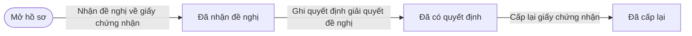
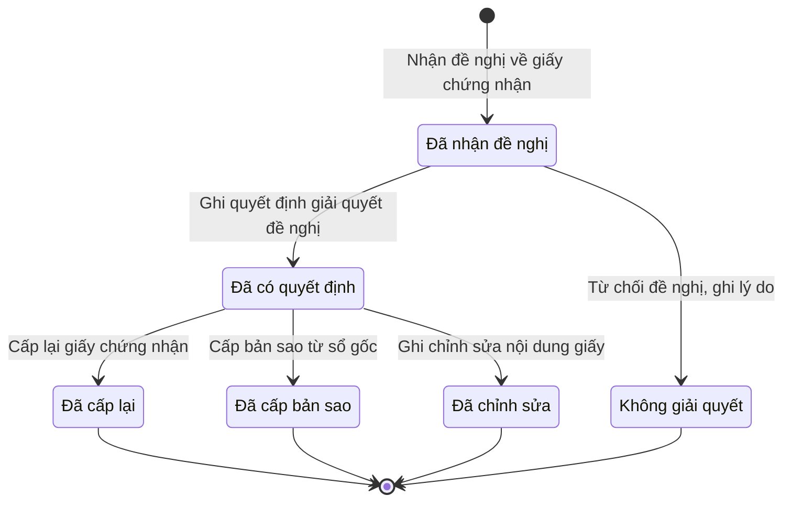

# qt-G2 · Cấp lại giấy chứng nhận

<!-- máy sinh: tom-tat -->
> **Hồ sơ:** Đề nghị cấp lại, bản sao, chỉnh sửa giấy chứng nhận (`CertificateRequest`)
>
> **Trong sổ phạm vi:** G2 · Cấp lại giấy chứng nhận (tầng 3)
>
> 7 bước · 6 chặng · 3 vai · 4 bảng quyết định · 1 hạn · 3 khớp nối.
>
> **Nguồn:** sổ nghiệp vụ `qt-G2` · khai báo của app: `dqtv-app/core/processes/gdqp-refresher/workflow/certificate-request.yaml`. Các bảng do máy sinh từ nguồn này.
<!-- hết: tom-tat -->

<!-- viết tay: dien-giai -->
## Diễn giải

*Phần này viết tay, diễn giải lại điều các bảng bên dưới ghi.*

### Quy trình này để làm gì

Theo dõi một **đề nghị về giấy chứng nhận** hoàn thành bồi dưỡng kiến thức QP&AN đã cấp: cấp lại, cấp bản sao, hoặc chỉnh sửa nội dung. Có hai vai: `operator` (Trợ lý Tác huấn) làm năm bước; `verifier` (Chỉ huy trưởng Ban CHQS xã) chỉ làm bước từ chối. Hồ sơ có bảy cấp lập (`level`); người làm phải thuộc đơn vị chủ hồ sơ.

Hồ sơ đi từ *Đã nhận đề nghị* sang *Đã có quyết định*, rồi kết thúc ở một trong ba chặng tuỳ loại đề nghị: *Đã cấp lại*, *Đã cấp bản sao*, *Đã chỉnh sửa*. Đề nghị bị từ chối thì kết thúc ở *Không giải quyết*.

### Khi nào bắt đầu

Vai `operator` bấm **Nhận đề nghị về giấy chứng nhận**. Phải nhập giấy được đề nghị (`certificateId`), loại đề nghị, giấy tờ chứng minh, chương trình, cấp lập và mã đơn vị. Hồ sơ mở ra có nối tới một **Giấy chứng nhận hoàn thành bồi dưỡng kiến thức QP&AN** (quy trình 16.gdqp-certificate) — đề nghị cho giấy nào. Bước mở không đòi gì trước.

Loại đề nghị có bốn giá trị, nhãn kèm luôn cách giải quyết: "Mất, hư hỏng — cấp bản sao từ sổ gốc" (`lost_or_damaged`), "Viết sai do lỗi của cơ quan cấp — cấp lại" (`issuer_error`), "Thay đổi, cải chính hộ tịch — chỉnh sửa" (`civil_status_change`), "Sai do người học cung cấp — chỉnh sửa" (`learner_supplied_error`).

### Diễn ra thế nào

**Chặng "Đã nhận đề nghị"** — hai lối ra:

- Vai `operator` bấm **Ghi quyết định giải quyết đề nghị**: nhập người quyết định, số quyết định, ngày ký và bản quét quyết định. Người quyết định được xét bằng bảng `reissue-decider`. Hồ sơ sang *Đã có quyết định*.
- Vai `verifier` bấm **Từ chối đề nghị, ghi lý do**: bắt buộc ghi lý do không giải quyết. Hồ sơ sang *Không giải quyết* và kết thúc. Người dùng đã chốt (7/10): việc từ chối do người ký làm.

**Chặng "Đã có quyết định"** — ba lối ra, đều do vai `operator` bấm; loại đề nghị quyết định lối nào bấm được:

- **Cấp lại giấy chứng nhận** → *Đã cấp lại*: phải nhập số hiệu giấy cấp lại, không đòi bản chụp. Chỉ cho qua khi loại đề nghị là `issuer_error`. Giấy mới có số hiệu mới, giấy cũ đã thay.
- **Cấp bản sao từ sổ gốc** → *Đã cấp bản sao*: nhập số vào sổ bản sao. Chỉ cho qua khi loại đề nghị là `lost_or_damaged`. Giấy gốc vẫn giữ giá trị.
- **Ghi chỉnh sửa nội dung giấy** → *Đã chỉnh sửa*: nhập nội dung chỉnh sửa. Chỉ cho qua khi loại đề nghị là `civil_status_change` hoặc `learner_supplied_error`.

Không có đường quay lại ở chặng nào.

### Kết thúc và để lại gì

Hồ sơ kết thúc ở *Đã cấp lại*, *Đã cấp bản sao*, *Đã chỉnh sửa* hoặc *Không giải quyết*. Có 2 khớp nối, đều tới Giấy chứng nhận (16.gdqp-certificate): ô nối lúc mở tới giấy được đề nghị, và ô nối ở bước cấp lại tới giấy mới cấp lại.

### Điều kiện chặn

- Mọi bước trừ bước mở: người làm phải thuộc đơn vị chủ hồ sơ. Sai người, sai chặng thì bước bị chặn, hồ sơ giữ nguyên.
- Người quyết định (bảng `reissue-decider`, xét ở bước ghi quyết định, 12 dòng): thiếu người quyết định thì chặn (`authority_unknown`). Cấp `commune`, `agencyOnCommune`, `province`, `militaryRegion`: mỗi cấp một người quyết định, không xét chương trình. Cấp `capitalCommand`, `hcmCommand`, `central`: xét cả người quyết định lẫn chương trình. Không khớp dòng nào thì chặn (`wrong_authority`).
- Ba bảng theo loại đề nghị (`reissue-kind`, `copy-kind`, `correction-kind`): bấm bước không hợp với loại đề nghị thì chặn (`wrong_request_kind`).
- Quy trình không đặt hạn và không có việc ngoài hệ nào.
<!-- hết viết tay -->

## 1. Đường đi ngắn nhất qua các chặng

<!-- máy sinh: luong-chinh -->
Đường ít bước nhất từ lúc mở hồ sơ tới chặng kết thúc xa nhất. Máy chọn theo số chặng, không theo ý nghĩa nghiệp vụ — trình tự công việc thật xem phần Diễn giải và bảng "Việc làm ở từng chặng" ở mục 6.

| # | Ai làm | Làm gì | Hồ sơ sang chặng |
|---|---|---|---|
| 1 | Trợ lý Tác huấn | Nhận đề nghị về giấy chứng nhận | Đã nhận đề nghị |
| 2 | Trợ lý Tác huấn | Ghi quyết định giải quyết đề nghị | Đã có quyết định |
| 3 | Trợ lý Tác huấn | Cấp lại giấy chứng nhận | Đã cấp lại |

<!-- hết: luong-chinh -->

## 2. Hồ sơ và việc nó để lại

<!-- máy sinh: muc-tieu -->
**App gọi quy trình này là:** Đề nghị cấp lại, bản sao, chỉnh sửa giấy chứng nhận.

**Khi mở, hồ sơ này ghi mối nối tới:**
- Giấy chứng nhận hoàn thành bồi dưỡng kiến thức QP&AN (16.gdqp-certificate) — bước `receiveReissueRequest`, khớp nối `requestForCertificate`
<!-- hết: muc-tieu -->

## 3. Khởi phát và kết thúc

<!-- máy sinh: khoi-phat -->
**1 cửa vào** — bước mở hồ sơ:

| Bước mở | Ai mở | Hồ sơ vào chặng | App bắt buộc nhập |
|---|---|---|---|
| Nhận đề nghị về giấy chứng nhận | Trợ lý Tác huấn | Đã nhận đề nghị | `certificateId`, loại đề nghị, giấy tờ chứng minh, chương trình, cấp lập, mã đơn vị |

**Kết thúc:** *Đã cấp lại* (`REISSUED`), *Đã cấp bản sao* (`COPY_ISSUED`), *Đã chỉnh sửa* (`CORRECTED`), *Không giải quyết* (`REJECTED`)
<!-- hết: khoi-phat -->

## 4. Vai trò

<!-- máy sinh: vai-tro -->
| Vai trong sổ | Tên trong app | Điều kiện | Làm những bước |
|---|---|---|---|
| `operator` | Trợ lý Tác huấn |  | Nhận đề nghị về giấy chứng nhận · Ghi quyết định giải quyết đề nghị · Cấp lại giấy chứng nhận · Cấp bản sao từ sổ gốc · Ghi chỉnh sửa nội dung giấy |
| `system` | Hệ thống tự làm |  | Đánh dấu đề nghị quá hạn xem xét |
| `verifier` | Chỉ huy trưởng Ban CHQS xã |  | Từ chối đề nghị, ghi lý do |

*"Tên trong app" là tên app đặt cho mã chủ thể của vai. Hồ sơ thuộc đơn vị cấp khác thì người làm là người giữ vai ấy ở đơn vị nêu trong cột "Điều kiện" (nếu sổ có ghi) và ở cột "Người làm phải thuộc" của bảng "Theo khai báo của app" (mục 7).*
<!-- hết: vai-tro -->

## 5. Nhánh phụ

<!-- máy sinh: nhanh-phu -->
**Bước khác đưa hồ sơ sang chặng mới** — đường song song, rẽ nhánh hoặc kết thúc sớm:

| Bước | Ai làm | Từ chặng | Sang chặng |
|---|---|---|---|
| Từ chối đề nghị, ghi lý do | Chỉ huy trưởng Ban CHQS xã | Đã nhận đề nghị | Không giải quyết |
| Cấp bản sao từ sổ gốc | Trợ lý Tác huấn | Đã có quyết định | Đã cấp bản sao |
| Ghi chỉnh sửa nội dung giấy | Trợ lý Tác huấn | Đã có quyết định | Đã chỉnh sửa |

**Làm trong lúc hồ sơ đứng yên ở một chặng** — ghi nhận, bổ sung:

| Bước | Ai làm | Ở chặng |
|---|---|---|
| Đánh dấu đề nghị quá hạn xem xét | Hệ thống tự làm | Đã nhận đề nghị |

<!-- hết: nhanh-phu -->

## 6. Các chặng và việc làm ở từng chặng

<!-- máy sinh: chang -->
| Chặng | Tên hiển thị | Vào bằng bước | Kết thúc? |
|---|---|---|---|
| `REQUESTED` | Đã nhận đề nghị | Nhận đề nghị về giấy chứng nhận |  |
| `DECIDED` | Đã có quyết định | Ghi quyết định giải quyết đề nghị |  |
| `REISSUED` | Đã cấp lại | Cấp lại giấy chứng nhận | **kết thúc** |
| `COPY_ISSUED` | Đã cấp bản sao | Cấp bản sao từ sổ gốc | **kết thúc** |
| `CORRECTED` | Đã chỉnh sửa | Ghi chỉnh sửa nội dung giấy | **kết thúc** |
| `REJECTED` | Không giải quyết | Từ chối đề nghị, ghi lý do | **kết thúc** |

### Việc làm ở từng chặng

Hồ sơ đang ở chặng nào thì làm được những bước nào.

| Hồ sơ đang ở chặng | Bước làm tại chặng (hồ sơ đứng yên) | Bước đưa hồ sơ sang chặng khác |
|---|---|---|
| **Đã nhận đề nghị** | Đánh dấu đề nghị quá hạn xem xét — Hệ thống tự làm | Ghi quyết định giải quyết đề nghị — Trợ lý Tác huấn → *Đã có quyết định* Từ chối đề nghị, ghi lý do — Chỉ huy trưởng Ban CHQS xã → *Không giải quyết* |
| **Đã có quyết định** | — | Cấp lại giấy chứng nhận — Trợ lý Tác huấn → *Đã cấp lại* Cấp bản sao từ sổ gốc — Trợ lý Tác huấn → *Đã cấp bản sao* Ghi chỉnh sửa nội dung giấy — Trợ lý Tác huấn → *Đã chỉnh sửa* |
| **Đã cấp lại** | — | — (kết thúc) |
| **Đã cấp bản sao** | — | — (kết thúc) |
| **Đã chỉnh sửa** | — | — (kết thúc) |
| **Không giải quyết** | — | — (kết thúc) |
<!-- hết: chang -->

## 7. Bảng bước

<!-- máy sinh: buoc -->
| # | Bước | Mã bước | Ai thực hiện | Từ chặng | Sang chặng | Phải có trước | Ghi lại |
|---|---|---|---|---|---|---|---|
| 1 | Nhận đề nghị về giấy chứng nhận | `receiveReissueRequest` | Trợ lý Tác huấn | — (mở hồ sơ) | `REQUESTED` | — | đơn vị chủ hồ sơ, `level`, chương trình, nối tới Giấy chứng nhận hoàn thành bồi dưỡng kiến thức QP&AN, loại đề nghị, giấy tờ chứng minh, ngày nhận |
| 2 | Ghi quyết định giải quyết đề nghị | `decideCertificateRequest` | Trợ lý Tác huấn | `REQUESTED` | `DECIDED` | người làm thuộc đơn vị chủ hồ sơ, `decideCertificateRequestFromIncomingDocumentUsable` | nối tới Văn bản đến, người quyết định |
| 3 | Đánh dấu đề nghị quá hạn xem xét | `flagReissueRequestOverdue` | Hệ thống tự làm | `REQUESTED` | giữ nguyên | `requestOverdueNotFlagged` | `overdueAt` |
| 4 | Từ chối đề nghị, ghi lý do | `rejectCertificateRequest` | Chỉ huy trưởng Ban CHQS xã | `REQUESTED` | `REJECTED` | người làm thuộc đơn vị chủ hồ sơ, đường báo người đề nghị | lý do không giải quyết, đường báo người đề nghị, ngày gửi thông báo |
| 5 | Cấp lại giấy chứng nhận | `reissueCertificate` | Trợ lý Tác huấn | `DECIDED` | `REISSUED` | người làm thuộc đơn vị chủ hồ sơ, `certificateInForce` | số hiệu giấy cấp lại, ngày cấp lại |
| 6 | Cấp bản sao từ sổ gốc | `issueCertificateCopy` | Trợ lý Tác huấn | `DECIDED` | `COPY_ISSUED` | người làm thuộc đơn vị chủ hồ sơ | số vào sổ bản sao, ngày cấp bản sao |
| 7 | Ghi chỉnh sửa nội dung giấy | `correctCertificate` | Trợ lý Tác huấn | `DECIDED` | `CORRECTED` | người làm thuộc đơn vị chủ hồ sơ | nội dung chỉnh sửa, ngày chỉnh sửa |

### Khi không đạt điều kiện

Mặc định: không đúng người, hồ sơ không ở đúng chặng, hoặc thiếu thứ "phải có trước" thì bước bị chặn, hồ sơ giữ nguyên. Bảng dưới chỉ kê những bước có kết quả riêng.

| # | Bước | Kết quả riêng |
|---|---|---|
| 2 | Ghi quyết định giải quyết đề nghị | bước dừng lại, hồ sơ giữ nguyên khi kết quả xét là: `authority_unknown`, `wrong_authority` |
| 3 | Đánh dấu đề nghị quá hạn xem xét | bước này không do người nào bấm |
| 5 | Cấp lại giấy chứng nhận | bước dừng lại, hồ sơ giữ nguyên khi kết quả xét là: `wrong_request_kind` |
| 6 | Cấp bản sao từ sổ gốc | bước dừng lại, hồ sơ giữ nguyên khi kết quả xét là: `wrong_request_kind` |
| 7 | Ghi chỉnh sửa nội dung giấy | bước dừng lại, hồ sơ giữ nguyên khi kết quả xét là: `wrong_request_kind` |

### Điều kiện "phải có trước" bằng lời

Cột "Phải có trước" ở bảng bước có hai loại: ô dữ liệu thường (bước chỉ đòi ô ấy đã có giá trị) và điều kiện hệ tự xét. Bảng này diễn các điều kiện hệ tự xét theo đúng công thức sổ ghi; số ở cột cuối là số thứ tự bước.

| Điều kiện | Đúng khi | Bước đòi |
|---|---|---|
| `actorInOwnerUnit` | người đang làm là người của đơn vị ghi ở ô đơn vị chủ hồ sơ của hồ sơ này (theo danh mục người của đơn vị, `dm.unit-staff`) | 2, 4, 5, 6, 7 |
| `decideCertificateRequestFromIncomingDocumentUsable` | có hồ sơ Việc luật giao kèm văn bản đến, đi — Văn bản đến (qt-1.incoming-document) chính là hồ sơ ghi ở ô nối `decideCertificateRequestFromIncomingDocument` của hồ sơ đang làm mà hồ sơ ấy đang ở chặng `RECEIVED` hoặc `DISTRIBUTED` | 2 |
| `requestOverdueNotFlagged` | KHÔNG (đã có `overdueAt`) | 3 |
| `certificateInForce` | có hồ sơ Giấy chứng nhận hoàn thành bồi dưỡng kiến thức QP&AN (qt-16.gdqp-certificate) chính là hồ sơ ghi ở ô nối `requestForCertificate` của hồ sơ đang làm mà hồ sơ ấy đang ở chặng `ISSUED` | 5 |

### Theo khai báo của app

Người làm phải thuộc đơn vị nào, ô người dùng phải nhập, bước có lặp được không, và căn cứ pháp lý — lấy từ khai báo quy trình trong app.

| # | Bước | Người làm phải thuộc | Bắt buộc nhập | Nhập nếu có | Lặp được | Căn cứ |
|---|---|---|---|---|---|---|
| 1 | Nhận đề nghị về giấy chứng nhận |  | `certificateId`, loại đề nghị, giấy tờ chứng minh, chương trình, cấp lập, mã đơn vị | giấy tờ chứng minh (bản quét), ngày nhận, mã tỉnh, mã xã, chủ hồ sơ cấp trên |  | TT10/2026/TT-BGDĐT Đ.14 k2 a, Đ.15 k3, Đ.17 k4 |
| 2 | Ghi quyết định giải quyết đề nghị |  | văn bản đến là quyết định giải quyết đề nghị, người quyết định | ngày ký (để trống thì lấy ngày ghi trên văn bản đến) |  | VBHN53/VBHN-BQP Đ.5 k2 — người có thẩm quyền cấp thì cấp lại, chỉnh sửa |
| 3 | Đánh dấu đề nghị quá hạn xem xét |  | — | — |  | TT10/2026/TT-BGDĐT Đ.14 k2b, Đ.15 k4b |
| 4 | Từ chối đề nghị, ghi lý do |  | lý do không giải quyết, đường báo người đề nghị | — |  | TT10/2026/TT-BGDĐT Đ.14 k2 b — không cấp lại thì trả lời bằng văn bản nêu rõ lý do |
| 5 | Cấp lại giấy chứng nhận |  | số hiệu giấy cấp lại | ngày cấp lại |  | TT10/2026/TT-BGDĐT Đ.13 k2 c, Đ.14 k4, k5 |
| 6 | Cấp bản sao từ sổ gốc |  | số vào sổ bản sao | ngày cấp bản sao |  | TT10/2026/TT-BGDĐT Đ.17, Đ.18 |
| 7 | Ghi chỉnh sửa nội dung giấy |  | nội dung chỉnh sửa | ngày chỉnh sửa |  | TT10/2026/TT-BGDĐT Đ.15 k4 c, d |

### Điều kiện và ghi chú app khai cho từng bước

Lấy từ khai báo quy trình trong app. Lời trong ngoặc kép là câu app hiện cho người dùng. Chức danh người ký ngoài hệ app chỉ khai bằng mã.

| # | Bước | Điều kiện, ghi chú |
|---|---|---|
| 1 | Nhận đề nghị về giấy chứng nhận | · hạn: 3 ngày làm việc — Xem xét đề nghị cấp lại, chỉnh sửa trong 03 ngày làm việc (TT10/2026 Đ.14 k2b, Đ.15 k4b) |
| 2 | Ghi quyết định giải quyết đề nghị | · không đòi bản chụp — app ghi: "bản số hoá lấy từ văn bản đến văn thư đã vào sổ (tầng đọc chép `scanPath` của văn bản ấy vào `decisionScanPath`), không tải ảnh ở bước này" |
| 3 | Đánh dấu đề nghị quá hạn xem xét | · phải đã có `dueDate` — thiếu thì app báo: "đề nghị không có hạn xem xét nào đang chạy" · không làm được khi đã có `overdueAt` — app báo: "đề nghị đã được ghi quá hạn xem xét" |
| 5 | Cấp lại giấy chứng nhận | · không đòi bản chụp — app ghi: "Số hiệu giấy cấp lại do HỆ cấp — bản quét quyết định cấp lại đã đính ở bước Ghi quyết định giải quyết đề nghị" |
<!-- hết: buoc -->

## 8. Bảng quyết định, hạn, việc ngoài hệ

<!-- máy sinh: quyet-dinh -->
**Bảng `copy-kind`** — xét ở bước *Cấp bản sao từ sổ gốc*; đầu vào: loại đề nghị. 2 dòng, dò từ trên xuống, dòng đầu tiên khớp thì dừng.

| Thứ tự dò (số sổ ghi) | Dòng | Khi | Thì |
|---|---|---|---|
| 1 | `match` | loại đề nghị là Mất, hư hỏng — cấp bản sao từ sổ gốc (`lost_or_damaged`) | cho qua |
| 2 | `otherwise` | mọi trường hợp còn lại | `wrong_request_kind` |

**Bảng `correction-kind`** — xét ở bước *Ghi chỉnh sửa nội dung giấy*; đầu vào: loại đề nghị. 2 dòng, dò từ trên xuống, dòng đầu tiên khớp thì dừng.

| Thứ tự dò (số sổ ghi) | Dòng | Khi | Thì |
|---|---|---|---|
| 1 | `match` | loại đề nghị là Thay đổi, cải chính hộ tịch — chỉnh sửa (`civil_status_change`) hoặc Sai do người học cung cấp — chỉnh sửa (`learner_supplied_error`) | cho qua |
| 2 | `otherwise` | mọi trường hợp còn lại | `wrong_request_kind` |

**Bảng `reissue-decider`** — xét ở bước *Ghi quyết định giải quyết đề nghị*; đầu vào: `level`, chương trình, người quyết định. 12 dòng, dò từ trên xuống, dòng đầu tiên khớp thì dừng.

| Thứ tự dò (số sổ ghi) | Dòng | Khi | Thì |
|---|---|---|---|
| 1 | `signer-unset` | chưa có người quyết định | `authority_unknown` |
| 2 | `commune` | `level` là `commune` và người quyết định là Chủ tịch Hội đồng GDQPAN cấp xã (`communeCouncilChair`) | cho qua |
| 3 | `agencyOnCommune` | `level` là `agencyOnCommune` và người quyết định là Người đứng đầu cơ quan, tổ chức (`agencyHead`) | cho qua |
| 4 | `province` | `level` là `province` và người quyết định là Chỉ huy trưởng Bộ CHQS cấp tỉnh (`provinceMilitaryCommander`) | cho qua |
| 5 | `militaryRegion` | `level` là `militaryRegion` và người quyết định là Hiệu trưởng trường quân sự quân khu (`regionSchoolPrincipal`) | cho qua |
| 6 | `capital-group-2-3` | `level` là `capitalCommand` và người quyết định là Hiệu trưởng trường quân sự Bộ Tư lệnh thành phố (`citySchoolPrincipal`) và chương trình là Chương trình đối tượng 2 (`group_2`) hoặc Chương trình đối tượng 3 và tương đương (`group_3_and_equivalent`) | cho qua |
| 7 | `capital-religious` | `level` là `capitalCommand` và người quyết định là Tư lệnh Bộ Tư lệnh thành phố (`cityCommander`) và chương trình là Chương trình cho chức sắc, chức việc tôn giáo, nhà hoạt động văn hoá, xã hội (`religious_or_cultural_figure`) | cho qua |
| 8 | `hcm-group-3` | `level` là `hcmCommand` và người quyết định là Hiệu trưởng trường quân sự Bộ Tư lệnh thành phố (`citySchoolPrincipal`) và chương trình là Chương trình đối tượng 3 và tương đương (`group_3_and_equivalent`) | cho qua |
| 9 | `hcm-religious` | `level` là `hcmCommand` và người quyết định là Tư lệnh Bộ Tư lệnh thành phố (`cityCommander`) và chương trình là Chương trình cho chức sắc, chức việc tôn giáo, nhà hoạt động văn hoá, xã hội (`religious_or_cultural_figure`) | cho qua |
| 10 | `central-group-1` | `level` là `central` và người quyết định là Giám đốc Học viện Quốc phòng (`defenceAcademyDirector`) và chương trình là Chương trình đối tượng 1 (`group_1`) | cho qua |
| 11 | `central-group-2` | `level` là `capitalCommand` và người quyết định là Giám đốc Học viện Chính trị (`politicalAcademyDirector`) và chương trình là Chương trình đối tượng 2 (`group_2`) | cho qua |
| 12 | `otherwise` | mọi trường hợp còn lại | `wrong_authority` |

**Bảng `reissue-kind`** — xét ở bước *Cấp lại giấy chứng nhận*; đầu vào: loại đề nghị. 2 dòng, dò từ trên xuống, dòng đầu tiên khớp thì dừng.

| Thứ tự dò (số sổ ghi) | Dòng | Khi | Thì |
|---|---|---|---|
| 1 | `match` | loại đề nghị là Viết sai do lỗi của cơ quan cấp — cấp lại (`issuer_error`) | cho qua |
| 2 | `otherwise` | mọi trường hợp còn lại | `wrong_request_kind` |

| Hạn | Tính từ | Thời hạn | Quá hạn thì |
|---|---|---|---|
| `decideCertificateRequest.deadline` | khi hồ sơ vào chặng Đã nhận đề nghị | 3 ngày làm việc | hệ làm bước Đánh dấu đề nghị quá hạn xem xét |

<!-- hết: quyet-dinh -->

## 9. Dữ liệu của hồ sơ

<!-- máy sinh: du-lieu -->
Các ô mà bước trong sổ ghi hoặc đòi. Số trong hai cột cuối là số thứ tự bước ở bảng bước (mục 7).

| Ô dữ liệu | Mã | Kiểu (app) | Giá trị cho phép | Loại ô (sổ) | Bước ghi | Bước đòi | Mô tả trong app |
|---|---|---|---|---|---|---|---|
| đơn vị chủ hồ sơ | `ownerUnit` |  |  | lưu trên hồ sơ (`stored`) | 1 | — |  |
| — | `level` |  | `commune`, `agencyOnCommune`, `province`, `militaryRegion`, `capitalCommand`, `hcmCommand`, `central` | lưu trên hồ sơ (`stored`) | 1 | — |  |
| chương trình | `programme` | chọn một | Chương trình đối tượng 1 (`group_1`), Chương trình đối tượng 2 (`group_2`), Chương trình đối tượng 3 và tương đương (`group_3_and_equivalent`), Chương trình đối tượng 4 và tương đương (`group_4_and_equivalent`), Chương trình cho chức sắc, chức việc tôn giáo, nhà hoạt động văn hoá, xã hội (`religious_or_cultural_figure`), Chương trình cho già làng, trưởng họ tộc (`village_elder_or_clan_head`) | hệ suy ra (`derived`) | 1 | — | Chương trình của giấy — chép từ giấy |
| loại đề nghị | `requestKind` | chọn một | Mất, hư hỏng — cấp bản sao từ sổ gốc (`lost_or_damaged`), Viết sai do lỗi của cơ quan cấp — cấp lại (`issuer_error`), Thay đổi, cải chính hộ tịch — chỉnh sửa (`civil_status_change`), Sai do người học cung cấp — chỉnh sửa (`learner_supplied_error`) | đưa vào ở bước (`input`) | 1 | — | Loại đề nghị — TT10/2026 Đ.14 cấp lại, Đ.15 chỉnh sửa, Đ.17 bản sao |
| giấy tờ chứng minh | `requestProof` | chữ |  | đưa vào ở bước (`input`) | 1 | — | Giấy tờ chứng minh kèm đề nghị |
| ngày nhận | `requestedAt` | ngày |  | lưu trên hồ sơ (`stored`) | 1 | — | Ngày nhận đề nghị |
| người quyết định | `decisionSignerTitle` | chọn một | Chủ tịch Hội đồng GDQPAN cấp xã (`communeCouncilChair`), Người đứng đầu cơ quan, tổ chức (`agencyHead`), Chỉ huy trưởng Bộ CHQS cấp tỉnh (`provinceMilitaryCommander`), Hiệu trưởng trường quân sự quân khu (`regionSchoolPrincipal`), Hiệu trưởng trường quân sự Bộ Tư lệnh thành phố (`citySchoolPrincipal`), Tư lệnh Bộ Tư lệnh thành phố (`cityCommander`), Giám đốc Học viện Quốc phòng (`defenceAcademyDirector`), Giám đốc Học viện Chính trị (`politicalAcademyDirector`), Người khác (`other`) | đưa vào ở bước (`input`) | 2 | — | Người quyết định — VBHN53 Đ.5 k2 |
| — | `overdueAt` | ngày |  | lưu trên hồ sơ (`stored`) | 3 | — | Ngày hệ ghi đề nghị quá hạn xem xét — chỉ nhắc, không khoá bước nào |
| lý do không giải quyết | `rejectReason` | chữ |  | đưa vào ở bước (`input`) | 4 | — | Lý do không giải quyết — trả lời bằng văn bản (TT10 Đ.14 k2b) |
| đường báo người đề nghị | `noticeChannel` | chọn một | Tài khoản dịch vụ công (`public_service_account`), Tin nhắn điện thoại (`sms`), Thư điện tử (`email`), Gặp trực tiếp (`in_person`) | đưa vào ở bước (`input`) | 4 | 4 | Báo người đề nghị về việc không giải quyết qua đường nào |
| ngày gửi thông báo | `refusalNoticeSentAt` | ngày |  | lưu trên hồ sơ (`stored`) | 4 | — | Ngày gửi thông báo không giải quyết |
| số hiệu giấy cấp lại | `newCertificateNumber` | chữ |  | lưu trên hồ sơ (`stored`) | 5 | — | Số hiệu giấy cấp lại — hệ cấp |
| ngày cấp lại | `reissuedAt` | ngày |  | lưu trên hồ sơ (`stored`) | 5 | — | Ngày cấp lại |
| số vào sổ bản sao | `copyNumber` | chữ |  | đưa vào ở bước (`input`) | 6 | — | Số vào sổ cấp bản sao |
| ngày cấp bản sao | `copyIssuedAt` | ngày |  | lưu trên hồ sơ (`stored`) | 6 | — | Ngày cấp bản sao |
| nội dung chỉnh sửa | `correctedFields` | chữ |  | đưa vào ở bước (`input`) | 7 | — | Nội dung chỉnh sửa |
| ngày chỉnh sửa | `correctedAt` | ngày |  | lưu trên hồ sơ (`stored`) | 7 | — | Ngày chỉnh sửa |
| người làm thuộc đơn vị chủ hồ sơ | `actorInOwnerUnit` |  | có hay chưa | hệ suy ra (`derived`) | — | 2, 4, 5, 6, 7 |  |
| — | `decideCertificateRequestFromIncomingDocumentUsable` |  | có hay chưa | hệ suy ra (`derived`) | — | 2 |  |
| — | `requestOverdueNotFlagged` |  | có hay chưa | hệ suy ra (`derived`) | — | 3 |  |
| — | `certificateInForce` |  | có hay chưa | hệ suy ra (`derived`) | — | 5 |  |

21 ô. Cột "Loại ô" là cách sổ phân loại ô, in kèm đúng chữ của sổ; ô nào người dùng phải nhập xem bảng "Theo khai báo của app" ở mục 7.
<!-- hết: du-lieu -->

## 10. Khớp nối với quy trình khác

<!-- máy sinh: khop-noi -->
| Quy trình kia | Hồ sơ kia | Quan hệ | Nội dung (mô tả trong app) | Bước ghi mối nối | Tên ô nối |
|---|---|---|---|---|---|
| 1.incoming-document | Văn bản đến | gắn với nhau ở một bước giữa chừng | Quyết định giải quyết đề nghị về giấy chứng nhận — văn bản đến đã vào sổ (TT10/2026 Đ.14, Đ.15, Đ.17) | G2·decideCertificateRequest | `decideCertificateRequestFromIncomingDocument` |
| 16.gdqp-certificate | Giấy chứng nhận hoàn thành bồi dưỡng kiến thức QP&AN | có nối | Giấy mới cấp lại — sổ link.replacedCertificate (TT10 Đ.13 k2c: số hiệu mới) | — | `reissuedCertificate` |
| 16.gdqp-certificate | Giấy chứng nhận hoàn thành bồi dưỡng kiến thức QP&AN | hồ sơ này **mở ra có nối tới** hồ sơ kia | Đề nghị cho giấy nào — sổ link.requestForCertificate | G2·receiveReissueRequest ⊕ | `requestForCertificate` |

3 khớp nối. ⊕ là bước tạo hồ sơ.
<!-- hết: khop-noi -->

## 11. Thông tin chung

<!-- máy sinh: thong-tin -->
| | |
|---|---|
| **Mã trong sổ** | `qt-G2` |
| **Quy trình trong app** | `gdqp-refresher` (`workflow/certificate-request.yaml`) — mặt công tác: `personnel` |
| **Hồ sơ** | Đề nghị cấp lại, bản sao, chỉnh sửa giấy chứng nhận (`CertificateRequest`) |
| **Căn cứ pháp lý từng bước** | cột "Căn cứ" ở bảng "Theo khai báo của app", mục 7 |
<!-- hết: thong-tin -->
