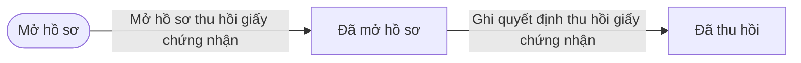
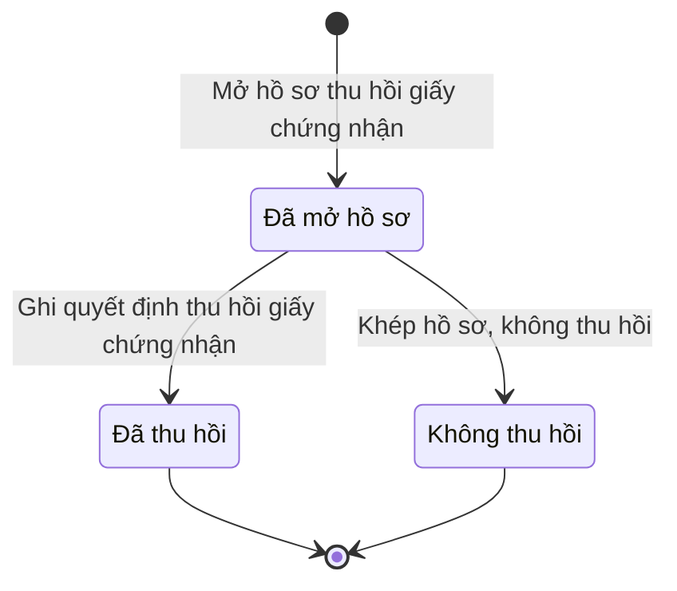

# qt-G3 · Thu hồi, huỷ giấy chứng nhận

<!-- máy sinh: tom-tat -->
> **Hồ sơ:** Hồ sơ thu hồi, huỷ bỏ giấy chứng nhận (`CertificateRevocation`)
>
> **Trong sổ phạm vi:** G3 · Thu hồi, huỷ giấy chứng nhận (tầng 3)
>
> 3 bước · 3 chặng · 2 vai · 1 bảng quyết định · 0 hạn · 2 khớp nối.
>
> **Nguồn:** sổ nghiệp vụ `qt-G3` · khai báo của app: `dqtv-app/core/processes/gdqp-refresher/workflow/certificate-revocation.yaml`. Các bảng do máy sinh từ nguồn này.
<!-- hết: tom-tat -->

<!-- viết tay: dien-giai -->
## Diễn giải

*Phần này viết tay, diễn giải lại điều các bảng bên dưới ghi.*

### Quy trình này để làm gì

Theo dõi một **hồ sơ thu hồi, huỷ bỏ giấy chứng nhận** hoàn thành bồi dưỡng kiến thức QP&AN đã cấp. Có hai vai: `operator` ("Trợ lý Tác huấn") mở hồ sơ và ghi quyết định thu hồi; `verifier` ("Chỉ huy trưởng Ban CHQS xã") khép hồ sơ khi không thu hồi. Hồ sơ có bảy cấp lập (`level`); người làm phải thuộc đơn vị chủ hồ sơ. Hồ sơ có ba chặng: *Đã mở hồ sơ*, rồi kết thúc ở *Đã thu hồi* hoặc *Không thu hồi*.

### Khi nào bắt đầu

Vai `operator` bấm **Mở hồ sơ thu hồi giấy chứng nhận**, bắt buộc nhập giấy bị xem xét (`certificateId`), căn cứ thu hồi, chứng cứ, chương trình, cấp lập và mã đơn vị. Hồ sơ mở ra có nối tới một **Giấy chứng nhận hoàn thành bồi dưỡng kiến thức QP&AN** (quy trình 16.gdqp-certificate) — thu hồi giấy nào. Bước mở không đòi gì trước.

Căn cứ thu hồi chọn một trong năm giá trị: "Gian lận trong học tập, kiểm tra hoặc làm hồ sơ" (`fraud`), "Cấp cho người không đủ điều kiện" (`ineligible`), "Do người không có thẩm quyền cấp" (`unauthorized_issuer`), "Bị tẩy xoá, sửa chữa" (`tampered`), "Để cho người khác sử dụng" (`used_by_other`).

### Diễn ra thế nào

**Chặng "Đã mở hồ sơ"** — không có việc làm tại chỗ, chỉ có hai lối ra:

- Vai `operator` bấm **Ghi quyết định thu hồi giấy chứng nhận**: nhập người quyết định, số quyết định, ngày ký và bản quét quyết định thu hồi. Người quyết định được xét bằng bảng `revocation-decider`. Hồ sơ sang *Đã thu hồi*.
- Vai `verifier` bấm **Khép hồ sơ, không thu hồi**: bắt buộc ghi lý do không thu hồi. Hồ sơ sang *Không thu hồi*.

Không có đường quay lại ở chặng nào.

### Kết thúc và để lại gì

Hồ sơ kết thúc ở *Đã thu hồi* hoặc *Không thu hồi*. Khớp nối duy nhất là ô nối lúc mở tới giấy bị xem xét thu hồi (`revokedCertificate`).

### Điều kiện chặn

- Hai bước sau bước mở đòi người làm thuộc đơn vị chủ hồ sơ. Sai người, sai chặng thì bước bị chặn, hồ sơ giữ nguyên.
- Người quyết định thu hồi (bảng `revocation-decider`, xét ở bước ghi quyết định, 12 dòng): thiếu người quyết định thì chặn (`authority_unknown`). Cấp `commune`, `agencyOnCommune`, `province`, `militaryRegion`: mỗi cấp một người quyết định, không xét chương trình. Cấp `capitalCommand`, `hcmCommand`, `central`: xét cả người quyết định lẫn chương trình. Không khớp dòng nào thì chặn (`wrong_authority`).
<!-- hết viết tay -->

## 1. Đường đi ngắn nhất qua các chặng

<!-- máy sinh: luong-chinh -->
Đường ít bước nhất từ lúc mở hồ sơ tới chặng kết thúc xa nhất. Máy chọn theo số chặng, không theo ý nghĩa nghiệp vụ — trình tự công việc thật xem phần Diễn giải và bảng "Việc làm ở từng chặng" ở mục 6.

| # | Ai làm | Làm gì | Hồ sơ sang chặng |
|---|---|---|---|
| 1 | Trợ lý Tác huấn | Mở hồ sơ thu hồi giấy chứng nhận | Đã mở hồ sơ |
| 2 | Trợ lý Tác huấn | Ghi quyết định thu hồi giấy chứng nhận | Đã thu hồi |

<!-- hết: luong-chinh -->

## 2. Hồ sơ và việc nó để lại

<!-- máy sinh: muc-tieu -->
**App gọi quy trình này là:** Hồ sơ thu hồi, huỷ bỏ giấy chứng nhận.

**Khi mở, hồ sơ này ghi mối nối tới:**
- Giấy chứng nhận hoàn thành bồi dưỡng kiến thức QP&AN (16.gdqp-certificate) — bước `recordRevocationGround`, khớp nối `revokedCertificate`
<!-- hết: muc-tieu -->

## 3. Khởi phát và kết thúc

<!-- máy sinh: khoi-phat -->
**1 cửa vào** — bước mở hồ sơ:

| Bước mở | Ai mở | Hồ sơ vào chặng | App bắt buộc nhập |
|---|---|---|---|
| Mở hồ sơ thu hồi giấy chứng nhận | Trợ lý Tác huấn | Đã mở hồ sơ | `certificateId`, căn cứ thu hồi, chứng cứ, chương trình, cấp lập, mã đơn vị |

**Kết thúc:** *Đã thu hồi* (`REVOKED`), *Không thu hồi* (`DROPPED`)
<!-- hết: khoi-phat -->

## 4. Vai trò

<!-- máy sinh: vai-tro -->
| Vai trong sổ | Tên trong app | Điều kiện | Làm những bước |
|---|---|---|---|
| `operator` | Trợ lý Tác huấn |  | Mở hồ sơ thu hồi giấy chứng nhận · Ghi quyết định thu hồi giấy chứng nhận |
| `verifier` | Chỉ huy trưởng Ban CHQS xã |  | Khép hồ sơ, không thu hồi |

*"Tên trong app" là tên app đặt cho mã chủ thể của vai. Hồ sơ thuộc đơn vị cấp khác thì người làm là người giữ vai ấy ở đơn vị nêu trong cột "Điều kiện" (nếu sổ có ghi) và ở cột "Người làm phải thuộc" của bảng "Theo khai báo của app" (mục 7).*
<!-- hết: vai-tro -->

## 5. Nhánh phụ

<!-- máy sinh: nhanh-phu -->
**Bước khác đưa hồ sơ sang chặng mới** — đường song song, rẽ nhánh hoặc kết thúc sớm:

| Bước | Ai làm | Từ chặng | Sang chặng |
|---|---|---|---|
| Khép hồ sơ, không thu hồi | Chỉ huy trưởng Ban CHQS xã | Đã mở hồ sơ | Không thu hồi |

<!-- hết: nhanh-phu -->

## 6. Các chặng và việc làm ở từng chặng

<!-- máy sinh: chang -->
| Chặng | Tên hiển thị | Vào bằng bước | Kết thúc? |
|---|---|---|---|
| `OPENED` | Đã mở hồ sơ | Mở hồ sơ thu hồi giấy chứng nhận |  |
| `REVOKED` | Đã thu hồi | Ghi quyết định thu hồi giấy chứng nhận | **kết thúc** |
| `DROPPED` | Không thu hồi | Khép hồ sơ, không thu hồi | **kết thúc** |

### Việc làm ở từng chặng

Hồ sơ đang ở chặng nào thì làm được những bước nào.

| Hồ sơ đang ở chặng | Bước làm tại chặng (hồ sơ đứng yên) | Bước đưa hồ sơ sang chặng khác |
|---|---|---|
| **Đã mở hồ sơ** | — | Ghi quyết định thu hồi giấy chứng nhận — Trợ lý Tác huấn → *Đã thu hồi* Khép hồ sơ, không thu hồi — Chỉ huy trưởng Ban CHQS xã → *Không thu hồi* |
| **Đã thu hồi** | — | — (kết thúc) |
| **Không thu hồi** | — | — (kết thúc) |
<!-- hết: chang -->

## 7. Bảng bước

<!-- máy sinh: buoc -->
| # | Bước | Mã bước | Ai thực hiện | Từ chặng | Sang chặng | Phải có trước | Ghi lại |
|---|---|---|---|---|---|---|---|
| 1 | Mở hồ sơ thu hồi giấy chứng nhận | `recordRevocationGround` | Trợ lý Tác huấn | — (mở hồ sơ) | `OPENED` | — | đơn vị chủ hồ sơ, `level`, chương trình, nối tới Giấy chứng nhận hoàn thành bồi dưỡng kiến thức QP&AN, căn cứ thu hồi, chứng cứ, ngày mở hồ sơ |
| 2 | Ghi quyết định thu hồi giấy chứng nhận | `decideRevocation` | Trợ lý Tác huấn | `OPENED` | `REVOKED` | người làm thuộc đơn vị chủ hồ sơ, `certificateInForce`, `decideRevocationFromIncomingDocumentUsable` | ngày thu hồi, nối tới Văn bản đến, người quyết định |
| 3 | Khép hồ sơ, không thu hồi | `dropRevocation` | Chỉ huy trưởng Ban CHQS xã | `OPENED` | `DROPPED` | người làm thuộc đơn vị chủ hồ sơ | lý do không thu hồi |

### Khi không đạt điều kiện

Mặc định: không đúng người, hồ sơ không ở đúng chặng, hoặc thiếu thứ "phải có trước" thì bước bị chặn, hồ sơ giữ nguyên. Bảng dưới chỉ kê những bước có kết quả riêng.

| # | Bước | Kết quả riêng |
|---|---|---|
| 2 | Ghi quyết định thu hồi giấy chứng nhận | bước dừng lại, hồ sơ giữ nguyên khi kết quả xét là: `authority_unknown`, `wrong_authority` |

### Điều kiện "phải có trước" bằng lời

Cột "Phải có trước" ở bảng bước có hai loại: ô dữ liệu thường (bước chỉ đòi ô ấy đã có giá trị) và điều kiện hệ tự xét. Bảng này diễn các điều kiện hệ tự xét theo đúng công thức sổ ghi; số ở cột cuối là số thứ tự bước.

| Điều kiện | Đúng khi | Bước đòi |
|---|---|---|
| `actorInOwnerUnit` | người đang làm là người của đơn vị ghi ở ô đơn vị chủ hồ sơ của hồ sơ này (theo danh mục người của đơn vị, `dm.unit-staff`) | 2, 3 |
| `certificateInForce` | có hồ sơ Giấy chứng nhận hoàn thành bồi dưỡng kiến thức QP&AN (qt-16.gdqp-certificate) chính là hồ sơ ghi ở ô nối `revokedCertificate` của hồ sơ đang làm mà hồ sơ ấy đang ở chặng `ISSUED` | 2 |
| `decideRevocationFromIncomingDocumentUsable` | có hồ sơ Việc luật giao kèm văn bản đến, đi — Văn bản đến (qt-1.incoming-document) chính là hồ sơ ghi ở ô nối `decideRevocationFromIncomingDocument` của hồ sơ đang làm mà hồ sơ ấy đang ở chặng `RECEIVED` hoặc `DISTRIBUTED` | 2 |

### Theo khai báo của app

Người làm phải thuộc đơn vị nào, ô người dùng phải nhập, bước có lặp được không, và căn cứ pháp lý — lấy từ khai báo quy trình trong app.

| # | Bước | Người làm phải thuộc | Bắt buộc nhập | Nhập nếu có | Lặp được | Căn cứ |
|---|---|---|---|---|---|---|
| 1 | Mở hồ sơ thu hồi giấy chứng nhận |  | `certificateId`, căn cứ thu hồi, chứng cứ, chương trình, cấp lập, mã đơn vị | chứng cứ (bản quét), ngày mở hồ sơ, mã tỉnh, mã xã, chủ hồ sơ cấp trên |  | TT10/2026/TT-BGDĐT Đ.16 k1 |
| 2 | Ghi quyết định thu hồi giấy chứng nhận |  | văn bản đến là quyết định thu hồi, người quyết định | ngày ký (để trống thì lấy ngày ghi trên văn bản đến), ngày thu hồi |  | VBHN53/VBHN-BQP Đ.5 k2 · TT10/2026/TT-BGDĐT Đ.16 k2, k3, k4 |
| 3 | Khép hồ sơ, không thu hồi |  | lý do không thu hồi | — |  | Sổ qt-G3 |

### Điều kiện và ghi chú app khai cho từng bước

Lấy từ khai báo quy trình trong app. Lời trong ngoặc kép là câu app hiện cho người dùng. Chức danh người ký ngoài hệ app chỉ khai bằng mã.

| # | Bước | Điều kiện, ghi chú |
|---|---|---|
| 2 | Ghi quyết định thu hồi giấy chứng nhận | · không đòi bản chụp — app ghi: "bản số hoá lấy từ văn bản đến văn thư đã vào sổ (tầng đọc chép `scanPath` của văn bản ấy vào `revocationScanPath`), không tải ảnh ở bước này" |
<!-- hết: buoc -->

## 8. Bảng quyết định, hạn, việc ngoài hệ

<!-- máy sinh: quyet-dinh -->
**Bảng `revocation-decider`** — xét ở bước *Ghi quyết định thu hồi giấy chứng nhận*; đầu vào: `level`, chương trình, người quyết định. 12 dòng, dò từ trên xuống, dòng đầu tiên khớp thì dừng.

| Thứ tự dò (số sổ ghi) | Dòng | Khi | Thì |
|---|---|---|---|
| 1 | `signer-unset` | chưa có người quyết định | `authority_unknown` |
| 2 | `commune` | `level` là `commune` và người quyết định là Chủ tịch Hội đồng GDQPAN cấp xã (`communeCouncilChair`) | cho qua |
| 3 | `agencyOnCommune` | `level` là `agencyOnCommune` và người quyết định là Người đứng đầu cơ quan, tổ chức (`agencyHead`) | cho qua |
| 4 | `province` | `level` là `province` và người quyết định là Chỉ huy trưởng Bộ CHQS cấp tỉnh (`provinceMilitaryCommander`) | cho qua |
| 5 | `militaryRegion` | `level` là `militaryRegion` và người quyết định là Hiệu trưởng trường quân sự quân khu (`regionSchoolPrincipal`) | cho qua |
| 6 | `capital-group-2-3` | `level` là `capitalCommand` và người quyết định là Hiệu trưởng trường quân sự Bộ Tư lệnh thành phố (`citySchoolPrincipal`) và chương trình là Chương trình đối tượng 2 (`group_2`) hoặc Chương trình đối tượng 3 và tương đương (`group_3_and_equivalent`) | cho qua |
| 7 | `capital-religious` | `level` là `capitalCommand` và người quyết định là Tư lệnh Bộ Tư lệnh thành phố (`cityCommander`) và chương trình là Chương trình cho chức sắc, chức việc tôn giáo, nhà hoạt động văn hoá, xã hội (`religious_or_cultural_figure`) | cho qua |
| 8 | `hcm-group-3` | `level` là `hcmCommand` và người quyết định là Hiệu trưởng trường quân sự Bộ Tư lệnh thành phố (`citySchoolPrincipal`) và chương trình là Chương trình đối tượng 3 và tương đương (`group_3_and_equivalent`) | cho qua |
| 9 | `hcm-religious` | `level` là `hcmCommand` và người quyết định là Tư lệnh Bộ Tư lệnh thành phố (`cityCommander`) và chương trình là Chương trình cho chức sắc, chức việc tôn giáo, nhà hoạt động văn hoá, xã hội (`religious_or_cultural_figure`) | cho qua |
| 10 | `central-group-1` | `level` là `central` và người quyết định là Giám đốc Học viện Quốc phòng (`defenceAcademyDirector`) và chương trình là Chương trình đối tượng 1 (`group_1`) | cho qua |
| 11 | `central-group-2` | `level` là `capitalCommand` và người quyết định là Giám đốc Học viện Chính trị (`politicalAcademyDirector`) và chương trình là Chương trình đối tượng 2 (`group_2`) | cho qua |
| 12 | `otherwise` | mọi trường hợp còn lại | `wrong_authority` |

<!-- hết: quyet-dinh -->

## 9. Dữ liệu của hồ sơ

<!-- máy sinh: du-lieu -->
Các ô mà bước trong sổ ghi hoặc đòi. Số trong hai cột cuối là số thứ tự bước ở bảng bước (mục 7).

| Ô dữ liệu | Mã | Kiểu (app) | Giá trị cho phép | Loại ô (sổ) | Bước ghi | Bước đòi | Mô tả trong app |
|---|---|---|---|---|---|---|---|
| đơn vị chủ hồ sơ | `ownerUnit` |  |  | lưu trên hồ sơ (`stored`) | 1 | — |  |
| — | `level` |  | `commune`, `agencyOnCommune`, `province`, `militaryRegion`, `capitalCommand`, `hcmCommand`, `central` | lưu trên hồ sơ (`stored`) | 1 | — |  |
| chương trình | `programme` | chọn một | Chương trình đối tượng 1 (`group_1`), Chương trình đối tượng 2 (`group_2`), Chương trình đối tượng 3 và tương đương (`group_3_and_equivalent`), Chương trình đối tượng 4 và tương đương (`group_4_and_equivalent`), Chương trình cho chức sắc, chức việc tôn giáo, nhà hoạt động văn hoá, xã hội (`religious_or_cultural_figure`), Chương trình cho già làng, trưởng họ tộc (`village_elder_or_clan_head`) | hệ suy ra (`derived`) | 1 | — | Chương trình của giấy — chép từ giấy |
| căn cứ thu hồi | `revocationGround` | chọn một | Gian lận trong học tập, kiểm tra hoặc làm hồ sơ (`fraud`), Cấp cho người không đủ điều kiện (`ineligible`), Do người không có thẩm quyền cấp (`unauthorized_issuer`), Bị tẩy xoá, sửa chữa (`tampered`), Để cho người khác sử dụng (`used_by_other`) | đưa vào ở bước (`input`) | 1 | — | Căn cứ thu hồi — TT10/2026 Đ.16 k1; ghi trong quyết định (Đ.16 k3c) |
| chứng cứ | `groundEvidence` | chữ |  | đưa vào ở bước (`input`) | 1 | — | Chứng cứ của căn cứ thu hồi |
| ngày mở hồ sơ | `openedAt` | ngày |  | lưu trên hồ sơ (`stored`) | 1 | — | Ngày mở hồ sơ |
| ngày thu hồi | `revokedAt` | ngày |  | lưu trên hồ sơ (`stored`) | 2 | — | Ngày thu hồi |
| người quyết định | `revocationSignerTitle` | chọn một | Chủ tịch Hội đồng GDQPAN cấp xã (`communeCouncilChair`), Người đứng đầu cơ quan, tổ chức (`agencyHead`), Chỉ huy trưởng Bộ CHQS cấp tỉnh (`provinceMilitaryCommander`), Hiệu trưởng trường quân sự quân khu (`regionSchoolPrincipal`), Hiệu trưởng trường quân sự Bộ Tư lệnh thành phố (`citySchoolPrincipal`), Tư lệnh Bộ Tư lệnh thành phố (`cityCommander`), Giám đốc Học viện Quốc phòng (`defenceAcademyDirector`), Giám đốc Học viện Chính trị (`politicalAcademyDirector`), Người khác (`other`) | đưa vào ở bước (`input`) | 2 | — | Người quyết định thu hồi — VBHN53 Đ.5 k2 |
| lý do không thu hồi | `dropReason` | chữ |  | đưa vào ở bước (`input`) | 3 | — | Lý do không thu hồi |
| người làm thuộc đơn vị chủ hồ sơ | `actorInOwnerUnit` |  | có hay chưa | hệ suy ra (`derived`) | — | 2, 3 |  |
| — | `certificateInForce` |  | có hay chưa | hệ suy ra (`derived`) | — | 2 |  |
| — | `decideRevocationFromIncomingDocumentUsable` |  | có hay chưa | hệ suy ra (`derived`) | — | 2 |  |

12 ô. Cột "Loại ô" là cách sổ phân loại ô, in kèm đúng chữ của sổ; ô nào người dùng phải nhập xem bảng "Theo khai báo của app" ở mục 7.
<!-- hết: du-lieu -->

## 10. Khớp nối với quy trình khác

<!-- máy sinh: khop-noi -->
| Quy trình kia | Hồ sơ kia | Quan hệ | Nội dung (mô tả trong app) | Bước ghi mối nối | Tên ô nối |
|---|---|---|---|---|---|
| 1.incoming-document | Văn bản đến | gắn với nhau ở một bước giữa chừng | Quyết định thu hồi giấy chứng nhận — văn bản đến đã vào sổ (TT10/2026 Đ.16) | G3·decideRevocation | `decideRevocationFromIncomingDocument` |
| 16.gdqp-certificate | Giấy chứng nhận hoàn thành bồi dưỡng kiến thức QP&AN | hồ sơ này **mở ra có nối tới** hồ sơ kia | Hồ sơ thu hồi giấy nào — sổ link.revokedCertificate | G3·recordRevocationGround ⊕ | `revokedCertificate` |

2 khớp nối. ⊕ là bước tạo hồ sơ.
<!-- hết: khop-noi -->

## 11. Thông tin chung

<!-- máy sinh: thong-tin -->
| | |
|---|---|
| **Mã trong sổ** | `qt-G3` |
| **Quy trình trong app** | `gdqp-refresher` (`workflow/certificate-revocation.yaml`) — mặt công tác: `personnel` |
| **Hồ sơ** | Hồ sơ thu hồi, huỷ bỏ giấy chứng nhận (`CertificateRevocation`) |
| **Căn cứ pháp lý từng bước** | cột "Căn cứ" ở bảng "Theo khai báo của app", mục 7 |
<!-- hết: thong-tin -->
