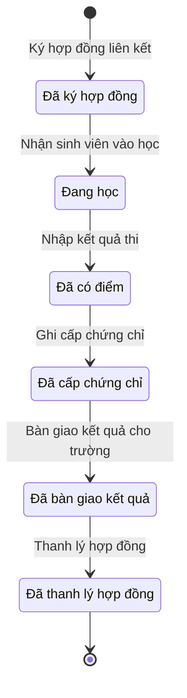

# qt-G7 · Đợt học liên kết tại trung tâm GDQP&AN

<!-- máy sinh: tom-tat -->
> **Hồ sơ:** Đợt học liên kết GDQP&AN (`LinkageCourse`)
>
> **Trong sổ phạm vi:** G7 · Đợt học liên kết tại trung tâm GDQP&AN — mỗi đợt của một trường một hồ sơ: hợp đồng, danh sách SV, miễn hoãn, hợp đồng bảo đảm bắn đạn thật (chặn nhập điểm nếu thiếu), trang phục theo số lượng, chứng chỉ TB ≥ 5 theo lô, thông báo kết quả, thanh lý (QĐ10/2025/QĐ-TTg Đ.19; TTLT18/2015; chốt 30/9)
>
> 11 bước · 6 chặng · 1 vai · 4 bảng quyết định · 0 hạn · 2 khớp nối.
>
> **Nguồn:** sổ nghiệp vụ `qt-G7` · khai báo của app: `dqtv-app/core/processes/gdqp-course/workflow/linkage-course.yaml`. Các bảng do máy sinh từ nguồn này.
<!-- hết: tom-tat -->

<!-- viết tay: dien-giai -->
## Diễn giải

*Phần này viết tay, diễn giải lại điều các bảng bên dưới ghi.*

### Quy trình này để làm gì

Trung tâm giáo dục quốc phòng và an ninh theo dõi một **đợt học liên kết**: mỗi đợt của một trường là một hồ sơ, từ lúc ký hợp đồng với trường tới lúc thanh lý hợp đồng. Trung tâm là người làm duy nhất của cả 11 bước.

Hồ sơ đi thẳng qua sáu chặng, không có đường rẽ hay quay lại: *Đã ký hợp đồng* → *Đang học* → *Đã có điểm* → *Đã cấp chứng chỉ* → *Đã bàn giao kết quả* → *Đã thanh lý hợp đồng*. Xen giữa là năm việc ghi nhận, làm lặp được trong lúc hồ sơ đứng yên: danh sách sinh viên, miễn hoãn, hợp đồng bảo đảm thao trường, cấp phát và thu hồi trang phục.

### Khi nào bắt đầu

Trung tâm bấm **Ký hợp đồng liên kết**. Phải nhập trường (`schoolId`), năm học, số hợp đồng và ảnh hoặc bản quét hợp đồng. Bước xét bảng `assigned-school-only`: ô "trường được giao liên kết" — trường có trong danh mục liên kết của chính trung tâm ấy — là "Được giao" thì cho qua, là "Không được giao" thì chặn (`school_not_assigned`). Hồ sơ mở ra có nối tới trung tâm (quy trình 29) và tới cơ sở giáo dục liên kết (G10).

### Diễn ra thế nào

**Chặng "Đã ký hợp đồng"** — ba việc ghi nhận, lặp được:

- **Nạp danh sách sinh viên**: nạp tệp danh sách trường gửi; bước ghi số sinh viên trong danh sách. Hệ tạo hồ sơ con *Sinh viên của đợt học liên kết*.
- **Ghi miễn, hoãn của sinh viên**: chọn sinh viên, loại miễn hoãn (`exemptionKind`), số và ngày quyết định của trường, kèm văn bản của trường. Hệ tạo hồ sơ con *Quyết định miễn, hoãn của trường*. Trường là người quyết định miễn ở mức nào. Bốn loại: miễn toàn bộ (`full_exempt`), miễn học phần (`module_exempt`), miễn thực hành (`practice_exempt`), tạm hoãn (`deferred`). Việc này còn làm được ở chặng *Đang học*.
- **Ghi hợp đồng bảo đảm thao trường**: đơn vị bảo đảm, ngày ký, bản quét hợp đồng, nội dung bảo đảm. Cũng làm được ở chặng *Đang học*.

Trung tâm bấm **Nhận sinh viên vào học**, nhập số sinh viên có mặt và ngày bắt đầu học; hồ sơ sang *Đang học*.

**Chặng "Đang học"** — **Ghi cấp phát trang phục** (số bộ đã cấp) và **Ghi thu hồi trang phục** (số bộ đã thu; số thiếu, hỏng và ghi chú nếu có), đều lặp được. Thu hồi còn làm được ở chặng *Đã có điểm*.

Trung tâm bấm **Nhập kết quả thi**: nạp tệp bảng điểm, khai đợt học có bắn đạn thật hay không. Hồ sơ sang *Đã có điểm*. Bước này bị chặn trong hai trường hợp: đợt có bắn đạn thật mà chưa có hợp đồng bảo đảm (`missing_support_contract`); loại miễn hoãn là `full_exempt` hoặc `deferred` (`score_not_expected`, bảng `exemption-scoring`).

**Chặng "Đã có điểm"** — trung tâm bấm **Ghi cấp chứng chỉ**: nạp tệp danh sách số chứng chỉ, ghi sinh viên phải học bù nếu có. Hồ sơ sang *Đã cấp chứng chỉ*. Loại miễn hoãn là `full_exempt` hoặc `deferred` thì ra `not_certified_in_batch` (bảng `exemption-certificate`). Bước này còn sinh ra bảng kết quả sinh viên (`studentResultSheet`) để xuất gửi cho trường.

**Chặng "Đã cấp chứng chỉ"** — trung tâm bấm **Bàn giao kết quả cho trường**: nhập số văn bản bàn giao, ngày bàn giao, biên bản bàn giao. Hồ sơ sang *Đã bàn giao kết quả*.

**Chặng "Đã bàn giao kết quả"** — trung tâm bấm **Thanh lý hợp đồng**, kèm biên bản thanh lý. Hồ sơ sang *Đã thanh lý hợp đồng*.

### Kết thúc và để lại gì

Hồ sơ kết thúc ở *Đã thanh lý hợp đồng*. Có 2 khớp nối, đều ghi ở bước ký hợp đồng: tới Trung tâm giáo dục quốc phòng và an ninh (quy trình 29, `courseAtCentre`) — đợt học tổ chức ở trung tâm nào — và tới Cơ sở giáo dục liên kết (G10, `courseForSchool`) — đợt học của trường nào.

### Điều kiện chặn

- Mọi bước trừ bước mở: người làm phải thuộc đơn vị chủ hồ sơ. Sai người, sai chặng thì bước bị chặn, hồ sơ giữ nguyên.
- Ký hợp đồng: trường không được giao liên kết thì chặn (bảng `assigned-school-only`).
- Nhập kết quả thi: có bắn đạn thật mà chưa có hợp đồng bảo đảm thì chặn (bảng `live-fire-support-check`); loại miễn hoãn `full_exempt` hoặc `deferred` thì chặn (bảng `exemption-scoring`).
- Ghi cấp chứng chỉ: loại miễn hoãn `full_exempt` hoặc `deferred` thì chặn (bảng `exemption-certificate`). Loại `module_exempt`, `practice_exempt` thì cả hai bảng cho qua.
<!-- hết viết tay -->

## 1. Đường đi ngắn nhất qua các chặng

<!-- máy sinh: luong-chinh -->
Đường ít bước nhất từ lúc mở hồ sơ tới chặng kết thúc xa nhất. Máy chọn theo số chặng, không theo ý nghĩa nghiệp vụ — trình tự công việc thật xem phần Diễn giải và bảng "Việc làm ở từng chặng" ở mục 6.

| # | Ai làm | Làm gì | Hồ sơ sang chặng |
|---|---|---|---|
| 1 | Trung tâm giáo dục quốc phòng và an ninh | Ký hợp đồng liên kết | Đã ký hợp đồng |
| 2 | Trung tâm giáo dục quốc phòng và an ninh | Nhận sinh viên vào học | Đang học |
| 3 | Trung tâm giáo dục quốc phòng và an ninh | Nhập kết quả thi | Đã có điểm |
| 4 | Trung tâm giáo dục quốc phòng và an ninh | Ghi cấp chứng chỉ | Đã cấp chứng chỉ |
| 5 | Trung tâm giáo dục quốc phòng và an ninh | Bàn giao kết quả cho trường | Đã bàn giao kết quả |
| 6 | Trung tâm giáo dục quốc phòng và an ninh | Thanh lý hợp đồng | Đã thanh lý hợp đồng |

```mermaid
flowchart LR
    S0(["Mở hồ sơ"])
    S1["Đã ký hợp đồng"]
    S0 -->|"Ký hợp đồng liên kết"| S1
    S2["Đang học"]
    S1 -->|"Nhận sinh viên vào học"| S2
    S3["Đã có điểm"]
    S2 -->|"Nhập kết quả thi"| S3
    S4["Đã cấp chứng chỉ"]
    S3 -->|"Ghi cấp chứng chỉ"| S4
    S5["Đã bàn giao kết quả"]
    S4 -->|"Bàn giao kết quả cho trường"| S5
    S6["Đã thanh lý hợp đồng"]
    S5 -->|"Thanh lý hợp đồng"| S6
```

<!-- hết: luong-chinh -->

## 2. Hồ sơ và việc nó để lại

<!-- máy sinh: muc-tieu -->
**App gọi quy trình này là:** Đợt học liên kết GDQP&AN.

**Khi mở, hồ sơ này ghi mối nối tới:**
- Cơ sở giáo dục liên kết (G10) — bước `signLinkageContract`, khớp nối `courseForSchool`
- Trung tâm giáo dục quốc phòng và an ninh (29) — bước `signLinkageContract`, khớp nối `courseAtCentre`
<!-- hết: muc-tieu -->

## 3. Khởi phát và kết thúc

<!-- máy sinh: khoi-phat -->
**1 cửa vào** — bước mở hồ sơ:

| Bước mở | Ai mở | Hồ sơ vào chặng | App bắt buộc nhập |
|---|---|---|---|
| Ký hợp đồng liên kết | Trung tâm giáo dục quốc phòng và an ninh | Đã ký hợp đồng | `schoolId`, năm học, số hợp đồng, hợp đồng (ảnh/bản quét) |

**Kết thúc:** *Đã thanh lý hợp đồng* (`CLOSED`)
<!-- hết: khoi-phat -->

## 4. Vai trò

<!-- máy sinh: vai-tro -->
| Vai trong sổ | Tên trong app | Điều kiện | Làm những bước |
|---|---|---|---|
| `centre` | Trung tâm giáo dục quốc phòng và an ninh |  | Ký hợp đồng liên kết · Nạp danh sách sinh viên · Ghi miễn, hoãn của sinh viên · Ghi hợp đồng bảo đảm thao trường · Nhận sinh viên vào học · Ghi cấp phát trang phục · Ghi thu hồi trang phục · Nhập kết quả thi · Ghi cấp chứng chỉ · Bàn giao kết quả cho trường · Thanh lý hợp đồng |

*"Tên trong app" là tên app đặt cho mã chủ thể của vai. Hồ sơ thuộc đơn vị cấp khác thì người làm là người giữ vai ấy ở đơn vị nêu trong cột "Điều kiện" (nếu sổ có ghi) và ở cột "Người làm phải thuộc" của bảng "Theo khai báo của app" (mục 7).*
<!-- hết: vai-tro -->

## 5. Nhánh phụ

<!-- máy sinh: nhanh-phu -->
**Làm trong lúc hồ sơ đứng yên ở một chặng** — ghi nhận, bổ sung:

| Bước | Ai làm | Ở chặng |
|---|---|---|
| Nạp danh sách sinh viên *(lặp được)* | Trung tâm giáo dục quốc phòng và an ninh | Đã ký hợp đồng |
| Ghi miễn, hoãn của sinh viên *(lặp được)* | Trung tâm giáo dục quốc phòng và an ninh | Đã ký hợp đồng, Đang học |
| Ghi hợp đồng bảo đảm thao trường *(lặp được)* | Trung tâm giáo dục quốc phòng và an ninh | Đã ký hợp đồng, Đang học |
| Ghi cấp phát trang phục *(lặp được)* | Trung tâm giáo dục quốc phòng và an ninh | Đang học |
| Ghi thu hồi trang phục *(lặp được)* | Trung tâm giáo dục quốc phòng và an ninh | Đang học, Đã có điểm |

<!-- hết: nhanh-phu -->

## 6. Các chặng và việc làm ở từng chặng

<!-- máy sinh: chang -->
| Chặng | Tên hiển thị | Vào bằng bước | Kết thúc? |
|---|---|---|---|
| `CONTRACTED` | Đã ký hợp đồng | Ký hợp đồng liên kết |  |
| `STUDYING` | Đang học | Nhận sinh viên vào học |  |
| `EXAMINED` | Đã có điểm | Nhập kết quả thi |  |
| `CERTIFIED` | Đã cấp chứng chỉ | Ghi cấp chứng chỉ |  |
| `HANDED_OVER` | Đã bàn giao kết quả | Bàn giao kết quả cho trường |  |
| `CLOSED` | Đã thanh lý hợp đồng | Thanh lý hợp đồng | **kết thúc** |

### Việc làm ở từng chặng

Hồ sơ đang ở chặng nào thì làm được những bước nào.

| Hồ sơ đang ở chặng | Bước làm tại chặng (hồ sơ đứng yên) | Bước đưa hồ sơ sang chặng khác |
|---|---|---|
| **Đã ký hợp đồng** | Nạp danh sách sinh viên (lặp được) — Trung tâm giáo dục quốc phòng và an ninh Ghi miễn, hoãn của sinh viên (lặp được) — Trung tâm giáo dục quốc phòng và an ninh Ghi hợp đồng bảo đảm thao trường (lặp được) — Trung tâm giáo dục quốc phòng và an ninh | Nhận sinh viên vào học — Trung tâm giáo dục quốc phòng và an ninh → *Đang học* |
| **Đang học** | Ghi miễn, hoãn của sinh viên (lặp được) — Trung tâm giáo dục quốc phòng và an ninh Ghi hợp đồng bảo đảm thao trường (lặp được) — Trung tâm giáo dục quốc phòng và an ninh Ghi cấp phát trang phục (lặp được) — Trung tâm giáo dục quốc phòng và an ninh Ghi thu hồi trang phục (lặp được) — Trung tâm giáo dục quốc phòng và an ninh | Nhập kết quả thi — Trung tâm giáo dục quốc phòng và an ninh → *Đã có điểm* |
| **Đã có điểm** | Ghi thu hồi trang phục (lặp được) — Trung tâm giáo dục quốc phòng và an ninh | Ghi cấp chứng chỉ — Trung tâm giáo dục quốc phòng và an ninh → *Đã cấp chứng chỉ* |
| **Đã cấp chứng chỉ** | — | Bàn giao kết quả cho trường — Trung tâm giáo dục quốc phòng và an ninh → *Đã bàn giao kết quả* |
| **Đã bàn giao kết quả** | — | Thanh lý hợp đồng — Trung tâm giáo dục quốc phòng và an ninh → *Đã thanh lý hợp đồng* |
| **Đã thanh lý hợp đồng** | — | — (kết thúc) |
<!-- hết: chang -->

## 7. Bảng bước

<!-- máy sinh: buoc -->
| # | Bước | Mã bước | Ai thực hiện | Từ chặng | Sang chặng | Phải có trước | Ghi lại |
|---|---|---|---|---|---|---|---|
| 1 | Ký hợp đồng liên kết | `signLinkageContract` | Trung tâm giáo dục quốc phòng và an ninh | — (mở hồ sơ) | `CONTRACTED` | — | đơn vị chủ hồ sơ, nối `linkedSchool`, năm học, số hợp đồng, `contractScan`, dự kiến bắt đầu, dự kiến kết thúc, số sinh viên dự kiến, dự kiến bắn đạn thật, trường được giao liên kết |
| 2 | Nạp danh sách sinh viên | `importStudentList` | Trung tâm giáo dục quốc phòng và an ninh | `CONTRACTED` | giữ nguyên | người làm thuộc đơn vị chủ hồ sơ | `studentListFile`, số sinh viên trong danh sách |
| 3 | Ghi miễn, hoãn của sinh viên | `recordStudentExemption` | Trung tâm giáo dục quốc phòng và an ninh | `CONTRACTED`, `STUDYING` | giữ nguyên | người làm thuộc đơn vị chủ hồ sơ | nối `exemptStudent`, `exemptionKind`, `exemptionEvidenceScan`, `schoolExemptionDecision` |
| 4 | Ghi hợp đồng bảo đảm thao trường | `requestRangeSupport` | Trung tâm giáo dục quốc phòng và an ninh | `CONTRACTED`, `STUDYING` | giữ nguyên | người làm thuộc đơn vị chủ hồ sơ | đơn vị bảo đảm, nội dung bảo đảm, `supportContractScan`, ngày hợp đồng bảo đảm |
| 5 | Nhận sinh viên vào học | `receiveStudents` | Trung tâm giáo dục quốc phòng và an ninh | `CONTRACTED` | `STUDYING` | người làm thuộc đơn vị chủ hồ sơ | số sinh viên có mặt, bắt đầu học |
| 6 | Ghi cấp phát trang phục | `issueStudentEquipment` | Trung tâm giáo dục quốc phòng và an ninh | `STUDYING` | giữ nguyên | người làm thuộc đơn vị chủ hồ sơ | trang phục đã cấp |
| 7 | Ghi thu hồi trang phục | `returnStudentEquipment` | Trung tâm giáo dục quốc phòng và an ninh | `STUDYING`, `EXAMINED` | giữ nguyên | người làm thuộc đơn vị chủ hồ sơ | trang phục đã thu, trang phục thiếu, hỏng, ghi chú trang phục |
| 8 | Nhập kết quả thi | `recordExamResults` | Trung tâm giáo dục quốc phòng và an ninh | `STUDYING` | `EXAMINED` | người làm thuộc đơn vị chủ hồ sơ | `moduleScoresFile`, có bắn đạn thật, có hợp đồng bảo đảm |
| 9 | Ghi cấp chứng chỉ | `issueStudyCertificates` | Trung tâm giáo dục quốc phòng và an ninh | `EXAMINED` | `CERTIFIED` | người làm thuộc đơn vị chủ hồ sơ | `certificateNumbers`, số được cấp chứng chỉ, nối `makeUpStudents`, cấp chứng chỉ ngày, `studentResultSheet` |
| 10 | Bàn giao kết quả cho trường | `handOverResults` | Trung tâm giáo dục quốc phòng và an ninh | `CERTIFIED` | `HANDED_OVER` | người làm thuộc đơn vị chủ hồ sơ | nối `resultOutgoingDocument`, bàn giao kết quả ngày |
| 11 | Thanh lý hợp đồng | `liquidateContract` | Trung tâm giáo dục quốc phòng và an ninh | `HANDED_OVER` | `CLOSED` | người làm thuộc đơn vị chủ hồ sơ | `liquidationScan`, thanh lý ngày |

### Khi không đạt điều kiện

Mặc định: không đúng người, hồ sơ không ở đúng chặng, hoặc thiếu thứ "phải có trước" thì bước bị chặn, hồ sơ giữ nguyên. Bảng dưới chỉ kê những bước có kết quả riêng.

| # | Bước | Kết quả riêng |
|---|---|---|
| 1 | Ký hợp đồng liên kết | bước dừng lại, hồ sơ giữ nguyên khi kết quả xét là: `school_not_assigned` |
| 8 | Nhập kết quả thi | bước dừng lại, hồ sơ giữ nguyên khi kết quả xét là: `missing_support_contract`, `score_not_expected` |
| 9 | Ghi cấp chứng chỉ | bước dừng lại, hồ sơ giữ nguyên khi kết quả xét là: `not_certified_in_batch` |

### Điều kiện "phải có trước" bằng lời

Cột "Phải có trước" ở bảng bước có hai loại: ô dữ liệu thường (bước chỉ đòi ô ấy đã có giá trị) và điều kiện hệ tự xét. Bảng này diễn các điều kiện hệ tự xét theo đúng công thức sổ ghi; số ở cột cuối là số thứ tự bước.

| Điều kiện | Đúng khi | Bước đòi |
|---|---|---|
| `actorInOwnerUnit` | người đang làm là người của đơn vị ghi ở ô đơn vị chủ hồ sơ của hồ sơ này (theo danh mục người của đơn vị, `dm.unit-staff`) | 2, 3, 4, 5, 6, 7, 8, 9, 10, 11 |

### Theo khai báo của app

Người làm phải thuộc đơn vị nào, ô người dùng phải nhập, bước có lặp được không, và căn cứ pháp lý — lấy từ khai báo quy trình trong app.

| # | Bước | Người làm phải thuộc | Bắt buộc nhập | Nhập nếu có | Lặp được | Căn cứ |
|---|---|---|---|---|---|---|
| 1 | Ký hợp đồng liên kết |  | `schoolId`, năm học, số hợp đồng, hợp đồng (ảnh/bản quét) | `centreId`, mã trung tâm, trường được giao liên kết, dự kiến bắt đầu, dự kiến kết thúc, số sinh viên dự kiến, dự kiến bắn đạn thật |  | QĐ10/2025/QĐ-TTg Đ.12 k3, Đ.19 k1 |
| 2 | Nạp danh sách sinh viên |  | danh sách sinh viên (tệp), sinh viên đọc từ tệp | — | có | QĐ10/2025/QĐ-TTg Đ.19 |
| 3 | Ghi miễn, hoãn của sinh viên |  | `studentId`, `exemptionKind`, `schoolDecisionNumber`, `schoolDecisionDate`, văn bản của trường (ảnh/bản quét) | — | có | TTLT18/2015/TTLT-BGDĐT-BLĐTBXH Đ.4 |
| 4 | Ghi hợp đồng bảo đảm thao trường |  | đơn vị bảo đảm, ngày hợp đồng bảo đảm, hợp đồng bảo đảm (ảnh/bản quét) | nội dung bảo đảm | có | QĐ10/2025/QĐ-TTg Đ.19 |
| 5 | Nhận sinh viên vào học |  | số sinh viên có mặt, bắt đầu học | — |  | QĐ10/2025/QĐ-TTg Đ.19 |
| 6 | Ghi cấp phát trang phục |  | trang phục đã cấp | — | có | QĐ10/2025/QĐ-TTg Đ.19 |
| 7 | Ghi thu hồi trang phục |  | trang phục đã thu | trang phục thiếu, hỏng, ghi chú trang phục | có | QĐ10/2025/QĐ-TTg Đ.19 |
| 8 | Nhập kết quả thi |  | bảng điểm (tệp), có bắn đạn thật, điểm từng sinh viên đọc từ tệp | có hợp đồng bảo đảm |  | QĐ10/2025/QĐ-TTg Đ.19 · TTLT18/2015/TTLT-BGDĐT-BLĐTBXH Đ.4 |
| 9 | Ghi cấp chứng chỉ |  | danh sách chứng chỉ (tệp), số chứng chỉ từng sinh viên đọc từ tệp | sinh viên phải học bù |  | QĐ10/2025/QĐ-TTg Đ.12 k3 · TTLT18/2015/TTLT-BGDĐT-BLĐTBXH Đ.4 |
| 10 | Bàn giao kết quả cho trường |  | số văn bản bàn giao, bàn giao kết quả ngày, biên bản bàn giao (ảnh/bản quét) | — |  | QĐ10/2025/QĐ-TTg Đ.19 |
| 11 | Thanh lý hợp đồng |  | biên bản thanh lý (ảnh/bản quét) | — |  | QĐ10/2025/QĐ-TTg Đ.19 |

### Điều kiện và ghi chú app khai cho từng bước

Lấy từ khai báo quy trình trong app. Lời trong ngoặc kép là câu app hiện cho người dùng. Chức danh người ký ngoài hệ app chỉ khai bằng mã.

| # | Bước | Điều kiện, ghi chú |
|---|---|---|
| 2 | Nạp danh sách sinh viên | · tạo thêm một hồ sơ con: Sinh viên của đợt học liên kết (`CourseStudent`) |
| 3 | Ghi miễn, hoãn của sinh viên | · tạo thêm một hồ sơ con: Quyết định miễn, hoãn của trường (`StudentExemption`) |
<!-- hết: buoc -->

## 8. Bảng quyết định, hạn, việc ngoài hệ

<!-- máy sinh: quyet-dinh -->
**Bảng `assigned-school-only`** — xét ở bước *Ký hợp đồng liên kết*; đầu vào: trường được giao liên kết. 2 dòng, dò từ trên xuống, dòng đầu tiên khớp thì dừng.

| Thứ tự dò (số sổ ghi) | Dòng | Khi | Thì |
|---|---|---|---|
| 1 | `assigned` | trường được giao liên kết là Được giao (`yes`) | cho qua |
| 2 | `otherwise` | trường được giao liên kết là Không được giao (`no`) | `school_not_assigned` |

**Bảng `exemption-certificate`** — xét ở bước *Ghi cấp chứng chỉ*; đầu vào: `exemptionKind`. 2 dòng, dò từ trên xuống, dòng đầu tiên khớp thì dừng.

| Thứ tự dò (số sổ ghi) | Dòng | Khi | Thì |
|---|---|---|---|
| 1 | `not-in-batch` | `exemptionKind` là `full_exempt` hoặc `deferred` | `not_certified_in_batch` |
| 2 | `studied` | `exemptionKind` là `module_exempt` hoặc `practice_exempt` | cho qua |

**Bảng `exemption-scoring`** — xét ở bước *Nhập kết quả thi*; đầu vào: `exemptionKind`. 2 dòng, dò từ trên xuống, dòng đầu tiên khớp thì dừng.

| Thứ tự dò (số sổ ghi) | Dòng | Khi | Thì |
|---|---|---|---|
| 1 | `not-studying` | `exemptionKind` là `full_exempt` hoặc `deferred` | `score_not_expected` |
| 2 | `remaining-parts` | `exemptionKind` là `module_exempt` hoặc `practice_exempt` | cho qua |

**Bảng `live-fire-support-check`** — xét ở bước *Nhập kết quả thi*; đầu vào: có bắn đạn thật, có hợp đồng bảo đảm. 2 dòng, dò từ trên xuống, dòng đầu tiên khớp thì dừng.

| Thứ tự dò (số sổ ghi) | Dòng | Khi | Thì |
|---|---|---|---|
| 1 | `live-fire-without-contract` | có bắn đạn thật là Có (`yes`) và có hợp đồng bảo đảm là Chưa có (`no`) | `missing_support_contract` |
| 2 | `otherwise` | mọi trường hợp còn lại | cho qua |

<!-- hết: quyet-dinh -->

## 9. Dữ liệu của hồ sơ

<!-- máy sinh: du-lieu -->
Các ô mà bước trong sổ ghi hoặc đòi. Số trong hai cột cuối là số thứ tự bước ở bảng bước (mục 7).

| Ô dữ liệu | Mã | Kiểu (app) | Giá trị cho phép | Loại ô (sổ) | Bước ghi | Bước đòi | Mô tả trong app |
|---|---|---|---|---|---|---|---|
| đơn vị chủ hồ sơ | `ownerUnit` |  |  | lưu trên hồ sơ (`stored`) | 1 | — |  |
| năm học | `linkageYear` | số |  | đưa vào ở bước (`input`) | 1 | — | Năm học của đợt liên kết |
| số hợp đồng | `contractNumber` | chữ |  | đưa vào ở bước (`input`) | 1 | — | Số hợp đồng đào tạo môn học GDQP&AN |
| — | `contractScan` |  |  | đưa vào ở bước (`input`) | 1 | — |  |
| dự kiến bắt đầu | `plannedStart` | ngày |  | đưa vào ở bước (`input`) | 1 | — | Ngày dự kiến bắt đầu học |
| dự kiến kết thúc | `plannedEnd` | ngày |  | đưa vào ở bước (`input`) | 1 | — | Ngày dự kiến kết thúc |
| số sinh viên dự kiến | `plannedStudentCount` | số |  | đưa vào ở bước (`input`) | 1 | — | Số sinh viên trường dự kiến gửi |
| dự kiến bắn đạn thật | `liveFirePlanned` | chọn một | Có (`yes`), Không (`no`) | đưa vào ở bước (`input`) | 1 | — | Đợt học dự kiến có bắn đạn thật |
| trường được giao liên kết | `schoolAssignedToCentre` | chọn một | Được giao (`yes`), Không được giao (`no`) | đưa vào ở bước (`input`) | 1 | — | Trường có trong danh mục liên kết của chính trung tâm này — hệ tra lúc ký hợp đồng |
| — | `studentListFile` |  |  | đưa vào ở bước (`input`) | 2 | — |  |
| số sinh viên trong danh sách | `importedStudentCount` | số |  | lưu trên hồ sơ (`stored`) | 2 | — | Số sinh viên trong danh sách |
| — | `exemptionKind` | chọn một — ở hồ sơ con Sinh viên của đợt học liên kết | `full_exempt`, `module_exempt`, `practice_exempt`, `deferred` | đưa vào ở bước (`input`) | 3 | — | Miễn toàn bộ · miễn học phần · miễn thực hành · tạm hoãn — theo quyết định của trường (TTLT18/2015 Đ.4) |
| — | `exemptionEvidenceScan` |  |  | đưa vào ở bước (`input`) | 3 | — |  |
| — | `schoolExemptionDecision` |  |  | đưa vào ở bước (`input`) | 3 | — |  |
| đơn vị bảo đảm | `supportUnitName` | chữ |  | đưa vào ở bước (`input`) | 4 | — | Đơn vị bảo đảm thao trường, bắn đạn thật |
| nội dung bảo đảm | `supportScope` | chữ |  | đưa vào ở bước (`input`) | 4 | — | Nội dung bảo đảm |
| — | `supportContractScan` |  |  | đưa vào ở bước (`input`) | 4 | — |  |
| ngày hợp đồng bảo đảm | `supportContractDate` | ngày |  | đưa vào ở bước (`input`) | 4 | — | Ngày ký hợp đồng bảo đảm |
| số sinh viên có mặt | `arrivedCount` | số |  | đưa vào ở bước (`input`) | 5 | — | Số sinh viên có mặt khi nhận vào học |
| bắt đầu học | `startedAt` | ngày |  | đưa vào ở bước (`input`) | 5 | — | Ngày bắt đầu học |
| trang phục đã cấp | `uniformsIssued` | số |  | đưa vào ở bước (`input`) | 6 | — | Số bộ trang phục đã cấp phát |
| trang phục đã thu | `uniformsReturned` | số |  | đưa vào ở bước (`input`) | 7 | — | Số bộ trang phục đã thu hồi |
| trang phục thiếu, hỏng | `uniformsShortOrDamaged` | số |  | đưa vào ở bước (`input`) | 7 | — | Số bộ thiếu hoặc hư hỏng khi thu hồi |
| ghi chú trang phục | `uniformNote` | chữ |  | đưa vào ở bước (`input`) | 7 | — | Ghi chú thu hồi trang phục |
| — | `moduleScoresFile` |  |  | đưa vào ở bước (`input`) | 8 | — |  |
| có bắn đạn thật | `liveFireInThisBatch` | chọn một | Có (`yes`), Không (`no`) | đưa vào ở bước (`input`) | 8 | — | Đợt học có nội dung bắn đạn thật |
| có hợp đồng bảo đảm | `supportContractOnFile` | chọn một | Đã có (`yes`), Chưa có (`no`) | đưa vào ở bước (`input`) | 8 | — | Đã có hợp đồng bảo đảm khi nhập điểm — hệ tra |
| — | `certificateNumbers` |  |  | lưu trên hồ sơ (`stored`) | 9 | — |  |
| số được cấp chứng chỉ | `passedCount` | số |  | lưu trên hồ sơ (`stored`) | 9 | — | Số sinh viên được cấp chứng chỉ |
| cấp chứng chỉ ngày | `certificatesIssuedAt` | ngày |  | lưu trên hồ sơ (`stored`) | 9 | — | Ngày ghi việc cấp chứng chỉ |
| — | `studentResultSheet` |  |  | hệ suy ra (`derived`) | 9 | — |  |
| bàn giao kết quả ngày | `resultSentAt` | ngày |  | lưu trên hồ sơ (`stored`) | 10 | — | Ngày bàn giao kết quả |
| — | `liquidationScan` |  |  | đưa vào ở bước (`input`) | 11 | — |  |
| thanh lý ngày | `closedAt` | ngày |  | lưu trên hồ sơ (`stored`) | 11 | — | Ngày thanh lý hợp đồng |
| người làm thuộc đơn vị chủ hồ sơ | `actorInOwnerUnit` |  | có hay chưa | hệ suy ra (`derived`) | — | 2, 3, 4, 5, 6, 7, 8, 9, 10, 11 |  |

35 ô. Cột "Loại ô" là cách sổ phân loại ô, in kèm đúng chữ của sổ; ô nào người dùng phải nhập xem bảng "Theo khai báo của app" ở mục 7.
<!-- hết: du-lieu -->

## 10. Khớp nối với quy trình khác

<!-- máy sinh: khop-noi -->
| Quy trình kia | Hồ sơ kia | Quan hệ | Nội dung (mô tả trong app) | Bước ghi mối nối | Tên ô nối |
|---|---|---|---|---|---|
| 29 | Trung tâm giáo dục quốc phòng và an ninh | hồ sơ này **mở ra có nối tới** hồ sơ kia | Đợt học tổ chức ở trung tâm GDQP&AN nào — trung tâm của phiên ký hợp đồng | G7·signLinkageContract ⊕ | `courseAtCentre` |
| G10 | Cơ sở giáo dục liên kết | hồ sơ này **mở ra có nối tới** hồ sơ kia | Đợt học của trường nào — trường được giao liên kết với trung tâm (QĐ10/2025/QĐ-TTg Đ.19 k1) | G7·signLinkageContract ⊕ | `courseForSchool` |

2 khớp nối. ⊕ là bước tạo hồ sơ.
<!-- hết: khop-noi -->

## 11. Thông tin chung

<!-- máy sinh: thong-tin -->
| | |
|---|---|
| **Mã trong sổ** | `qt-G7` |
| **Quy trình trong app** | `gdqp-course` (`workflow/linkage-course.yaml`) — mặt công tác: `personnel` |
| **Hồ sơ** | Đợt học liên kết GDQP&AN (`LinkageCourse`) |
| **Căn cứ pháp lý từng bước** | cột "Căn cứ" ở bảng "Theo khai báo của app", mục 7 |
<!-- hết: thong-tin -->
