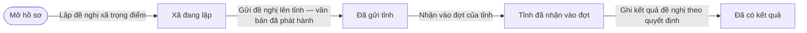
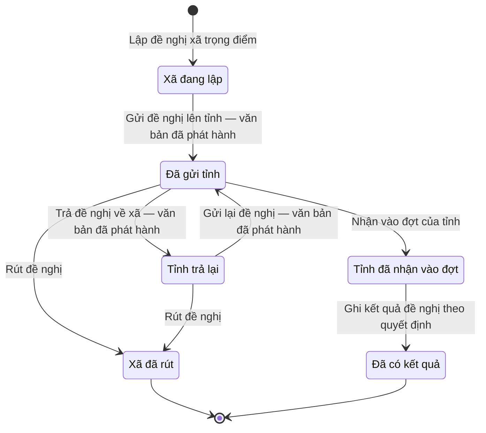

# qt-XT.commune-proposal · Đề nghị của xã — Đề nghị của xã về xã trọng điểm quốc phòng

<!-- máy sinh: tom-tat -->
> **Hồ sơ:** Đề nghị của xã về xã trọng điểm quốc phòng (`KeyCommuneProposal`)
>
> **Trong sổ phạm vi:** XT · Đề nghị của xã — xã đề nghị công nhận/thôi, tỉnh nhận vào đợt hoặc trả lại (thực tế CV 5236/UBND-NCVX Bình Định 16/6/2025; thêm 30/9)
>
> 10 bước · 6 chặng · 5 vai · 0 bảng quyết định · 0 hạn · 6 khớp nối.
>
> **Nguồn:** sổ nghiệp vụ `qt-XT.commune-proposal` · khai báo của app: `dqtv-app/core/processes/key-commune/workflow/key-commune-proposal.yaml`. Các bảng do máy sinh từ nguồn này.
<!-- hết: tom-tat -->

<!-- viết tay: dien-giai -->
## Diễn giải

*Phần này viết tay, diễn giải lại điều các bảng bên dưới ghi.*

### Quy trình này để làm gì

Một xã gửi lên Bộ CHQS cấp tỉnh **đề nghị công nhận hoặc thôi công nhận xã mình là xã trọng điểm về quốc phòng**. Tỉnh nhận đề nghị vào đợt của tỉnh hoặc trả lại; khi có quyết định của Bộ trưởng thì đề nghị nhận kết quả. Năm chặng: *Đã gửi tỉnh*, *Tỉnh trả lại*, *Tỉnh đã nhận vào đợt*, *Xã đã rút*, *Đã có kết quả*.

### Khi nào bắt đầu

Chỉ huy trưởng Ban CHQS xã bấm **Gửi đề nghị xã trọng điểm lên tỉnh**. Phải chọn đề nghị ("Công nhận" hay "Thôi công nhận"), ghi lý do và đính bản quét văn bản đề nghị của xã đã ký. Hồ sơ vào thẳng chặng *Đã gửi tỉnh*; không có chặng nháp. Bước này không đòi gì trước.

### Diễn ra thế nào

1. **Đã gửi tỉnh.** Bộ CHQS cấp tỉnh, là người của một đơn vị nằm trong ô cấp trên của chủ hồ sơ, có hai lựa chọn:
   - **Nhận vào đợt của tỉnh** — chọn đợt; hồ sơ sang *Tỉnh đã nhận vào đợt*.
   - **Trả đề nghị về xã** — ghi vì sao; hồ sơ sang *Tỉnh trả lại*.
2. **Tỉnh trả lại.** Chỉ huy trưởng Ban CHQS xã **Gửi lại đề nghị**, phải ghi xã đã sửa gì; hồ sơ về *Đã gửi tỉnh*.
3. **Rút đề nghị** — Chỉ huy trưởng Ban CHQS xã bấm được khi hồ sơ ở *Đã gửi tỉnh* hoặc *Tỉnh trả lại*, phải ghi lý do rút; hồ sơ sang *Xã đã rút*. Ở chặng *Tỉnh đã nhận vào đợt* không có bước rút.
4. **Tỉnh đã nhận vào đợt.** Hồ sơ chờ quyết định của Bộ trưởng. Bước **Ghi kết quả đề nghị theo quyết định** do hệ thống tự làm, không ai bấm; bước ghi kết quả và đưa hồ sơ sang *Đã có kết quả*. Kết quả có ba giá trị: "Được công nhận" (`recognized`), "Đã thôi công nhận" (`ended`), "Không được quyết định" (`rejected`).

### Kết thúc và để lại gì

Hai chặng kết thúc: *Xã đã rút* và *Đã có kết quả*. Bước nhận vào đợt ghi ô nối từ đề nghị tới Đợt đề nghị xã trọng điểm về quốc phòng của tỉnh, cùng ngày tỉnh nhận vào đợt.

### Điều kiện chặn

- Hai bước của tỉnh đòi người làm thuộc một đơn vị nằm trong ô "cấp trên của chủ hồ sơ". Gửi lại, rút đòi người làm thuộc đơn vị chủ hồ sơ.
- Bước mở và bước ghi kết quả không đòi điều kiện phải có trước nào.
- Sai người, sai chặng thì bước bị chặn, hồ sơ giữ nguyên.
<!-- hết viết tay -->

## 1. Đường đi ngắn nhất qua các chặng

<!-- máy sinh: luong-chinh -->
Đường ít bước nhất từ lúc mở hồ sơ tới chặng kết thúc xa nhất. Máy chọn theo số chặng, không theo ý nghĩa nghiệp vụ — trình tự công việc thật xem phần Diễn giải và bảng "Việc làm ở từng chặng" ở mục 6.

| # | Ai làm | Làm gì | Hồ sơ sang chặng |
|---|---|---|---|
| 1 | Trợ lý Quân lực | Lập đề nghị xã trọng điểm | Xã đang lập |
| 2 | Hệ thống tự làm | Gửi đề nghị lên tỉnh — văn bản đã phát hành | Đã gửi tỉnh |
| 3 | Bộ CHQS cấp tỉnh (thuộc cấp trên của chủ hồ sơ) | Nhận vào đợt của tỉnh | Tỉnh đã nhận vào đợt |
| 4 | Hệ thống tự làm | Ghi kết quả đề nghị theo quyết định | Đã có kết quả |

<!-- hết: luong-chinh -->

## 2. Hồ sơ và việc nó để lại

<!-- máy sinh: muc-tieu -->
**App gọi quy trình này là:** Đề nghị của xã về xã trọng điểm quốc phòng.

**Khi mở, hồ sơ này ghi mối nối tới:**
- Nhiệm vụ trên giao (1) — bước `proposeKeyCommuneStatus`, khớp nối `keyCommuneProposalServesTasking`
<!-- hết: muc-tieu -->

## 3. Khởi phát và kết thúc

<!-- máy sinh: khoi-phat -->
**1 cửa vào** — bước mở hồ sơ:

| Bước mở | Ai mở | Hồ sơ vào chặng | App bắt buộc nhập |
|---|---|---|---|
| Lập đề nghị xã trọng điểm | Trợ lý Quân lực | Xã đang lập | đề nghị, lý do, việc gốc |

**Kết thúc:** *Xã đã rút* (`WITHDRAWN`), *Đã có kết quả* (`CLOSED`)
<!-- hết: khoi-phat -->

## 4. Vai trò

<!-- máy sinh: vai-tro -->
| Vai trong sổ | Tên trong app | Điều kiện | Làm những bước |
|---|---|---|---|
| `AC-TLQL` | Trợ lý Quân lực |  | Lập đề nghị xã trọng điểm · Trình ký văn bản đề nghị xã trọng điểm · Trình ký văn bản gửi lại đề nghị |
| `system` | Hệ thống tự làm |  | Gửi đề nghị lên tỉnh — văn bản đã phát hành · Trả đề nghị về xã — văn bản đã phát hành · Gửi lại đề nghị — văn bản đã phát hành · Ghi kết quả đề nghị theo quyết định |
| `province` | Bộ CHQS cấp tỉnh | thuộc cấp trên của chủ hồ sơ (`actorInSuperiorUnit`, công thức ở mục 7) | Nhận vào đợt của tỉnh |
| `operator` | `operator` | thuộc cấp trên của chủ hồ sơ (`actorInSuperiorUnit`, công thức ở mục 7) | Trình ký văn bản trả đề nghị về xã |
| `commune` | Chỉ huy trưởng Ban CHQS xã |  | Rút đề nghị |

*"Tên trong app" là tên app đặt cho mã chủ thể của vai. Hồ sơ thuộc đơn vị cấp khác thì người làm là người giữ vai ấy ở đơn vị nêu trong cột "Điều kiện" (nếu sổ có ghi) và ở cột "Người làm phải thuộc" của bảng "Theo khai báo của app" (mục 7).*
<!-- hết: vai-tro -->

## 5. Nhánh phụ

<!-- máy sinh: nhanh-phu -->
**Bước khác đưa hồ sơ sang chặng mới** — đường song song, rẽ nhánh hoặc kết thúc sớm:

| Bước | Ai làm | Từ chặng | Sang chặng |
|---|---|---|---|
| Trả đề nghị về xã — văn bản đã phát hành | Hệ thống tự làm | Đã gửi tỉnh | Tỉnh trả lại |
| Rút đề nghị | Chỉ huy trưởng Ban CHQS xã | Đã gửi tỉnh, Tỉnh trả lại | Xã đã rút |

**Quay lại một chặng hồ sơ đã đi qua** (tính theo đường ngắn nhất từ lúc mở):

| Bước | Ai làm | Từ chặng | Về chặng |
|---|---|---|---|
| Gửi lại đề nghị — văn bản đã phát hành | Hệ thống tự làm | Tỉnh trả lại | Đã gửi tỉnh |

**Làm trong lúc hồ sơ đứng yên ở một chặng** — ghi nhận, bổ sung:

| Bước | Ai làm | Ở chặng |
|---|---|---|
| Trình ký văn bản đề nghị xã trọng điểm | Trợ lý Quân lực | Xã đang lập |
| Trình ký văn bản trả đề nghị về xã | `operator` (thuộc cấp trên của chủ hồ sơ) | Đã gửi tỉnh |
| Trình ký văn bản gửi lại đề nghị | Trợ lý Quân lực | Tỉnh trả lại |

<!-- hết: nhanh-phu -->

## 6. Các chặng và việc làm ở từng chặng

<!-- máy sinh: chang -->
| Chặng | Tên hiển thị | Vào bằng bước | Kết thúc? |
|---|---|---|---|
| `DRAFT` | Xã đang lập | Lập đề nghị xã trọng điểm |  |
| `PROPOSED` | Đã gửi tỉnh | Gửi đề nghị lên tỉnh — văn bản đã phát hành · Gửi lại đề nghị — văn bản đã phát hành |  |
| `RETURNED` | Tỉnh trả lại | Trả đề nghị về xã — văn bản đã phát hành |  |
| `ACCEPTED` | Tỉnh đã nhận vào đợt | Nhận vào đợt của tỉnh |  |
| `WITHDRAWN` | Xã đã rút | Rút đề nghị | **kết thúc** |
| `CLOSED` | Đã có kết quả | Ghi kết quả đề nghị theo quyết định | **kết thúc** |

### Việc làm ở từng chặng

Hồ sơ đang ở chặng nào thì làm được những bước nào.

| Hồ sơ đang ở chặng | Bước làm tại chặng (hồ sơ đứng yên) | Bước đưa hồ sơ sang chặng khác |
|---|---|---|
| **Xã đang lập** | Trình ký văn bản đề nghị xã trọng điểm — Trợ lý Quân lực | Gửi đề nghị lên tỉnh — văn bản đã phát hành — Hệ thống tự làm → *Đã gửi tỉnh* |
| **Đã gửi tỉnh** | Trình ký văn bản trả đề nghị về xã — `operator` (thuộc cấp trên của chủ hồ sơ) | Nhận vào đợt của tỉnh — Bộ CHQS cấp tỉnh (thuộc cấp trên của chủ hồ sơ) → *Tỉnh đã nhận vào đợt* Trả đề nghị về xã — văn bản đã phát hành — Hệ thống tự làm → *Tỉnh trả lại* Rút đề nghị — Chỉ huy trưởng Ban CHQS xã → *Xã đã rút* |
| **Tỉnh trả lại** | Trình ký văn bản gửi lại đề nghị — Trợ lý Quân lực | Gửi lại đề nghị — văn bản đã phát hành — Hệ thống tự làm → *Đã gửi tỉnh* Rút đề nghị — Chỉ huy trưởng Ban CHQS xã → *Xã đã rút* |
| **Tỉnh đã nhận vào đợt** | — | Ghi kết quả đề nghị theo quyết định — Hệ thống tự làm → *Đã có kết quả* |
| **Xã đã rút** | — | — (kết thúc) |
| **Đã có kết quả** | — | — (kết thúc) |
<!-- hết: chang -->

## 7. Bảng bước

<!-- máy sinh: buoc -->
| # | Bước | Mã bước | Ai thực hiện | Từ chặng | Sang chặng | Phải có trước | Ghi lại |
|---|---|---|---|---|---|---|---|
| 1 | Lập đề nghị xã trọng điểm | `proposeKeyCommuneStatus` | Trợ lý Quân lực | — (mở hồ sơ) | `DRAFT` | `taskingAssigned` | đơn vị chủ hồ sơ, cấp trên của chủ hồ sơ, đề nghị, lý do, nối tới Nhiệm vụ trên giao |
| 2 | Trình ký văn bản đề nghị xã trọng điểm | `requestKeyCommuneProposalSignature` | Trợ lý Quân lực | `DRAFT` | giữ nguyên | `noKeyCommuneProposalDocumentOpen`, người làm thuộc đơn vị chủ hồ sơ | nối tới Văn bản đi |
| 3 | Gửi đề nghị lên tỉnh — văn bản đã phát hành | `issueKeyCommuneProposal` | Hệ thống tự làm | `DRAFT` | `PROPOSED` | `keyCommuneProposalDocumentIssued` | ngày gửi, nối tới Văn bản đến |
| 4 | Nhận vào đợt của tỉnh | `acceptIntoProvinceBatch` | Bộ CHQS cấp tỉnh (thuộc cấp trên của chủ hồ sơ) | `PROPOSED` | `ACCEPTED` | người làm thuộc cấp trên của chủ hồ sơ, `submissionDistributedAtReceiver` | nối tới Đợt đề nghị xã trọng điểm về quốc phòng, ngày tỉnh nhận vào đợt |
| 5 | Trình ký văn bản trả đề nghị về xã | `requestReturnCommuneProposalSignature` | `operator` (thuộc cấp trên của chủ hồ sơ) | `PROPOSED` | giữ nguyên | `submissionDistributedAtReceiver`, `noReturnCommuneProposalDocumentOpen`, người làm thuộc cấp trên của chủ hồ sơ | vì sao trả đề nghị về xã, nối tới Văn bản đi |
| 6 | Trả đề nghị về xã — văn bản đã phát hành | `returnCommuneProposal` | Hệ thống tự làm | `PROPOSED` | `RETURNED` | `returnCommuneProposalDocumentIssued` | nối tới Văn bản đến |
| 7 | Trình ký văn bản gửi lại đề nghị | `requestResubmitCommuneProposalSignature` | Trợ lý Quân lực | `RETURNED` | giữ nguyên | `noResubmitCommuneProposalDocumentOpen`, người làm thuộc đơn vị chủ hồ sơ | xã đã sửa gì, nối tới Văn bản đi |
| 8 | Gửi lại đề nghị — văn bản đã phát hành | `resubmitCommuneProposal` | Hệ thống tự làm | `RETURNED` | `PROPOSED` | `resubmitCommuneProposalDocumentIssued` | nối tới Văn bản đến |
| 9 | Rút đề nghị | `withdrawCommuneProposal` | Chỉ huy trưởng Ban CHQS xã | `PROPOSED`, `RETURNED` | `WITHDRAWN` | người làm thuộc đơn vị chủ hồ sơ, `noResubmitCommuneProposalDocumentOpen` | lý do rút |
| 10 | Ghi kết quả đề nghị theo quyết định | `recordCommuneProposalOutcome` | Hệ thống tự làm | `ACCEPTED` | `CLOSED` | — | kết quả |

### Khi không đạt điều kiện

Mặc định: không đúng người, hồ sơ không ở đúng chặng, hoặc thiếu thứ "phải có trước" thì bước bị chặn, hồ sơ giữ nguyên. Bảng dưới chỉ kê những bước có kết quả riêng.

| # | Bước | Kết quả riêng |
|---|---|---|
| 3 | Gửi đề nghị lên tỉnh — văn bản đã phát hành | bước này không do người nào bấm |
| 6 | Trả đề nghị về xã — văn bản đã phát hành | bước này không do người nào bấm |
| 8 | Gửi lại đề nghị — văn bản đã phát hành | bước này không do người nào bấm |
| 10 | Ghi kết quả đề nghị theo quyết định | bước này không do người nào bấm |

### Điều kiện "phải có trước" bằng lời

Cột "Phải có trước" ở bảng bước có hai loại: ô dữ liệu thường (bước chỉ đòi ô ấy đã có giá trị) và điều kiện hệ tự xét. Bảng này diễn các điều kiện hệ tự xét theo đúng công thức sổ ghi; số ở cột cuối là số thứ tự bước.

| Điều kiện | Đúng khi | Bước đòi |
|---|---|---|
| `taskingAssigned` | có hồ sơ Việc luật giao kèm văn bản đến, đi (qt-1) chính là hồ sơ ghi ở ô nối `keyCommuneProposalServesTasking` của hồ sơ đang làm mà hồ sơ ấy đang ở chặng `ASSIGNED` hoặc `BROKEN_DOWN` | 1 |
| `noKeyCommuneProposalDocumentOpen` | KHÔNG (có hồ sơ Việc luật giao kèm văn bản đến, đi — Văn bản đi (qt-1.outgoing-document) chính là hồ sơ ghi ở ô nối `keyCommuneProposalByDocument` của hồ sơ đang làm mà hồ sơ ấy đang ở chặng `DRAFT` hoặc `PENDING_SIGNATURE` hoặc `SIGNED`) | 2 |
| `actorInOwnerUnit` | người đang làm là người của đơn vị ghi ở ô đơn vị chủ hồ sơ của hồ sơ này (theo danh mục người của đơn vị, `dm.unit-staff`) | 2, 7, 9 |
| `keyCommuneProposalDocumentIssued` | có hồ sơ Việc luật giao kèm văn bản đến, đi — Văn bản đi (qt-1.outgoing-document) chính là hồ sơ ghi ở ô nối `keyCommuneProposalByDocument` của hồ sơ đang làm mà hồ sơ ấy đang ở chặng `ISSUED` | 3 |
| `actorInSuperiorUnit` | người đang làm là người của một đơn vị nằm trong ô cấp trên của chủ hồ sơ của hồ sơ này (theo danh mục người của đơn vị, `dm.unit-staff`) | 4, 5 |
| `submissionDistributedAtReceiver` | có hồ sơ Việc luật giao kèm văn bản đến, đi — Văn bản đến (qt-1.incoming-document) chính là hồ sơ ghi ở ô nối `keyCommuneProposalSubmissionDeliveredAs` của hồ sơ đang làm mà hồ sơ ấy đang ở chặng `DISTRIBUTED` | 4, 5 |
| `noReturnCommuneProposalDocumentOpen` | KHÔNG (có hồ sơ Việc luật giao kèm văn bản đến, đi — Văn bản đi (qt-1.outgoing-document) chính là hồ sơ ghi ở ô nối `returnCommuneProposalByDocument` của hồ sơ đang làm mà hồ sơ ấy đang ở chặng `DRAFT` hoặc `PENDING_SIGNATURE` hoặc `SIGNED`) | 5 |
| `returnCommuneProposalDocumentIssued` | có hồ sơ Việc luật giao kèm văn bản đến, đi — Văn bản đi (qt-1.outgoing-document) chính là hồ sơ ghi ở ô nối `returnCommuneProposalByDocument` của hồ sơ đang làm mà hồ sơ ấy đang ở chặng `ISSUED` | 6 |
| `noResubmitCommuneProposalDocumentOpen` | KHÔNG (có hồ sơ Việc luật giao kèm văn bản đến, đi — Văn bản đi (qt-1.outgoing-document) chính là hồ sơ ghi ở ô nối `resubmitCommuneProposalByDocument` của hồ sơ đang làm mà hồ sơ ấy đang ở chặng `DRAFT` hoặc `PENDING_SIGNATURE` hoặc `SIGNED`) | 7, 9 |
| `resubmitCommuneProposalDocumentIssued` | có hồ sơ Việc luật giao kèm văn bản đến, đi — Văn bản đi (qt-1.outgoing-document) chính là hồ sơ ghi ở ô nối `resubmitCommuneProposalByDocument` của hồ sơ đang làm mà hồ sơ ấy đang ở chặng `ISSUED` | 8 |

### Theo khai báo của app

Người làm phải thuộc đơn vị nào, ô người dùng phải nhập, bước có lặp được không, và căn cứ pháp lý — lấy từ khai báo quy trình trong app.

| # | Bước | Người làm phải thuộc | Bắt buộc nhập | Nhập nếu có | Lặp được | Căn cứ |
|---|---|---|---|---|---|---|
| 1 | Lập đề nghị xã trọng điểm |  | đề nghị, lý do, việc gốc | — |  | sổ tri thức qt-XT.commune-proposal; L48/2019/QH14 Đ.15 k5 |
| 2 | Trình ký văn bản đề nghị xã trọng điểm | đơn vị chủ hồ sơ | — | dự thảo văn bản đề nghị xã trọng điểm (PDF) |  | NĐ30/2020/NĐ-CP Đ.13; L48/2019/QH14 Đ.15 k5 |
| 3 | Gửi đề nghị lên tỉnh — văn bản đã phát hành |  | — | — |  | NĐ30/2020/NĐ-CP Đ.18 |
| 4 | Nhận vào đợt của tỉnh | cấp trên của chủ hồ sơ | đợt của tỉnh | — |  | sổ tri thức qt-XT.commune-proposal |
| 5 | Trình ký văn bản trả đề nghị về xã | cấp trên của chủ hồ sơ | vì sao trả đề nghị về xã | dự thảo văn bản trả đề nghị về xã (PDF) |  | NĐ30/2020/NĐ-CP Đ.13 |
| 6 | Trả đề nghị về xã — văn bản đã phát hành |  | — | — |  | NĐ30/2020/NĐ-CP Đ.18 |
| 7 | Trình ký văn bản gửi lại đề nghị | đơn vị chủ hồ sơ | xã đã sửa gì | dự thảo văn bản gửi lại đề nghị (PDF), lý do |  | NĐ30/2020/NĐ-CP Đ.13 |
| 8 | Gửi lại đề nghị — văn bản đã phát hành |  | — | — |  | NĐ30/2020/NĐ-CP Đ.18 |
| 9 | Rút đề nghị | đơn vị chủ hồ sơ | lý do rút | — |  | sổ tri thức qt-XT.commune-proposal |
| 10 | Ghi kết quả đề nghị theo quyết định |  | kết quả | — |  | L48/2019/QH14 Đ.15 k5 |
<!-- hết: buoc -->

## 8. Bảng quyết định, hạn, việc ngoài hệ

<!-- máy sinh: quyet-dinh -->

<!-- hết: quyet-dinh -->

## 9. Dữ liệu của hồ sơ

<!-- máy sinh: du-lieu -->
Các ô mà bước trong sổ ghi hoặc đòi. Số trong hai cột cuối là số thứ tự bước ở bảng bước (mục 7).

| Ô dữ liệu | Mã | Kiểu (app) | Giá trị cho phép | Loại ô (sổ) | Bước ghi | Bước đòi | Mô tả trong app |
|---|---|---|---|---|---|---|---|
| đơn vị chủ hồ sơ | `ownerUnit` |  |  | lưu trên hồ sơ (`stored`) | 1 | — |  |
| cấp trên của chủ hồ sơ | `superiorUnits` |  |  | hệ suy ra (`derived`) | 1 | — |  |
| đề nghị | `requestKind` | chọn một | Công nhận (`recognize`), Thôi công nhận (`end`) | đưa vào ở bước (`input`) | 1 | — | Đề nghị công nhận hay thôi công nhận |
| lý do | `proposalReason` | chữ |  | đưa vào ở bước (`input`) | 1 | — | Lý do xã đề nghị |
| ngày gửi | `proposedAt` | ngày |  | lưu trên hồ sơ (`stored`) | 3 | — | Ngày xã gửi đề nghị |
| ngày tỉnh nhận vào đợt | `acceptedAt` | ngày |  | lưu trên hồ sơ (`stored`) | 4 | — | Ngày tỉnh nhận vào đợt |
| lý do tỉnh trả lại | `returnReason` | chữ |  | đưa vào ở bước (`input`) | 5 | — | Tỉnh trả lại — vì sao |
| xã sửa | `revisionNote` | chữ |  | đưa vào ở bước (`input`) | 7 | — | Xã sửa gì khi gửi lại |
| lý do rút | `withdrawNote` | chữ |  | đưa vào ở bước (`input`) | 9 | — | Xã rút đề nghị — vì sao |
| kết quả | `proposalOutcome` | chọn một | Được công nhận (`recognized`), Đã thôi công nhận (`ended`), Không được quyết định (`rejected`) | lưu trên hồ sơ (`stored`) | 10 | — | Kết quả cuối cùng theo quyết định của Bộ trưởng |
| — | `taskingAssigned` |  | có hay chưa | hệ suy ra (`derived`) | — | 1 |  |
| — | `noKeyCommuneProposalDocumentOpen` |  | có hay chưa | hệ suy ra (`derived`) | — | 2 |  |
| người làm thuộc đơn vị chủ hồ sơ | `actorInOwnerUnit` |  | có hay chưa | hệ suy ra (`derived`) | — | 2, 7, 9 |  |
| — | `keyCommuneProposalDocumentIssued` |  | có hay chưa | hệ suy ra (`derived`) | — | 3 |  |
| người làm thuộc cấp trên của chủ hồ sơ | `actorInSuperiorUnit` |  | có hay chưa | hệ suy ra (`derived`) | — | 4, 5 |  |
| — | `submissionDistributedAtReceiver` |  | có hay chưa | hệ suy ra (`derived`) | — | 4, 5 |  |
| — | `noReturnCommuneProposalDocumentOpen` |  | có hay chưa | hệ suy ra (`derived`) | — | 5 |  |
| — | `returnCommuneProposalDocumentIssued` |  | có hay chưa | hệ suy ra (`derived`) | — | 6 |  |
| — | `noResubmitCommuneProposalDocumentOpen` |  | có hay chưa | hệ suy ra (`derived`) | — | 7, 9 |  |
| — | `resubmitCommuneProposalDocumentIssued` |  | có hay chưa | hệ suy ra (`derived`) | — | 8 |  |

20 ô. Cột "Loại ô" là cách sổ phân loại ô, in kèm đúng chữ của sổ; ô nào người dùng phải nhập xem bảng "Theo khai báo của app" ở mục 7.
<!-- hết: du-lieu -->

## 10. Khớp nối với quy trình khác

<!-- máy sinh: khop-noi -->
| Quy trình kia | Hồ sơ kia | Quan hệ | Nội dung (mô tả trong app) | Bước ghi mối nối | Tên ô nối |
|---|---|---|---|---|---|
| 1 | Nhiệm vụ trên giao | hồ sơ này **mở ra có nối tới** hồ sơ kia | Việc gốc mà đề nghị xã trọng điểm này thực hiện — văn bản đi sinh từ đề nghị kế thừa việc này (sổ, 21/10/2026) | XT.commune-proposal·proposeKeyCommuneStatus ⊕ | `keyCommuneProposalServesTasking` |
| 1.incoming-document | Văn bản đến | gắn với nhau ở một bước giữa chừng | Văn bản tỉnh trả đề nghị ở Sổ văn bản đến của Ban CHQS xã — mỗi lượt một văn bản đến | XT.commune-proposal·returnCommuneProposal | `keyCommuneProposalReturnDeliveredAs` |
| 1.incoming-document | Văn bản đến | gắn với nhau ở một bước giữa chừng | Văn bản đề nghị / gửi lại của xã ở Sổ văn bản đến của Bộ CHQS tỉnh — mỗi lượt một văn bản đến | XT.commune-proposal·issueKeyCommuneProposal, XT.commune-proposal·resubmitCommuneProposal | `keyCommuneProposalSubmissionDeliveredAs` |
| 1.outgoing-document | Văn bản đi | gắn với nhau ở một bước giữa chừng | Văn bản đề nghị xã trọng điểm của Ban CHQS xã gửi Bộ CHQS tỉnh | XT.commune-proposal·requestKeyCommuneProposalSignature | `keyCommuneProposalByDocument` |
| 1.outgoing-document | Văn bản đi | gắn với nhau ở một bước giữa chừng | Văn bản Ban CHQS xã gửi lại đề nghị sau khi tỉnh trả về | XT.commune-proposal·requestResubmitCommuneProposalSignature | `resubmitCommuneProposalByDocument` |
| 1.outgoing-document | Văn bản đi | gắn với nhau ở một bước giữa chừng | Văn bản Bộ CHQS tỉnh trả đề nghị về xã | XT.commune-proposal·requestReturnCommuneProposalSignature | `returnCommuneProposalByDocument` |

6 khớp nối. ⊕ là bước tạo hồ sơ.

**Ô nối giữa các hồ sơ cùng mã quy trình, hoặc tới danh mục nền:** `provinceBatch` (Đề nghị của xã về xã trọng điểm quốc phòng → Đợt đề nghị xã trọng điểm về quốc phòng) — bước Nhận vào đợt của tỉnh.
<!-- hết: khop-noi -->

## 11. Thông tin chung

<!-- máy sinh: thong-tin -->
| | |
|---|---|
| **Mã trong sổ** | `qt-XT.commune-proposal` |
| **Quy trình trong app** | `key-commune` (`workflow/key-commune-proposal.yaml`) — mặt công tác: `personnel` |
| **Hồ sơ** | Đề nghị của xã về xã trọng điểm quốc phòng (`KeyCommuneProposal`) |
| **Cùng mã quy trình** | [qt-XT](qt-XT.html), [qt-XT.deputy-surplus](qt-XT.deputy-surplus.html) |
| **Căn cứ pháp lý từng bước** | cột "Căn cứ" ở bảng "Theo khai báo của app", mục 7 |
<!-- hết: thong-tin -->
