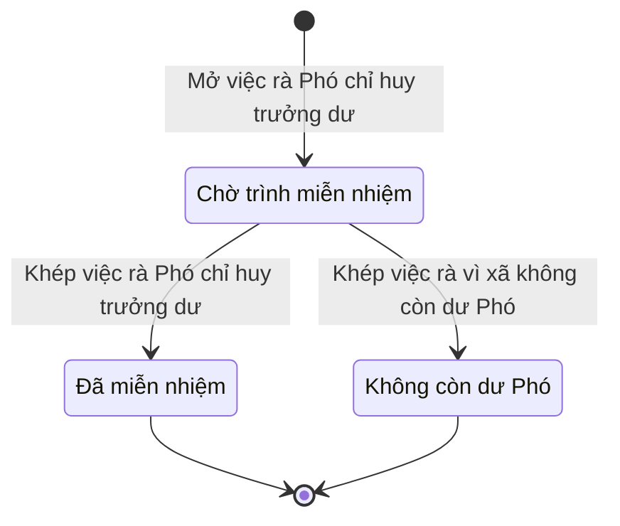

# qt-XT.deputy-surplus · Việc rà Phó chỉ huy trưởng dư sau khi thôi trọng điểm

<!-- máy sinh: tom-tat -->
> **Hồ sơ:** Việc rà Phó chỉ huy trưởng dư sau khi thôi trọng điểm (`DeputySurplusReview`)
>
> 4 bước · 3 chặng · 1 vai · 0 bảng quyết định · 1 hạn · 1 khớp nối.
>
> **Nguồn:** sổ nghiệp vụ `qt-XT.deputy-surplus` · khai báo của app: `dqtv-app/core/processes/key-commune/workflow/deputy-surplus.yaml`. Các bảng do máy sinh từ nguồn này.
<!-- hết: tom-tat -->

<!-- viết tay: dien-giai -->
## Diễn giải

*Phần này viết tay, diễn giải lại điều các bảng bên dưới ghi.*

### Quy trình này để làm gì

Khi một xã thôi là xã trọng điểm về quốc phòng mà còn dư Phó chỉ huy trưởng, hệ giữ một **việc rà Phó chỉ huy trưởng dư** để theo dõi cho tới khi có quyết định miễn nhiệm. Hai chặng: *Chờ trình miễn nhiệm* → *Đã miễn nhiệm*.

### Khi nào bắt đầu

Bước **Mở việc rà Phó chỉ huy trưởng dư** mở hồ sơ ở chặng *Chờ trình miễn nhiệm*. Bước này do hệ thống tự làm, không ai bấm; bước ghi đơn vị chủ hồ sơ, cấp trên của chủ hồ sơ, số Phó chỉ huy trưởng dư lúc mở việc và ô nối tới Đợt đề nghị xã trọng điểm về quốc phòng. Bước này không đòi gì trước.

### Diễn ra thế nào

1. **Chờ trình miễn nhiệm.** Hồ sơ đứng ở chặng này cho tới khi có quyết định miễn nhiệm; không có bước nào làm tại chặng.
2. Bước **Khép việc rà Phó chỉ huy trưởng dư** đưa hồ sơ sang *Đã miễn nhiệm*. Bước này do hệ thống tự làm; bước ghi ô nối tới hồ sơ chức vụ và ngày khép — ngày quyết định miễn nhiệm.

### Kết thúc và để lại gì

Hồ sơ dừng ở *Đã miễn nhiệm*. Có một khớp nối sang quy trình khác, ghi ở bước khép: việc rà khép bằng quyết định miễn nhiệm ghi trên một hồ sơ Nhân sự Ban chỉ huy quân sự cấp xã (30.commune-command).

### Điều kiện chặn

Hai bước không đòi điều kiện "phải có trước" nào. Hồ sơ không ở đúng chặng thì bước bị chặn, hồ sơ giữ nguyên.
<!-- hết viết tay -->

## 1. Đường đi ngắn nhất qua các chặng

<!-- máy sinh: luong-chinh -->
Đường ít bước nhất từ lúc mở hồ sơ tới chặng kết thúc xa nhất. Máy chọn theo số chặng, không theo ý nghĩa nghiệp vụ — trình tự công việc thật xem phần Diễn giải và bảng "Việc làm ở từng chặng" ở mục 6.

| # | Ai làm | Làm gì | Hồ sơ sang chặng |
|---|---|---|---|
| 1 | Hệ thống tự làm | Mở việc rà Phó chỉ huy trưởng dư | Chờ trình miễn nhiệm |
| 2 | Hệ thống tự làm | Khép việc rà Phó chỉ huy trưởng dư | Đã miễn nhiệm |

<!-- hết: luong-chinh -->

## 2. Hồ sơ và việc nó để lại

<!-- máy sinh: muc-tieu -->
**App gọi quy trình này là:** Việc rà Phó chỉ huy trưởng dư.
<!-- hết: muc-tieu -->

## 3. Khởi phát và kết thúc

<!-- máy sinh: khoi-phat -->
**1 cửa vào** — bước mở hồ sơ:

| Bước mở | Ai mở | Hồ sơ vào chặng | App bắt buộc nhập |
|---|---|---|---|
| Mở việc rà Phó chỉ huy trưởng dư | Hệ thống tự làm | Chờ trình miễn nhiệm | xã, phó chỉ huy trưởng dư, đợt, ngày quyết định có hiệu lực, hạn miễn nhiệm |

**Kết thúc:** *Đã miễn nhiệm* (`CLOSED`), *Không còn dư Phó* (`NO_SURPLUS`)
<!-- hết: khoi-phat -->

## 4. Vai trò

<!-- máy sinh: vai-tro -->
| Vai trong sổ | Tên trong app | Điều kiện | Làm những bước |
|---|---|---|---|
| `system` | Hệ thống tự làm |  | Mở việc rà Phó chỉ huy trưởng dư · Khép việc rà Phó chỉ huy trưởng dư · Khép việc rà vì xã không còn dư Phó · Đánh dấu việc rà Phó dư quá hạn |

*"Tên trong app" là tên app đặt cho mã chủ thể của vai. Hồ sơ thuộc đơn vị cấp khác thì người làm là người giữ vai ấy ở đơn vị nêu trong cột "Điều kiện" (nếu sổ có ghi) và ở cột "Người làm phải thuộc" của bảng "Theo khai báo của app" (mục 7).*
<!-- hết: vai-tro -->

## 5. Nhánh phụ

<!-- máy sinh: nhanh-phu -->
**Bước khác đưa hồ sơ sang chặng mới** — đường song song, rẽ nhánh hoặc kết thúc sớm:

| Bước | Ai làm | Từ chặng | Sang chặng |
|---|---|---|---|
| Khép việc rà vì xã không còn dư Phó | Hệ thống tự làm | Chờ trình miễn nhiệm | Không còn dư Phó |

**Làm trong lúc hồ sơ đứng yên ở một chặng** — ghi nhận, bổ sung:

| Bước | Ai làm | Ở chặng |
|---|---|---|
| Đánh dấu việc rà Phó dư quá hạn | Hệ thống tự làm | Chờ trình miễn nhiệm |

<!-- hết: nhanh-phu -->

## 6. Các chặng và việc làm ở từng chặng

<!-- máy sinh: chang -->
| Chặng | Tên hiển thị | Vào bằng bước | Kết thúc? |
|---|---|---|---|
| `OPEN` | Chờ trình miễn nhiệm | Mở việc rà Phó chỉ huy trưởng dư |  |
| `CLOSED` | Đã miễn nhiệm | Khép việc rà Phó chỉ huy trưởng dư | **kết thúc** |
| `NO_SURPLUS` | Không còn dư Phó | Khép việc rà vì xã không còn dư Phó | **kết thúc** |

### Việc làm ở từng chặng

Hồ sơ đang ở chặng nào thì làm được những bước nào.

| Hồ sơ đang ở chặng | Bước làm tại chặng (hồ sơ đứng yên) | Bước đưa hồ sơ sang chặng khác |
|---|---|---|
| **Chờ trình miễn nhiệm** | Đánh dấu việc rà Phó dư quá hạn — Hệ thống tự làm | Khép việc rà Phó chỉ huy trưởng dư — Hệ thống tự làm → *Đã miễn nhiệm* Khép việc rà vì xã không còn dư Phó — Hệ thống tự làm → *Không còn dư Phó* |
| **Đã miễn nhiệm** | — | — (kết thúc) |
| **Không còn dư Phó** | — | — (kết thúc) |
<!-- hết: chang -->

## 7. Bảng bước

<!-- máy sinh: buoc -->
| # | Bước | Mã bước | Ai thực hiện | Từ chặng | Sang chặng | Phải có trước | Ghi lại |
|---|---|---|---|---|---|---|---|
| 1 | Mở việc rà Phó chỉ huy trưởng dư | `openDeputySurplusReview` | Hệ thống tự làm | — (mở hồ sơ) | `OPEN` | — | đơn vị chủ hồ sơ, cấp trên của chủ hồ sơ, phó chỉ huy trưởng dư, nối tới Đợt đề nghị xã trọng điểm về quốc phòng, ngày quyết định có hiệu lực |
| 2 | Khép việc rà Phó chỉ huy trưởng dư | `closeDeputySurplusReview` | Hệ thống tự làm | `OPEN` | `CLOSED` | — | nối tới Nhân sự Ban chỉ huy quân sự cấp xã, ngày khép |
| 3 | Khép việc rà vì xã không còn dư Phó | `closeSurplusReviewNoSurplus` | Hệ thống tự làm | `OPEN` | `NO_SURPLUS` | — | ngày khép, vì sao không còn dư |
| 4 | Đánh dấu việc rà Phó dư quá hạn | `flagSurplusOverdue` | Hệ thống tự làm | `OPEN` | giữ nguyên | — | ngày quá hạn |

### Khi không đạt điều kiện

Mặc định: không đúng người, hồ sơ không ở đúng chặng, hoặc thiếu thứ "phải có trước" thì bước bị chặn, hồ sơ giữ nguyên. Bảng dưới chỉ kê những bước có kết quả riêng.

| # | Bước | Kết quả riêng |
|---|---|---|
| 1 | Mở việc rà Phó chỉ huy trưởng dư | bước này không do người nào bấm |
| 2 | Khép việc rà Phó chỉ huy trưởng dư | bước này không do người nào bấm |
| 3 | Khép việc rà vì xã không còn dư Phó | bước này không do người nào bấm |
| 4 | Đánh dấu việc rà Phó dư quá hạn | bước này không do người nào bấm |

### Điều kiện "phải có trước" bằng lời

Cột "Phải có trước" ở bảng bước có hai loại: ô dữ liệu thường (bước chỉ đòi ô ấy đã có giá trị) và điều kiện hệ tự xét. Bảng này diễn các điều kiện hệ tự xét theo đúng công thức sổ ghi; số ở cột cuối là số thứ tự bước.

Không bước nào đòi điều kiện hệ tự xét — mọi thứ "phải có trước" đều là ô dữ liệu thường.

### Theo khai báo của app

Người làm phải thuộc đơn vị nào, ô người dùng phải nhập, bước có lặp được không, và căn cứ pháp lý — lấy từ khai báo quy trình trong app.

| # | Bước | Người làm phải thuộc | Bắt buộc nhập | Nhập nếu có | Lặp được | Căn cứ |
|---|---|---|---|---|---|---|
| 1 | Mở việc rà Phó chỉ huy trưởng dư |  | xã, phó chỉ huy trưởng dư, đợt, ngày quyết định có hiệu lực, hạn miễn nhiệm | — |  | NĐ220/2025/NĐ-CP Đ.5 k2 |
| 2 | Khép việc rà Phó chỉ huy trưởng dư |  | hồ sơ chức vụ, ngày khép | — |  | L48/2019/QH14 Đ.23 k2 |
| 3 | Khép việc rà vì xã không còn dư Phó |  | ngày khép, vì sao không còn dư | — |  | NĐ220/2025/NĐ-CP Đ.5 k2 · sổ qt-XT.deputy-surplus |
| 4 | Đánh dấu việc rà Phó dư quá hạn |  | — | — |  | sổ qt-XT.deputy-surplus dismissalDue |

### Điều kiện và ghi chú app khai cho từng bước

Lấy từ khai báo quy trình trong app. Lời trong ngoặc kép là câu app hiện cho người dùng. Chức danh người ký ngoài hệ app chỉ khai bằng mã.

| # | Bước | Điều kiện, ghi chú |
|---|---|---|
| 4 | Đánh dấu việc rà Phó dư quá hạn | · không làm được khi đã có ô "ngày quá hạn" — app báo: "việc rà đã được đánh dấu quá hạn" |
<!-- hết: buoc -->

## 8. Bảng quyết định, hạn, việc ngoài hệ

<!-- máy sinh: quyet-dinh -->
| Hạn | Tính từ | Thời hạn | Quá hạn thì |
|---|---|---|---|
| `dismissalDue` | `{"fact": "decisionEffectiveDate"}` | 1 tháng | hệ làm bước Đánh dấu việc rà Phó dư quá hạn |

<!-- hết: quyet-dinh -->

## 9. Dữ liệu của hồ sơ

<!-- máy sinh: du-lieu -->
Các ô mà bước trong sổ ghi hoặc đòi. Số trong hai cột cuối là số thứ tự bước ở bảng bước (mục 7).

| Ô dữ liệu | Mã | Kiểu (app) | Giá trị cho phép | Loại ô (sổ) | Bước ghi | Bước đòi | Mô tả trong app |
|---|---|---|---|---|---|---|---|
| đơn vị chủ hồ sơ | `ownerUnit` |  |  | lưu trên hồ sơ (`stored`) | 1 | — |  |
| cấp trên của chủ hồ sơ | `superiorUnits` |  |  | lưu trên hồ sơ (`stored`) | 1 | — |  |
| phó chỉ huy trưởng dư | `deputySurplus` | số |  | lưu trên hồ sơ (`stored`) | 1 | — | Số Phó chỉ huy trưởng dư lúc mở việc |
| ngày quyết định có hiệu lực | `decisionEffectiveDate` | ngày |  | lưu trên hồ sơ (`stored`) | 1 | — | Ngày quyết định thôi công nhận xã trọng điểm có hiệu lực — mốc tính hạn |
| ngày khép | `closedAt` | ngày |  | lưu trên hồ sơ (`stored`) | 2, 3 | — | Ngày khép việc — ngày quyết định miễn nhiệm, hay ngày hệ thấy xã hết dư |
| vì sao không còn dư | `noSurplusReason` | chữ | có hay chưa | lưu trên hồ sơ (`stored`) | 3 | — | Vì sao xã không còn dư Phó chỉ huy trưởng |
| ngày quá hạn | `overdueAt` | ngày |  | lưu trên hồ sơ (`stored`) | 4 | — | Ngày hệ đánh dấu việc đã quá hạn |

7 ô. Cột "Loại ô" là cách sổ phân loại ô, in kèm đúng chữ của sổ; ô nào người dùng phải nhập xem bảng "Theo khai báo của app" ở mục 7.
<!-- hết: du-lieu -->

## 10. Khớp nối với quy trình khác

<!-- máy sinh: khop-noi -->
| Quy trình kia | Hồ sơ kia | Quan hệ | Nội dung (mô tả trong app) | Bước ghi mối nối | Tên ô nối |
|---|---|---|---|---|---|
| 30.commune-command | Nhân sự Ban chỉ huy quân sự cấp xã | gắn với nhau ở một bước giữa chừng | Khép bằng quyết định miễn nhiệm ghi trên hồ sơ chức vụ nào (qt-30) | XT.deputy-surplus·closeDeputySurplusReview | `surplusClosedByDismissal` |

1 khớp nối. ⊕ là bước tạo hồ sơ.

**Ô nối giữa các hồ sơ cùng mã quy trình, hoặc tới danh mục nền:** `surplusFromKeyCommuneBatch` (Việc rà Phó chỉ huy trưởng dư sau khi thôi trọng điểm → Đợt đề nghị xã trọng điểm về quốc phòng) — bước Mở việc rà Phó chỉ huy trưởng dư.
<!-- hết: khop-noi -->

## 11. Thông tin chung

<!-- máy sinh: thong-tin -->
| | |
|---|---|
| **Mã trong sổ** | `qt-XT.deputy-surplus` |
| **Quy trình trong app** | `key-commune` (`workflow/deputy-surplus.yaml`) — mặt công tác: `personnel` |
| **Hồ sơ** | Việc rà Phó chỉ huy trưởng dư sau khi thôi trọng điểm (`DeputySurplusReview`) |
| **Cùng mã quy trình** | [qt-XT](qt-XT.html), [qt-XT.commune-proposal](qt-XT.commune-proposal.html) |
| **Căn cứ pháp lý từng bước** | cột "Căn cứ" ở bảng "Theo khai báo của app", mục 7 |
<!-- hết: thong-tin -->
