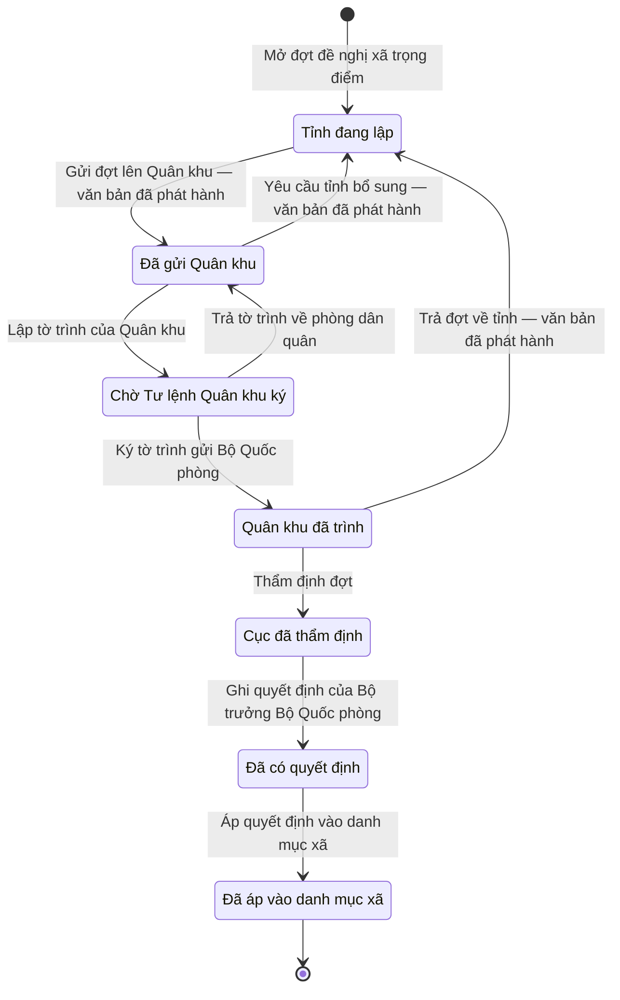

# qt-XT · Công nhận, thôi công nhận xã trọng điểm QP

<!-- máy sinh: tom-tat -->
> **Hồ sơ:** Đợt đề nghị xã trọng điểm về quốc phòng (`KeyCommuneBatch`)
>
> **Trong sổ phạm vi:** XT · Công nhận, thôi công nhận xã trọng điểm QP — hồ sơ đợt của tỉnh → Quân khu xem xét → Cục DQTV thẩm định → Bộ trưởng BQP quyết định (ngoài hệ, Cục ghi) → hệ bật/tắt thuộc tính xã (L48 Đ.15 k5; TT179/2019; chốt 30/9)
>
> 15 bước · 7 chặng · 6 vai · 0 bảng quyết định · 1 hạn · 6 khớp nối.
>
> **Nguồn:** sổ nghiệp vụ `qt-XT` · khai báo của app: `dqtv-app/core/processes/key-commune/workflow/key-commune-batch.yaml`. Các bảng do máy sinh từ nguồn này.
<!-- hết: tom-tat -->

<!-- viết tay: dien-giai -->
## Diễn giải

*Phần này viết tay, diễn giải lại điều các bảng bên dưới ghi.*

### Quy trình này để làm gì

Bộ CHQS cấp tỉnh gom các xã đề nghị **công nhận hoặc thôi công nhận xã trọng điểm về quốc phòng** vào một **đợt đề nghị** theo năm. Đợt đi từ tỉnh lên Quân khu, qua Cục Dân quân tự vệ thẩm định, tới quyết định của Bộ trưởng Bộ Quốc phòng (ký ngoài hệ, Cục ghi lại), rồi hệ bật hoặc tắt cờ xã trọng điểm của từng xã.

Bảy chặng: *Tỉnh đang lập* → *Đã gửi Quân khu* → *Chờ Tư lệnh Quân khu ký* → *Quân khu đã trình* → *Cục đã thẩm định* → *Đã có quyết định* → *Đã áp vào danh mục xã*.

### Khi nào bắt đầu

Bộ CHQS cấp tỉnh bấm **Mở đợt đề nghị xã trọng điểm**, chỉ nhập năm. Đây là hồ sơ cấp tỉnh, xã không thấy.

### Diễn ra thế nào

1. **Tỉnh đang lập.** Bộ CHQS cấp tỉnh **Thêm xã vào đợt** (lặp được) — mỗi dòng gồm xã, đề nghị (`batchLineKind`: `recognize` hoặc `end`), lý do, và đề nghị của xã nếu có; **Bỏ xã khỏi đợt** (lặp được) để gỡ một dòng. Xong thì **Gửi đợt lên Quân khu**, kèm ngày gửi và bản quét văn bản đề nghị của Chủ tịch UBND tỉnh.
2. **Đã gửi Quân khu.** Vai "Phòng Dân quân tự vệ, quân khu", thuộc cấp trên của chủ hồ sơ: **Yêu cầu tỉnh bổ sung** (ghi cần bổ sung gì, đợt về *Tỉnh đang lập*) hoặc **Lập tờ trình của Quân khu** (ghi ngày lập tờ trình, đợt sang *Chờ Tư lệnh Quân khu ký*).
3. **Chờ Tư lệnh Quân khu ký.** Vai "Tư lệnh quân khu", thuộc cấp trên của chủ hồ sơ: **Ký tờ trình gửi Bộ Quốc phòng** (sang *Quân khu đã trình*) hoặc **Trả tờ trình về phòng dân quân**, ghi vì sao (về *Đã gửi Quân khu*; bước này xoá ngày lập tờ trình).
4. **Quân khu đã trình.** Cục Dân quân tự vệ **Thẩm định đợt** — thẩm định từng dòng, ghi ngày thẩm định (sang *Cục đã thẩm định*); hoặc **Trả đợt về tỉnh**, ghi vì sao (đợt về thẳng *Tỉnh đang lập*).
5. **Cục đã thẩm định.** Cục **Ghi quyết định của Bộ trưởng Bộ Quốc phòng**: số quyết định, ngày ký, bản quét, ngày hiệu lực, và những dòng có trong quyết định. Đợt sang *Đã có quyết định*.
6. **Đã có quyết định.** Bước **Áp quyết định vào danh mục xã** do hệ thống tự làm, không ai bấm, khi đã tới ngày hiệu lực (`effectiveDateReached`): hệ đổi cờ xã trọng điểm đúng ngày quyết định có hiệu lực. Bước này ghi lúc áp cờ, ô nối `unitAttributeChange`, số Phó chỉ huy trưởng dư (`deputySurplus` — dư khi xã thôi trọng điểm, đếm lúc hệ áp cờ), ô nối `deputySurplusReview`, và `keyStatusWarnings`. Đợt sang *Đã áp vào danh mục xã*.

### Kết thúc và để lại gì

Đợt kết thúc ở *Đã áp vào danh mục xã*. Trên đường đi, đợt ghi năm ô nối: `batchLineCommune` và `batchLineProposal` (bước thêm xã), `batchLineToRemove` (bước bỏ xã), `unitAttributeChange` và `deputySurplusReview` (bước áp quyết định).

### Điều kiện chặn

- Sai người, sai chặng, thiếu thứ phải có trước thì bước bị chặn, hồ sơ giữ nguyên.
- Ba bước của tỉnh sau bước mở: người làm phải thuộc đơn vị chủ hồ sơ. Bốn bước của Quân khu: người làm phải thuộc một đơn vị nằm trong ô "cấp trên của chủ hồ sơ". Ba bước của Cục: người làm phải thuộc một đơn vị nằm trong ô `cucUnits` (`actorInCuc`).
- Áp quyết định: phải tới ngày hiệu lực mới áp.
<!-- hết viết tay -->

## 1. Đường đi ngắn nhất qua các chặng

<!-- máy sinh: luong-chinh -->
Đường ít bước nhất từ lúc mở hồ sơ tới chặng kết thúc xa nhất. Máy chọn theo số chặng, không theo ý nghĩa nghiệp vụ — trình tự công việc thật xem phần Diễn giải và bảng "Việc làm ở từng chặng" ở mục 6.

| # | Ai làm | Làm gì | Hồ sơ sang chặng |
|---|---|---|---|
| 1 | Bộ CHQS cấp tỉnh | Mở đợt đề nghị xã trọng điểm | Tỉnh đang lập |
| 2 | Hệ thống tự làm | Gửi đợt lên Quân khu — văn bản đã phát hành | Đã gửi Quân khu |
| 3 | Phòng Dân quân tự vệ, quân khu (thuộc cấp trên của chủ hồ sơ) | Lập tờ trình của Quân khu | Chờ Tư lệnh Quân khu ký |
| 4 | Tư lệnh quân khu (thuộc cấp trên của chủ hồ sơ) | Ký tờ trình gửi Bộ Quốc phòng | Quân khu đã trình |
| 5 | Cục Dân quân tự vệ | Thẩm định đợt | Cục đã thẩm định |
| 6 | Cục Dân quân tự vệ | Ghi quyết định của Bộ trưởng Bộ Quốc phòng | Đã có quyết định |
| 7 | Hệ thống tự làm | Áp quyết định vào danh mục xã | Đã áp vào danh mục xã |

<!-- hết: luong-chinh -->

## 2. Hồ sơ và việc nó để lại

<!-- máy sinh: muc-tieu -->
**App gọi quy trình này là:** Đợt đề nghị xã trọng điểm về quốc phòng.

**Khi mở, hồ sơ này ghi mối nối tới:**
- Nhiệm vụ trên giao (1) — bước `openKeyCommuneBatch`, khớp nối `keyCommuneBatchServesTasking`
<!-- hết: muc-tieu -->

## 3. Khởi phát và kết thúc

<!-- máy sinh: khoi-phat -->
**1 cửa vào** — bước mở hồ sơ:

| Bước mở | Ai mở | Hồ sơ vào chặng | App bắt buộc nhập |
|---|---|---|---|
| Mở đợt đề nghị xã trọng điểm | Bộ CHQS cấp tỉnh | Tỉnh đang lập | năm, việc gốc |

**Kết thúc:** *Đã áp vào danh mục xã* (`CLOSED`)
<!-- hết: khoi-phat -->

## 4. Vai trò

<!-- máy sinh: vai-tro -->
| Vai trong sổ | Tên trong app | Điều kiện | Làm những bước |
|---|---|---|---|
| `province` | Bộ CHQS cấp tỉnh |  | Mở đợt đề nghị xã trọng điểm · Thêm xã vào đợt · Bỏ xã khỏi đợt · Trình ký tờ trình gửi Quân khu |
| `system` | Hệ thống tự làm |  | Gửi đợt lên Quân khu — văn bản đã phát hành · Yêu cầu tỉnh bổ sung — văn bản đã phát hành · Trả đợt về tỉnh — văn bản đã phát hành · Áp quyết định vào danh mục xã |
| `AC-PDQqk` | Phòng Dân quân tự vệ, quân khu | thuộc cấp trên của chủ hồ sơ (`actorInSuperiorUnit`, công thức ở mục 7) | Trình ký văn bản yêu cầu tỉnh bổ sung · Lập tờ trình của Quân khu |
| `AC-TLqk` | Tư lệnh quân khu | thuộc cấp trên của chủ hồ sơ (`actorInSuperiorUnit`, công thức ở mục 7) | Trả tờ trình về phòng dân quân · Ký tờ trình gửi Bộ Quốc phòng |
| `AC-PKH` | Phòng Kế hoạch tổng hợp, Cục Dân quân tự vệ |  | Trình ký văn bản trả đợt về tỉnh |
| `cuc` | Cục Dân quân tự vệ |  | Thẩm định đợt · Ghi quyết định của Bộ trưởng Bộ Quốc phòng |

*"Tên trong app" là tên app đặt cho mã chủ thể của vai. Hồ sơ thuộc đơn vị cấp khác thì người làm là người giữ vai ấy ở đơn vị nêu trong cột "Điều kiện" (nếu sổ có ghi) và ở cột "Người làm phải thuộc" của bảng "Theo khai báo của app" (mục 7).*
<!-- hết: vai-tro -->

## 5. Nhánh phụ

<!-- máy sinh: nhanh-phu -->
**Quay lại một chặng hồ sơ đã đi qua** (tính theo đường ngắn nhất từ lúc mở):

| Bước | Ai làm | Từ chặng | Về chặng |
|---|---|---|---|
| Yêu cầu tỉnh bổ sung — văn bản đã phát hành | Hệ thống tự làm | Đã gửi Quân khu | Tỉnh đang lập |
| Trả tờ trình về phòng dân quân | Tư lệnh quân khu (thuộc cấp trên của chủ hồ sơ) | Chờ Tư lệnh Quân khu ký | Đã gửi Quân khu |
| Trả đợt về tỉnh — văn bản đã phát hành | Hệ thống tự làm | Quân khu đã trình | Tỉnh đang lập |

**Làm trong lúc hồ sơ đứng yên ở một chặng** — ghi nhận, bổ sung:

| Bước | Ai làm | Ở chặng |
|---|---|---|
| Thêm xã vào đợt *(lặp được)* | Bộ CHQS cấp tỉnh | Tỉnh đang lập |
| Bỏ xã khỏi đợt *(lặp được)* | Bộ CHQS cấp tỉnh | Tỉnh đang lập |
| Trình ký tờ trình gửi Quân khu | Bộ CHQS cấp tỉnh | Tỉnh đang lập |
| Trình ký văn bản yêu cầu tỉnh bổ sung | Phòng Dân quân tự vệ, quân khu (thuộc cấp trên của chủ hồ sơ) | Đã gửi Quân khu |
| Trình ký văn bản trả đợt về tỉnh | Phòng Kế hoạch tổng hợp, Cục Dân quân tự vệ | Quân khu đã trình |

<!-- hết: nhanh-phu -->

## 6. Các chặng và việc làm ở từng chặng

<!-- máy sinh: chang -->
| Chặng | Tên hiển thị | Vào bằng bước | Kết thúc? |
|---|---|---|---|
| `DRAFT` | Tỉnh đang lập | Mở đợt đề nghị xã trọng điểm · Yêu cầu tỉnh bổ sung — văn bản đã phát hành · Trả đợt về tỉnh — văn bản đã phát hành |  |
| `SUBMITTED` | Đã gửi Quân khu | Gửi đợt lên Quân khu — văn bản đã phát hành · Trả tờ trình về phòng dân quân |  |
| `REGION_SIGNING` | Chờ Tư lệnh Quân khu ký | Lập tờ trình của Quân khu |  |
| `REGION_ENDORSED` | Quân khu đã trình | Ký tờ trình gửi Bộ Quốc phòng |  |
| `APPRAISED` | Cục đã thẩm định | Thẩm định đợt |  |
| `DECIDED` | Đã có quyết định | Ghi quyết định của Bộ trưởng Bộ Quốc phòng |  |
| `CLOSED` | Đã áp vào danh mục xã | Áp quyết định vào danh mục xã | **kết thúc** |

### Việc làm ở từng chặng

Hồ sơ đang ở chặng nào thì làm được những bước nào.

| Hồ sơ đang ở chặng | Bước làm tại chặng (hồ sơ đứng yên) | Bước đưa hồ sơ sang chặng khác |
|---|---|---|
| **Tỉnh đang lập** | Thêm xã vào đợt (lặp được) — Bộ CHQS cấp tỉnh Bỏ xã khỏi đợt (lặp được) — Bộ CHQS cấp tỉnh Trình ký tờ trình gửi Quân khu — Bộ CHQS cấp tỉnh | Gửi đợt lên Quân khu — văn bản đã phát hành — Hệ thống tự làm → *Đã gửi Quân khu* |
| **Đã gửi Quân khu** | Trình ký văn bản yêu cầu tỉnh bổ sung — Phòng Dân quân tự vệ, quân khu (thuộc cấp trên của chủ hồ sơ) | Yêu cầu tỉnh bổ sung — văn bản đã phát hành — Hệ thống tự làm → *Tỉnh đang lập* Lập tờ trình của Quân khu — Phòng Dân quân tự vệ, quân khu (thuộc cấp trên của chủ hồ sơ) → *Chờ Tư lệnh Quân khu ký* |
| **Chờ Tư lệnh Quân khu ký** | — | Trả tờ trình về phòng dân quân — Tư lệnh quân khu (thuộc cấp trên của chủ hồ sơ) → *Đã gửi Quân khu* Ký tờ trình gửi Bộ Quốc phòng — Tư lệnh quân khu (thuộc cấp trên của chủ hồ sơ) → *Quân khu đã trình* |
| **Quân khu đã trình** | Trình ký văn bản trả đợt về tỉnh — Phòng Kế hoạch tổng hợp, Cục Dân quân tự vệ | Trả đợt về tỉnh — văn bản đã phát hành — Hệ thống tự làm → *Tỉnh đang lập* Thẩm định đợt — Cục Dân quân tự vệ → *Cục đã thẩm định* |
| **Cục đã thẩm định** | — | Ghi quyết định của Bộ trưởng Bộ Quốc phòng — Cục Dân quân tự vệ → *Đã có quyết định* |
| **Đã có quyết định** | — | Áp quyết định vào danh mục xã — Hệ thống tự làm → *Đã áp vào danh mục xã* |
| **Đã áp vào danh mục xã** | — | — (kết thúc) |
<!-- hết: chang -->

## 7. Bảng bước

<!-- máy sinh: buoc -->
| # | Bước | Mã bước | Ai thực hiện | Từ chặng | Sang chặng | Phải có trước | Ghi lại |
|---|---|---|---|---|---|---|---|
| 1 | Mở đợt đề nghị xã trọng điểm | `openKeyCommuneBatch` | Bộ CHQS cấp tỉnh | — (mở hồ sơ) | `DRAFT` | `taskingAssigned` | đơn vị chủ hồ sơ, cấp trên của chủ hồ sơ, `cucUnits`, năm, nối tới Nhiệm vụ trên giao |
| 2 | Thêm xã vào đợt | `addKeyCommuneLine` | Bộ CHQS cấp tỉnh | `DRAFT` | giữ nguyên | người làm thuộc đơn vị chủ hồ sơ | nối `batchLineCommune`, `batchLineKind`, `batchLineReason`, nối `batchLineProposal` |
| 3 | Bỏ xã khỏi đợt | `removeKeyCommuneLine` | Bộ CHQS cấp tỉnh | `DRAFT` | giữ nguyên | người làm thuộc đơn vị chủ hồ sơ | nối `batchLineToRemove` |
| 4 | Trình ký tờ trình gửi Quân khu | `requestKeyCommuneBatchSubmissionSignature` | Bộ CHQS cấp tỉnh | `DRAFT` | giữ nguyên | người làm thuộc đơn vị chủ hồ sơ, `noKeyCommuneBatchSubmittedDocumentOpen`, `batchHasLine` | nối tới Văn bản đi |
| 5 | Gửi đợt lên Quân khu — văn bản đã phát hành | `submitKeyCommuneBatch` | Hệ thống tự làm | `DRAFT` | `SUBMITTED` | `keyCommuneBatchSubmittedDocumentIssued` | ngày gửi Quân khu |
| 6 | Trình ký văn bản yêu cầu tỉnh bổ sung | `requestRequestKeyCommuneSupplementSignature` | Phòng Dân quân tự vệ, quân khu (thuộc cấp trên của chủ hồ sơ) | `SUBMITTED` | giữ nguyên | `noRequestKeyCommuneSupplementDocumentOpen`, người làm thuộc cấp trên của chủ hồ sơ | tỉnh cần bổ sung gì, nối tới Văn bản đi |
| 7 | Yêu cầu tỉnh bổ sung — văn bản đã phát hành | `requestKeyCommuneSupplement` | Hệ thống tự làm | `SUBMITTED` | `DRAFT` | `requestKeyCommuneSupplementDocumentIssued` | nối tới Văn bản đến |
| 8 | Lập tờ trình của Quân khu | `draftRegionSubmission` | Phòng Dân quân tự vệ, quân khu (thuộc cấp trên của chủ hồ sơ) | `SUBMITTED` | `REGION_SIGNING` | người làm thuộc cấp trên của chủ hồ sơ, `noRequestKeyCommuneSupplementDocumentOpen` | ngày lập tờ trình |
| 9 | Trả tờ trình về phòng dân quân | `returnRegionSubmission` | Tư lệnh quân khu (thuộc cấp trên của chủ hồ sơ) | `REGION_SIGNING` | `SUBMITTED` | người làm thuộc cấp trên của chủ hồ sơ | tư lệnh trả tờ trình; **xoá:** ngày lập tờ trình |
| 10 | Ký tờ trình gửi Bộ Quốc phòng | `endorseKeyCommuneBatch` | Tư lệnh quân khu (thuộc cấp trên của chủ hồ sơ) | `REGION_SIGNING` | `REGION_ENDORSED` | người làm thuộc cấp trên của chủ hồ sơ | ngày Tư lệnh ký |
| 11 | Trình ký văn bản trả đợt về tỉnh | `requestReturnKeyCommuneBatchSignature` | Phòng Kế hoạch tổng hợp, Cục Dân quân tự vệ | `REGION_ENDORSED` | giữ nguyên | `actorInCuc`, `noReturnKeyCommuneBatchDocumentOpen` | vì sao trả đợt về tỉnh, nối tới Văn bản đi |
| 12 | Trả đợt về tỉnh — văn bản đã phát hành | `returnKeyCommuneBatch` | Hệ thống tự làm | `REGION_ENDORSED` | `DRAFT` | `returnKeyCommuneBatchDocumentIssued` | nối tới Văn bản đến |
| 13 | Thẩm định đợt | `appraiseKeyCommuneBatch` | Cục Dân quân tự vệ | `REGION_ENDORSED` | `APPRAISED` | `actorInCuc` | thẩm định từng dòng, ngày Cục thẩm định |
| 14 | Ghi quyết định của Bộ trưởng Bộ Quốc phòng | `recordMinisterKeyCommuneDecision` | Cục Dân quân tự vệ | `APPRAISED` | `DECIDED` | `actorInCuc`, `recordMinisterKeyCommuneDecisionFromIncomingDocumentUsable` | ngày ký quyết định, ngày hiệu lực, những dòng có trong quyết định, nối tới Văn bản đến |
| 15 | Áp quyết định vào danh mục xã | `applyKeyCommuneStatus` | Hệ thống tự làm | `DECIDED` | `CLOSED` | — | nối tới Lần đổi phân loại xã trong danh mục địa bàn, hệ áp cờ lúc, `deputySurplus`, `keyStatusWarnings` |

### Khi không đạt điều kiện

Mặc định: không đúng người, hồ sơ không ở đúng chặng, hoặc thiếu thứ "phải có trước" thì bước bị chặn, hồ sơ giữ nguyên. Bảng dưới chỉ kê những bước có kết quả riêng.

| # | Bước | Kết quả riêng |
|---|---|---|
| 5 | Gửi đợt lên Quân khu — văn bản đã phát hành | bước này không do người nào bấm |
| 7 | Yêu cầu tỉnh bổ sung — văn bản đã phát hành | bước này không do người nào bấm |
| 12 | Trả đợt về tỉnh — văn bản đã phát hành | bước này không do người nào bấm |
| 15 | Áp quyết định vào danh mục xã | bước này không do người nào bấm |

### Điều kiện "phải có trước" bằng lời

Cột "Phải có trước" ở bảng bước có hai loại: ô dữ liệu thường (bước chỉ đòi ô ấy đã có giá trị) và điều kiện hệ tự xét. Bảng này diễn các điều kiện hệ tự xét theo đúng công thức sổ ghi; số ở cột cuối là số thứ tự bước.

| Điều kiện | Đúng khi | Bước đòi |
|---|---|---|
| `taskingAssigned` | có hồ sơ Việc luật giao kèm văn bản đến, đi (qt-1) chính là hồ sơ ghi ở ô nối `keyCommuneBatchServesTasking` của hồ sơ đang làm mà hồ sơ ấy đang ở chặng `ASSIGNED` hoặc `BROKEN_DOWN` | 1 |
| `actorInOwnerUnit` | người đang làm là người của đơn vị ghi ở ô đơn vị chủ hồ sơ của hồ sơ này (theo danh mục người của đơn vị, `dm.unit-staff`) | 2, 3, 4 |
| `noKeyCommuneBatchSubmittedDocumentOpen` | KHÔNG (có hồ sơ Việc luật giao kèm văn bản đến, đi — Văn bản đi (qt-1.outgoing-document) chính là hồ sơ ghi ở ô nối `keyCommuneBatchSubmittedByDocument` của hồ sơ đang làm mà hồ sơ ấy đang ở chặng `DRAFT` hoặc `PENDING_SIGNATURE` hoặc `SIGNED`) | 4 |
| `batchHasLine` | đã có nối `batchLineCommune` | 4 |
| `keyCommuneBatchSubmittedDocumentIssued` | có hồ sơ Việc luật giao kèm văn bản đến, đi — Văn bản đi (qt-1.outgoing-document) chính là hồ sơ ghi ở ô nối `keyCommuneBatchSubmittedByDocument` của hồ sơ đang làm mà hồ sơ ấy đang ở chặng `ISSUED` | 5 |
| `noRequestKeyCommuneSupplementDocumentOpen` | KHÔNG (có hồ sơ Việc luật giao kèm văn bản đến, đi — Văn bản đi (qt-1.outgoing-document) chính là hồ sơ ghi ở ô nối `requestKeyCommuneSupplementByDocument` của hồ sơ đang làm mà hồ sơ ấy đang ở chặng `DRAFT` hoặc `PENDING_SIGNATURE` hoặc `SIGNED`) | 6, 8 |
| `actorInSuperiorUnit` | người đang làm là người của một đơn vị nằm trong ô cấp trên của chủ hồ sơ của hồ sơ này (theo danh mục người của đơn vị, `dm.unit-staff`) | 6, 8, 9, 10 |
| `requestKeyCommuneSupplementDocumentIssued` | có hồ sơ Việc luật giao kèm văn bản đến, đi — Văn bản đi (qt-1.outgoing-document) chính là hồ sơ ghi ở ô nối `requestKeyCommuneSupplementByDocument` của hồ sơ đang làm mà hồ sơ ấy đang ở chặng `ISSUED` | 7 |
| `actorInCuc` | người đang làm là người của một đơn vị nằm trong ô `cucUnits` của hồ sơ này (theo danh mục người của đơn vị, `dm.unit-staff`) | 11, 13, 14 |
| `noReturnKeyCommuneBatchDocumentOpen` | KHÔNG (có hồ sơ Việc luật giao kèm văn bản đến, đi — Văn bản đi (qt-1.outgoing-document) chính là hồ sơ ghi ở ô nối `returnKeyCommuneBatchByDocument` của hồ sơ đang làm mà hồ sơ ấy đang ở chặng `DRAFT` hoặc `PENDING_SIGNATURE` hoặc `SIGNED`) | 11 |
| `returnKeyCommuneBatchDocumentIssued` | có hồ sơ Việc luật giao kèm văn bản đến, đi — Văn bản đi (qt-1.outgoing-document) chính là hồ sơ ghi ở ô nối `returnKeyCommuneBatchByDocument` của hồ sơ đang làm mà hồ sơ ấy đang ở chặng `ISSUED` | 12 |
| `recordMinisterKeyCommuneDecisionFromIncomingDocumentUsable` | có hồ sơ Việc luật giao kèm văn bản đến, đi — Văn bản đến (qt-1.incoming-document) chính là hồ sơ ghi ở ô nối `recordMinisterKeyCommuneDecisionFromIncomingDocument` của hồ sơ đang làm mà hồ sơ ấy đang ở chặng `RECEIVED` hoặc `DISTRIBUTED` | 14 |

### Theo khai báo của app

Người làm phải thuộc đơn vị nào, ô người dùng phải nhập, bước có lặp được không, và căn cứ pháp lý — lấy từ khai báo quy trình trong app.

| # | Bước | Người làm phải thuộc | Bắt buộc nhập | Nhập nếu có | Lặp được | Căn cứ |
|---|---|---|---|---|---|---|
| 1 | Mở đợt đề nghị xã trọng điểm |  | năm, việc gốc | — |  | L48/2019/QH14 Đ.15 k5; TT77/2020/TT-BQP Đ.5 k2 a |
| 2 | Thêm xã vào đợt | đơn vị chủ hồ sơ | xã, đề nghị, lý do | đề nghị của xã (nếu có) | có | sổ tri thức qt-XT |
| 3 | Bỏ xã khỏi đợt | đơn vị chủ hồ sơ | dòng xã | — | có | sổ tri thức qt-XT |
| 4 | Trình ký tờ trình gửi Quân khu | đơn vị chủ hồ sơ | — | tờ trình của Bộ CHQS tỉnh (PDF) |  | NĐ30/2020/NĐ-CP Đ.13; sổ tri thức qt-XT |
| 5 | Gửi đợt lên Quân khu — văn bản đã phát hành |  | — | — |  | sổ tri thức qt-XT |
| 6 | Trình ký văn bản yêu cầu tỉnh bổ sung | cấp trên của chủ hồ sơ | tỉnh cần bổ sung gì | dự thảo văn bản yêu cầu bổ sung (PDF) |  | NĐ30/2020/NĐ-CP Đ.13; L48/2019/QH14 Đ.15 k5 |
| 7 | Yêu cầu tỉnh bổ sung — văn bản đã phát hành |  | — | — |  | sổ tri thức qt-XT; NĐ30/2020/NĐ-CP Đ.18 |
| 8 | Lập tờ trình của Quân khu | cấp trên của chủ hồ sơ | ngày lập tờ trình | — |  | sổ tri thức qt-XT |
| 9 | Trả tờ trình về phòng dân quân | cấp trên của chủ hồ sơ | tư lệnh trả tờ trình | — |  | sổ tri thức qt-XT |
| 10 | Ký tờ trình gửi Bộ Quốc phòng | cấp trên của chủ hồ sơ | ngày Tư lệnh ký | — |  | sổ tri thức qt-XT |
| 11 | Trình ký văn bản trả đợt về tỉnh |  | vì sao trả đợt về tỉnh | dự thảo văn bản trả đợt (PDF) |  | NĐ30/2020/NĐ-CP Đ.13; TT179/2019/TT-BQP Đ.2 k3b |
| 12 | Trả đợt về tỉnh — văn bản đã phát hành |  | — | — |  | TT179/2019/TT-BQP Đ.2 k3b; NĐ30/2020/NĐ-CP Đ.18 |
| 13 | Thẩm định đợt |  | ngày Cục thẩm định, thẩm định từng dòng | — |  | TT179/2019/TT-BQP Đ.2 k3b |
| 14 | Ghi quyết định của Bộ trưởng Bộ Quốc phòng |  | quyết định trong Sổ văn bản đến, số quyết định, ngày ký quyết định, bản quét quyết định, ngày hiệu lực, những dòng có trong quyết định | — |  | L48/2019/QH14 Đ.15 k5 |
| 15 | Áp quyết định vào danh mục xã |  | — | — |  | L48/2019/QH14 Đ.15 k5 · NĐ220/2025/NĐ-CP Đ.5 k2 |

### Điều kiện và ghi chú app khai cho từng bước

Lấy từ khai báo quy trình trong app. Lời trong ngoặc kép là câu app hiện cho người dùng. Chức danh người ký ngoài hệ app chỉ khai bằng mã.

| # | Bước | Điều kiện, ghi chú |
|---|---|---|
| 15 | Áp quyết định vào danh mục xã | · tạo thêm một hồ sơ con: Lần đổi phân loại xã trong danh mục địa bàn (`UnitAttributeChange`) |
<!-- hết: buoc -->

## 8. Bảng quyết định, hạn, việc ngoài hệ

<!-- máy sinh: quyet-dinh -->
| Hạn | Tính từ | Thời hạn | Quá hạn thì |
|---|---|---|---|
| `applyKeyCommuneStatus.deadline.decided` | `{"fact": "effectiveDate"}` | 0 ngày | hệ làm bước Áp quyết định vào danh mục xã |

<!-- hết: quyet-dinh -->

## 9. Dữ liệu của hồ sơ

<!-- máy sinh: du-lieu -->
Các ô mà bước trong sổ ghi hoặc đòi. Số trong hai cột cuối là số thứ tự bước ở bảng bước (mục 7).

| Ô dữ liệu | Mã | Kiểu (app) | Giá trị cho phép | Loại ô (sổ) | Bước ghi | Bước đòi | Mô tả trong app |
|---|---|---|---|---|---|---|---|
| đơn vị chủ hồ sơ | `ownerUnit` |  |  | lưu trên hồ sơ (`stored`) | 1 | — |  |
| cấp trên của chủ hồ sơ | `superiorUnits` |  |  | hệ suy ra (`derived`) | 1 | — |  |
| — | `cucUnits` | bảng |  | lưu trên hồ sơ (`stored`) | 1 | — | Cục Dân quân tự vệ — đơn vị thẩm định, ghi quyết định của đợt (sổ qt-XT: mở đợt ghi `cucUnits`, `actorInCuc` đọc nó); danh sách id OrgUnit |
| năm | `batchYear` | số |  | đưa vào ở bước (`input`) | 1 | — | Năm của đợt |
| — | `batchLineKind` |  | `recognize`, `end` | đưa vào ở bước (`input`) | 2 | — |  |
| — | `batchLineReason` |  |  | đưa vào ở bước (`input`) | 2 | — |  |
| ngày gửi Quân khu | `submittedAt` | ngày |  | lưu trên hồ sơ (`stored`) | 5 | — | Ngày tỉnh gửi đợt lên Quân khu |
| quân khu yêu cầu bổ sung | `supplementNote` | chữ |  | đưa vào ở bước (`input`) | 6 | — | Quân khu yêu cầu tỉnh bổ sung gì |
| ngày lập tờ trình | `regionSubmissionDraftedAt` | ngày |  | lưu trên hồ sơ (`stored`) | 8 | — | Ngày phòng dân quân Quân khu lập xong tờ trình |
| tư lệnh trả tờ trình | `regionReturnNote` | chữ |  | đưa vào ở bước (`input`) | 9 | — | Tư lệnh Quân khu trả tờ trình — vì sao |
| ngày Tư lệnh ký | `regionEndorsedAt` | ngày |  | lưu trên hồ sơ (`stored`) | 10 | — | Ngày Tư lệnh Quân khu ký tờ trình gửi Bộ |
| cục trả về | `cucReturnNote` | chữ |  | đưa vào ở bước (`input`) | 11 | — | Cục trả đợt về tỉnh — vì sao |
| thẩm định từng dòng | `appraisalByLine` |  |  | đưa vào ở bước (`input`) | 13 | — |  |
| ngày Cục thẩm định | `appraisedAt` | ngày |  | lưu trên hồ sơ (`stored`) | 13 | — | Ngày Cục thẩm định xong |
| ngày ký quyết định | `decisionDate` | ngày |  | đưa vào ở bước (`input`) | 14 | — | Ngày ký quyết định |
| ngày hiệu lực | `effectiveDate` | ngày |  | đưa vào ở bước (`input`) | 14 | — | Ngày quyết định có hiệu lực |
| những dòng có trong quyết định | `decidedLines` |  |  | đưa vào ở bước (`input`) | 14 | — |  |
| hệ áp cờ lúc | `appliedAt` | ngày giờ |  | lưu trên hồ sơ (`stored`) | 15 | — | Lúc hệ bật/tắt cờ xã trọng điểm theo quyết định |
| — | `deputySurplus` | số — ở hồ sơ con Dòng xã trong đợt đề nghị xã trọng điểm |  | lưu trên hồ sơ (`stored`) | 15 | — | Số Phó chỉ huy trưởng dư khi xã thôi trọng điểm — đếm lúc hệ áp cờ |
| — | `keyStatusWarnings` |  |  | lưu trên hồ sơ (`stored`) | 15 | — |  |
| — | `taskingAssigned` |  | có hay chưa | hệ suy ra (`derived`) | — | 1 |  |
| người làm thuộc đơn vị chủ hồ sơ | `actorInOwnerUnit` |  | có hay chưa | hệ suy ra (`derived`) | — | 2, 3, 4 |  |
| — | `noKeyCommuneBatchSubmittedDocumentOpen` |  | có hay chưa | hệ suy ra (`derived`) | — | 4 |  |
| — | `batchHasLine` |  | có hay chưa | hệ suy ra (`derived`) | — | 4 |  |
| — | `keyCommuneBatchSubmittedDocumentIssued` |  | có hay chưa | hệ suy ra (`derived`) | — | 5 |  |
| — | `noRequestKeyCommuneSupplementDocumentOpen` |  | có hay chưa | hệ suy ra (`derived`) | — | 6, 8 |  |
| người làm thuộc cấp trên của chủ hồ sơ | `actorInSuperiorUnit` |  | có hay chưa | hệ suy ra (`derived`) | — | 6, 8, 9, 10 |  |
| — | `requestKeyCommuneSupplementDocumentIssued` |  | có hay chưa | hệ suy ra (`derived`) | — | 7 |  |
| — | `actorInCuc` |  | có hay chưa | hệ suy ra (`derived`) | — | 11, 13, 14 |  |
| — | `noReturnKeyCommuneBatchDocumentOpen` |  | có hay chưa | hệ suy ra (`derived`) | — | 11 |  |
| — | `returnKeyCommuneBatchDocumentIssued` |  | có hay chưa | hệ suy ra (`derived`) | — | 12 |  |
| — | `recordMinisterKeyCommuneDecisionFromIncomingDocumentUsable` |  | có hay chưa | hệ suy ra (`derived`) | — | 14 |  |

32 ô. Cột "Loại ô" là cách sổ phân loại ô, in kèm đúng chữ của sổ; ô nào người dùng phải nhập xem bảng "Theo khai báo của app" ở mục 7.
<!-- hết: du-lieu -->

## 10. Khớp nối với quy trình khác

<!-- máy sinh: khop-noi -->
| Quy trình kia | Hồ sơ kia | Quan hệ | Nội dung (mô tả trong app) | Bước ghi mối nối | Tên ô nối |
|---|---|---|---|---|---|
| 1 | Nhiệm vụ trên giao | hồ sơ này **mở ra có nối tới** hồ sơ kia | Việc gốc mà đợt đề nghị xã trọng điểm này thực hiện — văn bản đi sinh từ đợt kế thừa việc này (sổ qt-XT, 21/1… | XT·openKeyCommuneBatch ⊕ | `keyCommuneBatchServesTasking` |
| 1.incoming-document | Văn bản đến | gắn với nhau ở một bước giữa chừng | Văn bản yêu cầu bổ sung / trả đợt về tỉnh ở Sổ văn bản đến của Bộ CHQS tỉnh — mỗi lượt một văn bản đến | XT·requestKeyCommuneSupplement, XT·returnKeyCommuneBatch | `keyCommuneBatchReturnDeliveredAs` |
| 1.incoming-document | Văn bản đến | gắn với nhau ở một bước giữa chừng | Quyết định của Bộ trưởng Bộ Quốc phòng về xã trọng điểm — văn bản đến của Cục Dân quân tự vệ | XT·recordMinisterKeyCommuneDecision | `recordMinisterKeyCommuneDecisionFromIncomingDocument` |
| 1.outgoing-document | Văn bản đi | gắn với nhau ở một bước giữa chừng | Tờ trình của Bộ CHQS tỉnh gửi Quân khu — văn bản đi (khuôn trình ký chung) | XT·requestKeyCommuneBatchSubmissionSignature | `keyCommuneBatchSubmittedByDocument` |
| 1.outgoing-document | Văn bản đi | gắn với nhau ở một bước giữa chừng | Văn bản Quân khu yêu cầu tỉnh bổ sung đợt đề nghị xã trọng điểm — văn bản đi của Bộ Tư lệnh Quân khu | XT·requestRequestKeyCommuneSupplementSignature | `requestKeyCommuneSupplementByDocument` |
| 1.outgoing-document | Văn bản đi | gắn với nhau ở một bước giữa chừng | Văn bản Cục trả đợt đề nghị xã trọng điểm về tỉnh — văn bản đi của Cục Dân quân tự vệ | XT·requestReturnKeyCommuneBatchSignature | `returnKeyCommuneBatchByDocument` |

6 khớp nối. ⊕ là bước tạo hồ sơ.
<!-- hết: khop-noi -->

## 11. Thông tin chung

<!-- máy sinh: thong-tin -->
| | |
|---|---|
| **Mã trong sổ** | `qt-XT` |
| **Quy trình trong app** | `key-commune` (`workflow/key-commune-batch.yaml`) — mặt công tác: `personnel` |
| **Hồ sơ** | Đợt đề nghị xã trọng điểm về quốc phòng (`KeyCommuneBatch`) |
| **Cùng mã quy trình** | [qt-XT.commune-proposal](qt-XT.commune-proposal.html), [qt-XT.deputy-surplus](qt-XT.deputy-surplus.html) |
| **Căn cứ pháp lý từng bước** | cột "Căn cứ" ở bảng "Theo khai báo của app", mục 7 |
<!-- hết: thong-tin -->
